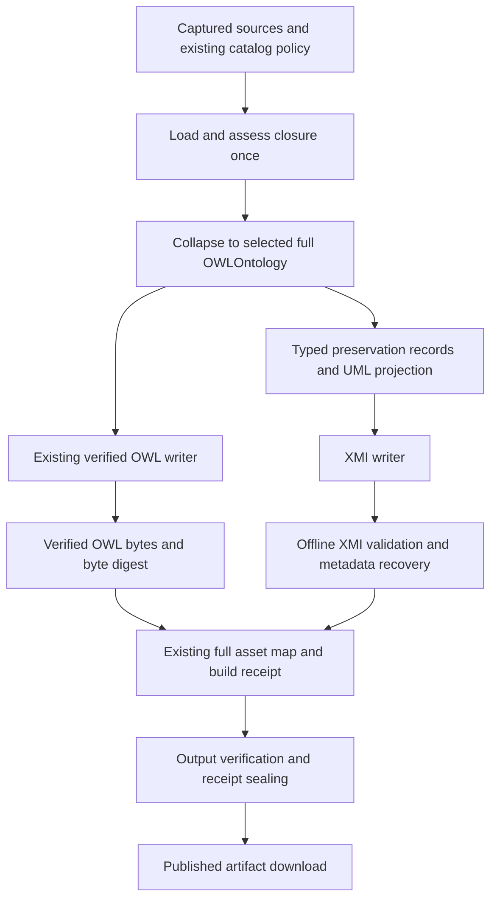

# Full ontology to UML XMI implementation plan

Date: 25 October 2026.
Status: **accepted for local implementation on 26 October 2026; conformance gates remain mandatory; no release or deployment approval**.

## Implementation checkpoint: 26 October 2026

The owner's implementation request accepts this plan's scope, recommended R2 route and defaults, local signed commits and configuration changes required by this plan.
Work stays on local `main`; no pushes, installation of desktop tools, deployment or live activation is authorized.
The original planning observations below remain historical.

The clean implementation baseline is `8eb21a102e751c290603fbf703578e20cf4a6c5b`, independently matched to remote `main`.
The preceding JavaScript-performance work has released this worktree.
Its unrelated retained evidence is outside this change.
This document already existed in commit `fbeb64affde12cae6dd551a244ed7f185043859f`; this checkpoint records implementation acceptance before source changes.

At the first checkpoint UO selected registry alias `npm:@hadden-industries/owlapi@0.1.0-rc.2`.
The owner subsequently selected the latest upstream commit rather than the npm artifact, including access to its additional public functionality as needed.
Fresh remote inspection identifies `36e28374447d94d9734960aaed6d3ab4be52ca17`; select `git+https://github.com/Hadden-Industries/owlapi.git#36e28374447d94d9734960aaed6d3ab4be52ca17` in the root manifest, regenerate the lock and clean-install with lifecycle scripts disabled.
Qualify that exact package payload and public boundary before relying on it; additional public subpaths still need a demonstrated consumer and the existing boundary controls.

Software selection reuses OwlAPI's public structural model, the existing collapse/fingerprint/build receipt, `@xmldom/xmldom` 0.9.12 (MIT), `@rubensworks/saxes` 6.0.1 (ISC) and `rdf-canonize` 5.0.0 (BSD-3-Clause); current registry metadata agrees with these selections.
These supply OWL, XML and RDF canonicalization, but do not implement the UO inverse metadata contract.
ODM is a design reference, with no copied profile assets.
The residual custom work is that versioned contract, conservative projection and integration with UO's existing artifact lifecycle.

Qualification candidates are [Eclipse UML2 5.6.1](https://download.eclipse.org/modeling/mdt/uml2/builds/release/5.6.1/) (EPL-2.0) and the independently implemented [PyEcore 0.15.2](https://pypi.org/project/pyecore/0.15.2/) (BSD-3-Clause).
Exact qualification libraries are acquired into isolated task storage, without changing the repository Python environment or installing a desktop application.
Their actual coordinate/profile support, full license texts, dependency identities and native diagnostics must be checked before general exporter work depends on them.
An independent metamodel loader is not by itself a second complete UML semantic validator.
The first witness must distinguish these claims and may change the proposed template; no hand-written subset validator may substitute for native conformance.

The user owns scope and acceptance; the implementation maintainer authors the witness and independent golden cases.
Final external review covers mapping correctness, recovery independence, parser/input trust boundaries and build/download integration.
Use one consolidated final review and narrow repair follow-ups; allow Claude 30 minutes per run with Opus 5.5 at Max after 18:31 Europe/Bucharest, or `agy` Flash 3.8 at High before then.
Run the full qualification only after external findings are resolved.
Focused meaningful checks remain available during development.

Reuse the existing task and native journals.
Keep actual failed evidence, signing and exact-scope lint/format checks; omit duplicate evidence wrappers and helper-witnessed reruns.
Defer disposable scratch cleanup until the undertaking ends.
Later slices remain conditional on SLICE-001's actual native conformance, recovery, rights and operational gates.

## Purpose and controlling scope

Generate a useful, standards-led UML 2.1-family model in XMI 2.1 during Universal Ontology's existing build, while retaining a recoverable representation of every metadata value represented by the selected generated `-full` ontology.
Produce both OWL and XMI from the same collapsed in-memory `OWLOntology`.
A consumer implementing the declared preservation contract must recover the metadata without relying on the original OWL file, a sidecar, a commercial importer, or readable comment formatting.

The owner's controlling clarification is: “We do not need to preserve the data from the imported ontologies - just what the -full says.”
This includes annotations on imported entities and axioms already present in the collapsed ontology.
It excludes imported ontology headers omitted by collapse, original import edges, document attribution, source XML spelling, discarded history and absent historical metadata.
An entity's different namespace does not remove it from scope.

The higher outcome is reliable exchange of UO knowledge with UML consumers: useful navigation and exact metadata recovery, without implying that UML expresses all OWL semantics.
The typed preservation representation is authoritative for recovery; the readable UML model is a projection.
These are distinct claims with distinct tests.

This plan uses the [expert response](../research/2026-10-25-full-ontologies-to-uml-xmi.md), the complete available commissioning discussion and current repository sources.
It supersedes earlier discussion suggestions to preserve original import provenance, choose the design around Erwin, or use extensions/sidecars as the preservation authority. It does not replace the existing [import-closure contract](../specs/2026-08-22-self-contained-owl-import-closure-contract.md).

## Baseline, authority and admission

### Observed baseline

| Item                   | Observation on 25 October 2026                                                                                                                                                      | Consequence                                                                                                                                                                                                                      |
| ---------------------- | ----------------------------------------------------------------------------------------------------------------------------------------------------------------------------------- | -------------------------------------------------------------------------------------------------------------------------------------------------------------------------------------------------------------------------------- |
| UO checkout            | `main`, HEAD `82ab7ed6e800a57b648d1ff52ee91c6c2e55d7e1`; origin `https://github.com/Hadden-Industries/universal-ontology.git`                                                       | Working files, including existing modifications, are the inspection baseline. Recheck before implementation.                                                                                                                     |
| Expert response        | `docs/research/2026-10-25-full-ontologies-to-uml-xmi.md`; 63,636 bytes; SHA-256 `f74123a9c4b6328524dad23064feebe0d1ba3e6216caaf35c8049e0c94fc9d99`                                  | Conceptual recommendation, not a completed profile, exact XML template or approved field mapping. Preserve the supplied response.                                                                                                |
| Original brief         | `G:\My Drive\Hadden Industries\WebVOWL\OWL-to-UML-XMI-2.1-expert-research-brief-2026-10-25.md`; retained SHA-256 `11508e924f5a11e43d87f843b4c6cac9eeb1cc77311307e0992d0a8347002f87` | Source for the detailed field definitions, register IDs, corpus paths and hashes. Import its necessary fixture metadata into a reviewed repository contract during SLICE-001; the drive path must not become a build dependency. |
| UO selected dependency | Root `devDependencies.owlapi` selects Git commit `e15320d6438b27c5aaa7aa9302b6919749873ec9`; installed/locked package identifies rc.1                                               | Historical starting point, not the API ceiling for this plan.                                                                                                                                                                    |
| Latest OwlAPI source   | Local clean HEAD and read-only remote HEAD both `36e28374447d94d9734960aaed6d3ab4be52ca17`; package identifies `0.1.0-rc.2`                                                         | Owner explicitly authorizes planning against the latest source. Freeze the then-current exact commit at adoption; do not use a floating build dependency or claim a published rc.2 release.                                      |
| OwlAPI qualification   | Current `docs/compatibility/behavior-profiles.md` says public profile admission is held for designated security evidence and a release decision                                     | Source availability is distinct from consumer qualification and production acceptance. Record resolution or an accountable accepted disposition before activation.                                                               |
| HISEW                  | Read-only `inspect-project-applicability --directory C:\Users\maksy\GitHub\universal-ontology --session-host codex` returned `personal`, `active: true`                             | Planning method applies. No execution was created, adopted, routed, verified or closed for this document. The unrelated WebVOWL execution is outside scope.                                                                      |

Existing UO changes at inspection include `AGENTS.md`, `docs/development.md`, `docs/mcp/local-development.md`, distribution verification scripts/tests, `skills-lock.json`, `tools/repository-skills.pyz`, the untracked research directory and two prior review documents.
They belong to other work and must be preserved.
In particular, coordinate future delivery with the owner of the changing distribution and PR qualification code; do not absorb it into this change.

The historical import-closure plan contains superseded rc.1 registry-only language.
Current [development guidance](../development.md) and [machine contract](../import-closure/contract.v1.json) make the root manifest the dependency selector and allow qualified exact Git sources.
Do not revive the obsolete pin or broaden the package boundary by inference.

### HISEW prerequisite status

The requested deliverable is this plan.
The IDs below form a **draft dossier revision 1**, local to this change.
They are proposed stable identifiers, not previously accepted HISEW records.
The owner has accepted the full-only scope, standards-led objective, in-memory generation approach and latest-OwlAPI planning assumption.
The remaining design decisions have recommendations below but require review before implementation depends on them.

Proposed implementation route: **R2**, because a new interchange contract, exact-value preservation, dependency adoption and publication behavior can materially mislead downstream consumers if wrong.
This is a risk recommendation, not a native routing result.
The documentation-only act of writing this draft does not authorize the implementation route.
Before material implementation, the UO owner must accept the requirements/design and actual route; the implementation agent must establish current owned execution applicability and use the route-selected verification/review controls.
Do not adopt another session's execution merely because it exists.

Missing prerequisites are explicit: accepted profile and exact mapping contract; completed software/validator selection and rights assessment; current dependency consumer acceptance; approved configuration deltas; route-selected oracle/review owners; and release/retention decisions.
SLICE-001 is the bounded preparation path for resolving these.
Later slices are conditional on its gates and are not instructions to code through an unresolved decision.

No budget, delivery date, staffing programme, geography or new review committee is established.
The report's 18-week/GBP 280,000 estimates and public-sector analogies are not requirements.
Use the existing UO owner, implementation maintainer, designated mapping reviewer and route-selected independent reviewers.

## Draft requirements and acceptance criteria

| Requirement                                                 | Acceptance criterion                                                                                                                                                                                                                | Source/meaning                                            |
| ----------------------------------------------------------- | ----------------------------------------------------------------------------------------------------------------------------------------------------------------------------------------------------------------------------------- | --------------------------------------------------------- |
| REQ-001 Preserve precisely the selected full ontology scope | AC-001: root identity/annotations and already-merged metadata survive; omitted imported headers/import graph and absent historical values produce zero synthetic assertions                                                         | Owner's scope correction; existing collapse contract      |
| REQ-002 Preserve exact metadata values and attachments      | AC-002: inverse recovery has zero missing/extra records and zero subject, predicate, node-kind, lexical, datatype, language or attachment differences, modulo one consistent anonymous-node bijection                               | Research preservation contract                            |
| REQ-003 Produce standards-led UML/XMI                       | AC-003: the frozen UML 2.1.2/XMI 2.1 coordinate, profile applications, IDs, references and containment pass selected native validation; two independent readers load the declared core UML subset                                   | Research recommendation, proposed concrete release gate   |
| REQ-004 Keep preservation inside the XMI                    | AC-004: a clean offline recovery reader recovers all required values using the XMI and declared contract/profile alone; no OWL or preservation sidecar is read                                                                      | Owner's interoperability objective; research architecture |
| REQ-005 Give every field and source construct a disposition | AC-005: M01-M45, D01-D09, H01-H10, E01 and S01-S34 have reviewed rules; an unseen metadata predicate/unknown datatype uses generic typed retention; an unsupported structural carrier fails explicitly                              | Finite inventory is coverage evidence, never an allowlist |
| REQ-006 Avoid invented UML constraints                      | AC-006: tests reject arbitrary `0..1`, misread qualified cardinalities, domain/range alternatives and fabricated UML Actor/ownership semantics; unsupported projection remains recoverable and diagnosed                            | OWL/UML semantic difference                               |
| REQ-007 Share the existing generation model                 | AC-007: full generation loads/collapses once per selected root; XMI projection consumes that exact collapsed model without rereading OWL as its generation input; existing OWL verification remains intact                          | Agreed UO workflow                                        |
| REQ-008 Bind and safely publish generated assets            | AC-008: XMI/profile/policy/dependency identities are bound to the current build receipt; failed export/recovery produces no successful receipt; changed inputs and stale/unowned outputs are rejected under current ownership rules | Existing build/publication boundary                       |
| REQ-009 Make identity and ordering reproducible             | AC-009: the same model and contract produce deterministic XMI bytes/IDs; equivalent models under anonymous renaming recover equivalent metadata; prefixes and display choices do not become source identity                         | Research identity/determinism requirement                 |
| REQ-010 Use supported current dependencies                  | AC-010: exact latest selected OwlAPI payload, public imports, normative behavior, licenses and consumer checks are evidenced; no internal imports, copied library code or compatibility shim                                        | Owner's latest-source assumption; REU/VER/LIC/NSH         |
| REQ-011 Serve qualified generated exports                   | AC-011: eligible UO pages download the receipt-bound XMI for their declared full scope; unavailable artifacts have no successful export action; no fallback invokes the old DOM converter                                           | Updated build-time workflow                               |
| REQ-012 Report evidence honestly                            | AC-012: XML, XMI, UML, profile, recovery, projection and named-tool observations have separate statuses; no visual appearance or successful parse is reported as lossless interchange                                               | Research assurance layers                                 |

### Domain invariants

1. Source IRI, source OWL role, UML element identity and `xmi:id` are distinct.
   Punning creates role-specific UML elements linked to the same retained IRI.
2. Literal lexical text, datatype IRI and language are separate values.
   An IRI and an `xsd:anyURI` literal with identical characters remain different terms.
   No numeric/date coercion, Unicode normalization, trimming or language correction occurs in the exporter.
3. An annotation on an ontology, an entity assertion, an axiom and another annotation retains its actual attachment.
   Subject plus predicate alone is never an axiom/annotation identity.
4. Distinct values and annotation structures survive.
   Repeated textual RDF/XML events that the selected OWL model has already deduplicated are not reconstructed as invented multiplicity.
   Ordered OWL structures retain order; set-valued constructs do not acquire source-order semantics.
5. A source value retained only in a readable name/comment or `xmi:Extension` does not satisfy preservation.
   Failure diagnostics do not turn lossy output into qualified output.
6. No reasoner is introduced.
   Existing asserted structure is the input; a UML relationship does not assert a new inferred OWL axiom.
7. XMI projection never mutates its input ontology or its manager.
   UO catalog, network, cutoff, source inventory and output-ownership policies retain their current authority.

## Architecture and decisions

### Current implementation seams

| Current authority                                                                                                                                                                                      | Observed behavior                                                                                                                                                         | Planned use                                                                                                                                                       |
| ------------------------------------------------------------------------------------------------------------------------------------------------------------------------------------------------------ | ------------------------------------------------------------------------------------------------------------------------------------------------------------------------- | ----------------------------------------------------------------------------------------------------------------------------------------------------------------- |
| [Materializer](../../scripts/materializeImportClosure.js)                                                                                                                                              | Loads the graph, assesses complete reconstruction, collapses it and calls the verified writer; returns no generation model                                                | Extract a cohesive internal load-and-collapse operation returning the owning manager, collapsed ontology and output format. Keep the existing CLI's OWL behavior. |
| [Collapse operation](../../scripts/ontology/collapseImportsClosure.js)                                                                                                                                 | Root ID/root annotations, no imports, structural axiom union, postcondition checks                                                                                        | Sole authority for what the generated full model contains                                                                                                         |
| [Atomic OWL writer](../../scripts/ontology/atomicOntologyWriter.js) and [verifier](../../scripts/ontology/verifyStandaloneOntology.js)                                                                 | Serialize, write/flush temporary bytes, read those bytes, fresh strict offline load, ID/import/fingerprint checks, then rename                                            | Retain unchanged guarantees; do not feed the verifier's reload into the XMI projection                                                                            |
| [Full asset builder](../../scripts/build/fullOntologyAssets.js)                                                                                                                                        | Discovers dated candidates; only import-declaring candidates receive `-full`; creates local captured mapper, temporary OWL output, JSON-LD/CSV assets, hashes and receipt | Add qualified `-full.xmi` to the same selected roots and asset map; include new producer/contract identities                                                      |
| [Build integration](../../scripts/build/ontologyAssets.js), [Vite lifecycle](../../scripts/build/vitePlugins.js), [full CLI](../../scripts/createFullVersions.js)                                      | Shared asset generation, lock, output checks, receipt sealing after output verification                                                                                   | One implementation path for website and full-generation CLI                                                                                                       |
| [Structural fingerprint](../../scripts/ontology/ontologyStructuralFingerprint.js)                                                                                                                      | Complete OWL structural digest modulo anonymous-individual renaming, using `rdf-canonize`                                                                                 | Reuse for semantic model identity and nonmutation evidence; do not assume this digest already supplies per-node canonical IDs                                     |
| [Projection policy](../../packages/universal-ontology-projection-policy/src/ontologyProjectionProperties.js)                                                                                           | Current and applicable historical annotation-property resolution                                                                                                          | Reuse for display selection only; preservation traverses all source metadata independently                                                                        |
| [Browser export](../../src/ontology.js) and [retired DOM converter](https://github.com/Hadden-Industries/universal-ontology/blob/8eb21a102e751c290603fbf703578e20cf4a6c5b/src/OwlToUmlXmiConverter.js) | Fetch XML and transform DOM shapes on click                                                                                                                               | Replace the supported published export path with a generated artifact download after qualification                                                                |

The projection can run before OWL serialization finishes.
If the XMI manifest contains the paired OWL byte digest, final XMI serialization waits for the already-required OWL write/readback to finish. This is a provenance dependency on verified bytes, not reparsing as projection input. Existing JSON-LD/CSV generation may continue using OWL bytes; this change does not redesign those producers.

### Recommended decisions

| Decision                     | Recommended default                                                                                                                                                                       | Status and boundary                                                                                                                                                                                                   |
| ---------------------------- | ----------------------------------------------------------------------------------------------------------------------------------------------------------------------------------------- | --------------------------------------------------------------------------------------------------------------------------------------------------------------------------------------------------------------------- |
| DEC-001 Source boundary      | The collapsed model corresponding to one selected full artifact; no original import provenance input                                                                                      | Accepted scope from the owner                                                                                                                                                                                         |
| DEC-002 Standards coordinate | UML 2.1.2 semantics; XMI 2.1; XMI namespace `http://schema.omg.org/spec/XMI/2.1`; candidate UML namespace `http://schema.omg.org/spec/UML/2.1.1/uml.xml` from OMG's normative merged CMOF | Primary sources checked; exact executable profile/metamodel binding must pass SLICE-001. Do not invent a `/2.1.2/` URI or copy the old converter's `/UML/2.1` URI.                                                    |
| DEC-003 Representation       | A single XMI containing readable UML plus ordinary UML preservation carriers and a small versioned project profile                                                                        | Recommended expert model; exact profile is a design gate                                                                                                                                                              |
| DEC-004 Literal encoding     | Authoritative standard padded base64 of the exact well-formed Unicode string's UTF-8 bytes for every literal; datatype and language retained separately; readable text is derived         | Default for uniform inverse behavior; reject unpaired surrogates/invalid payloads, never replace them silently                                                                                                        |
| DEC-005 Ownership            | Private UO exporter/recovery modules; OwlAPI supplies supported OWL structural APIs                                                                                                       | No UML format registration in `manager.saveOntology`; no new OwlAPI public adapter solely for UO                                                                                                                      |
| DEC-006 Dependency behavior  | Latest owner-selected exact OwlAPI source, explicit `normative-v1`, public indexed queries/dispatch/annotation APIs where useful                                                          | Consumer qualification and approved pin/lock update precede activation; no rc.1 fallback shim                                                                                                                         |
| DEC-007 Projection           | Conservative asserted class/property/instance view, with exact structural preservation/context where needed and explicit projection dispositions                                          | No unrestricted OWL-to-UML equivalence claim                                                                                                                                                                          |
| DEC-008 Identity             | Versioned role-qualified canonical keys; NCName-safe deterministic digest-derived IDs; collision detection; model-scoped anonymous mapping                                                | Hash length/encoding is a project choice, frozen with fixtures before implementation; prefer full SHA-256 hex with an alphabetic role prefix unless native validation or measured size justifies another exact scheme |
| DEC-009 Publication          | Extend the existing asset/receipt lifecycle; add `-full.xmi`; seal success only after all required artifacts verify                                                                       | No new multi-file transaction service; existing receipt is the publication admission boundary                                                                                                                         |
| DEC-010 Initial availability | Generate XMI only for the current full-artifact cohort. Offer it only where page-to-full-artifact identity is explicit                                                                    | No-import and earlier historical exports are separate scope; do not manufacture redundant `-full` files. Preserve their other downloads.                                                                              |
| DEC-011 Failure behavior     | Fail canonical export/build on unrepresentable preservation data. Report structured diagnostics for unprojected-but-preserved constructs                                                  | A loss report is evidence of failure to meet the canonical lossless gate, not permission to publish under the same claim                                                                                              |
| DEC-012 Cutover              | One maintained canonical exporter; switch eligible browser actions after qualification and remove the obsolete DOM path when no consumers remain                                          | No implicit NSH-01 exception; unsupported consumers receive explicit unavailability, not old-converter fallback                                                                                                       |

For DEC-002, OMG's [UML 2.1.2 catalogue](https://www.omg.org/spec/UML/2.1.2) identifies the normative documents and machine-readable resources; its [L2 merged CMOF](https://www.omg.org/spec/UML/20061012/L2.merged.cmof) declares the package URI shown above.
The [XMI 2.1 catalogue](https://www.omg.org/spec/XMI/2.1) identifies the requested serialization specification.
These facts do not alone prove that a proposed profile instance is valid: the executable conformance witness is still required.

Treat [ODM 1.1](https://www.omg.org/spec/ODM/1.1/PDF) as design precedent rather than apply its profile unchanged or claim ODM conformance.
Confirm relevant version/literal constraints and rights before adapting actual profile assets.
The research's prose and unresolved citation tokens are not substitutes for preserved primary evidence.

The research's proposed Schema.org provenance correction is not adopted.
On 25 October 2026, the official [position page](https://schema.org/position) identifies development V30.1, dated 16 September 2026, and the [release listing](https://schema.org/docs/releases.html) places 30.1 first.
The contract evidence must distinguish a development page from a pinned published vocabulary and record actual retrieval identity.
Preserve the original brief and response as received; add an explicit evidence reconciliation in the mapping record.

### Preservation contract to make executable

The first implementation contract must define these conceptual records, their UML metaclasses, exact stereotype extension points/property types/multiplicities, XML paths and inverse rules.
Names here are responsibilities, not an approved schema.

| Concept                   | Required information and constraint                                                                                                                                                  |
| ------------------------- | ------------------------------------------------------------------------------------------------------------------------------------------------------------------------------------ |
| Source identity           | IRI or scoped anonymous identity, ontology/entity/axiom/annotation role, explicit links to readable elements; no labels as identity                                                  |
| Term                      | Distinct IRI, literal and anonymous variants; literal payload, encoding, datatype IRI and language; empty literal distinguished from absent value                                    |
| Assertion                 | Subject, predicate IRI, object term, attachment kind and complete target; retain every distinct assertion, not one value per property                                                |
| Axiom target              | Structural kind and complete reconstructible operands/context needed to identify the target, including ordered constructs and anonymous references; a digest alone is insufficient   |
| Annotation target         | Parent axiom/assertion or parent annotation occurrence, recursively; preserve differing annotation sets on otherwise similar axioms                                                  |
| Ordered structure         | Ordered membership where the selected OWL contract says order exists; explicit index base; distinguish from unordered sets                                                           |
| Projection correspondence | Source target, generated UML element(s), applied rule/version and disposition; many source structures may have no diagram element                                                    |
| Export manifest           | Contract/profile identity, standards coordinate, exact generator/dependency identity, selected ontology identity, semantic model digest and optional paired verified OWL byte digest |

Proposed backbone: a dedicated preservation package containing typed `InstanceSpecification`/`Slot` records, with valid classifiers/value specifications and project stereotype applications; a separate package contains readable domain UML.
Profile definitions and required backbone type definitions should be embedded in the XMI by default so offline interpretation has no hidden network dependency.
Ship a separately documented reference profile as development/consumer tooling if useful, but never make a sidecar the only location of source values. SLICE-001 must demonstrate that this exact same-document profile application and serialization is valid in the chosen coordinate. If the native readers require an external profile resource, the owner must accept a declared offline bundle/dependency contract before changing the self-contained claim; do not silently substitute `xmi:Extension`.

Recovery returns the metadata preservation records and required target context.
It need not recreate original RDF/XML syntax, every redundant RDF list cell spelling, or a fully equivalent OWL reasoner model.
Preserve complete source constructs needed for attachment and the agreed S-register dispositions; do not interpret “metadata recovery” as permission to retain only an opaque axiom hash.
Conversely, full RDF graph reconstruction is not an extra release objective unless a particular mapping requires it.
SLICE-001 freezes this boundary with a positive and a negative example for each construct family.

The normative OwlAPI factory preserves typed literal lexical forms but lowercases language arguments.
Therefore “exact language” must mean the selected full ontology's represented/parsed language value, not pre-collapse spelling lost before this export. Qualify model-to-verified-full agreement for language, lexical values, annotations and blank-node targets. If a required value present in actual full bytes is unavailable in the model, stop and resolve the native parser/model boundary; do not reach back to original imports or quietly weaken fidelity.
This is a discriminating acceptance experiment, not permission to add an unqualified second source model.

### Mapping coverage and display rules

M01-M45 are required current metadata mappings.
D01-D09 are ordinary temporal assertions with typed values, not ontology documentation.
H01-H10 are readiness rules and produce nothing unless present in the selected input.
E01 is declaration-only: retain the declaration if represented, but do not invent an assertion value.
S01-S34 require explicit structural/projected/context-only dispositions.
The catalogue has 99 register entries including E01; the historical/full predicate occurrence union is 98 because E01 has no observed value occurrence.
The eight full files contain 85 observed predicates, including 31 of the 34 structural register predicates.
These reported counts are a fixture baseline, not deduplicated OWL assertion cardinalities.

For every individual register row, deliver: full predicate IRI; authoritative definition/reference/version; observed term kinds and subject/attachment forms; exact preservation carrier/property/XML path; multiplicity; readable projection rule or none; inverse algorithm; failure behavior; fixture IDs and coverage status. A family table alone does not satisfy this gate. Include full ontology/version identity even when exposed through `getOntologyID()` rather than annotation APIs; notably M27 `owl:versionIRI` must not disappear from an annotation-only traversal.

| Readable treatment     | Registers to cover individually                                                                                                        | Mandatory distinction                                                                           |
| ---------------------- | -------------------------------------------------------------------------------------------------------------------------------------- | ----------------------------------------------------------------------------------------------- |
| Names/alternate labels | M18 title; M23 label; M29 altLabel; M34 hiddenLabel; M37 prefLabel; M45 acronym                                                        | Select one display name without dropping alternatives/languages; identifiers remain independent |
| Comments               | M05 description; M21 comment; M30 changeNote; M31 definition; M32 editorialNote; M33 example; M35 historyNote; M36 note; M38 scopeNote | Predicate and attachment remain in typed records; comments never supply the inverse oracle      |
| Agents                 | M02 contributor; M04 creator; M12 publisher                                                                                            | Retain IRI/literal distinction; no invented UML Actor semantics                                 |
| Dates                  | M03 created; M11 modified                                                                                                              | Preserve lexical precision, timezone form and datatype                                          |
| Identifiers/versioning | M07 identifier; M26 priorVersion; M27 versionIRI; M28 versionInfo                                                                      | Do not substitute `xmi:id`, exporter version or current timestamp                               |
| Rights                 | M01 accessRights; M10 license; M15 rights                                                                                              | Preserve distinct predicates/resources; exporter licensing is separate metadata                 |
| Relations/provenance   | M08 isReplacedBy; M13 references; M14 replaces; M16 source; M17 subject; M22 isDefinedBy; M24 seeAlso                                  | Preserve direction and exact attachment; do not recover omitted import provenance               |
| Format/language/prefix | M06 format; M09 language; M19 preferredNamespacePrefix                                                                                 | Distinguish resource language from a literal language tag; prefixes are display preferences     |
| Order/state            | M20 position; M25 deprecated                                                                                                           | Preserve entity/axiom distinction and original typed values; order only the applicable view     |
| Catalogue              | M39 accessURL; M40 distribution; M41 downloadURL; M42 landingPage; M43 mediaType; M44 theme                                            | Distinguish dataset, distribution and access/download/landing resources                         |

Use `resolveApplicableOntologyProjectionPropertyIris` and related current UO policy only to select readable values under an evidenced ontology/version context.
Once imported document boundaries have been discarded, do not guess their publication versions or reacquire them for labels.
The generic preservation path is independent of display preferences and includes all retained predicates, including unknown future annotation properties.
A complete structural dispatch boundary must reject newly unsupported OWL kinds rather than silently omit their annotations.

For properties, the conservative initial rule is to project an association/attribute only when its domain/range/context has a justified mapping. Unconstrained multiplicity is not `0..1`; qualified counts are not unqualified total counts; multiple domain/range axioms are not an arbitrary endpoint choice.
Preserve complex restrictions, lists, disjointness, equivalence, property chains and unsupported constructs structurally with diagnostics.
Do not make every RDF predicate a UML association solely because it looks relational.

## Reuse, naming and ownership decisions

### DRY-01 assessment

| Rule and current authority                                     | Latest consumers and boundary                                                | Strategy and drift control                                                                                                                                                                          |
| -------------------------------------------------------------- | ---------------------------------------------------------------------------- | --------------------------------------------------------------------------------------------------------------------------------------------------------------------------------------------------- |
| OWL parsing/model/annotations: OwlAPI public contract          | UO loader, collapse, writer, new exporter; independently released dependency | Reuse public methods/kind dispatch. Request a native upstream fix if a real missing capability is found; no local copy of OwlAPI internals.                                                         |
| Full scope: UO collapse and contract                           | Full CLI, website build, XMI exporter                                        | One collapse operation and returned model; no second merge algorithm or importer                                                                                                                    |
| Field interpretation: UO projection-policy package             | Existing CSV/view model and new UML readable projection                      | Reuse current policy. Preservation remains a distinct domain with an explicit all-fields contract.                                                                                                  |
| XMI preservation semantics: reviewed versioned mapping/profile | Writer and recovery reader; downstream independent readers                   | One normative contract with separate implementations. Share neutral parsing/encoding only where it does not determine expected outcomes; retain independent fixtures and mutation-sensitive oracle. |
| IDs/anonymous correspondence                                   | Projection, preservation references and serializer                           | One model-scoped allocator/canonicalization result; reuse existing `rdf-canonize` capability if its public API satisfies per-node mapping. Do not treat the current whole-model hash as that map.   |
| Generated output ownership and receipts                        | Full CLI, Vite, verifier and publication checks                              | Extend current native producer/receipt logic together; no parallel XMI receipt framework with a different freshness rule                                                                            |

Predicted cohesive files are `scripts/ontology/loadCollapsedOntology.js`, `scripts/uml/exportOntologyUmlXmi.js`, `scripts/uml/recoverOntologyMetadata.js` and small internal record/identity/projection modules only where a separate responsibility warrants them.
These are predictions, not mandatory file counts or approved configuration names.
Keep the public private-to-UO seam approximately “collapsed ontology plus immutable contract/context to XMI bytes, diagnostics and validation evidence.” Do not expose managers, loaders or filesystem paths to a pure projection operation. Reassess the materializer's name/responsibility if its return contract changes; a private returning operation should not pretend to have published an artifact.

NAM-01 requires precise distinctions among metadata, OWL structure, projection, recovery, verification, source digest and output digest.
Do not name the artifact “lossless OWL” or the project profile “ODM” when those claims are not met.
The report's `OWLFullPreservation` is a conceptual name, not an already allocated public namespace.
Freeze a versioned project URI and its ownership in SLICE-001.

No NSH-01 override exists.
The installed `owlapi` npm alias is the current dependency boundary, not a behavioral shim.
Preserve the existing materializer CLI behavior while extracting its internal operation; do not introduce an old/new XMI mode or library fallback. WebVOWL export/package extraction is deferred until there is an authorized consumer; keep the core free of DOM/Node effects where practical without creating a speculative shared package now.

### REU-01 / VER-01 / LIC-01 gate

The response supplies standards/design research, but does **not** complete software-selection research. Before committing to a custom writer/profile validator, compare repository capabilities, native XML APIs/libraries, current maintained UML/MOF/XMI readers and generators, and ODM-related tooling against this exact coordinate and reversible value contract. Evaluate supported extension/composition before custom code.
Record exact latest stable or applicable LTS versions, supported old-format reading, platform/runtime, offline operation, profile support, evidence and licensing.
Modern tooling may support the required older wire standard; an old wire format does not justify silently selecting obsolete software.

Known reuse starting points are the installed XML dependencies (`@xmldom/xmldom`, `@rubensworks/saxes`), `rdf-canonize`, Node's crypto/text/binary primitives, current UO artifact machinery and public OwlAPI APIs.
Their presence is not proof of suitability or current-version clearance.
XML parsing alone does not supply UML metamodel validation.
Assess maintained native UML readers, including Eclipse UML2's documented import/resource support as a candidate, without assuming its current runtime accepts this precise profile/namespace.
Select a second genuinely independent core reader, not a second wrapper around the same engine.
Keep Java/tooling confined to qualification if selected; the exporter remains JavaScript.

The residual custom gap is UO's exact metadata-preserving OWL-to-UML mapping and build policy, to the extent native/reused tools cannot express it. Do not build a second generic XML parser, UML metamodel implementation, RDF canonicalizer or dependency resolver merely to avoid integration work. If no suitable supported validator is found, record the limitation and seek an accountable decision about the conformance claim before affected coding/release; do not label a hand-written subset checker full UML conformance.

UO's root package declares MIT/private; inspected OwlAPI source declares AGPL-3.0-only and contains the corresponding license text. This is a facts record, not legal clearance. Reuse existing valid organizational clearance if it covers the exact selected source and build/distribution use; otherwise the responsible owner must resolve it.
Assess notices and terms for any bundled profile/metamodel assets and newly selected validators independently. Link normative standards where possible; do not copy or redistribute standard documents/profile assets without checking their actual terms.
Build-only execution, distributed JavaScript and generated ontology data have different rights questions.

## Quality scenarios and proof ownership

| Scenario                       | Stimulus and environment                                                                                                                               | Required response and measure                                                                                                  |
| ------------------------------ | ------------------------------------------------------------------------------------------------------------------------------------------------------ | ------------------------------------------------------------------------------------------------------------------------------ |
| QA-001 Exact values            | Literal fixture contains empty text, `01` and `1` integers, dates/timezones, CR/LF/tab, non-NFC Unicode, supplementary characters and unknown datatype | Zero lexical/datatype/language mismatches after XMI recovery; malformed Unicode/base64 rejected                                |
| QA-002 Attachment              | Two axioms share subject/predicate but differ in target, annotations and nested annotations                                                            | Every annotation recovers against its complete correct target; swapping targets causes failure                                 |
| QA-003 Identity                | Punned IRI, repeated blank references, symmetric anonymous structures, reordered set input and renamed blank nodes                                     | Unique valid IDs and resolved references; stable repeated output and correct anonymous bijection; no accidental merging        |
| QA-004 Scope                   | Imported header has creator absent from collapsed model; imported entity has note present; historical field absent                                     | Only the retained note survives; zero fabricated header/history assertions; no external acquisition during projection/recovery |
| QA-005 Structural restraint    | Multiple domains, qualified cardinality, universal restriction, property chain and unsupported projected kind                                          | No stronger ordinary UML constraint; full required context retained or export fails with a specific diagnostic                 |
| QA-006 Unknown field           | New predicate and datatype absent from the register, including axiom attachment                                                                        | Typed generic record recovers unchanged; no allowlist loss                                                                     |
| QA-007 Publication failure     | Bad XMI reference/payload, source modification, output tampering, interrupted emission or stale receipt                                                | No successful current receipt; previous ownership evidence retained; retry rebuilds without accepting stale artifacts          |
| QA-008 Native interoperability | Minimal witness and corpus opened offline in two independent core readers and the contract-aware recovery reader                                       | Core model accepted by both; complete metadata recovered by declared reader; tool re-export measured separately                |
| QA-009 Resource/trust boundary | Large corpus and adversarial nesting/length, external entity/profile URL, path escape or link                                                          | Enforced selected bounds, no external resolution or out-of-root writes; bounded explicit failure                               |
| QA-010 Dependency change       | Frozen latest OwlAPI source replaces current pin under approved config change                                                                          | Package payload/public API checks and impacted full-generation/consumer checks pass; normative literal behavior retained       |
| QA-011 User download           | Eligible full-backed page and page without supported XMI                                                                                               | Correct scoped generated file for first; explicit unavailable action for second; no runtime DOM conversion                     |

The mapping reviewer owns expected semantics and hand-authored golden tuples.
The implementation maintainer owns producer behavior and diagnostics.
Independent conformance reviewers own native-reader evidence.
The UO owner accepts route, scope, rights, operational limits and release claims.
Assign people before claiming review completion; a role name is not approval.

Use real OwlAPI, actual XML serialization/parsing and actual filesystem operations in focused tests. Mock only genuine external boundaries such as unreachable network acquisition or injected filesystem failure; do not mock away the library/profile consumer being qualified.
Recovery must not import the exporter's field-dropping or attachment-selection logic.
Negative mutations must prove that deleting a predicate, changing lexical payload/datatype, swapping annotation targets or breaking a reference fails, even if writer and reader share neutral helpers.

## Vertical implementation slices

### SLICE-001: Freeze a minimal conformance and recovery witness

Deliver one reviewed minimal full-model fixture through the proposed exact UML/profile XML and back to independently specified expected metadata. Include one named class, an IRI-valued creator, a multilingual/non-NFC literal, two separately annotated axioms and one nested annotation.
This is the cheapest experiment proving the chosen profile has a viable serialization and recovery contract before a general exporter is written.

Complete the standards manifest, exact profile/backbone, offline dependency rules, per-register matrix, inverse specification, ID contract, software/rights assessment and corpus fixture manifest.
Resolve same-document profile application through the selected native validator and at least one independent reader early; select the second reader before release planning is accepted.
Refresh the M/D/H/E/S inventory from the exact retained eight full fixtures and distinguish parse events, RDF sets and OWL structural sets.
Import required baseline hashes from the brief, verify actual bytes and retain mismatches visibly.

Exit: owner/mapping-reviewer acceptance of draft REQ/AC/QA/DEC and proposed R2 route; exact approved profile/template witness; named oracle owners; selected dependencies and license statuses; explicit remaining production limits. If the namespace/profile cannot be loaded, native lossless data is unavailable, or software/rights selection changes the architecture, stop the affected design and revise this plan.
Do not present a hand-written example as metamodel validation.

Reversible demonstration: fixture and contract review only, no published assets or production cutover.
Any machine-readable mapping/profile/test configuration files require exact configuration approval before creation.

### SLICE-002: Qualify latest OwlAPI and one complete in-memory export path

After the exact selector/lock approval, adopt the frozen current OwlAPI source and qualify supported public APIs under `normative-v1`. Extract the load/collapse result seam and generate the minimal fixture's OWL and XMI from the same model.
Use indexed ontology reads and public kind dispatch where appropriate; capture ontology/version identity separately from annotations.
Do not add unsupported deep imports because a convenient internal RDF graph happens to exist.

Demonstrate typed records, reversible literal encoding, profile applications, valid IDs/references, serializer and independent recovery together.
Run existing collapse, package-boundary, atomic-writer and materializer CLI regressions.
Verify projection leaves the model fingerprint unchanged and does not add network calls or a second OWL parse as generation input.
Reuse the existing OWL readback; XMI recovery operates on emitted XMI bytes and proves a different property.

Exit: AC-001/002/004/007/010 pass for the witness; exact dependency payload accepted for this consumer; existing OWL CLI behavior preserved.
If the source candidate's release/security admission remains unresolved, local implementation evidence does not authorize production activation.

Demonstration remains local and explicitly experimental.
No download route or successful production receipt advertises this subset as corpus-complete.

### SLICE-003: Complete value, attachment and structural coverage

Expand the same vertical path to all metadata families, temporal assertions, ontology/version identities, axiom/nested annotations, unknown predicates/datatypes, punning and anonymous targets.
Add conservative readable projections and correspondence records, with exact dispositions for every S-register construct and every current OwlAPI structural kind encountered by the selected corpus.
Use explicit order only where the source contract demands it.

Implement deterministic keys and scoped anonymous correspondence using a qualified existing canonicalization API.
Profile/canonicalization budgets must be measured on the largest selected closure and symmetric pathological fixtures.
Expected records must be independently authored for adversarial fixtures.
For historical-only mappings, verify absence stays absent and inject a positive synthetic case without changing current production ontology data.

Exit: all synthetic fixtures recover with zero unexplained differences; every register row has exact paths/inverse logic/fixture; unknown-kind behavior is explicit; negative mutations fail; unsupported visual constructs remain preserved and diagnosed.
Complex ordinary UML projection can remain deliberately limited under DEC-007, but its preservation disposition cannot be postponed behind a successful lossless claim.

### SLICE-004: Integrate the full asset set and receipt

For each existing import-declaring candidate, use the collapsed model directly and add `<dated-source>-full.xmi` to `createFullOntologyAssets`.
Preserve discovery/cutoff/no-import behavior.
Once the verified OWL bytes exist, hash those bytes for the XMI manifest's paired source-artifact field; calculate the XMI output hash only after final serialization.
Keep semantic model digest and byte digests in separate named fields.
Avoid circular hashes: the XMI need not contain its own digest or the final receipt digest.

Extend producer evidence to cover every new exporter/recovery module, mapping/profile/standards inputs and actual selected dependency. The current directory scan covers only immediate `.js` entries in `scripts/build` and `scripts/ontology`; placing code under `scripts/uml` requires explicit inclusion. Bind effective display policy and profile bytes, not just a version string. Extend suffix ownership checks, output checks, verifier expectations and success fields consistently for XMI. Preserve captured source hash rechecks and existing downstream JSON-LD/CSV validation.

The receipt's expected artifact contract changes from three representations to four.
Choose an explicit new receipt schema version after inspecting all current consumers, including `scripts/verifyFullOntologyBuild.js` and the publication gate.
Update consumers together.
Prior schema-1 receipts may be read solely to establish exact ownership of cleanup candidates, never to admit a current XMI build as successful.
Reject stale successful-receipt reuse.
This is historical evidence handling, not a second supported export version.

Use the existing lock, temporary workspace, contained-path checks, output verification and receipt sealing.
A failure may leave generated files in `dist`; it must leave no current success receipt.
Do not claim the existing per-file writes are a globally atomic transaction.
Publication consumes only an accepted complete artifact set; retry after interruption rebuilds/revalidates it. Cleanup remains restricted to previous receipt-bound paths whose bytes still match. Unknown/mutated output ownership blocks cleanup.

Exit: website and `generate:full-ontologies` use the same path; full artifact quartet is complete; source/policy/exporter/output tampering is detected; interruption and stale-output tests pass; existing ordinary OWL, JSON-LD and CSV outputs retain their accepted contracts.

### SLICE-005: Qualify corpus and independent consumers

Exercise all eight retained controlling full artifacts plus the current discovered build cohort if it has changed.
Historical full artifacts can be loaded directly offline in qualification; this does not change the production in-memory generation path.
Compare recovered metadata against independently obtained expected terms/context from those exact bytes and against hand-authored edge fixtures.
Use an existing independent RDF parser for the source-side coverage audit where feasible; do not generate all expected assertions with the same traversal as production.

Produce a source/recovery comparison ledger with missing, extra, subject, predicate, kind, lexical, datatype, language, attachment, ordering and identity-only categories. Counts are evidence only when attached to exact inputs and full difference details. Run the selected native UML/profile validator and both independent core readers.
Establish baseline duration, peak memory and output-size expansion on a named machine/runtime; owner accepts finite operational budgets from those measurements, not a fabricated SLA. Include failure/limit behavior in receipt qualification.

Exit: all in-scope source records recover, all required conformance layers pass, measured resource use satisfies accepted limits, native/security reviews are resolved and final route-selected verification passes on the frozen candidate.
A failed named-tool re-export limits that tool-specific claim; it does not justify changing the canonical model to Erwin's preferences.

### SLICE-006: Switch downloads and retire obsolete conversion

Bind page availability to the generated asset identity rather than guessing a URL for every ontology page.
Eligible full pages use their paired `-full.xmi`; an authored page may offer the paired full export only when the UI clearly identifies that scope and the build supplies the actual association.
For no-import/historical pages without a qualified artifact, make XMI unavailable and preserve other exports.
Expanding these pages to authored-model XMI is a separately accepted scope extension.

Replace `exportXMI` and its lazy converter load with the existing materialized-download pattern.
Update the page/build tests and perform a real browser check of download identity, failure handling, keyboard interaction and accessible state. Apply repository browser/web guidance during implementation.
Remove the old DOM converter and obsolete tests only after a consumer search proves no maintained caller remains; retain useful adversarial cases in the new suite.
Update user/developer docs to state full scope, profile version, exact recovery claim and unsupported tool round trips.

Exit: AC-011/012 pass, no maintained fallback/dual XMI implementation remains, and release acceptance names the observer and supported claims.
Deployment, commits and pushing remain separate authorizations.

### Traceability and ordering

| Slice     | REQ / AC                | QA                 | Decisions               | Falsifiable proof                                                                                            | Release/cleanup implication                                                   |
| --------- | ----------------------- | ------------------ | ----------------------- | ------------------------------------------------------------------------------------------------------------ | ----------------------------------------------------------------------------- |
| SLICE-001 | 001-006, 009, 012       | 001-006, 008       | 001-008, 011            | Native-loaded exact profile witness and independently specified recovered tuples; completed per-field matrix | Blocks implementation baseline if material contract/oracle/rights gaps remain |
| SLICE-002 | 001, 002, 004, 007, 010 | 001, 002, 004, 010 | 001, 004-006            | Same-model witness plus old OWL/package regressions and dependency acceptance                                | No production exposure of partial mapping                                     |
| SLICE-003 | 002, 004-006, 009       | 001-006, 009       | 003, 004, 007, 008, 011 | All edge cases and mapping rows; mutation-sensitive recovery                                                 | No silent fallback or lossy success                                           |
| SLICE-004 | 007, 008, 010, 012      | 004, 007, 009, 010 | 005, 006, 009-011       | Shared CLI/build tests, hashes, tamper/interruption/ownership probes                                         | Current receipt required; prior evidence used only for bounded cleanup        |
| SLICE-005 | 001-010, 012            | 001-010            | 001-011                 | Eight controlling artifacts, current cohort, independent readers, resource results, final reviews/profiles   | Establishes exact candidate eligibility, not deployment                       |
| SLICE-006 | 008, 011, 012           | 007, 011           | 009, 010, 012           | Real browser download and caller-removal evidence                                                            | One supported export path; accountable activation/observation                 |

The UO implementation maintainer owns integration.
Sequence SLICE-001 before dependent coding; SLICE-002 before corpus mapping; SLICE-003 before production receipt integration is declared complete; SLICE-005 before public cutover.
After the contract is frozen, independent reader qualification, corpus expected-record preparation and read-only licensing work can proceed independently.
Writer and recovery implementations can be independently authored against that contract, but coordinate schema changes before parallel writes.
This plan does not authorize or require additional subagents.

## Configuration and compatibility gates

No configuration file is changed by this planning task.
Before implementation edits a configuration/policy file, present the exact file, setting/current and proposed value, pipeline effect and smallest change for the owner's explicit approval.
Approval of this Markdown plan alone does not approve those changes.

| Likely future file/setting                                                                                                | Smallest proposed change and effect                                                                                                                                                                                                    | Gate                                                                                                       |
| ------------------------------------------------------------------------------------------------------------------------- | -------------------------------------------------------------------------------------------------------------------------------------------------------------------------------------------------------------------------------------- | ---------------------------------------------------------------------------------------------------------- |
| Root `package.json`: `devDependencies.owlapi`; generated `package-lock.json`                                              | Replace the exact Git selector with the frozen latest approved source; regenerate only its necessary lock closure and clean-install with scripts disabled                                                                              | Exact source selection/config approval, payload verification, licenses and affected consumer qualification |
| `docs/import-closure/contract.v1.json`: package boundary                                                                  | Prefer no change: current selector is already manifest-owned. Amend only if the chosen public `owlapi/search`, `owlapi/model/parameters` or renderer imports require an explicit boundary update after current tests/policy inspection | Do not weaken internal/unregistered import prohibition or add every exported subpath speculatively         |
| New preservation profile, mapping/standards manifests and their validation schema at paths selected in SLICE-001          | Create the minimal machine-readable contract and immutable version identity required by the selected native consumer                                                                                                                   | These define build/test/policy behavior; approve exact paths/content before creation                       |
| Existing build orchestration, receipt consumers and any governing receipt schema                                          | Add the XMI output, producer inputs, validation result and current schema; retain old receipt parsing only for ownership evidence                                                                                                      | Treat configuration-like build/policy changes conservatively; present the concrete diff before applying    |
| Root `package.json` scripts/devDependencies and `package-lock.json`, only if selected validator integration requires them | Add a supported qualification command/dependency only after software selection; prefer existing Jest/build entry points                                                                                                                | No invented validator/version or installation in this planning task                                        |
| `scripts/ci/` or actual current selector/workflow policy paths discovered at implementation                               | Ensure new files/tests trigger the existing required consumer/build/release checks; amend only a demonstrated gap                                                                                                                      | Exact files/settings approval, and coordinate with existing other-session CI/distribution work             |
| HISEW project verification profiles                                                                                       | Reuse current focused/affected/full commands where adequate; propose a change only if new obligations cannot be covered                                                                                                                | Separate HISEW configuration authority; never edit execution records manually                              |

The last three rows are conditional integration areas, not approved unnamed edits.
The implementation owner must replace them with exact existing paths and concrete deltas before requesting permission.
Avoid editing `vite.config.mjs`, npm scripts, network policy or the import cutoff if the existing asset seam suffices.
No runtime/version pin, lint exception, blanket JSON/Markdown exception or new web service is implied.

Data compatibility is a new versioned interchange contract.
Unknown preservation contract/profile versions fail explicitly in the recovery reader. Profile/mapping changes that alter recovered meaning or target identity require a new version and requalification.
XMI IDs are not promised stable across a contract version change.
Ordinary OWL outputs retain their existing identity/metadata/axiom contract.
No ontology-source backfill or mutation is needed; generated XMI can be rebuilt from selected models after approved dependency adoption.

## Verification, trust and operational acceptance

### Proportionate verification schedule

During implementation, use focused paths through the existing Jest command, for example `npm test -- --runInBand --runTestsByPath ...`.
Select actual files after creating the slice; do not maintain a fabricated ready-to-run test list.
Existing impacted suites include `tests/import-closure/owlapi-package-boundary.test.js`, `collapse-imports-closure.test.js`, `atomic-ontology-writer.test.js`, `materialize-import-closure-cli.test.js`, `create-full-versions.test.js`, `tests/build/full-ontology-assets.test.js`, `ontology-assets.test.js`, `vite-plugins.test.js`, `website-build.integration.test.js`, `built-ontology-page.test.js` and the current browser-export tests.
Check current test selection and side effects before execution.

Use current repository lint/format commands on the changed scope, then route-selected affected/final profiles.
Observed package scripts expose `test:unit`, `test:consumer` and `check:qualification`; the first does not cover new `scripts/uml` tests automatically.
Verify the actual active HISEW profile definitions before implementation rather than claiming these strings are already selected here.
`check:qualification` includes lint, formatting checks, Jest, Python, skill consistency, `build:verify` and generated JSON checks.
Existing mandatory CI floors remain.
Broad qualification is for the integrated frozen candidate; repeat it only for changed inputs, failures, policy or a concrete unresolved risk.

`npm run build:verify` is the documented build entry point that preserves tracked inputs.
Inspect current lifecycle hooks before any build.
Builds create ignored outputs and product-owned reports; they are not read-only checks.
Do not run `fix:all`, install tools, update locks or regenerate source artifacts as a substitute for validating this documentation-only plan.
The final plan itself receives scoped Markdown formatting/lint and local-link checks only.

Keep the current OWL readback once per produced OWL file.
Add one XMI parse/recovery/contract check on the final XMI bytes in normal generation.
Expensive independent native reader runs and the full source/recovery corpus audit belong to qualification/release unless the accepted route requires them per build.
Do not add repeated full-OWL reloads merely to support XMI; existing verification's fresh load remains a safeguard for OWL output, not evidence that XMI is correct.

### Security and privacy boundaries

Treat ontology annotations and recovered XML as untrusted data.
Use a supported XML serializer/parser with external entities, DTD/network resolution and remote profile fetching disabled at the recovery boundary.
Impose accepted limits on bytes, record counts, nesting, references and canonicalization work; reject duplicate IDs, dangling targets, cycles where forbidden, invalid base64 and unsupported profile versions.
Encode comments/names through XML APIs and display them as text in any future viewer.
URI-valued source metadata is data, never an instruction to fetch or execute.

Reuse current output-root containment/link/ownership enforcement.
Preserve exact source data only within the authorized ontology corpus; do not include local filesystem paths, environment secrets or remote credentials in export manifests.
Record versioned public source identities and hashes needed for reproducibility.
Rights/source metadata in an ontology does not authorize acquisition of unrelated documents. The route-selected security reviewer owns assessment of the new parser/profile/trust boundaries; public dependency admission and this exporter assessment remain separate evidence.

### Observability and release evidence

The build evidence must answer: which selected full model and verified OWL bytes produced this XMI; which contract/profile/dependency bytes were used; how many ontology/entity/axiom/nested annotations and terms were preserved; what projected or stayed preservation-only; whether unknown metadata used generic retention; and which conformance/recovery stages passed.
Record bounded diagnostics with source identity/target, stage and reason, not full sensitive payload dumps by default.

Separate deterministic artifact content from volatile telemetry.
Runtime, memory, worker identity and timestamps belong in the build/qualification receipt unless the contract deliberately fixes them; they must not destabilize XMI IDs or bytes. Record total XMI bytes, encoded lexical bytes, counts, elapsed stages and maximum observed nesting for capacity decisions. Do not make a dashboard a prerequisite; the existing report/receipt plus qualification ledger can supply the evidence.

Production acceptance requires a frozen artifact set, exact dependency acceptance, all required profile/mapping/recovery checks, independent core-reader evidence, resolved reviews, rights disposition, accurate download availability and approved deployment.
The responsible UO maintainer observes the first authorized deployed build and checks receipt identity and representative downloads.
“Built locally,” “qualified,” “published,” “downloaded correctly,” and “tool re-export preserved metadata” remain separate statuses.

## Rollout, recovery and cleanup

Before activation, keep generated candidates in the normal local/build artifact area and retain the exact failed witness/evidence needed for decisions.
Do not advertise partial mappings as supported export.
Regenerate selected artifacts from captured current inputs after each contract/dependency change; never relabel old evidence with a new version.

At activation, switch the full asset generator, current receipt consumers and supported download route as one reviewed candidate.
The deployment mechanism still owns actual website publication.
The proposed initial release does not modify WebVOWL, introduce a new npm package or install a UML desktop tool for the user.

Abort on any unexplained recovery difference, invalid native profile/metamodel result, unsupported source kind with attached data, unverifiable dependency, ownership conflict, changed input or unaccepted operational/rights boundary.
Preserve diagnostics and exact input/candidate identities. Failed generation leaves no accepted current receipt. Resume by rebuilding and revalidating from captured/current source identity, not by treating leftover files as complete checkpoints.

Before public cutover, reverse only this change's uncommitted edits or disable its candidate through an approved configuration change.
After activation, prefer an accountable forward fix or temporarily restrict XMI availability.
Do not restore the retired lossy converter as a fallback.
A prior deployment may be restored only if it remains supported under the accepted contract, has an intact recoverable artifact/receipt set, and the deployment owner authorizes that exact restore.
This plan does not assert that current hosting supplies atomic rollback.

Task scratch is removed when its consumers finish.
Retain approved standards/profile fixtures, exact qualification manifests and required failure evidence. Generated stale-file cleanup uses existing receipt/hash ownership checks; it never deletes unknown user outputs.
Old receipt evidence remains historical, not an accepted current schema.
Source ontology files, user-owned working changes and unrelated HISEW executions are outside cleanup scope.

## Uncertainties, experiments and replanning triggers

| Decision-sensitive uncertainty                                        | Cheapest discriminating evidence                                                                                   | Owner and stop/replan condition                                                                                                |
| --------------------------------------------------------------------- | ------------------------------------------------------------------------------------------------------------------ | ------------------------------------------------------------------------------------------------------------------------------ |
| Exact profile serializes/loads in strict UML 2.1.2/XMI 2.1 coordinate | Minimal same-document profile/backbone witness loaded by selected native validator/readers                         | Mapping reviewer; revise profile/packaging before general exporter if invalid                                                  |
| Latest OwlAPI exposes every retained value/context                    | Witness plus corpus coverage of model versus verified full bytes, including language and nested annotations        | UO/OwlAPI maintainers; native repair or explicit contract resolution before claiming fidelity                                  |
| Independent validator/reusable writer fit                             | Current supported API/format probe and license inventory, comparing native tools/extensions                        | Implementation maintainer and rights owner; blocked adoption cannot be replaced by a shadow validator without renewed research |
| Anonymous identity cost and stability                                 | Symmetric graph fixture, blank-label permutation and largest selected closure                                      | Implementation maintainer; revise canonicalization strategy/bounds if unstable or excessive, without relaxing equality         |
| Preservation-only versus full structural reconstruction               | Per-S-register examples identifying exactly what is needed to recover target metadata and justified UML projection | Mapping reviewer/owner; rebaseline if a full OWL reconstruction capability becomes necessary                                   |
| Existing receipt consumers/cleanup migration                          | Inventory current verifier/publication/CI readers and run prior-receipt ownership/tamper probes                    | UO integration owner; revise migration before production if old evidence can wrongly authorize new outputs                     |
| Corpus or dependency changes while work proceeds                      | Compare frozen manifest/hashes/API/profile identities at each gate                                                 | Maintainer; refresh affected evidence, not every unrelated test by default                                                     |
| No-import exports become required                                     | Owner-selected examples and exact desired source scope                                                             | Owner; add an independently traced slice and availability rules before widening output discovery                               |

Replan if the intended outcome changes to full logical OWL equivalence, source-byte reconstruction, original import provenance, vendor-specific compatibility, interactive WebVOWL edited-model export, a different UML/XMI version, or independently published exporter packaging. Rebaseline affected requirements if metadata cannot be represented under the selected contract, operational size makes single-XMI delivery unacceptable, or current upstream/license/security conditions invalidate the selected implementation.
Do not resolve schedule pressure by reducing preservation to comments and retaining the word “lossless.”

## Planning evidence and next decision

This document records source inspection, a read-only HISEW applicability check, current local/remote OwlAPI identity and bounded primary-source checks.
It does not record implementation tests, native UML reader acceptance, software-license clearance, completed HISEW routing, deployment or a commit.
The research response remains unchanged.

The next decision is acceptance or amendment of this draft's scope, recommended defaults and SLICE-001 evidence work.
The first material implementation gate is an exact, native-validated profile/template and reviewed inverse contract, followed by the explicitly approved dependency/configuration changes.
No further research into the general desirability of in-memory generation is needed; the remaining experiments target concrete contract, consumer and preservation risks.
