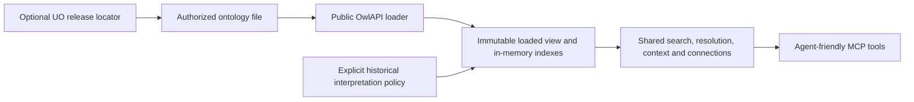

# Direct ontology-file loading and agent-friendly MCP browsing

**Date:** 13 November 2026.  
**Status:** Detailed implementation proposal. The originating request accepts the direction; delivery starts with SLICE-000's bounded capability and packaging decision. Detailed source-authority, resource, dependency and distribution decisions must pass their stated gates before dependent implementation.  
**Planning scope:** This document only. It authorizes no product implementation, dependency/configuration changes, scans, publication, or changes to source ontologies or the exporter.  
**Decision owner and local acceptance owner:** Max. The implementing coordinator owns integration and evidence. OwlAPI, converter and projection-policy owners retain authority over their contracts.

## 1. Controlling direction

An operator points the local MCP server at ordinary ontology documents. An agent discovers and browses terms, definitions, designations, notes, sources and relationships without knowing RDF/XML, OWL syntax, namespace IRIs, metadata vocabularies, SPARQL, UO release families, or generated-index directories.

UO releases and other ontology files use **the same ingestion, in-memory indexing and query implementation**. UO release discovery is an optional document locator. Historical interpretation differences are small explicit mapping inputs to shared code, with original assertions preserved. There is no privileged UO query backend.

The representative external contract is the current converter profile **Generic STS — OWL classes, resource-valued citations**, ID `generic-sts-resource`, version `1.0.0`. The ISO files are representative acceptance inputs. Their publisher, document numbers, filenames, namespaces, counts and clause shapes must not become implementation rules.

Direct loading builds disposable indexes in memory. It does not invoke the artifact generator internally, require a prebuilt catalog, copy sources into this repository, or persist indexes as a prerequisite. Persistent caching is a later optional optimization.

### Accepted direction and proposed decisions

The user has accepted direct OwlAPI loading, in-memory indexes, agent-friendly browsing, one implementation for UO and other ontologies, and profile-level generalization beyond two ISO examples. The detailed interfaces and gates below are implementation proposals, not existing functionality.

The [September context plan](2026-09-23-mcp-ontology-context.md) remains useful semantic history, especially exact assertion evidence and honest completeness. Its restrictions against arbitrary document inputs and artifact-first local architecture are superseded **for this proposed delivery**. Its historical sole-consumer/compatibility assumptions must be rechecked against today's installed/published consumers.

## 2. Current evidence and owning sources

### 2.1 Inspected baseline

UO checkout: `6941a2fb453e7a365ef419a021dc3c792427e1f3`. Recheck the integrated baseline before implementation.

| Current owner                                                                                                                                                                                                           | Observed responsibility and consequence                                                                                                                   |
| ----------------------------------------------------------------------------------------------------------------------------------------------------------------------------------------------------------------------- | --------------------------------------------------------------------------------------------------------------------------------------------------------- |
| [Stdio configuration](../../packages/universal-ontology-mcp-server/src/universalOntologyMcpStdioConfiguration.js)                                                                                                       | Accepts filesystem/HTTP query artifacts, not an ontology document path.                                                                                   |
| [MCP registration](../../packages/universal-ontology-mcp-server/src/createUniversalOntologyMcpServer.js)                                                                                                                | Delegates four operations through validated schemas and bounded text/structured responses.                                                                |
| [Query facade](../../packages/universal-ontology-query/src/createOntologyQueryModule.js)                                                                                                                                | Lexical interpretation, language choice, deterministic ranking, exact resolution and runtime artifact indexes; text search currently iterates candidates. |
| [Node facade](../../packages/universal-ontology-query/src/createNodeOntologyQueryModule.js)                                                                                                                             | Catalog/snapshot selection, imports and dataset composition for lexical/context queries.                                                                  |
| [Store execution](../../packages/universal-ontology-query/src/createOntologyStoreExecution.js) and [worker](../../packages/universal-ontology-query/src/ontologyStoreWorker.cjs)                                        | Embedded Oxigraph, cancellation, bounded execution and warm dataset state.                                                                                |
| [Context queries](../../packages/universal-ontology-query/src/ontologyContextQueries.js) and [context search](../../packages/universal-ontology-query/src/ontologyContextSearch.js)                                     | Exact assertion evidence, structural context, metadata filtering and connections.                                                                         |
| [Artifact production](../../scripts/build/createOntologyQueryArtifacts.js) and [worker](../../scripts/build/ontologyAssetWorker.js)                                                                                     | Precompute lexical JSON and canonical N-Quads before current local MCP consumption.                                                                       |
| [Projection policy](../../packages/universal-ontology-projection-policy/src/ontologyProjectionProperties.js) and [declaration](../../packages/universal-ontology-projection-policy/data/field-property-history.v1.json) | Shared authority for historical field and source interpretations. Reuse rather than duplicate.                                                            |

[Context behavior](../mcp/ontology-context.md), [installation](../mcp/local-installation.md) and [development controls](../development.md) identify current consumers and preserved invariants. These are edit-seam predictions, not frozen private module names or predicted line numbers.

### 2.2 OwlAPI: established capability and adoption gap

The root `package.json.devDependencies.owlapi` currently selects `npm:@hadden-industries/owlapi@0.1.0-rc.3`. It is the existing sole editable source/version selector; public imports use the `owlapi` alias.

The [public API reference](https://github.com/Hadden-Industries/owlapi/blob/main/API.md) and [preserve-mode prerequisites](https://github.com/Hadden-Industries/owlapi/blob/main/docs/compatibility/canonical-vowl-prerequisites.md) are the upstream capability references. Inspected public operations include `OWLManager.createOWLOntologyManager`, `StringDocumentSource`, `OWLOntologyLoaderConfiguration`, `loadOntologyGraphFromOntologyDocument`, entity/annotation/reference methods on the loaded ontology, and `owlapi/search`.

OwlAPI derives indexes per immutable ontology snapshot. Consumers must use public operations, not private index modules. Its preserve mode exposes per-document `context.sourceStructure` containing statements, annotations, roles and expressions. This is **not a promised raw RDF/JS quad dataset**. SLICE-000 must prove that the required browsing/evidence view can be formed without losing authored information; do not assume a nonexistent quad-export operation.

Installed and [remotely inspected package metadata](https://github.com/Hadden-Industries/owlapi/blob/main/package.json) identify version `0.1.0-rc.3` and licence `AGPL-3.0-only`. UO and the MCP manifest currently declare MIT. Build-time adoption does not establish runtime embedding/distribution clearance. Record actual rights clearance and accurate notices before embedding/shipping; do not infer a legal conclusion or silently change a licence.

Before admission, verify the currently applicable release, exact terms and selected public capabilities. A selector change needs exact configuration approval. Do not replace the user-selected library just because packaging requires work.

### 2.3 Generic STS profile authority

The live extension imports the shared Google package at:

`chrome/extensions/packages/terminological-entries-to-owl/`

Its current authorities are [the profile](https://github.com/Hadden-Industries/google/blob/9fa1d41a9045e4a5031ef4f880f1a5ee1c56b79a/chrome/extensions/packages/terminological-entries-to-owl/profiles/generic-sts-resource.json), [the mapper](https://github.com/Hadden-Industries/google/blob/9fa1d41a9045e4a5031ef4f880f1a5ee1c56b79a/chrome/extensions/packages/terminological-entries-to-owl/src/rdf/owl-class-annotations-v1.js), `src/rdf/designation-labels.js`, the package README and RDF validation tests.

Google revision: `9fa1d41a9045e4a5031ef4f880f1a5ee1c56b79a`. Profile and mapping files were clean at inspection.

- Profile SHA-256: `1ced840a6270aa5ecd53cf83f32ce64d5627d276f9c116d435b02208437cc067`.
- Mapping SHA-256: `94123035c6e085333738547ddd33994dc2712f300146ad1e7f6956b914b23a20`.

The profile uses `sts-tbx-html-v1`, `en-notes-to-entry-v1`, `owl-class-annotations-v1` and `html-id-v1` with resource-valued citations and explicit ontology IRI/term namespace. The older converter retained in `chrome/extensions/Terminological Entries to OWL/` is reference material, not the complete live producer contract.

The MCP consumes the resulting ontology. It does not import Chrome, DOM conversion, jsdom or HTML extraction.

### 2.4 Private acceptance inputs and limits of existing evidence

| Input                     | SHA-256                                                            | Earlier read-only loader observation                       |
| ------------------------- | ------------------------------------------------------------------ | ---------------------------------------------------------- |
| ISO 21506:2024 RDF export | `055ce1e21d18c5ed6c69d67390e453f0925bee09ee275e13c67eadb785978d3e` | 100 classes and 100 definition assertions in preserve mode |
| ISO 19439:2006 RDF export | `1a72d37fce049b7cab0dda8d767b726373debcc26e6f556fb8ab2e4e67d3577a` | 64 classes and 64 definition assertions in preserve mode   |

Source locators:

- `\\nas\backup\Google Drive\Hadden Industries\Ontology\ISO 21506_2024 Project, programme and portfolio management — Vocabulary - 3 Terms and definitions.rdf`
- `\\nas\backup\Google Drive\Hadden Industries\Ontology\ISO 19439_2006 Enterprise integration — Framework for enterprise modelling - 3 Terms and definitions.rdf`

Earlier single-process loader checks observed approximately 416 ms and 60 ms. These are illustrative loading observations, not packaged-server, citation-fidelity, percentile or capacity qualification.

A prior UO core/import-closure experiment rejected a legacy OWL 1 class-expression pattern in preserve mode; compatible mode loaded that closure. This real fit question belongs in SLICE-000. Silent policy fallback or silently omitted imports is unacceptable.

The Markdown HISEW reconciliation is supporting prose. Markdown conversion/retrieval and automated assessment of its conclusions are outside this delivery. Private ISO files remain untouched and are not committed as public test fixtures.

## 3. Scope and HISEW route

### Included

Direct authorized local/UNC ontology files; OwlAPI loading/structural access; in-memory browsing indexes; the generalized Generic STS resource-citation contract; UO parity through shared code; multiple loaded views and refresh/close; explicit import/source diagnostics; all four browsing operations through source stdio, installed stdio and existing loopback HTTP; setup and distribution migration.

### Excluded

Ontology editing/saving, automatic repair, reasoning, source-quality certification, embeddings/model calls, public SPARQL, web scraping, automatic remote imports/JSON-LD contexts, recursive directory indexing, compressed archives, a new graph service and public hosting. Optional persistent caching waits for measured need and an accepted validity/retention contract.

Do not modify the exporter, authored UO content or private ISO exports as a shortcut.

### Risk, authority and review

The plan-document change is bounded documentation work. The future implementation is **provisionally R2**: it introduces filesystem-read admission, changes import/source authority and process resources, affects installed tool contracts, and moves a dependency into runtime distribution.

The coordinator must reconcile this route with current consumer commitments and accept an exact baseline covering material decisions/QA before implementation. Planning authority does not authorize configuration changes or release.

Required lenses: ordinary semantic/implementation review, native security assessment of source admission/packaging, runtime dependency/terms review, and route-required independent verification. Use actual installed controls and bounded specialist assignments; no agent fan-out merely to fill headings.

## 4. Requirements, acceptance and quality scenarios

| ID      | Required outcome                          | Acceptance                                                                                                                                                                        |
| ------- | ----------------------------------------- | --------------------------------------------------------------------------------------------------------------------------------------------------------------------------------- |
| REQ-001 | Open ordinary authorized ontology files.  | AC-001: a fresh consumer with no generated query directory opens both ISO examples and a UO document and answers all four browsing operations.                                    |
| REQ-002 | One shared query implementation.          | AC-002: equivalent fixtures under unrelated/UO namespaces produce equivalent semantic results, with no UO-only search/context backend.                                            |
| REQ-003 | Ordinary-language interaction.            | AC-003: a fresh agent completes the browse journey using paths, labels and returned handles without XML, SPARQL, predicate IRIs, release-family selectors or artifact generation. |
| REQ-004 | Preserve Generic STS metadata.            | AC-004: independent fixtures retain definitions, designation types/status, positions, sources, modifications, field references and descriptions.                                  |
| REQ-005 | Exact evidence and honest semantics.      | AC-005: sources attach only to their actual assertion/occurrence; entry sources remain distinguishable; references/restrictions never become inferred business facts.             |
| REQ-006 | Reuse loaded state.                       | AC-006: unchanged warm queries do not reparse/reload documents; index validity includes all content and interpretation inputs.                                                    |
| REQ-007 | Coherent change and multiple views.       | AC-007: refresh publishes a new immutable view, old follow-ups remain pinned while retained, and failed/cancelled loading preserves existing ready views.                         |
| REQ-008 | Explicit imports.                         | AC-008: admitted local imports work; unavailable/conflicting/refused dependencies remain visible and never establish a complete closure.                                          |
| REQ-009 | Bounded resources and complete reporting. | AC-009: pressure/traversal/size tests give explicit limits or incompleteness without silent result loss, orphan workers or unbounded retained views.                              |
| REQ-010 | Preserve deployments.                     | AC-010: browser exports stay free of new Node/filesystem/WASM bindings; stdio/loopback HTTP share semantics and retain existing transport protections.                            |
| REQ-011 | Qualify the installed product.            | AC-011: an isolated qualified package/archive browses fixtures without this checkout, Python, Google sources or generated query artifacts.                                        |
| REQ-012 | Deliberate migration/recovery.            | AC-012: setup uses direct sources, generation is not a hidden prerequisite, and a retained prior executable can be selected without modifying source data.                        |

- **QA-001 — no-preparation journey:** omit query artifacts in a disposable consumer. Open a synthetic Generic STS file and use all four operations. Initialization alone does not pass.
- **QA-002 — genericity:** vary publisher, namespace, title, language, filename and clause shape while preserving graph meaning. Browsing behavior is invariant; evidence remains authored.
- **QA-003 — assertion identity:** languages, near-identical literals, duplicate wording with different occurrence IDs, and differently annotated axioms cannot share sources/positions accidentally.
- **QA-004 — adverse input:** traversal/link escape, changed files, NAS interruption, malformed XML, entities, remote contexts/imports and unsupported structures cannot broaden authority or corrupt ready views.
- **QA-005 — coherent refresh:** interrupt capture, parse, indexing and publication. Prior views remain valid; partial handles are never discoverable.
- **QA-006 — measured resources:** measure cold loads, at least 100 warm mixed queries, alternating ontologies, repeated open/close/refresh, peak RSS and retained entries. Verify work counts/release independently. SLICE-000 establishes concrete reference-machine latency/capacity budgets before dependent optimization.
- **QA-007 — deployments:** repeat the same semantic journey through source stdio, installed stdio and loopback HTTP.
- **QA-008 — recovery:** a killed worker is quiescent before replacement; another ready view works and retry does not duplicate publication.
- **QA-009 — isolation:** mutating returned objects cannot modify cached state. Concurrent requests cannot observe partial selections.
- **QA-010 — privacy:** logs/telemetry omit paths, source strings, citations and query text; dependency resolution does not upload ontology content.

## 5. Selected architecture and decisions

### DEC-001 — one loaded-view and browsing contract

The central seam is an immutable **loaded ontology view** consumed by shared lexical/context/connection queries. It contains document/source identities, authored ontology/version identities when present, immutable terms/assertions, interpretation provenance, import coverage and derived indexes.

The Node workspace captures/loads documents; the shared browsing module interprets them; MCP validates/renders requests. Brand, filename, directory layout and exporter do not select different query implementations.



Retain browsing of the named entity kinds already supported by the current tools, including properties and individuals; the class-oriented export profile is not a new restriction on general ontology browsing. Preserve structural expression evidence without presenting it as a named entity or inferred fact.

Existing artifact/browser consumers may adapt their representation into shared queries where that preserves deployment boundaries. That is a real deployment adapter, not another UO semantic engine.

### DEC-002 — public OwlAPI adapter with proved source fidelity

Use the inspected public bindings and an explicit parsing/behavior policy. Begin fidelity qualification with `normative-v1` and `preserve`. Do not import private modules or depend on internal cache shape.

Retain captured bytes and supported source/axiom evidence. SLICE-000 carries the known refused UO import through the proposed caller and settles the supported representation or upstream gap.

No automatic compatible-mode retry, syntax conversion, filtered validator input, invented declaration, discarded statement or lossy round trip may manufacture support. Any accepted alternate parsing policy is visible in diagnostics and cache identity.

### DEC-003 — reuse existing semantic and execution owners

Reuse lexical normalization/ranking, language selection, exact evidence joins, result fitting, waiter-aware loading, cancellation and context/connection logic where applicable.

Retain embedded Oxigraph when it remains the qualified supplier for exact joins/traversal. First prove conversion from public OwlAPI/source evidence. If fidelity is insufficient, pursue an OwlAPI-owned public capability or an explicitly selected maintained RDF operation; do not reintroduce artifact generation secretly.

Do not mandate two complete stores if one admitted representation suffices. Measure retained-object/conversion cost before choosing lifetimes.

### DEC-004 — standard rules and explicit historical mappings

SKOS, SKOS-XL, RDFS, OWL and Dublin Core interpretation is shared. Extra interpretation is an explicit, identified/versioned input with evidence of applicability.

The current UO history declaration remains authoritative. Bind a historical rule to verified ontology/release metadata or explicit operator selection, not an arbitrary basename. Unknown applicability leaves raw fields and a diagnostic.

Distinguish observed predicates from interpreted roles. Never rewrite source triples or interpret every description/reference as a definition/source.

### DEC-005 — ephemeral immutable workspace

One local operator workspace exists per process. Loaded IDs are process-scoped selectors, not security tokens or global ontology identities. Handles can share one retained immutable view; documents/versions with the same ontology IRI remain distinguishable.

Snapshot identity includes captured root/import digests, effective base/format/graph choices, parser identity/policy and interpretation identity. Paths/mtimes alone are insufficient. Changing an import invalidates the relevant view even when root bytes do not change.

Cross-process survival is not promised initially. Expired IDs/cursors fail clearly. Persistence needs a separate validity/retention decision.

### DEC-006 — explicit source authority

Startup sources authorize those exact files. Opening other sources requires operator-configured allowed roots/import mappings; a tool call cannot expand its own authority.

UNC shares follow the same admission rules. Separate filesystem identity, ontology IRI and document base IRI. Use native path/file identity and link/junction checks; string-prefix containment is insufficient.

One process is one operator workspace. Stateless HTTP does not establish tenant isolation. Preserve loopback/Host/Origin protections and explicit source authority on both transports. Shared remote/multi-user use reopens the design.

### DEC-007 — format/import policy

First-path mandatory formats are RDF/XML and Turtle, including explicit hints and extensionless RDF/XML. Enable further documented OwlAPI formats only through the same qualification matrix and accurate capability reporting.

Syntax support does not guarantee reconstruction of every ontology using that syntax. Distinguish unsupported structures from malformed bytes. Reasoning or OWL 2 DL validity is not a prerequisite for terminology browsing.

Admit only configured local sources/catalog bindings. Remote imports/JSON-LD contexts are off by default. The capability slice settles a useful root view with explicit incomplete imports; a request requiring a complete closure fails if completeness cannot be established.

### DEC-008 — native reuse and one current contract

Custom code owns browsing projection, source authority, immutable workspace lifecycle and presentation. Maintained/native suppliers own syntax parsing, reconstruction, RDF joins/storage and schema validation.

Do not add a custom XML/RDF parser, public SPARQL, recipe language or unapproved compatibility shim. Keep one current contract and migrate actual consumers together; first inventory current commitments rather than assuming historical ones.

## 6. Proposed agent experience and tool contract

The following names and fields are proposed implementation contracts, not claims about today's server.

A startup invocation such as `universal-ontology-mcp-server --ontology <file>` opens one explicitly authorized document. Repeat the option for several documents. Exact flag spelling, permitted-root configuration and installation changes are settled and approved before implementation.

Expose three small workspace operations:

| Operation         | Purpose and result                                                                                                                                                         |
| ----------------- | -------------------------------------------------------------------------------------------------------------------------------------------------------------------------- |
| `open_ontology`   | Open an authorized source; return a process-scoped `ontologyId`, title, authored version, detected format, languages, counts, import completeness and bounded diagnostics. |
| `list_ontologies` | Discover ready views, distinguish same-IRI versions, and recover handles without reading filesystem layout or release catalog internals.                                   |
| `close_ontology`  | Release this loaded selection; explain active-use/deferred eviction when relevant.                                                                                         |

Use `open_ontology` with an explicit refresh choice to capture current bytes and publish a replacement view. Do not add several competing refresh mechanisms. A startup-loaded default allows immediate use of the existing browsing tools.

Keep the four browsing operations, backed by the shared query contract:

| Existing tool             | Agent-level behavior                                                                                                                             |
| ------------------------- | ------------------------------------------------------------------------------------------------------------------------------------------------ |
| `search_entities`         | Search ordinary words, labels, synonyms, identifiers and definitions; return concise, language-aware matches and reusable entity handles.        |
| `resolve_entity`          | Resolve an IRI, identifier, exact designation or returned handle; report genuine ambiguity instead of selecting silently.                        |
| `get_entity_context`      | Read a term card with definitions, designations, notes, examples, sources and bounded relationships, with evidence available for each assertion. |
| `find_entity_connections` | Explain bounded, typed chains between entities; distinguish references, asserted hierarchy and structural OWL expressions.                       |

An agent supplies `ontologyId` when several views are loaded, or uses the explicit default. Advanced source-selection fields may remain available, but graph-set, artifact-family and projection-policy identifiers must not be prerequisites for ordinary browsing.

Return plain-language summaries with machine-readable structured content. Include the source's actual identifiers and language tags. Retain exact IRIs, datatypes, assertion provenance and structural evidence in expandable/detail fields; do not dump whole documents into ordinary responses.

A term card should answer “what is this term?”, “which wording and language?”, “what definition occurrence?”, “where did that statement come from?” and “what can I follow next?” without requiring vocabulary knowledge. Missing labels use an honest identifier fallback. Unknown properties remain inspectable evidence and do not disappear because the preferred renderer lacks a friendly name.

Handles, pagination and errors follow these rules:

- Results pin an immutable loaded view. Cursors include its identity and effective query; unchanged cursors are followed unchanged.
- An open/refresh never silently retargets an existing handle or cursor. A retained old view remains readable while leased; after expiry, return a clear expiration result.
- Process restart expires ephemeral handles. Reopening the same file creates a newly admitted selection; it does not establish persistent cursor compatibility.
- Entity handles disambiguate entity kind and view when one IRI has several roles or occurs in several documents. Annotation/citation resources need not masquerade as classes.
- Missing or inaccessible files, denied source authority, unsupported syntax/structure, unresolved imports, capacity refusal, cancellation and expired views have distinct stable machine-readable reasons with actionable text.
- Ambiguous labels and multiple exact identifier matches return candidates. They are not parser failures.
- Both stdio and HTTP use the same semantic result and result-fitting rules. HTTP's process workspace is shared; protocol session state does not establish filesystem authority or tenant isolation.

Update tool metadata and examples to teach this workflow. New workspace tools require an explicit review of client tool allowlists; merely registering them in source does not establish live availability.

## 7. Generic STS interpretation contract

Interpret standard vocabulary through shared rules. The profile is a useful conformance fixture and documentation label, not a publisher detector or a required embedded marker.

The authoritative producer is the shared `terminological-entries-to-owl` package imported by the named extension. Do not implement against the extension's older reference converter.

| Exported evidence                                                               | Shared browsing interpretation                                                                                | Required adverse or distinction case                                                                                                        |
| ------------------------------------------------------------------------------- | ------------------------------------------------------------------------------------------------------------- | ------------------------------------------------------------------------------------------------------------------------------------------- |
| `owl:Class` with `rdfs:isDefinedBy` and `dcterms:identifier`                    | One term, ontology membership and printed entry/clause identifier                                             | Namespace or publisher changes do not change interpretation; an identifier is not a global IRI.                                             |
| `skos:prefLabel`, `altLabel`, `hiddenLabel` and duplicate `rdfs:label`          | Preferred, alternative and hidden designation roles with actual languages; deprecation needs its own evidence | Deduplicate display wording without merging distinct source occurrences or losing role evidence.                                            |
| `skosxl:Label`, `literalForm`, `dcterms:type` and occurrence identifier         | Full form, variant, abbreviation or acronym on the particular designation occurrence                          | Designation type is independent of preferred/alternative/deprecated status. Repeated lexical forms may have different types and provenance. |
| Label assertion `owl:Axiom` with `dcterms:references` to a designation resource | Connect label wording to the appropriate source designation occurrence                                        | Preserve several source occurrences on the same lexical assertion; do not arbitrarily select one.                                           |
| `owl:deprecated` on the hidden-label assertion's axiom                          | Deprecation of that designation                                                                               | Do not mark the entire class deprecated unless the class itself has supporting evidence.                                                    |
| `skos:definition`, including numbered occurrences                               | Definition text, language and individual occurrence evidence                                                  | Two equal lexical definitions can have distinct axiom metadata. Preserve those occurrences separately.                                      |
| Definition axiom `schema:position` and `dcterms:identifier`                     | Authored definition sequence and occurrence identity                                                          | An unnumbered definition has no invented position; deterministic fallback order is visibly different from authored order.                   |
| `skos:note` used for definition context                                         | Contextual note on the entry                                                                                  | Do not concatenate it into the definition or treat every note as a source modification.                                                     |
| `skos:scopeNote` and `skos:example` with axiom positions                        | Notes to entry and examples, with authored sequence                                                           | Preserve language, gaps and ties; do not renumber the evidence.                                                                             |
| Term `dcterms:source` to an IRI or blank citation resource                      | Term/entry source; render available `bibliographicCitation` and locator details                               | A source of the entry is not automatically the source of each definition. Unlabeled resources remain followable identifiers.                |
| `skos:note` on the axiom annotating a source assertion                          | Modification statement attached to that particular source relationship                                        | Never present it as a term note or a modification of an unrelated source.                                                                   |
| Field/definition/label axiom `dcterms:references`                               | References scoped to the exact asserted field                                                                 | Keep term-level and assertion-level references separate; never promote them into logical subclass claims.                                   |
| Referenced term resource with a label and target IRI                            | Followable term reference with the cited wording                                                              | Unresolved external targets remain explicit unresolved references; do not guess ISO URL patterns.                                           |
| Referenced image resource with label, description and identifier                | Figure caption, alternative text and figure locator                                                           | No image fetch or implicit remote access; reference metadata is sufficient.                                                                 |
| Ontology title, source and optional version IRI                                 | View title, document/source provenance and authored version when present                                      | Keep document locator, ontology IRI, version IRI and cited standard identifier distinct.                                                    |
| Declared annotation properties and ordinary unknown annotations                 | Retained, queryable source evidence                                                                           | No prerequisite reasoning, OWL 2 DL conformance or full producer-profile recognition.                                                       |

The profile emits no logical hierarchy or imports merely because entries are classes. A connection result may legitimately have no subclass path. Reference edges must be named as references.

Follow [SKOS's vocabulary semantics](https://www.w3.org/TR/skos-reference/), [OWL's RDF axiom mapping](https://www.w3.org/TR/owl2-mapping-to-rdf/) and [Dublin Core source semantics](https://www.dublincore.org/specifications/dublin-core/dcmi-terms/terms/source/). The producer's exact mapping supplies application-specific occurrence conventions; it does not authorize stronger general semantic claims.

Use three independent kinds of oracle:

1. Small hand-authored RDF fixtures with explicit expected term cards, assertion identities and connection paths.
2. Synthetic, redistributable exports from the actual profile, including non-ISO namespaces, multiple languages, repeated wording, numbered definitions and modified sources.
3. Private acceptance against the two identified NAS files, compared with directly inspected source statements and exporter expectations.

A second OwlAPI serialization of its own input is not an independent fidelity oracle. Byte-for-byte serialization equality is not required; assertion/occurrence identity, values, roles and source witnesses are.

## 8. Loaded-view lifecycle and effects

The query seam should accept a loaded ontology view, independent of whether a source adapter found a local document, a release document, or an existing deployment artifact.

A view exposes identity, source/import diagnostics, entity lookup/search, exact evidence access and bounded structural/reference traversal. Keep parser objects and mutable manager state private. The existing artifact adapter remains for real website/distribution consumers while those consumers require it.

The initial load lifecycle is:

1. Admit the source against startup/allowed-root authority and format/import policy.
2. Capture bounded bytes once, establish file identity and content digest, and resolve the effective document base. Recheck the source identity/stability at the read boundary.
3. Load the captured document and authorized closure in an isolated, terminable execution context using public OwlAPI APIs.
4. Build or acquire the required native indexes and evidence representation; validate internal references and capacity before exposing the view.
5. Atomically publish a ready immutable view and return its handle. Publish no partly built searchable object.
6. Release temporary bytes/managers/conversion structures once their actual consumers are finished, subject to the chosen evidence representation and bounded lifetime.

Each captured import has its own identity, digest and base. A repeated ontology IRI does not collapse distinct source documents or versions. Use an independent manager/closure scope when a shared manager would merge them.

Deduplicate concurrent loads only for an established identical input/policy identity. Reuse the current waiter-aware ownership pattern: one caller's cancellation must not cancel another live waiter's load; the last cancellation terminates owned work and waits for quiescence.

A refresh captures a new closure, builds a new view and swaps the selected ready view only after success. Parse failure, a disconnected share or an over-budget replacement leaves the last ready view intact and clearly identified as the prior captured content. Old request leases retain the old view within the documented budget; if retention cannot be afforded, reject the refresh or expire idle handles explicitly rather than silently altering results.

Closing releases selection ownership and eventually evicts unused indexes. Define view-count, idle-retention and aggregate-memory bounds before supporting indefinite multi-view sessions. Do not add an unbounded background file watcher initially.

Distinguish termination of the execution worker from admission of its replacement. Cancellation, timeout and crash recovery must not leave parser/store work consuming resources invisibly or reuse partially initialized state.

## 9. Index and resource strategy

Use OwlAPI's public indexed model operations where they supply the required lookup. Reuse the existing normalization, language selection and ranking rules; add native `Map`/`Set` indexes only for demonstrated browsing needs such as exact IRI, identifier, normalized designation, entity kind and reverse references.

Do not claim constant-time full-text search. The current lexical candidate loop is a useful baseline, but partial-word/definition matching may remain linear. Measure it against the largest supported views. If it misses the accepted target, select a maintained in-memory text-index supplier or a justified bounded token/prefix index while preserving the accepted matching/ranking contract. Do not invent a query language or silently remove substring behavior to obtain a better benchmark.

Measure at least:

- Byte acquisition, OwlAPI parsing/reconstruction, closure resolution, evidence projection and index construction separately.
- First useful browse and warm exact/search/context/connection latency, including p50/p95, result fitting and transport cost.
- Process RSS and worker high-water RSS, retained view size, temporary overlap during conversion/refresh, and cleanup after close/cancellation.
- File bytes, statement/axiom/entity/label counts, longest values, number of imports/views and bounded traversal depth.
- Candidate count and terms scanned where a search does scan, rather than hiding that work behind “indexed” terminology.

The existing worker's 1-second query limit, 10-second lifecycle limit, 16-source/8-MiB-per-source/64-MiB aggregate admission, 200,000-quad limit and 128-MiB JavaScript old-generation setting are calibration inputs, not automatically suitable new product limits. An old-generation limit does not bound total RSS or native/WASM allocation.

SLICE-000 must publish concrete initial supported-corpus and latency/memory budgets, measurement hardware/runtime, cold/warm definitions, sample counts and permitted variance before later performance acceptance. Use those measured limits in configuration proposals and capacity diagnostics. “Fast”, “large” and “reasonable memory” alone are not acceptance criteria.

Prefer one retained semantic/evidence representation with derived compact indexes. If exact joins still require Oxigraph alongside OwlAPI, demonstrate why, measure duplication and release no-longer-needed parser/model structures. Preserve reload capability from admitted captured content/source authority without creating a compulsory persistent index directory.

## 10. Vertical implementation slices

Each slice ends in a user-observable browse or recovery behavior and a specific independent check. File lists identify current owners to inspect; they are not a prescription to split every concern into a new package.

### SLICE-000 — prove the actual runtime path and select its bounds

**Trace:** REQ-001, REQ-002, REQ-004, REQ-009, REQ-011; AC-001/002/004/009/011; QA-001/003/006; DEC-001/002/003/007.

**Demonstration:** one synthetic Generic STS document, each private ISO document and representative current/historical UO documents reach a thin real MCP context response through public OwlAPI APIs. Include the previously refused UO import, not just an easy root document. No generated query directory participates.

**Work and owners:** inspect the existing query/context/store modules and public OwlAPI loader/evidence contracts. Determine whether the public preserve representation can feed exact assertion/blank-node/axiom joins without a lossy round trip. Spike the real standalone bundler path, including its dynamic-import/native-component restrictions. Resolve runtime distribution rights and notices before admitting the selected supplier.

**Independent proof:** hand-authored expected assertions/occurrences plus source inspection; capture the exact bytes, parser identity/policy, successful outputs and all refusal diagnostics. Measure the full load/query/cleanup path and duplicate-representation cost on a declared representative corpus.

**Exit:** a recorded supplier/seam decision, public-API evidence recipe, actual bundle closure, supported preserve/import behavior, concrete capacity/latency targets and exact configuration proposals. Define whether incomplete imports permit a useful explicitly incomplete root view. No dependent rollout until these are settled.

**Replan:** if exact evidence or required UO reconstruction is unavailable, request the necessary public OwlAPI capability and repeat this slice after delivery. If licence rights, deployment closure or resource budgets do not fit, return a concrete supplier/architecture decision for approval; do not replace OwlAPI silently or manufacture a passing subset.

### SLICE-001 — browse a directly supplied local document

**Trace:** REQ-001/002/003/006/008; AC-001/002/003/006/008; QA-001/004; DEC-001/005/006.

**Demonstration:** launch the real stdio server with one authorized RDF/XML file in a temporary path containing spaces and Unicode. Search, resolve and read context immediately, with no catalog registration or pre-generated index.

**Work and owners:** add the direct-document adapter and loaded-view seam around `createNodeOntologyQueryModule.js` and `createOntologyQueryModule.js`; implement source admission and the first atomic load. Extend stdio configuration, tool schemas/metadata and rendering together. Keep Node-only imports outside browser exports.

**Independent proof:** compare exact expected values from a small synthetic fixture; run from an unrelated working directory with no query-artifact root. Deny an unapproved path, a linked escape, unreadable/malformed input and an over-budget read without partial results. Exercise a real initialized MCP client.

**Exit:** a bounded one-view lifecycle and error contract; old artifact/browser consumers remain passing. First-path source/flag configuration edits occur only after their exact approvals.

### SLICE-002 — read the complete Generic STS term card and follow references

**Trace:** REQ-003/004/005; AC-003/004/005; QA-002/003/009; DEC-003/004.

**Demonstration:** all four browsing tools operate on synthetic profile output with several definitions, source modifications, notes/examples, designation types and references. A non-ISO export works without a source-specific branch.

**Work and owners:** extend existing context/evidence projection, query indexes and text rendering. Centralize standard vocabulary roles and keep the authoritative historical projection-policy package as the extra-mapping owner.

**Independent proof:** assertion/occurrence fixture matrix for every row in the profile contract above. Include equal lexical definitions with different occurrence metadata, source-assertion notes, deprecated wording on an active class, multilingual ambiguity, unresolved references and no logical connection path. Compare against the producer's mapping and hand-authored expected records.

**Exit:** term-level, field-level and source-assertion evidence remain distinct; citation blank nodes and label resources are followable; truncation never changes which assertion a source belongs to.

### SLICE-003 — browse UO releases through the same path

**Trace:** REQ-002/005/012; AC-002/005/012; QA-002/003; DEC-001/004/008.

**Demonstration:** select a release document, load it with the same direct adapter, and use the same four tools. Current and historical property conventions produce truthful results.

**Work and owners:** replace MCP assumptions that require artifact-family selection with the shared loaded-view seam. Optional release discovery resolves document locators and verified metadata; it does not supply a UO-specific query engine. Bind applicable mappings from `universal-ontology-projection-policy` and its history declaration using explicit evidence.

**Independent proof:** a shared conformance suite for UO and generic documents, plus existing release expectations. Include unfamiliar filenames/namespaces, same-IRI versions, missing mapping evidence and the known problematic import case. Verify ordinary external loading does not invoke the Python ownership inventory or demand UO catalog membership.

**Exit:** release-specific code is limited to discovery and explicit historical interpretation inputs. Shared source loading, indexing, evidence access, search and rendering are demonstrably the same owners.

### SLICE-004 — keep several sources useful through refresh and failures

**Trace:** REQ-006/007/008/009; AC-006/007/008/009; QA-004/005/006/008; DEC-005/006/007.

**Demonstration:** open two ontologies, switch between them, change a root/import, refresh atomically, and continue a pinned old request. Close an idle view and observe bounded cleanup.

**Work and owners:** implement view identity, immutable snapshots, leases/eviction, import authority, stable reads and worker lifecycle by reusing the existing store-execution queue/cancellation pattern. Qualify Turtle as well as RDF/XML; enable any other advertised formats only after their matrix passes.

**Independent proof:** simultaneous opens, one/all waiters cancelling, parser crash, timeout, share loss, file replacement during capture, import cycle, denied remote import/context, import-only change and two versions sharing an ontology IRI. Use counters/digests to prove one load per admitted view and no reparse on warm queries.

**Exit:** declared queue/view/memory limits hold; failed refresh preserves the prior ready view; no stale cursor is rebound; no orphan worker continues after termination acknowledgement.

### SLICE-005 — make the complete agent journey consistent on both transports

**Trace:** REQ-003/007/010; AC-003/007/010; QA-007/009/010; DEC-005/006/008.

**Demonstration:** an agent lists/open sources, discovers a term, resolves ambiguity, reads its definition/source and follows a reference, with the same results over stdio and streamable HTTP.

**Work and owners:** finish workspace tool schemas, metadata, result fitting, pagination, handle/error behavior and examples in the MCP package. Preserve existing loopback/Host/Origin controls and explicit shared-workspace semantics.

**Independent proof:** real MCP clients compare structured/text results, errors, pagination and limits. A second HTTP client cannot gain extra source authority through a tool argument. Logs avoid source text and unrestricted local paths. An expired process handle yields useful recovery instructions.

**Exit:** no ordinary user journey needs artifact vocabulary, RDF syntax or query languages. Each returned follow-up handle works against the pinned view; transport adapters do not implement divergent semantics.

### SLICE-006 — run the installed product without repository preparation

**Trace:** REQ-001/010/011; AC-001/010/011; QA-001/006/007/010; DEC-002/003/008.

**Demonstration:** install/package the supported distribution in isolation and browse a synthetic file, then the two authorized private RDF examples locally. No Python, Google checkout, source repository, private NAS fixture in CI, or generated query directory is required.

**Work and owners:** qualify the MCP workspace bundle builder, component allowlist, dynamic-import closure, notices, SBOM, archive assembly, release verifier and setup script. Keep one editable OwlAPI version selector. Resolve each required dependency/configuration change through the exact-file approval gate.

**Independent proof:** inspect packed files and resolved runtime imports; run from an unrelated directory with repository-only dependencies unavailable. Exercise Windows and a supported second platform. Confirm no accidental native/compression dependency or unresolved parser import is concealed by development `node_modules`.

**Exit:** actual shipped bytes support every advertised format and tool. Approved rights, licence/notice obligations and supported-runtime limits are reflected in distribution metadata; source-helper success is not substituted for installed-product evidence.

### SLICE-007 — cut over actual consumers and remove mandatory MCP preparation

**Trace:** REQ-001/002/010/012; AC-001/002/010/012; QA-001/007; DEC-001/008.

**Demonstration:** documented local setup configures the direct source and starts a browsable server without pre-materializing MCP indexes. Existing website/artifact deployment remains correct under its actual consumers.

**Work and owners:** inventory CLI/package/HTTP/client commitments, update setup and local-installation/development docs, and migrate tool/source contracts as one current design. Retire only MCP-only preparation and dead compatibility paths whose consumers have moved.

**Independent proof:** setup/check regression, recorded configuration readback after exact approval, all tool allowlists, browser-safe query exports and website build verification. Verify dry/check modes do not mutate. Reproduce from a fresh supported environment.

**Exit:** no hidden required generation step and no permanent UO backend split. A concrete versioning/release decision covers actual externally consumed schema changes; historical “sole consumer” assumptions are revalidated.

### SLICE-008 — accept the operational journey and recovery

**Trace:** all requirements/acceptance criteria; QA-001 through QA-010.

**Demonstration:** perform the final agent journey on current UO, a historical UO case, a non-ISO Generic STS fixture and both private ISO exports using the candidate installed product. Repeat failure/recovery and measured capacity acceptance on the frozen candidate.

**Independent proof:** capture exact source/distribution/runtime identities, commands, all-tool results, fidelity checks, budget measurements and unresolved exclusions. Review semantics, filesystem/remote-resource authority, worker recovery, package rights and migration with appropriate specialist lenses.

**Exit:** each acceptance criterion has an independent result or an explicitly accepted exclusion; rollout/recovery instructions are executable; temporary spike code, indexes and generated scratch are disposed of after their consumers finish. Do not declare completion from registration, setup, a loader smoke test or unit tests alone.

## 11. Dependencies, ownership and work ordering

The implementing coordinator owns the shared contract, integration and final evidence. OwlAPI owns parser/reconstruction guarantees; the converter owns profile emission; the projection-policy package owns historical mappings. A consumer adapter must not redefine these authorities.

SLICE-000 precedes dependent architecture and adoption. SLICE-001 establishes the common working path. SLICE-002 and SLICE-003 can supply independently researched fixtures/expectations concurrently after the shared semantics are agreed, but overlapping query/projection edits require one integration owner. SLICE-004 precedes final multi-view/transport acceptance. SLICE-006's packaging spike begins in SLICE-000 and reaches completion before installer cutover. SLICE-007 and SLICE-008 consume the integrated candidate.

No work queue should assign separate teams to implement UO and Generic STS loaders/query engines. Independent fixture research, licence/packaging investigation and client-inventory research can proceed without creating competing semantic owners.

The purpose remains useful agent browsing of normal files. Reopen the design if optimizing release distribution makes an ordinary file require catalog preparation, if producer quirks become global semantics, or if resource controls make the representative documents unusable.

## 12. Configuration and rights approval boundary

This plan changes no configuration. Before implementation, propose each actual exact file/setting, behavior and pipeline impact, and the smallest change. The following inventory predicts review points; it does not grant approval.

| File or owner to inspect                              | Possible smallest change and consequence                                                                                                                                                                                                                                                                                                                                                                |
| ----------------------------------------------------- | ------------------------------------------------------------------------------------------------------------------------------------------------------------------------------------------------------------------------------------------------------------------------------------------------------------------------------------------------------------------------------------------------------- |
| Root `package.json`, `devDependencies.owlapi`         | Keep the single existing version selector unless adoption requires an explicitly approved ownership move. Any version/channel change needs current-source, compatibility and rights evidence.                                                                                                                                                                                                           |
| `packages/universal-ontology-mcp-server/package.json` | Preserve the current bundle-only contract with no separately installed runtime dependencies unless its exact change is approved. Declare only the development/build inputs actually needed by the qualified standalone route. Preserve one source/version authority; do not add a second independently editable OwlAPI selector. Reassess package licence metadata against actual approved obligations. |
| `package-lock.json`                                   | Regenerate only for the approved manifest/resolution change; review transitive/native components and integrity entries. Lockfile changes need explicit approval.                                                                                                                                                                                                                                        |
| MCP bundle/build and release-policy owners            | Admit only the qualified OwlAPI/parser closure, origins, dynamic import handling and notices. Do not relax component/origin validation broadly to obtain a passing bundle. Policy-bearing build changes are included in the exact-change approval.                                                                                                                                                      |
| Root `package.json` setup/serve/build entries         | Remove only the mandatory MCP preparation stage or add approved document arguments; preserve website/build consumers and lifecycle safety. Approve the exact script values.                                                                                                                                                                                                                             |
| `.codex/config.toml`                                  | Change only the local server command/arguments and relevant tool enablement after review; local startup behavior changes.                                                                                                                                                                                                                                                                               |
| `.mcp.json`                                           | Change the matching server command/arguments only if this host file actually exists and is in use; no new host configuration by assumption.                                                                                                                                                                                                                                                             |
| `.agents/mcp_config.json`                             | Same exact-value review for its consumer and tool allowlist, if applicable.                                                                                                                                                                                                                                                                                                                             |
| CI/test/runtime and published registry metadata       | Change only when the integrated supported runtime, capabilities or distribution contract requires it. Existing suites are not permission to broaden profile settings.                                                                                                                                                                                                                                   |
| Licence/notice/SBOM declarations                      | Apply the approved runtime distribution obligations and actual component inventory. Do not infer licence compatibility or owner consent from successful installation.                                                                                                                                                                                                                                   |

The source configuration parser and test code can be edited within a later implementation request, but committed configuration, policy/build inputs and host settings retain the repository's separate exact-change approval rule.

Do not modify the Chrome extension/profile or source ontologies to make the loader pass. A needed producer or OwlAPI change belongs to its owning repository and a separate authorized task.

## 13. Verification plan and commands

The commands below are maintained entry points inspected during planning. They are planned checks, not results for an implementation that does not yet exist. New test names are proposals.

| Claim                                              | Focused proof and existing owner                                                                                                                                                                                                       |
| -------------------------------------------------- | -------------------------------------------------------------------------------------------------------------------------------------------------------------------------------------------------------------------------------------- |
| Shared lookup/search and historical mapping        | Existing query facade suites plus proposed direct-document conformance cases under `packages/universal-ontology-query/tests/`. Run the same expectations through generic and UO source adapters.                                       |
| Exact field/citation/occurrence evidence           | Extend `ontology-context-queries.test.js` with independently expected profile cases, including blank-node citations and repeated lexical assertions.                                                                                   |
| Bounded loading, leases and cancellation           | Extend `ontology-store-execution.test.js` and add proposed loaded-view lifecycle integration cases. Observe owned-worker termination, queue state and retained memory.                                                                 |
| Honest source admission and format/import behavior | Add proposed direct-document tests using real local files, explicit import fixtures, linked escapes, replacement races and forbidden remote resources; mock only the external availability boundary when necessary.                    |
| Four tools and new workspace operations            | Extend MCP server, stdio, semantic-transports and ontology-context transport integration suites using real MCP clients and the same source fixtures.                                                                                   |
| Browser boundary and artifact consumers            | Existing package-interface, artifact and displayed-release tests, plus the preserving website build. Node-only loader imports must not enter browser entry points.                                                                     |
| Shipped runtime, notices and metadata              | Workspace-build, npm-package, platform-archive, SPDX-SBOM, release-verifier and registry-metadata suites under `tests/distribution/`; run against packaged bytes, not just source imports.                                             |
| Setup without preparation                          | Existing `tests/test_set_up_mcp_servers.py` and local-server integration tests, extended for approved direct source configuration and check-only behavior. Python remains installer/test tooling, not a browsing runtime prerequisite. |
| End-user acceptance                                | Frozen installed candidate, all tools, measured resource scenarios, private authorized ISO inputs, current/historical UO and a non-ISO synthetic export. Retain exact identities and adverse outcomes.                                 |

Examples of focused invocation, with exact new paths supplied only after they exist:

```powershell
npm test -- --runInBand --runTestsByPath packages/universal-ontology-query/tests/ontology-context-queries.test.js packages/universal-ontology-query/tests/ontology-store-execution.test.js
npm test -- --runInBand --runTestsByPath packages/universal-ontology-mcp-server/tests/universal-ontology-mcp-server.test.js packages/universal-ontology-mcp-server/tests/ontology-context-transports.integration.test.js
npm run test:python -- --pattern test_set_up_mcp_servers.py
npm run build:mcp-package
npm run set-up:mcp-servers -- --check
npm run build:verify
```

Inspect the current lifecycle of each command before execution. Use the existing `.venv` for Python; do not introduce `PYTHONPATH`. A setup check proves only its reported state. Live tool invocation and packaged-runtime acceptance remain separate evidence.

Select affected checks from actual changed paths and the active HISEW route, then freeze the candidate before expensive final profiles. Do not rerun product suites solely to validate this planning document. Future configuration changes require their approvals before the corresponding build/setup write.

CI uses synthetic fixtures only. Public tests must not depend on a mounted NAS, adjacent Google checkout, private standards text, network parser dependencies or private credentials. Private ISO acceptance records may retain authorized local digests/counts and bounded outcomes without redistributing the documents.

Measure cold loading in a fresh process and warm queries against the same captured view. Report sample count, p50/p95, peak RSS, corpus identities and hardware/runtime. Validate result completeness/fidelity alongside timing so a truncated or incomplete result cannot pass a performance target.

## 14. Migration, interruption and recovery

Inventory actual installed CLI/tool-schema consumers before deciding versioning. The four tool names are useful continuity, but replacing release-centric selectors or adding workspace operations still changes contracts. Choose one current contract and update affected clients together; do not introduce a permanent alias/compatibility layer without an explicit owner decision.

Use a staged candidate distribution and explicit local acceptance before switching the installed host configuration. Activation has a concrete boundary: the selected executable and its approved source arguments. Read back those values and call the tools through that executable.

Before replacing an installation, retain the prior executable/version and any artifacts that its current documented startup requires, subject to the existing retention policy. A supported recovery switches back to that matching installation/configuration pair. This does not promise that new ephemeral handles survive rollback or that new source semantics can be read by the old binary.

A failed source load or refresh changes no source bytes and publishes no replacement view. A failed installer/configuration operation retains its prior state and diagnostic; do not delete the older installation until the new candidate has passed live acceptance. An interrupted packaging task resumes from retained build/evidence identities rather than assuming publication completed.

No authored-ontology backfill or persistent index migration is required for the initial in-memory design. If persistent caching is later selected, its schema/version, content/import validity, recovery and deletion policy require a separate design.

Delete only task-created obsolete MCP preparation paths once their actual consumers have migrated. Keep artifact production required by the website, published snapshots or other real consumers. Retire stale generated MCP-only indexes after their rollback consumers are finished; preserve required failure evidence.

## 15. Observability and privacy

Answer these operational questions without inspecting RDF manually:

- Which sources/views are ready, which are incomplete, and which source/import failed?
- Was a request served from an existing captured view or did a load occur?
- Where was load time spent, and which phase or capacity rule refused the document?
- How many views/workers/queued operations remain, and did close/cancellation actually release them?
- Is a result truncated, a reference unresolved, or an import closure incomplete?

Expose bounded structured diagnostics and optional local timing/counter details. Record phase durations, counts, cache/view identity, rejection reason and worker lifecycle. Keep tool-result provenance available to the authorized caller.

Do not log whole source documents, queries, citations, unrestricted filesystem paths or private NAS locators by default. Do not upload ontology text/diagnostics or fetch citations/images/imports implicitly. No new telemetry service is required.

The source policy must constrain external DTD/entities, remote imports, JSON-LD contexts, redirects and parser-initiated I/O through the actual qualified parser path. A prechecked filename alone does not establish that parsing is offline. SLICE-000/004 must observe attempted external access and its refusal.

## 16. Open decisions and conditional work

| Uncertainty                                                                            | Cheapest discriminating observation                                                                    | Decision and independent work                                                                                                                              |
| -------------------------------------------------------------------------------------- | ------------------------------------------------------------------------------------------------------ | ---------------------------------------------------------------------------------------------------------------------------------------------------------- |
| Does public preserve evidence support exact original assertion/axiom/blank-node joins? | Thin real context response for the adversarial fixtures, not an assumed raw-quad export                | If insufficient, request an upstream public capability before dependent evidence implementation. Fixture expectations and consumer inventory can continue. |
| Can required UO documents/imports load faithfully in the accepted policy?              | Reproduce the known preserve-mode refusal through the real proposed caller                             | Resolve upstream support or an explicitly accepted visible parsing policy; never silently retry compatible mode. Generic fixture work can continue.        |
| Can runtime OwlAPI/parser imports fit the standalone distribution?                     | Build/run an isolated candidate with each mandatory format and inspect its complete closure            | Select the supported deployment binding and smallest approved packaging changes. No blanket dynamic-import/native-component exception.                     |
| Are runtime distribution rights cleared?                                               | Review actual package licences/terms and obtain the owner's explicit distribution decision             | No inferred clearance from the root MIT declaration or existing build-time dependency. Rights uncertainty blocks adoption, not this plan.                  |
| What inputs and workloads fit?                                                         | Measure representative current/historical UO and profile corpora, including conversion/refresh overlap | Publish concrete resource/SLO limits before dependent acceptance. If useful documents cannot fit, revise representation or supported scope explicitly.     |
| Does lexical scanning meet the accepted search target?                                 | Measure warm search work and latency at the supported size while verifying accepted matching           | Keep the simple supplier if sufficient; otherwise select a maintained/justified in-memory index without semantic regression.                               |
| Which consumers require migration/versioning?                                          | Inspect published package/CLI/schema commitments and actual configured clients                         | Set the release boundary from present evidence, not an older plan's sole-consumer assumption.                                                              |
| Can a local/UNC path stay within intended authority?                                   | Real Windows file/link/share tests and offline parser I/O observation                                  | Approve the exact source-policy settings and document unsupported identity guarantees. No global filesystem access inferred from a tool call.              |

Reconsider the affected decision when a new format changes parser I/O, an import changes without the root, multiple versions collide, fidelity requires unsupported private APIs, ordinary queries repeatedly rebuild state, resource cleanup is not observable, consumers need persistent cursors, or deployment becomes multi-user/remote.

A passing check with the correct oracle normally calls for continued integration. A contradicted requirement, rights decision, source authority or recovery guarantee calls for the smallest owner decision and pauses only dependent work.

## 17. Acceptance and handoff

The implementation is ready for local acceptance only when:

- UO and generic documents share actual loading, indexing and query owners.
- All four browsing tools work on a directly supplied source without generated indexes; source/workspace operations complete the agent journey.
- Generic STS semantics pass the full synthetic occurrence/citation matrix and non-ISO case.
- Current/historical UO, both private ISO examples and advertised formats meet documented fidelity and completeness behavior.
- Runtime distribution rights and exact configuration changes are approved; isolated packaged operation is proven.
- Measured supported-size/resource/latency targets pass on the frozen candidate, including refresh and cancellation cleanup.
- Actual consumers are migrated, recovery is demonstrated, and obsolete task-created material is removed when its consumers finish.
- Evidence distinguishes source-loader tests, setup/readback, live tools, packaged operation and release/publication. Nothing here authorizes publication.

| Acceptance criterion family                                               | Primary slices          | Independent evidence                                                                 |
| ------------------------------------------------------------------------- | ----------------------- | ------------------------------------------------------------------------------------ |
| AC-001 direct files; AC-002 shared implementation                         | 000, 001, 003, 006, 007 | No-preparation installed path; shared conformance and owner tracing                  |
| AC-003 agent experience; AC-004 profile fidelity; AC-005 source semantics | 001, 002, 005, 008      | Real-client journey and independently expected assertion/occurrence records          |
| AC-006 reuse; AC-007 coherent views                                       | 001, 004, 005           | Load counters, digests, leases, cursor and refresh/cancellation observations         |
| AC-008 source/import authority; AC-009 resources                          | 000, 001, 004, 008      | Denied external access, actual boundary tests and measured capacity/cleanup          |
| AC-010 transports; AC-011 installed product; AC-012 migration             | 003, 005, 006, 007, 008 | Transport parity, isolated shipped bytes, client/configuration readback and recovery |

The next authorized implementation request should begin with SLICE-000 and its exact configuration/rights proposals. This document records the implementation hypothesis and gates; it does not certify product completion.
