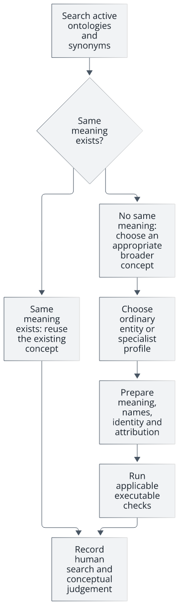
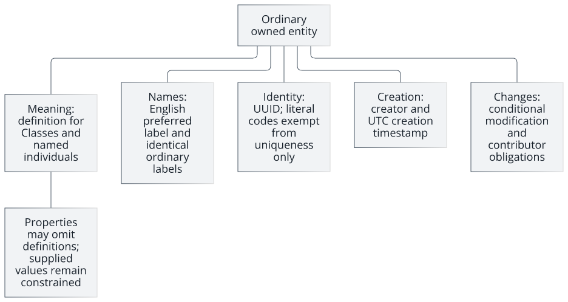
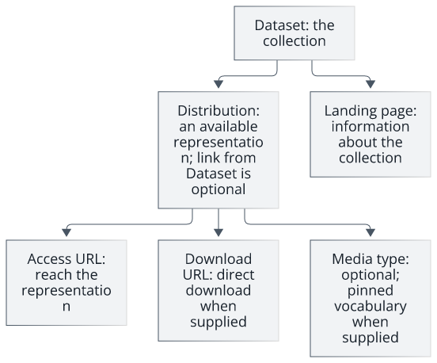
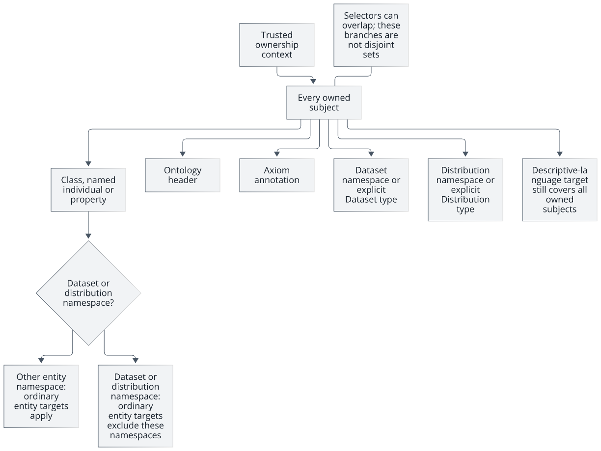
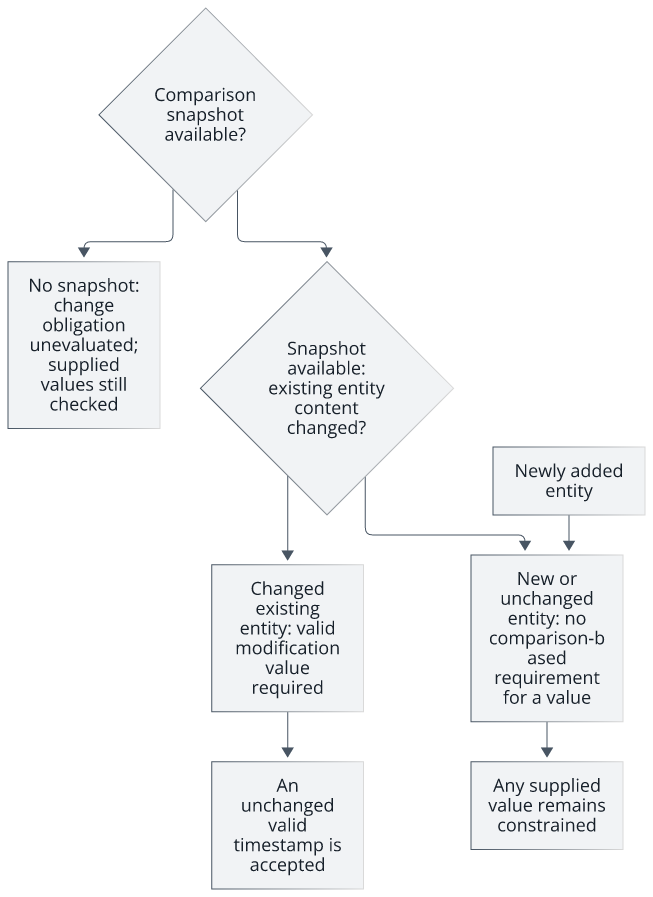
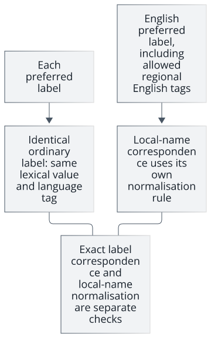
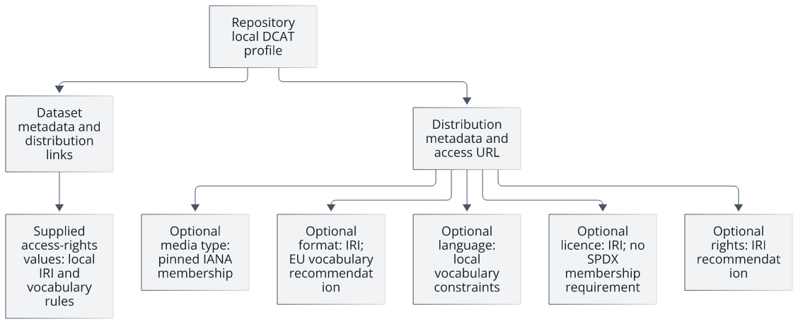

# Universal Ontology Editing Policy

**Make the model clearer. Keep its structure trustworthy.**

Use the [Contributor guide](#contributor-guide) for your next action and the [Technical reference](#technical-reference) for exact requirements, exceptions, validation behaviour and provenance.

The Contributor guide contains non-normative summaries. The canonical repository policy governs.

## Contributor guide

### Start with the meaning

**Contributor summary — non-normative.**

Before creating a Class, named individual or property, search the latest active ontologies for the same meaning, including synonyms and alternative spellings. Reuse an existing concept; if an appropriate broader concept exists, add the new concept beneath it. Record the search and judgement for human review. Automated conformance cannot establish conceptual adequacy.

Technical requirements: [EP-HUMAN-CONCEPT-REUSE](#ep-human-concept-reuse)

<picture>
  <source media="(prefers-color-scheme: dark)" srcset="assets/editing-policy/policy-journey-dark.svg">
  <source media="(prefers-color-scheme: light)" srcset="assets/editing-policy/policy-journey-light.svg">
  
</picture>

Search before creating a concept; reuse and human judgement remain separate from executable checks.

<details>
<summary>Text equivalent of the policy-journey diagram</summary>

Search the latest active ontologies before creating a concept, including synonyms and alternative spellings.
If the same meaning exists, reuse that concept.
Otherwise, place the new concept beneath an appropriate broader concept where one exists, select the applicable editing scope and prepare its metadata.
Executable checks and human conceptual review answer different questions; passing the former does not discharge the latter.

</details>

Diagram requirements: [EP-HUMAN-CONCEPT-REUSE](#ep-human-concept-reuse)

### Choose the kind of change

**Contributor summary — non-normative.**

Identify whether you are adding an ordinary entity, changing an existing one, describing a dataset or distribution, editing an ontology header, or annotating an axiom. These scopes can overlap. Dataset and distribution profiles have their own rules; do not apply the ordinary-entity checklist indiscriminately.

Technical requirements: [EP-AXIOM-POSITION](#ep-axiom-position) · [EP-DATASET-TYPE-IRI](#ep-dataset-type-iri) · [EP-ENTITY-UUID](#ep-entity-uuid) · [EP-ONT-VERSION](#ep-ont-version)

### Add or describe an ordinary ontology entity

**Contributor summary — non-normative.**

An ordinary owned entity needs a UUID identifier, creator attribution and a creation timestamp. Literal enumeration identifiers have an exception to IRI identifier uniqueness. Classes and named individuals need definitions; properties may omit them, while supplied definitions remain constrained. Supply an English preferred label, including an allowed regional English tag, and an identical ordinary label for every preferred label. Exact label correspondence and local-name normalisation are separate checks. ORCID format checks do not establish checksum, registration or identity.

Technical requirements: [EP-DEFINITION](#ep-definition) · [EP-ENTITY-CREATED](#ep-entity-created) · [EP-ENTITY-CREATOR](#ep-entity-creator) · [EP-ENTITY-UUID](#ep-entity-uuid) · [EP-IDENTIFIER-UNIQUE](#ep-identifier-unique) · [EP-LABEL](#ep-label) · [EP-PREFLABEL-IRI](#ep-preflabel-iri) · [EP-PREFLABEL-LABEL](#ep-preflabel-label) · [EP-PREFLABEL-LANGUAGE](#ep-preflabel-language)

<picture>
  <source media="(prefers-color-scheme: dark)" srcset="assets/editing-policy/entity-anatomy-dark.svg">
  <source media="(prefers-color-scheme: light)" srcset="assets/editing-policy/entity-anatomy-light.svg">
  
</picture>

Ordinary entity metadata separates meaning, names, identity, creation and change obligations.

<details>
<summary>Text equivalent of the entity-anatomy diagram</summary>

An ordinary owned entity combines meaning, language-tagged names, identity and attribution.
Classes and named individuals require definitions; properties may omit them, while supplied values remain constrained.
Every preferred label has an identical ordinary label; normalising a local name is a separate check.
Creator and creation metadata describe creation, while modification and contributor obligations depend on the change and available comparison context.
Dedicated dataset and distribution profiles are separate from this ordinary-entity view.

</details>

Diagram requirements: [EP-ENTITY-UUID](#ep-entity-uuid) · [EP-ENTITY-CREATOR](#ep-entity-creator) · [EP-ENTITY-CREATED](#ep-entity-created) · [EP-DEFINITION](#ep-definition) · [EP-PREFLABEL-LANGUAGE](#ep-preflabel-language) · [EP-PREFLABEL-LABEL](#ep-preflabel-label)

### Change an existing entity

**Contributor summary — non-normative.**

An existing entity changed relative to the comparison snapshot needs a valid modification value. An unchanged valid value is accepted, and a new entity needs no modification value. Without the comparison snapshot, the change obligation is unevaluated; unevaluated does not mean passed. Contributor values are optional in the graph and constrained when supplied. A different editor has a human obligation to add contributor attribution, which is never inferred from Git identity.

Technical requirements: [EP-CONTRIBUTOR](#ep-contributor) · [EP-MODIFIED](#ep-modified)

### Describe datasets and distributions

**Contributor summary — non-normative.**

A Dataset describes the collection; a Distribution describes an available representation. Follow this repository's local DCAT profile for required metadata and access routes. A distribution does not have to state a media type. If it does, its value must satisfy the pinned media-type vocabulary. Optional presence does not mean unconstrained content. Use dcat:downloadURL with its exact capitalisation.

Technical requirements: [EP-DATASET-DISTRIBUTION](#ep-dataset-distribution) · [EP-DATASET-LANDING](#ep-dataset-landing) · [EP-DATASET-REQUIRED](#ep-dataset-required) · [EP-DATASET-TYPE-IRI](#ep-dataset-type-iri) · [EP-DISTRIBUTION-DOWNLOAD](#ep-distribution-download) · [EP-DISTRIBUTION-MEDIA](#ep-distribution-media) · [EP-DISTRIBUTION-REQUIRED](#ep-distribution-required)

<picture>
  <source media="(prefers-color-scheme: dark)" srcset="assets/editing-policy/dataset-access-guide-dark.svg">
  <source media="(prefers-color-scheme: light)" srcset="assets/editing-policy/dataset-access-guide-light.svg">
  
</picture>

A Dataset may link to Distributions; access routes and optional media types follow the local profile.

<details>
<summary>Text equivalent of the dataset-access-guide diagram</summary>

A Dataset describes the collection and may link to Distribution resources.
A Distribution describes an available representation and provides the access route required by the local profile.
A landing page describes the collection; an access URL reaches the representation; a supplied download URL identifies a direct download.
Media type is optional, but supplied media types must satisfy the repository-pinned vocabulary.
These are the repository's local DCAT profile requirements, rather than universal cardinalities imposed by the DCAT vocabulary.

</details>

Diagram requirements: [EP-DATASET-DISTRIBUTION](#ep-dataset-distribution) · [EP-DATASET-LANDING](#ep-dataset-landing) · [EP-DISTRIBUTION-REQUIRED](#ep-distribution-required) · [EP-DISTRIBUTION-DOWNLOAD](#ep-distribution-download) · [EP-DISTRIBUTION-MEDIA](#ep-distribution-media)

### Review before proposing the change

**Contributor summary — non-normative.**

Check the exact technical requirements and run the repository's relevant validation commands. Review warnings as recommendations. Record conceptual reuse, definition adequacy and applicable source or contributor judgements. Passing executable checks establishes only the machine-checkable constraints tested in the available context; human review remains necessary.

Technical requirements: [EP-DEFINITION](#ep-definition) · [EP-DISTRIBUTION-RIGHTS](#ep-distribution-rights) · [EP-HUMAN-CONCEPT-REUSE](#ep-human-concept-reuse) · [EP-OPTIONAL-ANNOTATIONS](#ep-optional-annotations) · [EP-PROPERTY-NAME-ISO](#ep-property-name-iso)

## Technical reference

### How to read the reference

Normative strength, property presence, assessment and evaluation state are separate dimensions. MUST does not itself mean a property must be present. Human review does not mean optional. Warnings remain recommendations. Unevaluated does not mean passed. SHACL conformance does not establish conceptual adequacy.

Structural editing requirements for every owned entity, ontology header and axiom in each latest active ontology version and in every replacement candidate. Human conceptual review remains separate and is documented here as explicit human clauses.

Canonical policy lineage: [https://github.com/Hadden-Industries/universal-ontology/wiki/Editing-Policy/819704130dee55bf04712d4cd09723d8df35581c](https://github.com/Hadden-Industries/universal-ontology/wiki/Editing-Policy/819704130dee55bf04712d4cd09723d8df35581c)

Generated from the canonical policy graph (policy identity `sha256:250753977dc6cb2711e0fcc7fd1d1c63a44e6b0ea831488affaaf2fac6f10ecb`). Do not edit this page by hand; change the policy sources under [`policy/`](https://github.com/Hadden-Industries/universal-ontology/tree/main/policy) in the repository and regenerate. The enforced policy is the one in the repository; when this page and the repository differ, the repository governs.

<picture>
  <source media="(prefers-color-scheme: dark)" srcset="assets/editing-policy/scope-validation-dark.svg">
  <source media="(prefers-color-scheme: light)" srcset="assets/editing-policy/scope-validation-light.svg">
  
</picture>

Trusted ownership feeds overlapping targets; dedicated DCAT namespaces are excluded from ordinary entity targets.

<details>
<summary>Text equivalent of the scope-validation diagram</summary>

Ownership is supplied by trusted validation context.
Targets select ordinary entity types, ontology headers, axiom annotations and specialist dataset or distribution subjects.
These selectors can overlap; the branches do not divide resources into mutually exclusive sets.
Ordinary entity selectors exclude the dedicated dataset and distribution namespaces, while the descriptive-language selector continues to reach every owned subject.
Explicit dataset or distribution types and their namespaces also participate in the local specialist targets.

</details>

Diagram requirements: [EP-ENTITY-UUID](#ep-entity-uuid) · [EP-DATASET-TYPE-IRI](#ep-dataset-type-iri) · [EP-DISTRIBUTION-REQUIRED](#ep-distribution-required) · [EP-DESCRIPTIVE-LANGUAGE](#ep-descriptive-language)

Technical clauses: [EP-AXIOM-POSITION](#ep-axiom-position) · [EP-CLASS-NAME](#ep-class-name) · [EP-CONTRIBUTOR](#ep-contributor) · [EP-DATASET-ACCESS-RIGHTS](#ep-dataset-access-rights) · [EP-DATASET-ACCESS-RIGHTS-IRI](#ep-dataset-access-rights-iri) · [EP-DATASET-DISTRIBUTION](#ep-dataset-distribution) · [EP-DATASET-LANDING](#ep-dataset-landing) · [EP-DATASET-REQUIRED](#ep-dataset-required) · [EP-DATASET-TYPE-IRI](#ep-dataset-type-iri) · [EP-DEFINITION](#ep-definition) · [EP-DESCRIPTION-LANGUAGE](#ep-description-language) · [EP-DESCRIPTIVE-LANGUAGE](#ep-descriptive-language) · [EP-DISTRIBUTION-DOWNLOAD](#ep-distribution-download) · [EP-DISTRIBUTION-FORMAT](#ep-distribution-format) · [EP-DISTRIBUTION-FORMAT-EU](#ep-distribution-format-eu) · [EP-DISTRIBUTION-LANGUAGE](#ep-distribution-language) · [EP-DISTRIBUTION-LICENCE](#ep-distribution-licence) · [EP-DISTRIBUTION-MEDIA](#ep-distribution-media) · [EP-DISTRIBUTION-REQUIRED](#ep-distribution-required) · [EP-DISTRIBUTION-RIGHTS](#ep-distribution-rights) · [EP-ENTITY-CREATED](#ep-entity-created) · [EP-ENTITY-CREATOR](#ep-entity-creator) · [EP-ENTITY-UUID](#ep-entity-uuid) · [EP-HUMAN-CONCEPT-REUSE](#ep-human-concept-reuse) · [EP-IDENTIFIER-UNIQUE](#ep-identifier-unique) · [EP-INDIVIDUAL-NAME](#ep-individual-name) · [EP-LABEL](#ep-label) · [EP-MODIFIED](#ep-modified) · [EP-ONT-VERSION](#ep-ont-version) · [EP-OPTIONAL-ANNOTATIONS](#ep-optional-annotations) · [EP-PREFLABEL-IRI](#ep-preflabel-iri) · [EP-PREFLABEL-LABEL](#ep-preflabel-label) · [EP-PREFLABEL-LANGUAGE](#ep-preflabel-language) · [EP-PROPERTY-NAME](#ep-property-name) · [EP-PROPERTY-NAME-ISO](#ep-property-name-iso)

**Ontology header**

Version identity of each authored module document.

### EP-ONT-VERSION

**Version identity**

**Normative strength:** MUST

**Presence:** see the property-specific cardinalities and conditions below; strength does not imply required presence.

**Assessment:** executable validation; additional human obligations remain as stated below.

**Evaluation context:** this reference is not a validation result. Unevaluated obligations have not passed; comparison-dependent checks require the run's comparison context.

Each authored module document has one `owl:Ontology` header with exactly one IRI-valued `owl:versionIRI` and exactly one `owl:versionInfo`. The version info is a valid calendar date written `YYYY-MM-DD`; the final path segment of the version IRI (an existing trailing slash is allowed) is that date written `YYYYMMDD`. An optional `dcterms:modified` on the header has at most one value, an `xsd:date` written `YYYY-MM-DD` or `YYYY-MM-DDZ`, whose calendar date equals the version info; a numeric offset or an `xsd:dateTime` fails. Imported headers belong to other modules and never cause a false multiple-header result.

**Applies to:** the owl:Ontology header of each authored module document

**Executable constraints:**

- `owl:versionInfo`: exactly one value
- `owl:versionInfo`: datatype `xsd:string`
- `owl:versionInfo`: matches the pattern `^[0-9]{4}-[0-9]{2}-[0-9]{2}$`
- `owl:versionIRI`: exactly one value
- `owl:versionIRI`: node kind `sh:IRI`
- `dcterms:modified`: at most one value
- `dcterms:modified`: datatype `xsd:date`
- `dcterms:modified`: matches the pattern `^[0-9]{4}-[0-9]{2}-[0-9]{2}Z?$`
- the entity: The owl:versionIRI ends in the owl:versionInfo date written YYYYMMDD. (SPARQL-based check; see the policy source)
- the entity: The header dcterms:modified date equals the owl:versionInfo date. (SPARQL-based check; see the policy source)
- the entity: The owl:versionInfo is a real calendar date. (SPARQL-based check; see the policy source)

<details>
<summary>Source and provenance</summary>

Original clause heading: EP-ONT-VERSION — Version identity (MUST)

**Source:** Editing Policy Wiki W01 (lines 18-23); DEC-001; DEC-025; DEC-027

</details>

**Complete constraint and context data:**

The RDF projection preserves literal language/datatype identity, logical branches, targets, messages and severities. Shared definitions appear in the [shared policy declarations](#shared-policy-declarations). Anonymous numeric references are local to each block and are not public identifiers.

```json
{
  "triples": [
    [{"iri":"https://haddenindustries.com/ontology/policy/editing/EP-ONT-VERSION"},{"iri":"http://purl.org/dc/terms/source"},{"datatype":null,"language":null,"literal":"Editing Policy Wiki W01 (lines 18-23); DEC-001; DEC-025; DEC-027"}],
    [{"iri":"https://haddenindustries.com/ontology/policy/editing/EP-ONT-VERSION"},{"iri":"http://www.w3.org/1999/02/22-rdf-syntax-ns#type"},{"iri":"http://www.w3.org/ns/shacl#NodeShape"}],
    [{"iri":"https://haddenindustries.com/ontology/policy/editing/EP-ONT-VERSION"},{"iri":"http://www.w3.org/ns/shacl#description"},{"datatype":null,"language":"en","literal":"Each authored module document has one `owl:Ontology` header with exactly one IRI-valued `owl:versionIRI` and exactly one `owl:versionInfo`. The version info is a valid calendar date written `YYYY-MM-DD`; the final path segment of the version IRI (an existing trailing slash is allowed) is that date written `YYYYMMDD`. An optional `dcterms:modified` on the header has at most one value, an `xsd:date` written `YYYY-MM-DD` or `YYYY-MM-DDZ`, whose calendar date equals the version info; a numeric offset or an `xsd:dateTime` fails. Imported headers belong to other modules and never cause a false multiple-header result."}],
    [{"iri":"https://haddenindustries.com/ontology/policy/editing/EP-ONT-VERSION"},{"iri":"http://www.w3.org/ns/shacl#group"},{"iri":"https://haddenindustries.com/ontology/policy/editing/OntologyHeaderGroup"}],
    [{"iri":"https://haddenindustries.com/ontology/policy/editing/EP-ONT-VERSION"},{"iri":"http://www.w3.org/ns/shacl#name"},{"datatype":null,"language":"en","literal":"Version identity"}],
    [{"iri":"https://haddenindustries.com/ontology/policy/editing/EP-ONT-VERSION"},{"iri":"http://www.w3.org/ns/shacl#order"},{"datatype":"http://www.w3.org/2001/XMLSchema#integer","language":null,"literal":"10"}],
    [{"iri":"https://haddenindustries.com/ontology/policy/editing/EP-ONT-VERSION"},{"iri":"http://www.w3.org/ns/shacl#property"},{"iri":"https://haddenindustries.com/ontology/policy/editing/EP-ONT-VERSION-info"}],
    [{"iri":"https://haddenindustries.com/ontology/policy/editing/EP-ONT-VERSION"},{"iri":"http://www.w3.org/ns/shacl#property"},{"iri":"https://haddenindustries.com/ontology/policy/editing/EP-ONT-VERSION-iri"}],
    [{"iri":"https://haddenindustries.com/ontology/policy/editing/EP-ONT-VERSION"},{"iri":"http://www.w3.org/ns/shacl#property"},{"iri":"https://haddenindustries.com/ontology/policy/editing/EP-ONT-VERSION-modified"}],
    [{"iri":"https://haddenindustries.com/ontology/policy/editing/EP-ONT-VERSION"},{"iri":"http://www.w3.org/ns/shacl#sparql"},{"iri":"https://haddenindustries.com/ontology/policy/editing/EP-ONT-VERSION-alignment"}],
    [{"iri":"https://haddenindustries.com/ontology/policy/editing/EP-ONT-VERSION"},{"iri":"http://www.w3.org/ns/shacl#sparql"},{"iri":"https://haddenindustries.com/ontology/policy/editing/EP-ONT-VERSION-calendar"}],
    [{"iri":"https://haddenindustries.com/ontology/policy/editing/EP-ONT-VERSION"},{"iri":"http://www.w3.org/ns/shacl#sparql"},{"iri":"https://haddenindustries.com/ontology/policy/editing/EP-ONT-VERSION-modified-alignment"}],
    [{"iri":"https://haddenindustries.com/ontology/policy/editing/EP-ONT-VERSION"},{"iri":"http://www.w3.org/ns/shacl#target"},{"iri":"https://haddenindustries.com/ontology/policy/editing/OwnedOntologyHeaderTarget"}],
    [{"iri":"https://haddenindustries.com/ontology/policy/editing/EP-ONT-VERSION"},{"iri":"https://haddenindustries.com/ontology/policy#normativeStrength"},{"datatype":null,"language":null,"literal":"MUST"}],
    [{"iri":"https://haddenindustries.com/ontology/policy/editing/EP-ONT-VERSION"},{"iri":"https://haddenindustries.com/ontology/policy#requirementId"},{"datatype":null,"language":null,"literal":"EP-ONT-VERSION"}],
    [{"iri":"https://haddenindustries.com/ontology/policy/editing/EP-ONT-VERSION-alignment"},{"iri":"http://www.w3.org/1999/02/22-rdf-syntax-ns#type"},{"iri":"http://www.w3.org/ns/shacl#SPARQLConstraint"}],
    [{"iri":"https://haddenindustries.com/ontology/policy/editing/EP-ONT-VERSION-alignment"},{"iri":"http://www.w3.org/ns/shacl#message"},{"datatype":null,"language":"en","literal":"The owl:versionIRI ends in the owl:versionInfo date written YYYYMMDD."}],
    [{"iri":"https://haddenindustries.com/ontology/policy/editing/EP-ONT-VERSION-alignment"},{"iri":"http://www.w3.org/ns/shacl#prefixes"},{"iri":"https://haddenindustries.com/ontology/policy/editing/EditingPolicy"}],
    [{"iri":"https://haddenindustries.com/ontology/policy/editing/EP-ONT-VERSION-alignment"},{"iri":"http://www.w3.org/ns/shacl#select"},{"datatype":null,"language":null,"literal":"\n        SELECT $this ?value ?path WHERE {\n            BIND ( owl:versionIRI AS ?path )\n            $this owl:versionIRI ?value ; owl:versionInfo ?info .\n            BIND ( REPLACE(REPLACE(STR(?value), \"/$\", \"\"), \"^.*/\", \"\") AS ?tail )\n            FILTER ( ?tail != REPLACE(STR(?info), \"-\", \"\") )\n        }\n        "}],
    [{"iri":"https://haddenindustries.com/ontology/policy/editing/EP-ONT-VERSION-calendar"},{"iri":"http://www.w3.org/1999/02/22-rdf-syntax-ns#type"},{"iri":"http://www.w3.org/ns/shacl#SPARQLConstraint"}],
    [{"iri":"https://haddenindustries.com/ontology/policy/editing/EP-ONT-VERSION-calendar"},{"iri":"http://www.w3.org/ns/shacl#message"},{"datatype":null,"language":"en","literal":"The owl:versionInfo is a real calendar date."}],
    [{"iri":"https://haddenindustries.com/ontology/policy/editing/EP-ONT-VERSION-calendar"},{"iri":"http://www.w3.org/ns/shacl#prefixes"},{"iri":"https://haddenindustries.com/ontology/policy/editing/EditingPolicy"}],
    [{"iri":"https://haddenindustries.com/ontology/policy/editing/EP-ONT-VERSION-calendar"},{"iri":"http://www.w3.org/ns/shacl#select"},{"datatype":null,"language":null,"literal":"\n        SELECT $this ?value ?path WHERE {\n            BIND ( owl:versionInfo AS ?path )\n            $this owl:versionInfo ?value .\n            FILTER ( REGEX(STR(?value), \"^[0-9]{4}-[0-9]{2}-[0-9]{2}$\") )\n            BIND ( xsd:integer(SUBSTR(STR(?value), 1, 4)) AS ?year )\n            BIND ( xsd:integer(SUBSTR(STR(?value), 6, 2)) AS ?month )\n            BIND ( xsd:integer(SUBSTR(STR(?value), 9, 2)) AS ?day )\n            BIND ( IF ( ?month IN (1, 3, 5, 7, 8, 10, 12), 31,\n                   IF ( ?month IN (4, 6, 9, 11), 30,\n                   IF ( ?month = 2, IF ( (?year - 4 * FLOOR(?year / 4)) = 0 && ((?year - 100 * FLOOR(?year / 100)) != 0 || (?year - 400 * FLOOR(?year / 400)) = 0), 29, 28 ), 0 ) ) ) AS ?maximum )\n            FILTER ( ?month < 1 || ?day < 1 || ?day > ?maximum )\n        }\n        "}],
    [{"iri":"https://haddenindustries.com/ontology/policy/editing/EP-ONT-VERSION-info"},{"iri":"http://www.w3.org/1999/02/22-rdf-syntax-ns#type"},{"iri":"http://www.w3.org/ns/shacl#PropertyShape"}],
    [{"iri":"https://haddenindustries.com/ontology/policy/editing/EP-ONT-VERSION-info"},{"iri":"http://www.w3.org/ns/shacl#datatype"},{"iri":"http://www.w3.org/2001/XMLSchema#string"}],
    [{"iri":"https://haddenindustries.com/ontology/policy/editing/EP-ONT-VERSION-info"},{"iri":"http://www.w3.org/ns/shacl#maxCount"},{"datatype":"http://www.w3.org/2001/XMLSchema#integer","language":null,"literal":"1"}],
    [{"iri":"https://haddenindustries.com/ontology/policy/editing/EP-ONT-VERSION-info"},{"iri":"http://www.w3.org/ns/shacl#message"},{"datatype":null,"language":"en","literal":"The header carries exactly one owl:versionInfo written YYYY-MM-DD."}],
    [{"iri":"https://haddenindustries.com/ontology/policy/editing/EP-ONT-VERSION-info"},{"iri":"http://www.w3.org/ns/shacl#minCount"},{"datatype":"http://www.w3.org/2001/XMLSchema#integer","language":null,"literal":"1"}],
    [{"iri":"https://haddenindustries.com/ontology/policy/editing/EP-ONT-VERSION-info"},{"iri":"http://www.w3.org/ns/shacl#path"},{"iri":"http://www.w3.org/2002/07/owl#versionInfo"}],
    [{"iri":"https://haddenindustries.com/ontology/policy/editing/EP-ONT-VERSION-info"},{"iri":"http://www.w3.org/ns/shacl#pattern"},{"datatype":null,"language":null,"literal":"^[0-9]{4}-[0-9]{2}-[0-9]{2}$"}],
    [{"iri":"https://haddenindustries.com/ontology/policy/editing/EP-ONT-VERSION-iri"},{"iri":"http://www.w3.org/1999/02/22-rdf-syntax-ns#type"},{"iri":"http://www.w3.org/ns/shacl#PropertyShape"}],
    [{"iri":"https://haddenindustries.com/ontology/policy/editing/EP-ONT-VERSION-iri"},{"iri":"http://www.w3.org/ns/shacl#maxCount"},{"datatype":"http://www.w3.org/2001/XMLSchema#integer","language":null,"literal":"1"}],
    [{"iri":"https://haddenindustries.com/ontology/policy/editing/EP-ONT-VERSION-iri"},{"iri":"http://www.w3.org/ns/shacl#message"},{"datatype":null,"language":"en","literal":"The header carries exactly one IRI-valued owl:versionIRI."}],
    [{"iri":"https://haddenindustries.com/ontology/policy/editing/EP-ONT-VERSION-iri"},{"iri":"http://www.w3.org/ns/shacl#minCount"},{"datatype":"http://www.w3.org/2001/XMLSchema#integer","language":null,"literal":"1"}],
    [{"iri":"https://haddenindustries.com/ontology/policy/editing/EP-ONT-VERSION-iri"},{"iri":"http://www.w3.org/ns/shacl#nodeKind"},{"iri":"http://www.w3.org/ns/shacl#IRI"}],
    [{"iri":"https://haddenindustries.com/ontology/policy/editing/EP-ONT-VERSION-iri"},{"iri":"http://www.w3.org/ns/shacl#path"},{"iri":"http://www.w3.org/2002/07/owl#versionIRI"}],
    [{"iri":"https://haddenindustries.com/ontology/policy/editing/EP-ONT-VERSION-modified"},{"iri":"http://www.w3.org/1999/02/22-rdf-syntax-ns#type"},{"iri":"http://www.w3.org/ns/shacl#PropertyShape"}],
    [{"iri":"https://haddenindustries.com/ontology/policy/editing/EP-ONT-VERSION-modified"},{"iri":"http://www.w3.org/ns/shacl#datatype"},{"iri":"http://www.w3.org/2001/XMLSchema#date"}],
    [{"iri":"https://haddenindustries.com/ontology/policy/editing/EP-ONT-VERSION-modified"},{"iri":"http://www.w3.org/ns/shacl#maxCount"},{"datatype":"http://www.w3.org/2001/XMLSchema#integer","language":null,"literal":"1"}],
    [{"iri":"https://haddenindustries.com/ontology/policy/editing/EP-ONT-VERSION-modified"},{"iri":"http://www.w3.org/ns/shacl#message"},{"datatype":null,"language":"en","literal":"An optional header dcterms:modified is a single xsd:date written YYYY-MM-DD or YYYY-MM-DDZ."}],
    [{"iri":"https://haddenindustries.com/ontology/policy/editing/EP-ONT-VERSION-modified"},{"iri":"http://www.w3.org/ns/shacl#path"},{"iri":"http://purl.org/dc/terms/modified"}],
    [{"iri":"https://haddenindustries.com/ontology/policy/editing/EP-ONT-VERSION-modified"},{"iri":"http://www.w3.org/ns/shacl#pattern"},{"datatype":null,"language":null,"literal":"^[0-9]{4}-[0-9]{2}-[0-9]{2}Z?$"}],
    [{"iri":"https://haddenindustries.com/ontology/policy/editing/EP-ONT-VERSION-modified-alignment"},{"iri":"http://www.w3.org/1999/02/22-rdf-syntax-ns#type"},{"iri":"http://www.w3.org/ns/shacl#SPARQLConstraint"}],
    [{"iri":"https://haddenindustries.com/ontology/policy/editing/EP-ONT-VERSION-modified-alignment"},{"iri":"http://www.w3.org/ns/shacl#message"},{"datatype":null,"language":"en","literal":"The header dcterms:modified date equals the owl:versionInfo date."}],
    [{"iri":"https://haddenindustries.com/ontology/policy/editing/EP-ONT-VERSION-modified-alignment"},{"iri":"http://www.w3.org/ns/shacl#prefixes"},{"iri":"https://haddenindustries.com/ontology/policy/editing/EditingPolicy"}],
    [{"iri":"https://haddenindustries.com/ontology/policy/editing/EP-ONT-VERSION-modified-alignment"},{"iri":"http://www.w3.org/ns/shacl#select"},{"datatype":null,"language":null,"literal":"\n        SELECT $this ?value ?path WHERE {\n            BIND ( dcterms:modified AS ?path )\n            $this dcterms:modified ?value ; owl:versionInfo ?info .\n            FILTER ( REPLACE(STR(?value), \"Z$\", \"\") != STR(?info) )\n        }\n        "}],
    [{"iri":"https://haddenindustries.com/ontology/policy/editing/OwnedOntologyHeaderTarget"},{"iri":"http://www.w3.org/1999/02/22-rdf-syntax-ns#type"},{"iri":"http://www.w3.org/ns/shacl#SPARQLTarget"}],
    [{"iri":"https://haddenindustries.com/ontology/policy/editing/OwnedOntologyHeaderTarget"},{"iri":"http://www.w3.org/2000/01/rdf-schema#comment"},{"datatype":null,"language":"en","literal":"the owl:Ontology header of each authored module document"}],
    [{"iri":"https://haddenindustries.com/ontology/policy/editing/OwnedOntologyHeaderTarget"},{"iri":"http://www.w3.org/ns/shacl#prefixes"},{"iri":"https://haddenindustries.com/ontology/policy/editing/EditingPolicy"}],
    [{"iri":"https://haddenindustries.com/ontology/policy/editing/OwnedOntologyHeaderTarget"},{"iri":"http://www.w3.org/ns/shacl#select"},{"datatype":null,"language":null,"literal":"\n        SELECT DISTINCT ?this WHERE { ?this uoc:ownedBy ?module . ?this a owl:Ontology . }\n        "}]
  ]
}
```

Canonical source: [policy/ontology-policy.ttl](https://github.com/Hadden-Industries/universal-ontology/blob/main/policy/ontology-policy.ttl); resource `https://haddenindustries.com/ontology/policy/editing/EP-ONT-VERSION`; rule fingerprint `sha256:c5428f7573db56b5bfe6b1a4db412c8abd4672690daceaa5980258cbaf263fe1`.

**Entity metadata**

Metadata every owned Class, NamedIndividual, ObjectProperty and DatatypeProperty must carry.

### EP-ENTITY-UUID

**UUID identifier**

**Normative strength:** MUST

**Presence:** see the property-specific cardinalities and conditions below; strength does not imply required presence.

**Assessment:** executable validation; additional human obligations remain as stated below.

**Evaluation context:** this reference is not a validation result. Unevaluated obligations have not passed; comparison-dependent checks require the run's comparison context.

Every owned Class, NamedIndividual, ObjectProperty and DatatypeProperty has at least one `dcterms:identifier` that is a version-4 UUID URN, for example `urn:uuid:905770f1-45ca-4738-8eb6-a2e84935c74c`. The version nibble must be `4` and the variant nibble `8`, `9`, `a` or `b`; a version-1 UUID or a wrong variant does not qualify even if a lenient parser would accept it. Additional identifiers of other kinds are allowed alongside the qualifying UUID.

**Applies to:** every owned Class, NamedIndividual, ObjectProperty and DatatypeProperty in the validated module set, outside the DCAT dataset/ and distribution/ namespaces

<details>
<summary>Source and provenance</summary>

Original clause heading: EP-ENTITY-UUID — UUID identifier (MUST)

**Source:** Editing Policy Wiki W07 (lines 59-61); DEC-005; DEC-015

</details>

**Complete constraint and context data:**

The RDF projection preserves literal language/datatype identity, logical branches, targets, messages and severities. Shared definitions appear in the [shared policy declarations](#shared-policy-declarations). Anonymous numeric references are local to each block and are not public identifiers.

```json
{
  "triples": [
    [{"anonymous":0},{"iri":"http://www.w3.org/ns/shacl#nodeKind"},{"iri":"http://www.w3.org/ns/shacl#IRI"}],
    [{"anonymous":0},{"iri":"http://www.w3.org/ns/shacl#pattern"},{"datatype":null,"language":null,"literal":"^urn:uuid:[0-9a-fA-F]{8}-[0-9a-fA-F]{4}-4[0-9a-fA-F]{3}-[89abAB][0-9a-fA-F]{3}-[0-9a-fA-F]{12}$"}],
    [{"iri":"https://haddenindustries.com/ontology/policy/editing/EP-ENTITY-UUID"},{"iri":"http://purl.org/dc/terms/source"},{"datatype":null,"language":null,"literal":"Editing Policy Wiki W07 (lines 59-61); DEC-005; DEC-015"}],
    [{"iri":"https://haddenindustries.com/ontology/policy/editing/EP-ENTITY-UUID"},{"iri":"http://www.w3.org/1999/02/22-rdf-syntax-ns#type"},{"iri":"http://www.w3.org/ns/shacl#NodeShape"}],
    [{"iri":"https://haddenindustries.com/ontology/policy/editing/EP-ENTITY-UUID"},{"iri":"http://www.w3.org/ns/shacl#description"},{"datatype":null,"language":"en","literal":"Every owned Class, NamedIndividual, ObjectProperty and DatatypeProperty has at least one `dcterms:identifier` that is a version-4 UUID URN, for example `urn:uuid:905770f1-45ca-4738-8eb6-a2e84935c74c`. The version nibble must be `4` and the variant nibble `8`, `9`, `a` or `b`; a version-1 UUID or a wrong variant does not qualify even if a lenient parser would accept it. Additional identifiers of other kinds are allowed alongside the qualifying UUID."}],
    [{"iri":"https://haddenindustries.com/ontology/policy/editing/EP-ENTITY-UUID"},{"iri":"http://www.w3.org/ns/shacl#group"},{"iri":"https://haddenindustries.com/ontology/policy/editing/EntityMetadataGroup"}],
    [{"iri":"https://haddenindustries.com/ontology/policy/editing/EP-ENTITY-UUID"},{"iri":"http://www.w3.org/ns/shacl#name"},{"datatype":null,"language":"en","literal":"UUID identifier"}],
    [{"iri":"https://haddenindustries.com/ontology/policy/editing/EP-ENTITY-UUID"},{"iri":"http://www.w3.org/ns/shacl#order"},{"datatype":"http://www.w3.org/2001/XMLSchema#integer","language":null,"literal":"10"}],
    [{"iri":"https://haddenindustries.com/ontology/policy/editing/EP-ENTITY-UUID"},{"iri":"http://www.w3.org/ns/shacl#property"},{"iri":"https://haddenindustries.com/ontology/policy/editing/EP-ENTITY-UUID-qualifying"}],
    [{"iri":"https://haddenindustries.com/ontology/policy/editing/EP-ENTITY-UUID"},{"iri":"http://www.w3.org/ns/shacl#target"},{"iri":"https://haddenindustries.com/ontology/policy/editing/OwnedEntityTarget"}],
    [{"iri":"https://haddenindustries.com/ontology/policy/editing/EP-ENTITY-UUID"},{"iri":"https://haddenindustries.com/ontology/policy#normativeStrength"},{"datatype":null,"language":null,"literal":"MUST"}],
    [{"iri":"https://haddenindustries.com/ontology/policy/editing/EP-ENTITY-UUID"},{"iri":"https://haddenindustries.com/ontology/policy#requirementId"},{"datatype":null,"language":null,"literal":"EP-ENTITY-UUID"}],
    [{"iri":"https://haddenindustries.com/ontology/policy/editing/EP-ENTITY-UUID-qualifying"},{"iri":"http://www.w3.org/1999/02/22-rdf-syntax-ns#type"},{"iri":"http://www.w3.org/ns/shacl#PropertyShape"}],
    [{"iri":"https://haddenindustries.com/ontology/policy/editing/EP-ENTITY-UUID-qualifying"},{"iri":"http://www.w3.org/ns/shacl#message"},{"datatype":null,"language":"en","literal":"An owned entity carries at least one version-4 UUID URN identifier."}],
    [{"iri":"https://haddenindustries.com/ontology/policy/editing/EP-ENTITY-UUID-qualifying"},{"iri":"http://www.w3.org/ns/shacl#path"},{"iri":"http://purl.org/dc/terms/identifier"}],
    [{"iri":"https://haddenindustries.com/ontology/policy/editing/EP-ENTITY-UUID-qualifying"},{"iri":"http://www.w3.org/ns/shacl#qualifiedMinCount"},{"datatype":"http://www.w3.org/2001/XMLSchema#integer","language":null,"literal":"1"}],
    [{"iri":"https://haddenindustries.com/ontology/policy/editing/EP-ENTITY-UUID-qualifying"},{"iri":"http://www.w3.org/ns/shacl#qualifiedValueShape"},{"anonymous":0}]
  ]
}
```

Canonical source: [policy/entity-policy.ttl](https://github.com/Hadden-Industries/universal-ontology/blob/main/policy/entity-policy.ttl); resource `https://haddenindustries.com/ontology/policy/editing/EP-ENTITY-UUID`; rule fingerprint `sha256:cbd74434cd0ee3a1f2458e65884c2167d02aea542e28a5bbaa8f83e36bd4436e`.

### EP-IDENTIFIER-UNIQUE

**Identifier uniqueness**

**Normative strength:** MUST

**Presence:** see the property-specific cardinalities and conditions below; strength does not imply required presence.

**Assessment:** executable validation; additional human obligations remain as stated below.

**Evaluation context:** this reference is not a validation result. Unevaluated obligations have not passed; comparison-dependent checks require the run's comparison context.

Two distinct owned entities in the validated module set never share an IRI-valued `dcterms:identifier`. IRI identifiers are compared as RDF terms; UUID URNs are compared without regard to hexadecimal letter case, so `urn:uuid:...AB...` and `urn:uuid:...ab...` are the same identifier. Literal identifiers (enumeration codes such as weekday numbers or currency codes, which are meaningful only within their own scheme) are outside this rule, as they were for the legacy validator. Repeated assertions of one identifier on the same entity are not a second holder, and superseded versions are never combined with the current set. Both holders of an exactly repeated identifier are reported; for a case-variant UUID the holder whose spelling contains uppercase letters is reported.

**Applies to:** owned entities whose identifier another owned entity also holds

**Executable constraints:**

- the entity: Another owned entity holds the same identifier. (SPARQL-based check; see the policy source)

<details>
<summary>Source and provenance</summary>

Original clause heading: EP-IDENTIFIER-UNIQUE — Identifier uniqueness (MUST)

**Source:** Editing Policy Wiki W08 (line 63); DEC-015 as amended by Max on 2026-09-12 (literal identifiers exempt)

</details>

**Complete constraint and context data:**

The RDF projection preserves literal language/datatype identity, logical branches, targets, messages and severities. Shared definitions appear in the [shared policy declarations](#shared-policy-declarations). Anonymous numeric references are local to each block and are not public identifiers.

```json
{
  "triples": [
    [{"iri":"https://haddenindustries.com/ontology/policy/editing/DuplicateIdentifierHolderTarget"},{"iri":"http://www.w3.org/1999/02/22-rdf-syntax-ns#type"},{"iri":"http://www.w3.org/ns/shacl#SPARQLTarget"}],
    [{"iri":"https://haddenindustries.com/ontology/policy/editing/DuplicateIdentifierHolderTarget"},{"iri":"http://www.w3.org/2000/01/rdf-schema#comment"},{"datatype":null,"language":"en","literal":"owned entities whose identifier another owned entity also holds"}],
    [{"iri":"https://haddenindustries.com/ontology/policy/editing/DuplicateIdentifierHolderTarget"},{"iri":"http://www.w3.org/ns/shacl#prefixes"},{"iri":"https://haddenindustries.com/ontology/policy/editing/EditingPolicy"}],
    [{"iri":"https://haddenindustries.com/ontology/policy/editing/DuplicateIdentifierHolderTarget"},{"iri":"http://www.w3.org/ns/shacl#select"},{"datatype":null,"language":null,"literal":"\n        SELECT DISTINCT ?this WHERE {\n            {\n                ?this dcterms:identifier ?id .\n                ?other dcterms:identifier ?id .\n                ?this uoc:ownedBy ?module .\n                ?other uoc:ownedBy ?otherModule .\n                FILTER ( ?this != ?other && isIRI(?id) )\n            } UNION {\n                { SELECT ?this ?id WHERE {\n                    ?this dcterms:identifier ?id .\n                    ?this uoc:ownedBy ?module .\n                    FILTER ( isIRI(?id) && REGEX(STR(?id), \"^urn:uuid:.*[A-F]\") )\n                } }\n                { SELECT ?other ?otherId WHERE {\n                    ?other dcterms:identifier ?otherId .\n                    ?other uoc:ownedBy ?otherModule .\n                    FILTER ( isIRI(?otherId) && STRSTARTS(LCASE(STR(?otherId)), \"urn:uuid:\") )\n                } }\n                FILTER ( ?this != ?other && ?otherId != ?id && LCASE(STR(?otherId)) = LCASE(STR(?id)) )\n            }\n        }\n        "}],
    [{"iri":"https://haddenindustries.com/ontology/policy/editing/EP-IDENTIFIER-UNIQUE"},{"iri":"http://purl.org/dc/terms/source"},{"datatype":null,"language":null,"literal":"Editing Policy Wiki W08 (line 63); DEC-015 as amended by Max on 2026-09-12 (literal identifiers exempt)"}],
    [{"iri":"https://haddenindustries.com/ontology/policy/editing/EP-IDENTIFIER-UNIQUE"},{"iri":"http://www.w3.org/1999/02/22-rdf-syntax-ns#type"},{"iri":"http://www.w3.org/ns/shacl#NodeShape"}],
    [{"iri":"https://haddenindustries.com/ontology/policy/editing/EP-IDENTIFIER-UNIQUE"},{"iri":"http://www.w3.org/ns/shacl#description"},{"datatype":null,"language":"en","literal":"Two distinct owned entities in the validated module set never share an IRI-valued `dcterms:identifier`. IRI identifiers are compared as RDF terms; UUID URNs are compared without regard to hexadecimal letter case, so `urn:uuid:...AB...` and `urn:uuid:...ab...` are the same identifier. Literal identifiers (enumeration codes such as weekday numbers or currency codes, which are meaningful only within their own scheme) are outside this rule, as they were for the legacy validator. Repeated assertions of one identifier on the same entity are not a second holder, and superseded versions are never combined with the current set. Both holders of an exactly repeated identifier are reported; for a case-variant UUID the holder whose spelling contains uppercase letters is reported."}],
    [{"iri":"https://haddenindustries.com/ontology/policy/editing/EP-IDENTIFIER-UNIQUE"},{"iri":"http://www.w3.org/ns/shacl#group"},{"iri":"https://haddenindustries.com/ontology/policy/editing/EntityMetadataGroup"}],
    [{"iri":"https://haddenindustries.com/ontology/policy/editing/EP-IDENTIFIER-UNIQUE"},{"iri":"http://www.w3.org/ns/shacl#name"},{"datatype":null,"language":"en","literal":"Identifier uniqueness"}],
    [{"iri":"https://haddenindustries.com/ontology/policy/editing/EP-IDENTIFIER-UNIQUE"},{"iri":"http://www.w3.org/ns/shacl#order"},{"datatype":"http://www.w3.org/2001/XMLSchema#integer","language":null,"literal":"15"}],
    [{"iri":"https://haddenindustries.com/ontology/policy/editing/EP-IDENTIFIER-UNIQUE"},{"iri":"http://www.w3.org/ns/shacl#sparql"},{"iri":"https://haddenindustries.com/ontology/policy/editing/EP-IDENTIFIER-UNIQUE-holders"}],
    [{"iri":"https://haddenindustries.com/ontology/policy/editing/EP-IDENTIFIER-UNIQUE"},{"iri":"http://www.w3.org/ns/shacl#target"},{"iri":"https://haddenindustries.com/ontology/policy/editing/DuplicateIdentifierHolderTarget"}],
    [{"iri":"https://haddenindustries.com/ontology/policy/editing/EP-IDENTIFIER-UNIQUE"},{"iri":"https://haddenindustries.com/ontology/policy#normativeStrength"},{"datatype":null,"language":null,"literal":"MUST"}],
    [{"iri":"https://haddenindustries.com/ontology/policy/editing/EP-IDENTIFIER-UNIQUE"},{"iri":"https://haddenindustries.com/ontology/policy#requirementId"},{"datatype":null,"language":null,"literal":"EP-IDENTIFIER-UNIQUE"}],
    [{"iri":"https://haddenindustries.com/ontology/policy/editing/EP-IDENTIFIER-UNIQUE-holders"},{"iri":"http://www.w3.org/1999/02/22-rdf-syntax-ns#type"},{"iri":"http://www.w3.org/ns/shacl#SPARQLConstraint"}],
    [{"iri":"https://haddenindustries.com/ontology/policy/editing/EP-IDENTIFIER-UNIQUE-holders"},{"iri":"http://www.w3.org/ns/shacl#message"},{"datatype":null,"language":"en","literal":"Another owned entity holds the same identifier."}],
    [{"iri":"https://haddenindustries.com/ontology/policy/editing/EP-IDENTIFIER-UNIQUE-holders"},{"iri":"http://www.w3.org/ns/shacl#prefixes"},{"iri":"https://haddenindustries.com/ontology/policy/editing/EditingPolicy"}],
    [{"iri":"https://haddenindustries.com/ontology/policy/editing/EP-IDENTIFIER-UNIQUE-holders"},{"iri":"http://www.w3.org/ns/shacl#select"},{"datatype":null,"language":null,"literal":"\n        SELECT $this ?value ?path WHERE {\n            BIND ( dcterms:identifier AS ?path )\n            $this dcterms:identifier ?value .\n            FILTER ( isIRI(?value) )\n            ?other dcterms:identifier ?otherId .\n            ?other uoc:ownedBy ?otherModule .\n            FILTER ( $this != ?other )\n            FILTER ( ?otherId = ?value\n                  || ( isIRI(?value) && isIRI(?otherId) && STRSTARTS(LCASE(STR(?value)), \"urn:uuid:\")\n                       && LCASE(STR(?otherId)) = LCASE(STR(?value)) ) )\n        }\n        "}]
  ]
}
```

Canonical source: [policy/entity-policy.ttl](https://github.com/Hadden-Industries/universal-ontology/blob/main/policy/entity-policy.ttl); resource `https://haddenindustries.com/ontology/policy/editing/EP-IDENTIFIER-UNIQUE`; rule fingerprint `sha256:a232ca78f43c469d9970f497dde21b72e79878100c20bee2af111cfb5988e00d`.

### EP-ENTITY-CREATOR

**Creator**

**Normative strength:** MUST

**Presence:** see the property-specific cardinalities and conditions below; strength does not imply required presence.

**Assessment:** executable validation; additional human obligations remain as stated below.

**Evaluation context:** this reference is not a validation result. Unevaluated obligations have not passed; comparison-dependent checks require the run's comparison context.

Every owned entity has exactly one `dcterms:creator`, an IRI in the canonical ORCID form `https://orcid.org/0000-0000-0000-000X` (four groups of four characters, digits throughout except that the final character may be an uppercase `X`; no query, fragment or trailing slash). This is an offline format check only: a well-formed ORCID with an incorrect checksum passes, and neither registration nor the person's identity is verified.

**Applies to:** every owned Class, NamedIndividual, ObjectProperty and DatatypeProperty in the validated module set, outside the DCAT dataset/ and distribution/ namespaces

**Executable constraints:**

- `dcterms:creator`: exactly one value
- `dcterms:creator`: node kind `sh:IRI`
- `dcterms:creator`: matches the pattern `^https://orcid\.org/[0-9]{4}-[0-9]{4}-[0-9]{4}-[0-9]{3}[0-9X]$`

<details>
<summary>Source and provenance</summary>

Original clause heading: EP-ENTITY-CREATOR — Creator (MUST)

**Source:** Editing Policy Wiki W06 (lines 51-57); DEC-022; DEC-026

</details>

**Complete constraint and context data:**

The RDF projection preserves literal language/datatype identity, logical branches, targets, messages and severities. Shared definitions appear in the [shared policy declarations](#shared-policy-declarations). Anonymous numeric references are local to each block and are not public identifiers.

```json
{
  "triples": [
    [{"iri":"https://haddenindustries.com/ontology/policy/editing/EP-ENTITY-CREATOR"},{"iri":"http://purl.org/dc/terms/source"},{"datatype":null,"language":null,"literal":"Editing Policy Wiki W06 (lines 51-57); DEC-022; DEC-026"}],
    [{"iri":"https://haddenindustries.com/ontology/policy/editing/EP-ENTITY-CREATOR"},{"iri":"http://www.w3.org/1999/02/22-rdf-syntax-ns#type"},{"iri":"http://www.w3.org/ns/shacl#NodeShape"}],
    [{"iri":"https://haddenindustries.com/ontology/policy/editing/EP-ENTITY-CREATOR"},{"iri":"http://www.w3.org/ns/shacl#description"},{"datatype":null,"language":"en","literal":"Every owned entity has exactly one `dcterms:creator`, an IRI in the canonical ORCID form `https://orcid.org/0000-0000-0000-000X` (four groups of four characters, digits throughout except that the final character may be an uppercase `X`; no query, fragment or trailing slash). This is an offline format check only: a well-formed ORCID with an incorrect checksum passes, and neither registration nor the person's identity is verified."}],
    [{"iri":"https://haddenindustries.com/ontology/policy/editing/EP-ENTITY-CREATOR"},{"iri":"http://www.w3.org/ns/shacl#group"},{"iri":"https://haddenindustries.com/ontology/policy/editing/EntityMetadataGroup"}],
    [{"iri":"https://haddenindustries.com/ontology/policy/editing/EP-ENTITY-CREATOR"},{"iri":"http://www.w3.org/ns/shacl#name"},{"datatype":null,"language":"en","literal":"Creator"}],
    [{"iri":"https://haddenindustries.com/ontology/policy/editing/EP-ENTITY-CREATOR"},{"iri":"http://www.w3.org/ns/shacl#order"},{"datatype":"http://www.w3.org/2001/XMLSchema#integer","language":null,"literal":"20"}],
    [{"iri":"https://haddenindustries.com/ontology/policy/editing/EP-ENTITY-CREATOR"},{"iri":"http://www.w3.org/ns/shacl#property"},{"iri":"https://haddenindustries.com/ontology/policy/editing/EP-ENTITY-CREATOR-count"}],
    [{"iri":"https://haddenindustries.com/ontology/policy/editing/EP-ENTITY-CREATOR"},{"iri":"http://www.w3.org/ns/shacl#property"},{"iri":"https://haddenindustries.com/ontology/policy/editing/EP-ENTITY-CREATOR-orcid"}],
    [{"iri":"https://haddenindustries.com/ontology/policy/editing/EP-ENTITY-CREATOR"},{"iri":"http://www.w3.org/ns/shacl#target"},{"iri":"https://haddenindustries.com/ontology/policy/editing/OwnedEntityTarget"}],
    [{"iri":"https://haddenindustries.com/ontology/policy/editing/EP-ENTITY-CREATOR"},{"iri":"https://haddenindustries.com/ontology/policy#normativeStrength"},{"datatype":null,"language":null,"literal":"MUST"}],
    [{"iri":"https://haddenindustries.com/ontology/policy/editing/EP-ENTITY-CREATOR"},{"iri":"https://haddenindustries.com/ontology/policy#requirementId"},{"datatype":null,"language":null,"literal":"EP-ENTITY-CREATOR"}],
    [{"iri":"https://haddenindustries.com/ontology/policy/editing/EP-ENTITY-CREATOR-count"},{"iri":"http://www.w3.org/1999/02/22-rdf-syntax-ns#type"},{"iri":"http://www.w3.org/ns/shacl#PropertyShape"}],
    [{"iri":"https://haddenindustries.com/ontology/policy/editing/EP-ENTITY-CREATOR-count"},{"iri":"http://www.w3.org/ns/shacl#maxCount"},{"datatype":"http://www.w3.org/2001/XMLSchema#integer","language":null,"literal":"1"}],
    [{"iri":"https://haddenindustries.com/ontology/policy/editing/EP-ENTITY-CREATOR-count"},{"iri":"http://www.w3.org/ns/shacl#message"},{"datatype":null,"language":"en","literal":"An owned entity carries exactly one dcterms:creator."}],
    [{"iri":"https://haddenindustries.com/ontology/policy/editing/EP-ENTITY-CREATOR-count"},{"iri":"http://www.w3.org/ns/shacl#minCount"},{"datatype":"http://www.w3.org/2001/XMLSchema#integer","language":null,"literal":"1"}],
    [{"iri":"https://haddenindustries.com/ontology/policy/editing/EP-ENTITY-CREATOR-count"},{"iri":"http://www.w3.org/ns/shacl#path"},{"iri":"http://purl.org/dc/terms/creator"}],
    [{"iri":"https://haddenindustries.com/ontology/policy/editing/EP-ENTITY-CREATOR-orcid"},{"iri":"http://www.w3.org/1999/02/22-rdf-syntax-ns#type"},{"iri":"http://www.w3.org/ns/shacl#PropertyShape"}],
    [{"iri":"https://haddenindustries.com/ontology/policy/editing/EP-ENTITY-CREATOR-orcid"},{"iri":"http://www.w3.org/ns/shacl#message"},{"datatype":null,"language":"en","literal":"dcterms:creator is a canonical https://orcid.org/ IRI."}],
    [{"iri":"https://haddenindustries.com/ontology/policy/editing/EP-ENTITY-CREATOR-orcid"},{"iri":"http://www.w3.org/ns/shacl#nodeKind"},{"iri":"http://www.w3.org/ns/shacl#IRI"}],
    [{"iri":"https://haddenindustries.com/ontology/policy/editing/EP-ENTITY-CREATOR-orcid"},{"iri":"http://www.w3.org/ns/shacl#path"},{"iri":"http://purl.org/dc/terms/creator"}],
    [{"iri":"https://haddenindustries.com/ontology/policy/editing/EP-ENTITY-CREATOR-orcid"},{"iri":"http://www.w3.org/ns/shacl#pattern"},{"datatype":null,"language":null,"literal":"^https://orcid\\.org/[0-9]{4}-[0-9]{4}-[0-9]{4}-[0-9]{3}[0-9X]$"}]
  ]
}
```

Canonical source: [policy/entity-policy.ttl](https://github.com/Hadden-Industries/universal-ontology/blob/main/policy/entity-policy.ttl); resource `https://haddenindustries.com/ontology/policy/editing/EP-ENTITY-CREATOR`; rule fingerprint `sha256:121d1a12e49cc070a08e831d084649c2ede65f6fc75a9b25e6a74d1bd1e95e49`.

### EP-ENTITY-CREATED

**Creation timestamp**

**Normative strength:** MUST

**Presence:** see the property-specific cardinalities and conditions below; strength does not imply required presence.

**Assessment:** executable validation; additional human obligations remain as stated below.

**Evaluation context:** this reference is not a validation result. Unevaluated obligations have not passed; comparison-dependent checks require the run's comparison context.

Every owned Class, NamedIndividual, ObjectProperty and DatatypeProperty has exactly one `dcterms:created` value. The value is an `xsd:dateTime` with a real calendar date and time, written in UTC with the lexical `Z` designator (for example `2026-01-02T03:04:05Z`). A missing value, two different values, a plain string, an impossible date such as 30 February, a numeric offset such as `+00:00`, or a date without a time all fail.

**Applies to:** every owned Class, NamedIndividual, ObjectProperty and DatatypeProperty in the validated module set, outside the DCAT dataset/ and distribution/ namespaces

**Executable constraints:**

- `dcterms:created`: exactly one value
- `dcterms:created`: datatype `xsd:dateTime`
- `dcterms:created`: matches the pattern `^-?[0-9]{4,}-[0-9]{2}-[0-9]{2}T[0-9]{2}:[0-9]{2}:[0-9]{2}(\.[0-9]+)?Z$`

<details>
<summary>Source and provenance</summary>

Original clause heading: EP-ENTITY-CREATED — Creation timestamp (MUST)

**Source:** Editing Policy Wiki W05 (lines 41-49); DEC-022

</details>

**Complete constraint and context data:**

The RDF projection preserves literal language/datatype identity, logical branches, targets, messages and severities. Shared definitions appear in the [shared policy declarations](#shared-policy-declarations). Anonymous numeric references are local to each block and are not public identifiers.

```json
{
  "triples": [
    [{"iri":"https://haddenindustries.com/ontology/policy/editing/EP-ENTITY-CREATED"},{"iri":"http://purl.org/dc/terms/source"},{"datatype":null,"language":null,"literal":"Editing Policy Wiki W05 (lines 41-49); DEC-022"}],
    [{"iri":"https://haddenindustries.com/ontology/policy/editing/EP-ENTITY-CREATED"},{"iri":"http://www.w3.org/1999/02/22-rdf-syntax-ns#type"},{"iri":"http://www.w3.org/ns/shacl#NodeShape"}],
    [{"iri":"https://haddenindustries.com/ontology/policy/editing/EP-ENTITY-CREATED"},{"iri":"http://www.w3.org/ns/shacl#description"},{"datatype":null,"language":"en","literal":"Every owned Class, NamedIndividual, ObjectProperty and DatatypeProperty has exactly one `dcterms:created` value. The value is an `xsd:dateTime` with a real calendar date and time, written in UTC with the lexical `Z` designator (for example `2026-01-02T03:04:05Z`). A missing value, two different values, a plain string, an impossible date such as 30 February, a numeric offset such as `+00:00`, or a date without a time all fail."}],
    [{"iri":"https://haddenindustries.com/ontology/policy/editing/EP-ENTITY-CREATED"},{"iri":"http://www.w3.org/ns/shacl#group"},{"iri":"https://haddenindustries.com/ontology/policy/editing/EntityMetadataGroup"}],
    [{"iri":"https://haddenindustries.com/ontology/policy/editing/EP-ENTITY-CREATED"},{"iri":"http://www.w3.org/ns/shacl#name"},{"datatype":null,"language":"en","literal":"Creation timestamp"}],
    [{"iri":"https://haddenindustries.com/ontology/policy/editing/EP-ENTITY-CREATED"},{"iri":"http://www.w3.org/ns/shacl#order"},{"datatype":"http://www.w3.org/2001/XMLSchema#integer","language":null,"literal":"30"}],
    [{"iri":"https://haddenindustries.com/ontology/policy/editing/EP-ENTITY-CREATED"},{"iri":"http://www.w3.org/ns/shacl#property"},{"iri":"https://haddenindustries.com/ontology/policy/editing/EP-ENTITY-CREATED-count"}],
    [{"iri":"https://haddenindustries.com/ontology/policy/editing/EP-ENTITY-CREATED"},{"iri":"http://www.w3.org/ns/shacl#property"},{"iri":"https://haddenindustries.com/ontology/policy/editing/EP-ENTITY-CREATED-datatype"}],
    [{"iri":"https://haddenindustries.com/ontology/policy/editing/EP-ENTITY-CREATED"},{"iri":"http://www.w3.org/ns/shacl#property"},{"iri":"https://haddenindustries.com/ontology/policy/editing/EP-ENTITY-CREATED-lexical"}],
    [{"iri":"https://haddenindustries.com/ontology/policy/editing/EP-ENTITY-CREATED"},{"iri":"http://www.w3.org/ns/shacl#target"},{"iri":"https://haddenindustries.com/ontology/policy/editing/OwnedEntityTarget"}],
    [{"iri":"https://haddenindustries.com/ontology/policy/editing/EP-ENTITY-CREATED"},{"iri":"https://haddenindustries.com/ontology/policy#normativeStrength"},{"datatype":null,"language":null,"literal":"MUST"}],
    [{"iri":"https://haddenindustries.com/ontology/policy/editing/EP-ENTITY-CREATED"},{"iri":"https://haddenindustries.com/ontology/policy#requirementId"},{"datatype":null,"language":null,"literal":"EP-ENTITY-CREATED"}],
    [{"iri":"https://haddenindustries.com/ontology/policy/editing/EP-ENTITY-CREATED-count"},{"iri":"http://www.w3.org/1999/02/22-rdf-syntax-ns#type"},{"iri":"http://www.w3.org/ns/shacl#PropertyShape"}],
    [{"iri":"https://haddenindustries.com/ontology/policy/editing/EP-ENTITY-CREATED-count"},{"iri":"http://www.w3.org/ns/shacl#maxCount"},{"datatype":"http://www.w3.org/2001/XMLSchema#integer","language":null,"literal":"1"}],
    [{"iri":"https://haddenindustries.com/ontology/policy/editing/EP-ENTITY-CREATED-count"},{"iri":"http://www.w3.org/ns/shacl#message"},{"datatype":null,"language":"en","literal":"An owned entity carries exactly one dcterms:created value."}],
    [{"iri":"https://haddenindustries.com/ontology/policy/editing/EP-ENTITY-CREATED-count"},{"iri":"http://www.w3.org/ns/shacl#minCount"},{"datatype":"http://www.w3.org/2001/XMLSchema#integer","language":null,"literal":"1"}],
    [{"iri":"https://haddenindustries.com/ontology/policy/editing/EP-ENTITY-CREATED-count"},{"iri":"http://www.w3.org/ns/shacl#path"},{"iri":"http://purl.org/dc/terms/created"}],
    [{"iri":"https://haddenindustries.com/ontology/policy/editing/EP-ENTITY-CREATED-datatype"},{"iri":"http://www.w3.org/1999/02/22-rdf-syntax-ns#type"},{"iri":"http://www.w3.org/ns/shacl#PropertyShape"}],
    [{"iri":"https://haddenindustries.com/ontology/policy/editing/EP-ENTITY-CREATED-datatype"},{"iri":"http://www.w3.org/ns/shacl#datatype"},{"iri":"http://www.w3.org/2001/XMLSchema#dateTime"}],
    [{"iri":"https://haddenindustries.com/ontology/policy/editing/EP-ENTITY-CREATED-datatype"},{"iri":"http://www.w3.org/ns/shacl#message"},{"datatype":null,"language":"en","literal":"dcterms:created is an xsd:dateTime with a valid calendar date and time."}],
    [{"iri":"https://haddenindustries.com/ontology/policy/editing/EP-ENTITY-CREATED-datatype"},{"iri":"http://www.w3.org/ns/shacl#path"},{"iri":"http://purl.org/dc/terms/created"}],
    [{"iri":"https://haddenindustries.com/ontology/policy/editing/EP-ENTITY-CREATED-lexical"},{"iri":"http://www.w3.org/1999/02/22-rdf-syntax-ns#type"},{"iri":"http://www.w3.org/ns/shacl#PropertyShape"}],
    [{"iri":"https://haddenindustries.com/ontology/policy/editing/EP-ENTITY-CREATED-lexical"},{"iri":"http://www.w3.org/ns/shacl#message"},{"datatype":null,"language":"en","literal":"dcterms:created is a full date and time in UTC written with the lexical Z designator."}],
    [{"iri":"https://haddenindustries.com/ontology/policy/editing/EP-ENTITY-CREATED-lexical"},{"iri":"http://www.w3.org/ns/shacl#path"},{"iri":"http://purl.org/dc/terms/created"}],
    [{"iri":"https://haddenindustries.com/ontology/policy/editing/EP-ENTITY-CREATED-lexical"},{"iri":"http://www.w3.org/ns/shacl#pattern"},{"datatype":null,"language":null,"literal":"^-?[0-9]{4,}-[0-9]{2}-[0-9]{2}T[0-9]{2}:[0-9]{2}:[0-9]{2}(\\.[0-9]+)?Z$"}]
  ]
}
```

Canonical source: [policy/entity-policy.ttl](https://github.com/Hadden-Industries/universal-ontology/blob/main/policy/entity-policy.ttl); resource `https://haddenindustries.com/ontology/policy/editing/EP-ENTITY-CREATED`; rule fingerprint `sha256:907d26eb2a0bba5d01c378bb4e973e087a2ff445889b917c2469324c8cf51057`.

<picture>
  <source media="(prefers-color-scheme: dark)" srcset="assets/editing-policy/modification-obligation-dark.svg">
  <source media="(prefers-color-scheme: light)" srcset="assets/editing-policy/modification-obligation-light.svg">
  
</picture>

Changed existing entities need a valid modification value; absent comparison context leaves the obligation unevaluated.

<details>
<summary>Text equivalent of the modification-obligation diagram</summary>

When a comparison snapshot exists and an existing entity's content changed, a valid modification value is required.
An unchanged valid timestamp is accepted; the timestamp itself does not have to advance.
A newly added or unchanged entity has no comparison-based obligation to supply a modification value.
Without comparison context, that obligation is unevaluated, which is distinct from passing.
In every case, supplied values remain subject to the ordinary count and lexical-form constraints.

</details>

Diagram requirements: [EP-MODIFIED](#ep-modified)

### EP-MODIFIED

**Modification timestamp**

**Normative strength:** MUST

**Presence:** see the property-specific cardinalities and conditions below; strength does not imply required presence.

**Assessment:** executable validation; additional human obligations remain as stated below.

**Evaluation context:** this reference is not a validation result. Unevaluated obligations have not passed; comparison-dependent checks require the run's comparison context.

An owned entity carries at most one `dcterms:modified` value. When present it is either an `xsd:date` written `YYYY-MM-DD` or an `xsd:dateTime` with a real calendar date and time written in UTC with the lexical `Z` designator. An existing entity whose content changed relative to the comparison snapshot must carry a valid `dcterms:modified`; a valid value that did not change is accepted in ordinary editing, and a newly added entity needs no value. When a run has no comparison snapshot the change obligation is reported as unevaluated rather than invented.

**Applies to:** every owned Class, NamedIndividual, ObjectProperty and DatatypeProperty in the validated module set, outside the DCAT dataset/ and distribution/ namespaces

**Executable constraints:**

- `dcterms:modified`: at most one value
- the entity: An existing entity whose content changed carries a dcterms:modified value. (SPARQL-based check; see the policy source)

<details>
<summary>Source and provenance</summary>

Original clause heading: EP-MODIFIED — Modification timestamp (MUST)

**Source:** Editing Policy Wiki W17 (lines 129-139); DEC-016; DEC-017; DEC-022

</details>

**Complete constraint and context data:**

The RDF projection preserves literal language/datatype identity, logical branches, targets, messages and severities. Shared definitions appear in the [shared policy declarations](#shared-policy-declarations). Anonymous numeric references are local to each block and are not public identifiers.

```json
{
  "triples": [
    [{"anonymous":0},{"iri":"http://www.w3.org/1999/02/22-rdf-syntax-ns#first"},{"anonymous":3}],
    [{"anonymous":0},{"iri":"http://www.w3.org/1999/02/22-rdf-syntax-ns#rest"},{"anonymous":2}],
    [{"anonymous":1},{"iri":"http://www.w3.org/ns/shacl#datatype"},{"iri":"http://www.w3.org/2001/XMLSchema#dateTime"}],
    [{"anonymous":1},{"iri":"http://www.w3.org/ns/shacl#pattern"},{"datatype":null,"language":null,"literal":"^-?[0-9]{4,}-[0-9]{2}-[0-9]{2}T[0-9]{2}:[0-9]{2}:[0-9]{2}(\\.[0-9]+)?Z$"}],
    [{"anonymous":2},{"iri":"http://www.w3.org/1999/02/22-rdf-syntax-ns#first"},{"anonymous":1}],
    [{"anonymous":2},{"iri":"http://www.w3.org/1999/02/22-rdf-syntax-ns#rest"},{"iri":"http://www.w3.org/1999/02/22-rdf-syntax-ns#nil"}],
    [{"anonymous":3},{"iri":"http://www.w3.org/ns/shacl#datatype"},{"iri":"http://www.w3.org/2001/XMLSchema#date"}],
    [{"anonymous":3},{"iri":"http://www.w3.org/ns/shacl#pattern"},{"datatype":null,"language":null,"literal":"^-?[0-9]{4,}-[0-9]{2}-[0-9]{2}$"}],
    [{"iri":"https://haddenindustries.com/ontology/policy/editing/EP-MODIFIED"},{"iri":"http://purl.org/dc/terms/source"},{"datatype":null,"language":null,"literal":"Editing Policy Wiki W17 (lines 129-139); DEC-016; DEC-017; DEC-022"}],
    [{"iri":"https://haddenindustries.com/ontology/policy/editing/EP-MODIFIED"},{"iri":"http://www.w3.org/1999/02/22-rdf-syntax-ns#type"},{"iri":"http://www.w3.org/ns/shacl#NodeShape"}],
    [{"iri":"https://haddenindustries.com/ontology/policy/editing/EP-MODIFIED"},{"iri":"http://www.w3.org/ns/shacl#description"},{"datatype":null,"language":"en","literal":"An owned entity carries at most one `dcterms:modified` value. When present it is either an `xsd:date` written `YYYY-MM-DD` or an `xsd:dateTime` with a real calendar date and time written in UTC with the lexical `Z` designator. An existing entity whose content changed relative to the comparison snapshot must carry a valid `dcterms:modified`; a valid value that did not change is accepted in ordinary editing, and a newly added entity needs no value. When a run has no comparison snapshot the change obligation is reported as unevaluated rather than invented."}],
    [{"iri":"https://haddenindustries.com/ontology/policy/editing/EP-MODIFIED"},{"iri":"http://www.w3.org/ns/shacl#group"},{"iri":"https://haddenindustries.com/ontology/policy/editing/EntityMetadataGroup"}],
    [{"iri":"https://haddenindustries.com/ontology/policy/editing/EP-MODIFIED"},{"iri":"http://www.w3.org/ns/shacl#name"},{"datatype":null,"language":"en","literal":"Modification timestamp"}],
    [{"iri":"https://haddenindustries.com/ontology/policy/editing/EP-MODIFIED"},{"iri":"http://www.w3.org/ns/shacl#order"},{"datatype":"http://www.w3.org/2001/XMLSchema#integer","language":null,"literal":"40"}],
    [{"iri":"https://haddenindustries.com/ontology/policy/editing/EP-MODIFIED"},{"iri":"http://www.w3.org/ns/shacl#property"},{"iri":"https://haddenindustries.com/ontology/policy/editing/EP-MODIFIED-count"}],
    [{"iri":"https://haddenindustries.com/ontology/policy/editing/EP-MODIFIED"},{"iri":"http://www.w3.org/ns/shacl#property"},{"iri":"https://haddenindustries.com/ontology/policy/editing/EP-MODIFIED-form"}],
    [{"iri":"https://haddenindustries.com/ontology/policy/editing/EP-MODIFIED"},{"iri":"http://www.w3.org/ns/shacl#target"},{"iri":"https://haddenindustries.com/ontology/policy/editing/OwnedEntityTarget"}],
    [{"iri":"https://haddenindustries.com/ontology/policy/editing/EP-MODIFIED"},{"iri":"https://haddenindustries.com/ontology/policy#normativeStrength"},{"datatype":null,"language":null,"literal":"MUST"}],
    [{"iri":"https://haddenindustries.com/ontology/policy/editing/EP-MODIFIED"},{"iri":"https://haddenindustries.com/ontology/policy#requirementId"},{"datatype":null,"language":null,"literal":"EP-MODIFIED"}],
    [{"iri":"https://haddenindustries.com/ontology/policy/editing/EP-MODIFIED-changed"},{"iri":"http://www.w3.org/1999/02/22-rdf-syntax-ns#type"},{"iri":"http://www.w3.org/ns/shacl#SPARQLConstraint"}],
    [{"iri":"https://haddenindustries.com/ontology/policy/editing/EP-MODIFIED-changed"},{"iri":"http://www.w3.org/ns/shacl#message"},{"datatype":null,"language":"en","literal":"An existing entity whose content changed carries a dcterms:modified value."}],
    [{"iri":"https://haddenindustries.com/ontology/policy/editing/EP-MODIFIED-changed"},{"iri":"http://www.w3.org/ns/shacl#prefixes"},{"iri":"https://haddenindustries.com/ontology/policy/editing/EditingPolicy"}],
    [{"iri":"https://haddenindustries.com/ontology/policy/editing/EP-MODIFIED-changed"},{"iri":"http://www.w3.org/ns/shacl#select"},{"datatype":null,"language":null,"literal":"\n        SELECT $this ?path WHERE {\n            BIND ( dcterms:modified AS ?path )\n            $this uoc:changeKind uoc:Changed .\n            FILTER NOT EXISTS { $this dcterms:modified ?modified }\n        }\n        "}],
    [{"iri":"https://haddenindustries.com/ontology/policy/editing/EP-MODIFIED-changed-candidates"},{"iri":"http://www.w3.org/1999/02/22-rdf-syntax-ns#type"},{"iri":"http://www.w3.org/ns/shacl#SPARQLTarget"}],
    [{"iri":"https://haddenindustries.com/ontology/policy/editing/EP-MODIFIED-changed-candidates"},{"iri":"http://www.w3.org/2000/01/rdf-schema#comment"},{"datatype":null,"language":"en","literal":"existing owned entities whose content changed relative to the comparison snapshot and that carry no dcterms:modified"}],
    [{"iri":"https://haddenindustries.com/ontology/policy/editing/EP-MODIFIED-changed-candidates"},{"iri":"http://www.w3.org/ns/shacl#prefixes"},{"iri":"https://haddenindustries.com/ontology/policy/editing/EditingPolicy"}],
    [{"iri":"https://haddenindustries.com/ontology/policy/editing/EP-MODIFIED-changed-candidates"},{"iri":"http://www.w3.org/ns/shacl#select"},{"datatype":null,"language":null,"literal":"\n        SELECT DISTINCT ?this WHERE {\n            ?this uoc:changeKind uoc:Changed .\n            ?this uoc:ownedBy ?module . ?this a ?kind .\n            FILTER ( ?kind IN ( owl:Class, owl:NamedIndividual, owl:ObjectProperty, owl:DatatypeProperty ) )\n            FILTER ( !STRSTARTS(STR(?this), \"https://haddenindustries.com/ontology/dataset/\")\n                  && !STRSTARTS(STR(?this), \"https://haddenindustries.com/ontology/distribution/\") )\n            FILTER NOT EXISTS { ?this dcterms:modified ?modified }\n        }\n        "}],
    [{"iri":"https://haddenindustries.com/ontology/policy/editing/EP-MODIFIED-changed-shape"},{"iri":"http://www.w3.org/1999/02/22-rdf-syntax-ns#type"},{"iri":"http://www.w3.org/ns/shacl#NodeShape"}],
    [{"iri":"https://haddenindustries.com/ontology/policy/editing/EP-MODIFIED-changed-shape"},{"iri":"http://www.w3.org/ns/shacl#sparql"},{"iri":"https://haddenindustries.com/ontology/policy/editing/EP-MODIFIED-changed"}],
    [{"iri":"https://haddenindustries.com/ontology/policy/editing/EP-MODIFIED-changed-shape"},{"iri":"http://www.w3.org/ns/shacl#target"},{"iri":"https://haddenindustries.com/ontology/policy/editing/EP-MODIFIED-changed-candidates"}],
    [{"iri":"https://haddenindustries.com/ontology/policy/editing/EP-MODIFIED-changed-shape"},{"iri":"https://haddenindustries.com/ontology/policy#partOf"},{"iri":"https://haddenindustries.com/ontology/policy/editing/EP-MODIFIED"}],
    [{"iri":"https://haddenindustries.com/ontology/policy/editing/EP-MODIFIED-count"},{"iri":"http://www.w3.org/1999/02/22-rdf-syntax-ns#type"},{"iri":"http://www.w3.org/ns/shacl#PropertyShape"}],
    [{"iri":"https://haddenindustries.com/ontology/policy/editing/EP-MODIFIED-count"},{"iri":"http://www.w3.org/ns/shacl#maxCount"},{"datatype":"http://www.w3.org/2001/XMLSchema#integer","language":null,"literal":"1"}],
    [{"iri":"https://haddenindustries.com/ontology/policy/editing/EP-MODIFIED-count"},{"iri":"http://www.w3.org/ns/shacl#message"},{"datatype":null,"language":"en","literal":"An owned entity carries at most one dcterms:modified value."}],
    [{"iri":"https://haddenindustries.com/ontology/policy/editing/EP-MODIFIED-count"},{"iri":"http://www.w3.org/ns/shacl#path"},{"iri":"http://purl.org/dc/terms/modified"}],
    [{"iri":"https://haddenindustries.com/ontology/policy/editing/EP-MODIFIED-form"},{"iri":"http://www.w3.org/1999/02/22-rdf-syntax-ns#type"},{"iri":"http://www.w3.org/ns/shacl#PropertyShape"}],
    [{"iri":"https://haddenindustries.com/ontology/policy/editing/EP-MODIFIED-form"},{"iri":"http://www.w3.org/ns/shacl#message"},{"datatype":null,"language":"en","literal":"dcterms:modified is an xsd:date (YYYY-MM-DD) or an xsd:dateTime in UTC with the lexical Z designator."}],
    [{"iri":"https://haddenindustries.com/ontology/policy/editing/EP-MODIFIED-form"},{"iri":"http://www.w3.org/ns/shacl#or"},{"anonymous":0}],
    [{"iri":"https://haddenindustries.com/ontology/policy/editing/EP-MODIFIED-form"},{"iri":"http://www.w3.org/ns/shacl#path"},{"iri":"http://purl.org/dc/terms/modified"}]
  ]
}
```

Canonical source: [policy/entity-policy.ttl](https://github.com/Hadden-Industries/universal-ontology/blob/main/policy/entity-policy.ttl); resource `https://haddenindustries.com/ontology/policy/editing/EP-MODIFIED`; rule fingerprint `sha256:b900620c3bd3314f6c3a33ed2bd001c9994c8d1e2d455abb063dedd00da2f457`.

### EP-CONTRIBUTOR

**Contributors**

**Normative strength:** MUST

**Presence:** see the property-specific cardinalities and conditions below; strength does not imply required presence.

**Assessment:** executable validation; additional human obligations remain as stated below.

**Evaluation context:** this reference is not a validation result. Unevaluated obligations have not passed; comparison-dependent checks require the run's comparison context.

`dcterms:contributor` is optional and may repeat. Every supplied value is an IRI in the canonical ORCID form, checked offline exactly as for the creator. When a person other than the creator changes an entity, they add themselves as a contributor; that instruction is a human obligation and contributors are never inferred from Git identity.

**Applies to:** every owned Class, NamedIndividual, ObjectProperty and DatatypeProperty in the validated module set, outside the DCAT dataset/ and distribution/ namespaces

**Executable constraints:**

- `dcterms:contributor`: node kind `sh:IRI`
- `dcterms:contributor`: matches the pattern `^https://orcid\.org/[0-9]{4}-[0-9]{4}-[0-9]{4}-[0-9]{3}[0-9X]$`

<details>
<summary>Source and provenance</summary>

Original clause heading: EP-CONTRIBUTOR — Contributors (MUST)

**Source:** Editing Policy Wiki W18 (lines 141-147); DEC-026

</details>

**Complete constraint and context data:**

The RDF projection preserves literal language/datatype identity, logical branches, targets, messages and severities. Shared definitions appear in the [shared policy declarations](#shared-policy-declarations). Anonymous numeric references are local to each block and are not public identifiers.

```json
{
  "triples": [
    [{"iri":"https://haddenindustries.com/ontology/policy/editing/EP-CONTRIBUTOR"},{"iri":"http://purl.org/dc/terms/source"},{"datatype":null,"language":null,"literal":"Editing Policy Wiki W18 (lines 141-147); DEC-026"}],
    [{"iri":"https://haddenindustries.com/ontology/policy/editing/EP-CONTRIBUTOR"},{"iri":"http://www.w3.org/1999/02/22-rdf-syntax-ns#type"},{"iri":"http://www.w3.org/ns/shacl#NodeShape"}],
    [{"iri":"https://haddenindustries.com/ontology/policy/editing/EP-CONTRIBUTOR"},{"iri":"http://www.w3.org/ns/shacl#description"},{"datatype":null,"language":"en","literal":"`dcterms:contributor` is optional and may repeat. Every supplied value is an IRI in the canonical ORCID form, checked offline exactly as for the creator. When a person other than the creator changes an entity, they add themselves as a contributor; that instruction is a human obligation and contributors are never inferred from Git identity."}],
    [{"iri":"https://haddenindustries.com/ontology/policy/editing/EP-CONTRIBUTOR"},{"iri":"http://www.w3.org/ns/shacl#group"},{"iri":"https://haddenindustries.com/ontology/policy/editing/EntityMetadataGroup"}],
    [{"iri":"https://haddenindustries.com/ontology/policy/editing/EP-CONTRIBUTOR"},{"iri":"http://www.w3.org/ns/shacl#name"},{"datatype":null,"language":"en","literal":"Contributors"}],
    [{"iri":"https://haddenindustries.com/ontology/policy/editing/EP-CONTRIBUTOR"},{"iri":"http://www.w3.org/ns/shacl#order"},{"datatype":"http://www.w3.org/2001/XMLSchema#integer","language":null,"literal":"50"}],
    [{"iri":"https://haddenindustries.com/ontology/policy/editing/EP-CONTRIBUTOR"},{"iri":"http://www.w3.org/ns/shacl#property"},{"iri":"https://haddenindustries.com/ontology/policy/editing/EP-CONTRIBUTOR-orcid"}],
    [{"iri":"https://haddenindustries.com/ontology/policy/editing/EP-CONTRIBUTOR"},{"iri":"http://www.w3.org/ns/shacl#target"},{"iri":"https://haddenindustries.com/ontology/policy/editing/OwnedEntityTarget"}],
    [{"iri":"https://haddenindustries.com/ontology/policy/editing/EP-CONTRIBUTOR"},{"iri":"https://haddenindustries.com/ontology/policy#normativeStrength"},{"datatype":null,"language":null,"literal":"MUST"}],
    [{"iri":"https://haddenindustries.com/ontology/policy/editing/EP-CONTRIBUTOR"},{"iri":"https://haddenindustries.com/ontology/policy#requirementId"},{"datatype":null,"language":null,"literal":"EP-CONTRIBUTOR"}],
    [{"iri":"https://haddenindustries.com/ontology/policy/editing/EP-CONTRIBUTOR-orcid"},{"iri":"http://www.w3.org/1999/02/22-rdf-syntax-ns#type"},{"iri":"http://www.w3.org/ns/shacl#PropertyShape"}],
    [{"iri":"https://haddenindustries.com/ontology/policy/editing/EP-CONTRIBUTOR-orcid"},{"iri":"http://www.w3.org/ns/shacl#message"},{"datatype":null,"language":"en","literal":"dcterms:contributor is a canonical https://orcid.org/ IRI."}],
    [{"iri":"https://haddenindustries.com/ontology/policy/editing/EP-CONTRIBUTOR-orcid"},{"iri":"http://www.w3.org/ns/shacl#nodeKind"},{"iri":"http://www.w3.org/ns/shacl#IRI"}],
    [{"iri":"https://haddenindustries.com/ontology/policy/editing/EP-CONTRIBUTOR-orcid"},{"iri":"http://www.w3.org/ns/shacl#path"},{"iri":"http://purl.org/dc/terms/contributor"}],
    [{"iri":"https://haddenindustries.com/ontology/policy/editing/EP-CONTRIBUTOR-orcid"},{"iri":"http://www.w3.org/ns/shacl#pattern"},{"datatype":null,"language":null,"literal":"^https://orcid\\.org/[0-9]{4}-[0-9]{4}-[0-9]{4}-[0-9]{3}[0-9X]$"}]
  ]
}
```

Canonical source: [policy/entity-policy.ttl](https://github.com/Hadden-Industries/universal-ontology/blob/main/policy/entity-policy.ttl); resource `https://haddenindustries.com/ontology/policy/editing/EP-CONTRIBUTOR`; rule fingerprint `sha256:7b2e734358eeb03989d4b4e2335a5db0b25cc94d3a93481ed5619281e40ed160`.

**Naming**

Local-name grammar of owned entities.

### EP-CLASS-NAME

**Class local names are PascalCase**

**Normative strength:** MUST

**Presence:** see the property-specific cardinalities and conditions below; strength does not imply required presence.

**Assessment:** executable validation; additional human obligations remain as stated below.

**Evaluation context:** this reference is not a validation result. Unevaluated obligations have not passed; comparison-dependent checks require the run's comparison context.

The local name of every owned Class (the part after the last `/` or `#`) is ASCII PascalCase: an uppercase letter followed by letters and digits only, for example `RiskEvent`. `risk_event`, `riskEvent` and names with underscores fail. Foreign class declarations present in a module document are not owned and are not checked.

**Applies to:** every owned Class

**Executable constraints:**

- the entity: The Class local name is ASCII PascalCase. (SPARQL-based check; see the policy source)

<details>
<summary>Source and provenance</summary>

Original clause heading: EP-CLASS-NAME — Class local names are PascalCase (MUST)

**Source:** Editing Policy Wiki W03 (lines 33-35); DEC-013

</details>

**Complete constraint and context data:**

The RDF projection preserves literal language/datatype identity, logical branches, targets, messages and severities. Shared definitions appear in the [shared policy declarations](#shared-policy-declarations). Anonymous numeric references are local to each block and are not public identifiers.

```json
{
  "triples": [
    [{"iri":"https://haddenindustries.com/ontology/policy/editing/EP-CLASS-NAME"},{"iri":"http://purl.org/dc/terms/source"},{"datatype":null,"language":null,"literal":"Editing Policy Wiki W03 (lines 33-35); DEC-013"}],
    [{"iri":"https://haddenindustries.com/ontology/policy/editing/EP-CLASS-NAME"},{"iri":"http://www.w3.org/1999/02/22-rdf-syntax-ns#type"},{"iri":"http://www.w3.org/ns/shacl#NodeShape"}],
    [{"iri":"https://haddenindustries.com/ontology/policy/editing/EP-CLASS-NAME"},{"iri":"http://www.w3.org/ns/shacl#description"},{"datatype":null,"language":"en","literal":"The local name of every owned Class (the part after the last `/` or `#`) is ASCII PascalCase: an uppercase letter followed by letters and digits only, for example `RiskEvent`. `risk_event`, `riskEvent` and names with underscores fail. Foreign class declarations present in a module document are not owned and are not checked."}],
    [{"iri":"https://haddenindustries.com/ontology/policy/editing/EP-CLASS-NAME"},{"iri":"http://www.w3.org/ns/shacl#group"},{"iri":"https://haddenindustries.com/ontology/policy/editing/NamingGroup"}],
    [{"iri":"https://haddenindustries.com/ontology/policy/editing/EP-CLASS-NAME"},{"iri":"http://www.w3.org/ns/shacl#name"},{"datatype":null,"language":"en","literal":"Class local names are PascalCase"}],
    [{"iri":"https://haddenindustries.com/ontology/policy/editing/EP-CLASS-NAME"},{"iri":"http://www.w3.org/ns/shacl#order"},{"datatype":"http://www.w3.org/2001/XMLSchema#integer","language":null,"literal":"10"}],
    [{"iri":"https://haddenindustries.com/ontology/policy/editing/EP-CLASS-NAME"},{"iri":"http://www.w3.org/ns/shacl#target"},{"iri":"https://haddenindustries.com/ontology/policy/editing/OwnedClassTarget"}],
    [{"iri":"https://haddenindustries.com/ontology/policy/editing/EP-CLASS-NAME"},{"iri":"https://haddenindustries.com/ontology/policy#normativeStrength"},{"datatype":null,"language":null,"literal":"MUST"}],
    [{"iri":"https://haddenindustries.com/ontology/policy/editing/EP-CLASS-NAME"},{"iri":"https://haddenindustries.com/ontology/policy#requirementId"},{"datatype":null,"language":null,"literal":"EP-CLASS-NAME"}],
    [{"iri":"https://haddenindustries.com/ontology/policy/editing/EP-CLASS-NAME-grammar"},{"iri":"http://www.w3.org/1999/02/22-rdf-syntax-ns#type"},{"iri":"http://www.w3.org/ns/shacl#SPARQLConstraint"}],
    [{"iri":"https://haddenindustries.com/ontology/policy/editing/EP-CLASS-NAME-grammar"},{"iri":"http://www.w3.org/ns/shacl#message"},{"datatype":null,"language":"en","literal":"The Class local name is ASCII PascalCase."}],
    [{"iri":"https://haddenindustries.com/ontology/policy/editing/EP-CLASS-NAME-grammar"},{"iri":"http://www.w3.org/ns/shacl#prefixes"},{"iri":"https://haddenindustries.com/ontology/policy/editing/EditingPolicy"}],
    [{"iri":"https://haddenindustries.com/ontology/policy/editing/EP-CLASS-NAME-grammar"},{"iri":"http://www.w3.org/ns/shacl#select"},{"datatype":null,"language":null,"literal":"\n        SELECT $this ?value WHERE {\n            BIND ( REPLACE(STR($this), \"^.*[/#]\", \"\") AS ?value )\n            FILTER ( !REGEX(?value, \"^[A-Z][A-Za-z0-9]*$\") )\n        }\n        "}],
    [{"iri":"https://haddenindustries.com/ontology/policy/editing/EP-CLASS-NAME-grammar-candidates"},{"iri":"http://www.w3.org/1999/02/22-rdf-syntax-ns#type"},{"iri":"http://www.w3.org/ns/shacl#SPARQLTarget"}],
    [{"iri":"https://haddenindustries.com/ontology/policy/editing/EP-CLASS-NAME-grammar-candidates"},{"iri":"http://www.w3.org/2000/01/rdf-schema#comment"},{"datatype":null,"language":"en","literal":"owned Classes whose local name is not PascalCase"}],
    [{"iri":"https://haddenindustries.com/ontology/policy/editing/EP-CLASS-NAME-grammar-candidates"},{"iri":"http://www.w3.org/ns/shacl#prefixes"},{"iri":"https://haddenindustries.com/ontology/policy/editing/EditingPolicy"}],
    [{"iri":"https://haddenindustries.com/ontology/policy/editing/EP-CLASS-NAME-grammar-candidates"},{"iri":"http://www.w3.org/ns/shacl#select"},{"datatype":null,"language":null,"literal":"\n        SELECT DISTINCT ?this WHERE {\n            ?this uoc:ownedBy ?module . ?this a owl:Class .\n            FILTER ( !STRSTARTS(STR(?this), \"https://haddenindustries.com/ontology/dataset/\")\n                  && !STRSTARTS(STR(?this), \"https://haddenindustries.com/ontology/distribution/\") )\n            FILTER ( !REGEX(REPLACE(STR(?this), \"^.*[/#]\", \"\"), \"^[A-Z][A-Za-z0-9]*$\") )\n        }\n        "}],
    [{"iri":"https://haddenindustries.com/ontology/policy/editing/EP-CLASS-NAME-grammar-shape"},{"iri":"http://www.w3.org/1999/02/22-rdf-syntax-ns#type"},{"iri":"http://www.w3.org/ns/shacl#NodeShape"}],
    [{"iri":"https://haddenindustries.com/ontology/policy/editing/EP-CLASS-NAME-grammar-shape"},{"iri":"http://www.w3.org/ns/shacl#sparql"},{"iri":"https://haddenindustries.com/ontology/policy/editing/EP-CLASS-NAME-grammar"}],
    [{"iri":"https://haddenindustries.com/ontology/policy/editing/EP-CLASS-NAME-grammar-shape"},{"iri":"http://www.w3.org/ns/shacl#target"},{"iri":"https://haddenindustries.com/ontology/policy/editing/EP-CLASS-NAME-grammar-candidates"}],
    [{"iri":"https://haddenindustries.com/ontology/policy/editing/EP-CLASS-NAME-grammar-shape"},{"iri":"https://haddenindustries.com/ontology/policy#partOf"},{"iri":"https://haddenindustries.com/ontology/policy/editing/EP-CLASS-NAME"}],
    [{"iri":"https://haddenindustries.com/ontology/policy/editing/OwnedClassTarget"},{"iri":"http://www.w3.org/1999/02/22-rdf-syntax-ns#type"},{"iri":"http://www.w3.org/ns/shacl#SPARQLTarget"}],
    [{"iri":"https://haddenindustries.com/ontology/policy/editing/OwnedClassTarget"},{"iri":"http://www.w3.org/2000/01/rdf-schema#comment"},{"datatype":null,"language":"en","literal":"every owned Class"}],
    [{"iri":"https://haddenindustries.com/ontology/policy/editing/OwnedClassTarget"},{"iri":"http://www.w3.org/ns/shacl#prefixes"},{"iri":"https://haddenindustries.com/ontology/policy/editing/EditingPolicy"}],
    [{"iri":"https://haddenindustries.com/ontology/policy/editing/OwnedClassTarget"},{"iri":"http://www.w3.org/ns/shacl#select"},{"datatype":null,"language":null,"literal":"\n        SELECT DISTINCT ?this\n        WHERE {\n            ?this uoc:ownedBy ?module . ?this a owl:Class .\n            FILTER ( !STRSTARTS(STR(?this), \"https://haddenindustries.com/ontology/dataset/\")\n                  && !STRSTARTS(STR(?this), \"https://haddenindustries.com/ontology/distribution/\") )\n        }\n        "}]
  ]
}
```

Canonical source: [policy/entity-policy.ttl](https://github.com/Hadden-Industries/universal-ontology/blob/main/policy/entity-policy.ttl); resource `https://haddenindustries.com/ontology/policy/editing/EP-CLASS-NAME`; rule fingerprint `sha256:b83ad33bfae7fd995c1d48a496a93e28c53ee8f9ea067d26d48633bdc8160928`.

### EP-INDIVIDUAL-NAME

**NamedIndividual local names are PascalCase with an optional class prefix**

**Normative strength:** MUST

**Presence:** see the property-specific cardinalities and conditions below; strength does not imply required presence.

**Assessment:** executable validation; additional human obligations remain as stated below.

**Evaluation context:** this reference is not a validation result. Unevaluated obligations have not passed; comparison-dependent checks require the run's comparison context.

The local name of every owned NamedIndividual is ASCII PascalCase, optionally preceded by the PascalCase local name of one of the individual's explicitly asserted classes and an underscore: `Red` and `Colour_Red` are both valid for an individual typed `Colour`. A prefix that is not an asserted class, an empty suffix, or stripping an arbitrary first underscore fails; an inferred superclass never supplies the prefix. DCAT dataset and distribution individuals follow their own profile and are not targeted.

**Applies to:** every owned NamedIndividual outside the DCAT dataset/ and distribution/ namespaces

**Executable constraints:**

- the entity: The NamedIndividual local name is PascalCase, or AssertedClass\_PascalCase. (SPARQL-based check; see the policy source)

<details>
<summary>Source and provenance</summary>

Original clause heading: EP-INDIVIDUAL-NAME — NamedIndividual local names are PascalCase with an optional class prefix (MUST)

**Source:** Editing Policy Wiki W03 (lines 33-35); DEC-003; DEC-013

</details>

**Complete constraint and context data:**

The RDF projection preserves literal language/datatype identity, logical branches, targets, messages and severities. Shared definitions appear in the [shared policy declarations](#shared-policy-declarations). Anonymous numeric references are local to each block and are not public identifiers.

```json
{
  "triples": [
    [{"iri":"https://haddenindustries.com/ontology/policy/editing/EP-INDIVIDUAL-NAME"},{"iri":"http://purl.org/dc/terms/source"},{"datatype":null,"language":null,"literal":"Editing Policy Wiki W03 (lines 33-35); DEC-003; DEC-013"}],
    [{"iri":"https://haddenindustries.com/ontology/policy/editing/EP-INDIVIDUAL-NAME"},{"iri":"http://www.w3.org/1999/02/22-rdf-syntax-ns#type"},{"iri":"http://www.w3.org/ns/shacl#NodeShape"}],
    [{"iri":"https://haddenindustries.com/ontology/policy/editing/EP-INDIVIDUAL-NAME"},{"iri":"http://www.w3.org/ns/shacl#description"},{"datatype":null,"language":"en","literal":"The local name of every owned NamedIndividual is ASCII PascalCase, optionally preceded by the PascalCase local name of one of the individual's explicitly asserted classes and an underscore: `Red` and `Colour_Red` are both valid for an individual typed `Colour`. A prefix that is not an asserted class, an empty suffix, or stripping an arbitrary first underscore fails; an inferred superclass never supplies the prefix. DCAT dataset and distribution individuals follow their own profile and are not targeted."}],
    [{"iri":"https://haddenindustries.com/ontology/policy/editing/EP-INDIVIDUAL-NAME"},{"iri":"http://www.w3.org/ns/shacl#group"},{"iri":"https://haddenindustries.com/ontology/policy/editing/NamingGroup"}],
    [{"iri":"https://haddenindustries.com/ontology/policy/editing/EP-INDIVIDUAL-NAME"},{"iri":"http://www.w3.org/ns/shacl#name"},{"datatype":null,"language":"en","literal":"NamedIndividual local names are PascalCase with an optional class prefix"}],
    [{"iri":"https://haddenindustries.com/ontology/policy/editing/EP-INDIVIDUAL-NAME"},{"iri":"http://www.w3.org/ns/shacl#order"},{"datatype":"http://www.w3.org/2001/XMLSchema#integer","language":null,"literal":"20"}],
    [{"iri":"https://haddenindustries.com/ontology/policy/editing/EP-INDIVIDUAL-NAME"},{"iri":"http://www.w3.org/ns/shacl#target"},{"iri":"https://haddenindustries.com/ontology/policy/editing/OwnedNamedIndividualTarget"}],
    [{"iri":"https://haddenindustries.com/ontology/policy/editing/EP-INDIVIDUAL-NAME"},{"iri":"https://haddenindustries.com/ontology/policy#normativeStrength"},{"datatype":null,"language":null,"literal":"MUST"}],
    [{"iri":"https://haddenindustries.com/ontology/policy/editing/EP-INDIVIDUAL-NAME"},{"iri":"https://haddenindustries.com/ontology/policy#requirementId"},{"datatype":null,"language":null,"literal":"EP-INDIVIDUAL-NAME"}],
    [{"iri":"https://haddenindustries.com/ontology/policy/editing/EP-INDIVIDUAL-NAME-grammar"},{"iri":"http://www.w3.org/1999/02/22-rdf-syntax-ns#type"},{"iri":"http://www.w3.org/ns/shacl#SPARQLConstraint"}],
    [{"iri":"https://haddenindustries.com/ontology/policy/editing/EP-INDIVIDUAL-NAME-grammar"},{"iri":"http://www.w3.org/ns/shacl#message"},{"datatype":null,"language":"en","literal":"The NamedIndividual local name is PascalCase, or AssertedClass_PascalCase."}],
    [{"iri":"https://haddenindustries.com/ontology/policy/editing/EP-INDIVIDUAL-NAME-grammar"},{"iri":"http://www.w3.org/ns/shacl#prefixes"},{"iri":"https://haddenindustries.com/ontology/policy/editing/EditingPolicy"}],
    [{"iri":"https://haddenindustries.com/ontology/policy/editing/EP-INDIVIDUAL-NAME-grammar"},{"iri":"http://www.w3.org/ns/shacl#select"},{"datatype":null,"language":null,"literal":"\n        SELECT $this ?value WHERE {\n            BIND ( REPLACE(STR($this), \"^.*[/#]\", \"\") AS ?value )\n            FILTER ( !REGEX(?value, \"^[A-Z][A-Za-z0-9]*$\") )\n            FILTER ( !( REGEX(?value, \"^[A-Z][A-Za-z0-9]*_[A-Z][A-Za-z0-9]*$\")\n                        && EXISTS {\n                            $this a ?class .\n                            FILTER ( REPLACE(STR(?class), \"^.*[/#]\", \"\") = REPLACE(?value, \"_.*$\", \"\") )\n                        } ) )\n        }\n        "}],
    [{"iri":"https://haddenindustries.com/ontology/policy/editing/EP-INDIVIDUAL-NAME-grammar-candidates"},{"iri":"http://www.w3.org/1999/02/22-rdf-syntax-ns#type"},{"iri":"http://www.w3.org/ns/shacl#SPARQLTarget"}],
    [{"iri":"https://haddenindustries.com/ontology/policy/editing/EP-INDIVIDUAL-NAME-grammar-candidates"},{"iri":"http://www.w3.org/2000/01/rdf-schema#comment"},{"datatype":null,"language":"en","literal":"owned NamedIndividuals whose local name is neither PascalCase nor AssertedClass_PascalCase"}],
    [{"iri":"https://haddenindustries.com/ontology/policy/editing/EP-INDIVIDUAL-NAME-grammar-candidates"},{"iri":"http://www.w3.org/ns/shacl#prefixes"},{"iri":"https://haddenindustries.com/ontology/policy/editing/EditingPolicy"}],
    [{"iri":"https://haddenindustries.com/ontology/policy/editing/EP-INDIVIDUAL-NAME-grammar-candidates"},{"iri":"http://www.w3.org/ns/shacl#select"},{"datatype":null,"language":null,"literal":"\n        SELECT DISTINCT ?this WHERE {\n            ?this uoc:ownedBy ?module . ?this a owl:NamedIndividual .\n            FILTER ( !STRSTARTS(STR(?this), \"https://haddenindustries.com/ontology/dataset/\")\n                  && !STRSTARTS(STR(?this), \"https://haddenindustries.com/ontology/distribution/\") )\n            BIND ( REPLACE(STR(?this), \"^.*[/#]\", \"\") AS ?local )\n            FILTER ( !REGEX(?local, \"^[A-Z][A-Za-z0-9]*$\") )\n            FILTER ( !( REGEX(?local, \"^[A-Z][A-Za-z0-9]*_[A-Z][A-Za-z0-9]*$\")\n                        && EXISTS { ?this a ?class . FILTER ( REPLACE(STR(?class), \"^.*[/#]\", \"\") = REPLACE(?local, \"_.*$\", \"\") ) } ) )\n        }\n        "}],
    [{"iri":"https://haddenindustries.com/ontology/policy/editing/EP-INDIVIDUAL-NAME-grammar-shape"},{"iri":"http://www.w3.org/1999/02/22-rdf-syntax-ns#type"},{"iri":"http://www.w3.org/ns/shacl#NodeShape"}],
    [{"iri":"https://haddenindustries.com/ontology/policy/editing/EP-INDIVIDUAL-NAME-grammar-shape"},{"iri":"http://www.w3.org/ns/shacl#sparql"},{"iri":"https://haddenindustries.com/ontology/policy/editing/EP-INDIVIDUAL-NAME-grammar"}],
    [{"iri":"https://haddenindustries.com/ontology/policy/editing/EP-INDIVIDUAL-NAME-grammar-shape"},{"iri":"http://www.w3.org/ns/shacl#target"},{"iri":"https://haddenindustries.com/ontology/policy/editing/EP-INDIVIDUAL-NAME-grammar-candidates"}],
    [{"iri":"https://haddenindustries.com/ontology/policy/editing/EP-INDIVIDUAL-NAME-grammar-shape"},{"iri":"https://haddenindustries.com/ontology/policy#partOf"},{"iri":"https://haddenindustries.com/ontology/policy/editing/EP-INDIVIDUAL-NAME"}],
    [{"iri":"https://haddenindustries.com/ontology/policy/editing/OwnedNamedIndividualTarget"},{"iri":"http://www.w3.org/1999/02/22-rdf-syntax-ns#type"},{"iri":"http://www.w3.org/ns/shacl#SPARQLTarget"}],
    [{"iri":"https://haddenindustries.com/ontology/policy/editing/OwnedNamedIndividualTarget"},{"iri":"http://www.w3.org/2000/01/rdf-schema#comment"},{"datatype":null,"language":"en","literal":"every owned NamedIndividual outside the DCAT dataset/ and distribution/ namespaces"}],
    [{"iri":"https://haddenindustries.com/ontology/policy/editing/OwnedNamedIndividualTarget"},{"iri":"http://www.w3.org/ns/shacl#prefixes"},{"iri":"https://haddenindustries.com/ontology/policy/editing/EditingPolicy"}],
    [{"iri":"https://haddenindustries.com/ontology/policy/editing/OwnedNamedIndividualTarget"},{"iri":"http://www.w3.org/ns/shacl#select"},{"datatype":null,"language":null,"literal":"\n        SELECT DISTINCT ?this\n        WHERE {\n            ?this uoc:ownedBy ?module . ?this a owl:NamedIndividual .\n            FILTER ( !STRSTARTS(STR(?this), \"https://haddenindustries.com/ontology/dataset/\")\n                  && !STRSTARTS(STR(?this), \"https://haddenindustries.com/ontology/distribution/\") )\n        }\n        "}]
  ]
}
```

Canonical source: [policy/entity-policy.ttl](https://github.com/Hadden-Industries/universal-ontology/blob/main/policy/entity-policy.ttl); resource `https://haddenindustries.com/ontology/policy/editing/EP-INDIVIDUAL-NAME`; rule fingerprint `sha256:2494274a57543352e873bb6c2a05b69271dd5a45c25e33f35f584b1f7f0a7711`.

### EP-PROPERTY-NAME

**Property local names are camelCase**

**Normative strength:** MUST

**Presence:** see the property-specific cardinalities and conditions below; strength does not imply required presence.

**Assessment:** executable validation; additional human obligations remain as stated below.

**Evaluation context:** this reference is not a validation result. Unevaluated obligations have not passed; comparison-dependent checks require the run's comparison context.

In every module that does not follow ISO naming, the local name of an owned ObjectProperty or DatatypeProperty is ASCII camelCase (a lowercase letter followed by letters and digits), optionally preceded by a PascalCase prefix and an underscore: `hasPart` and `Thing_hasPart` pass; `thing_hasPart`, `HasPart` and `has_part` fail. Modules flagged as ISO naming are assessed by the separate ISO recommendation instead.

**Applies to:** every owned ObjectProperty and DatatypeProperty

**Executable constraints:**

- the entity: The property local name is camelCase, optionally with a PascalCase\_ prefix. (SPARQL-based check; see the policy source)

<details>
<summary>Source and provenance</summary>

Original clause heading: EP-PROPERTY-NAME — Property local names are camelCase (MUST)

**Source:** Editing Policy Wiki W04 (line 37); DEC-002; DEC-013

</details>

**Complete constraint and context data:**

The RDF projection preserves literal language/datatype identity, logical branches, targets, messages and severities. Shared definitions appear in the [shared policy declarations](#shared-policy-declarations). Anonymous numeric references are local to each block and are not public identifiers.

```json
{
  "triples": [
    [{"iri":"https://haddenindustries.com/ontology/policy/editing/EP-PROPERTY-NAME"},{"iri":"http://purl.org/dc/terms/source"},{"datatype":null,"language":null,"literal":"Editing Policy Wiki W04 (line 37); DEC-002; DEC-013"}],
    [{"iri":"https://haddenindustries.com/ontology/policy/editing/EP-PROPERTY-NAME"},{"iri":"http://www.w3.org/1999/02/22-rdf-syntax-ns#type"},{"iri":"http://www.w3.org/ns/shacl#NodeShape"}],
    [{"iri":"https://haddenindustries.com/ontology/policy/editing/EP-PROPERTY-NAME"},{"iri":"http://www.w3.org/ns/shacl#description"},{"datatype":null,"language":"en","literal":"In every module that does not follow ISO naming, the local name of an owned ObjectProperty or DatatypeProperty is ASCII camelCase (a lowercase letter followed by letters and digits), optionally preceded by a PascalCase prefix and an underscore: `hasPart` and `Thing_hasPart` pass; `thing_hasPart`, `HasPart` and `has_part` fail. Modules flagged as ISO naming are assessed by the separate ISO recommendation instead."}],
    [{"iri":"https://haddenindustries.com/ontology/policy/editing/EP-PROPERTY-NAME"},{"iri":"http://www.w3.org/ns/shacl#group"},{"iri":"https://haddenindustries.com/ontology/policy/editing/NamingGroup"}],
    [{"iri":"https://haddenindustries.com/ontology/policy/editing/EP-PROPERTY-NAME"},{"iri":"http://www.w3.org/ns/shacl#name"},{"datatype":null,"language":"en","literal":"Property local names are camelCase"}],
    [{"iri":"https://haddenindustries.com/ontology/policy/editing/EP-PROPERTY-NAME"},{"iri":"http://www.w3.org/ns/shacl#order"},{"datatype":"http://www.w3.org/2001/XMLSchema#integer","language":null,"literal":"30"}],
    [{"iri":"https://haddenindustries.com/ontology/policy/editing/EP-PROPERTY-NAME"},{"iri":"http://www.w3.org/ns/shacl#target"},{"iri":"https://haddenindustries.com/ontology/policy/editing/OwnedPropertyTarget"}],
    [{"iri":"https://haddenindustries.com/ontology/policy/editing/EP-PROPERTY-NAME"},{"iri":"https://haddenindustries.com/ontology/policy#normativeStrength"},{"datatype":null,"language":null,"literal":"MUST"}],
    [{"iri":"https://haddenindustries.com/ontology/policy/editing/EP-PROPERTY-NAME"},{"iri":"https://haddenindustries.com/ontology/policy#requirementId"},{"datatype":null,"language":null,"literal":"EP-PROPERTY-NAME"}],
    [{"iri":"https://haddenindustries.com/ontology/policy/editing/EP-PROPERTY-NAME-grammar"},{"iri":"http://www.w3.org/1999/02/22-rdf-syntax-ns#type"},{"iri":"http://www.w3.org/ns/shacl#SPARQLConstraint"}],
    [{"iri":"https://haddenindustries.com/ontology/policy/editing/EP-PROPERTY-NAME-grammar"},{"iri":"http://www.w3.org/ns/shacl#message"},{"datatype":null,"language":"en","literal":"The property local name is camelCase, optionally with a PascalCase_ prefix."}],
    [{"iri":"https://haddenindustries.com/ontology/policy/editing/EP-PROPERTY-NAME-grammar"},{"iri":"http://www.w3.org/ns/shacl#prefixes"},{"iri":"https://haddenindustries.com/ontology/policy/editing/EditingPolicy"}],
    [{"iri":"https://haddenindustries.com/ontology/policy/editing/EP-PROPERTY-NAME-grammar"},{"iri":"http://www.w3.org/ns/shacl#select"},{"datatype":null,"language":null,"literal":"\n        SELECT $this ?value WHERE {\n            $this uoc:ownedBy ?module .\n            FILTER NOT EXISTS { ?module uoc:isoNaming true }\n            BIND ( REPLACE(STR($this), \"^.*[/#]\", \"\") AS ?value )\n            FILTER ( !REGEX(?value, \"^([A-Z][A-Za-z0-9]*_)?[a-z][A-Za-z0-9]*$\") )\n        }\n        "}],
    [{"iri":"https://haddenindustries.com/ontology/policy/editing/EP-PROPERTY-NAME-grammar-candidates"},{"iri":"http://www.w3.org/1999/02/22-rdf-syntax-ns#type"},{"iri":"http://www.w3.org/ns/shacl#SPARQLTarget"}],
    [{"iri":"https://haddenindustries.com/ontology/policy/editing/EP-PROPERTY-NAME-grammar-candidates"},{"iri":"http://www.w3.org/2000/01/rdf-schema#comment"},{"datatype":null,"language":"en","literal":"owned properties of non-ISO modules whose local name is not camelCase"}],
    [{"iri":"https://haddenindustries.com/ontology/policy/editing/EP-PROPERTY-NAME-grammar-candidates"},{"iri":"http://www.w3.org/ns/shacl#prefixes"},{"iri":"https://haddenindustries.com/ontology/policy/editing/EditingPolicy"}],
    [{"iri":"https://haddenindustries.com/ontology/policy/editing/EP-PROPERTY-NAME-grammar-candidates"},{"iri":"http://www.w3.org/ns/shacl#select"},{"datatype":null,"language":null,"literal":"\n        SELECT DISTINCT ?this WHERE {\n            ?this uoc:ownedBy ?module . ?this a ?kind .\n            FILTER ( ?kind IN ( owl:ObjectProperty, owl:DatatypeProperty ) )\n            FILTER NOT EXISTS { ?module uoc:isoNaming true }\n            FILTER ( !REGEX(REPLACE(STR(?this), \"^.*[/#]\", \"\"), \"^([A-Z][A-Za-z0-9]*_)?[a-z][A-Za-z0-9]*$\") )\n        }\n        "}],
    [{"iri":"https://haddenindustries.com/ontology/policy/editing/EP-PROPERTY-NAME-grammar-shape"},{"iri":"http://www.w3.org/1999/02/22-rdf-syntax-ns#type"},{"iri":"http://www.w3.org/ns/shacl#NodeShape"}],
    [{"iri":"https://haddenindustries.com/ontology/policy/editing/EP-PROPERTY-NAME-grammar-shape"},{"iri":"http://www.w3.org/ns/shacl#sparql"},{"iri":"https://haddenindustries.com/ontology/policy/editing/EP-PROPERTY-NAME-grammar"}],
    [{"iri":"https://haddenindustries.com/ontology/policy/editing/EP-PROPERTY-NAME-grammar-shape"},{"iri":"http://www.w3.org/ns/shacl#target"},{"iri":"https://haddenindustries.com/ontology/policy/editing/EP-PROPERTY-NAME-grammar-candidates"}],
    [{"iri":"https://haddenindustries.com/ontology/policy/editing/EP-PROPERTY-NAME-grammar-shape"},{"iri":"https://haddenindustries.com/ontology/policy#partOf"},{"iri":"https://haddenindustries.com/ontology/policy/editing/EP-PROPERTY-NAME"}]
  ]
}
```

Canonical source: [policy/entity-policy.ttl](https://github.com/Hadden-Industries/universal-ontology/blob/main/policy/entity-policy.ttl); resource `https://haddenindustries.com/ontology/policy/editing/EP-PROPERTY-NAME`; rule fingerprint `sha256:d09aec849a231e8a6e14c5344b1f7afc0e4ee65234a21e7be0baae355ab1416a`.

### EP-PROPERTY-NAME-ISO

**ISO property local names should be lower snake\_case**

**Normative strength:** SHOULD

**Presence:** see the property-specific cardinalities and conditions below; strength does not imply required presence.

**Assessment:** executable validation; additional human obligations remain as stated below.

**Evaluation context:** this reference is not a validation result. Unevaluated obligations have not passed; comparison-dependent checks require the run's comparison context.

In modules flagged as ISO naming, the whole local name of an owned property should be lower snake_case as written in the standard, for example `registration_status`. Any other spelling, including a capitalised prefix, is reported as a warning and never blocks.

**Applies to:** every owned ObjectProperty and DatatypeProperty

**Executable constraints:**

- the entity: The ISO property local name should be lower snake\_case. (SPARQL-based check; see the policy source) — recommendation (SHOULD), reported as a warning

<details>
<summary>Source and provenance</summary>

Original clause heading: EP-PROPERTY-NAME-ISO — ISO property local names should be lower snake\_case (SHOULD)

**Source:** Editing Policy Wiki W04 (line 37); DEC-002; DEC-013

</details>

**Complete constraint and context data:**

The RDF projection preserves literal language/datatype identity, logical branches, targets, messages and severities. Shared definitions appear in the [shared policy declarations](#shared-policy-declarations). Anonymous numeric references are local to each block and are not public identifiers.

```json
{
  "triples": [
    [{"iri":"https://haddenindustries.com/ontology/policy/editing/EP-PROPERTY-NAME-ISO"},{"iri":"http://purl.org/dc/terms/source"},{"datatype":null,"language":null,"literal":"Editing Policy Wiki W04 (line 37); DEC-002; DEC-013"}],
    [{"iri":"https://haddenindustries.com/ontology/policy/editing/EP-PROPERTY-NAME-ISO"},{"iri":"http://www.w3.org/1999/02/22-rdf-syntax-ns#type"},{"iri":"http://www.w3.org/ns/shacl#NodeShape"}],
    [{"iri":"https://haddenindustries.com/ontology/policy/editing/EP-PROPERTY-NAME-ISO"},{"iri":"http://www.w3.org/ns/shacl#description"},{"datatype":null,"language":"en","literal":"In modules flagged as ISO naming, the whole local name of an owned property should be lower snake_case as written in the standard, for example `registration_status`. Any other spelling, including a capitalised prefix, is reported as a warning and never blocks."}],
    [{"iri":"https://haddenindustries.com/ontology/policy/editing/EP-PROPERTY-NAME-ISO"},{"iri":"http://www.w3.org/ns/shacl#group"},{"iri":"https://haddenindustries.com/ontology/policy/editing/NamingGroup"}],
    [{"iri":"https://haddenindustries.com/ontology/policy/editing/EP-PROPERTY-NAME-ISO"},{"iri":"http://www.w3.org/ns/shacl#name"},{"datatype":null,"language":"en","literal":"ISO property local names should be lower snake_case"}],
    [{"iri":"https://haddenindustries.com/ontology/policy/editing/EP-PROPERTY-NAME-ISO"},{"iri":"http://www.w3.org/ns/shacl#order"},{"datatype":"http://www.w3.org/2001/XMLSchema#integer","language":null,"literal":"35"}],
    [{"iri":"https://haddenindustries.com/ontology/policy/editing/EP-PROPERTY-NAME-ISO"},{"iri":"http://www.w3.org/ns/shacl#severity"},{"iri":"http://www.w3.org/ns/shacl#Warning"}],
    [{"iri":"https://haddenindustries.com/ontology/policy/editing/EP-PROPERTY-NAME-ISO"},{"iri":"http://www.w3.org/ns/shacl#target"},{"iri":"https://haddenindustries.com/ontology/policy/editing/OwnedPropertyTarget"}],
    [{"iri":"https://haddenindustries.com/ontology/policy/editing/EP-PROPERTY-NAME-ISO"},{"iri":"https://haddenindustries.com/ontology/policy#normativeStrength"},{"datatype":null,"language":null,"literal":"SHOULD"}],
    [{"iri":"https://haddenindustries.com/ontology/policy/editing/EP-PROPERTY-NAME-ISO"},{"iri":"https://haddenindustries.com/ontology/policy#requirementId"},{"datatype":null,"language":null,"literal":"EP-PROPERTY-NAME-ISO"}],
    [{"iri":"https://haddenindustries.com/ontology/policy/editing/EP-PROPERTY-NAME-ISO-grammar"},{"iri":"http://www.w3.org/1999/02/22-rdf-syntax-ns#type"},{"iri":"http://www.w3.org/ns/shacl#SPARQLConstraint"}],
    [{"iri":"https://haddenindustries.com/ontology/policy/editing/EP-PROPERTY-NAME-ISO-grammar"},{"iri":"http://www.w3.org/ns/shacl#message"},{"datatype":null,"language":"en","literal":"The ISO property local name should be lower snake_case."}],
    [{"iri":"https://haddenindustries.com/ontology/policy/editing/EP-PROPERTY-NAME-ISO-grammar"},{"iri":"http://www.w3.org/ns/shacl#prefixes"},{"iri":"https://haddenindustries.com/ontology/policy/editing/EditingPolicy"}],
    [{"iri":"https://haddenindustries.com/ontology/policy/editing/EP-PROPERTY-NAME-ISO-grammar"},{"iri":"http://www.w3.org/ns/shacl#select"},{"datatype":null,"language":null,"literal":"\n        SELECT $this ?value WHERE {\n            $this uoc:ownedBy ?module .\n            ?module uoc:isoNaming true .\n            BIND ( REPLACE(STR($this), \"^.*[/#]\", \"\") AS ?value )\n            FILTER ( !REGEX(?value, \"^[a-z][a-z0-9]*(_[a-z0-9]+)*$\") )\n        }\n        "}],
    [{"iri":"https://haddenindustries.com/ontology/policy/editing/EP-PROPERTY-NAME-ISO-grammar-candidates"},{"iri":"http://www.w3.org/1999/02/22-rdf-syntax-ns#type"},{"iri":"http://www.w3.org/ns/shacl#SPARQLTarget"}],
    [{"iri":"https://haddenindustries.com/ontology/policy/editing/EP-PROPERTY-NAME-ISO-grammar-candidates"},{"iri":"http://www.w3.org/2000/01/rdf-schema#comment"},{"datatype":null,"language":"en","literal":"owned properties of ISO modules whose local name is not lower snake_case"}],
    [{"iri":"https://haddenindustries.com/ontology/policy/editing/EP-PROPERTY-NAME-ISO-grammar-candidates"},{"iri":"http://www.w3.org/ns/shacl#prefixes"},{"iri":"https://haddenindustries.com/ontology/policy/editing/EditingPolicy"}],
    [{"iri":"https://haddenindustries.com/ontology/policy/editing/EP-PROPERTY-NAME-ISO-grammar-candidates"},{"iri":"http://www.w3.org/ns/shacl#select"},{"datatype":null,"language":null,"literal":"\n        SELECT DISTINCT ?this WHERE {\n            ?this uoc:ownedBy ?module . ?this a ?kind .\n            FILTER ( ?kind IN ( owl:ObjectProperty, owl:DatatypeProperty ) )\n            ?module uoc:isoNaming true .\n            FILTER ( !REGEX(REPLACE(STR(?this), \"^.*[/#]\", \"\"), \"^[a-z][a-z0-9]*(_[a-z0-9]+)*$\") )\n        }\n        "}],
    [{"iri":"https://haddenindustries.com/ontology/policy/editing/EP-PROPERTY-NAME-ISO-grammar-shape"},{"iri":"http://www.w3.org/1999/02/22-rdf-syntax-ns#type"},{"iri":"http://www.w3.org/ns/shacl#NodeShape"}],
    [{"iri":"https://haddenindustries.com/ontology/policy/editing/EP-PROPERTY-NAME-ISO-grammar-shape"},{"iri":"http://www.w3.org/ns/shacl#severity"},{"iri":"http://www.w3.org/ns/shacl#Warning"}],
    [{"iri":"https://haddenindustries.com/ontology/policy/editing/EP-PROPERTY-NAME-ISO-grammar-shape"},{"iri":"http://www.w3.org/ns/shacl#sparql"},{"iri":"https://haddenindustries.com/ontology/policy/editing/EP-PROPERTY-NAME-ISO-grammar"}],
    [{"iri":"https://haddenindustries.com/ontology/policy/editing/EP-PROPERTY-NAME-ISO-grammar-shape"},{"iri":"http://www.w3.org/ns/shacl#target"},{"iri":"https://haddenindustries.com/ontology/policy/editing/EP-PROPERTY-NAME-ISO-grammar-candidates"}],
    [{"iri":"https://haddenindustries.com/ontology/policy/editing/EP-PROPERTY-NAME-ISO-grammar-shape"},{"iri":"https://haddenindustries.com/ontology/policy#partOf"},{"iri":"https://haddenindustries.com/ontology/policy/editing/EP-PROPERTY-NAME-ISO"}]
  ]
}
```

Canonical source: [policy/entity-policy.ttl](https://github.com/Hadden-Industries/universal-ontology/blob/main/policy/entity-policy.ttl); resource `https://haddenindustries.com/ontology/policy/editing/EP-PROPERTY-NAME-ISO`; rule fingerprint `sha256:3906905b4a663dd4a5423daa6e80847e90300e478c354af08afead5ae2c350e9`.

**Labels, definitions and descriptive text**

Language-tagged designations and descriptions of owned entities.

### EP-LABEL

**Labels**

**Normative strength:** MUST

**Presence:** see the property-specific cardinalities and conditions below; strength does not imply required presence.

**Assessment:** executable validation; additional human obligations remain as stated below.

**Evaluation context:** this reference is not a validation result. Unevaluated obligations have not passed; comparison-dependent checks require the run's comparison context.

Every owned entity has at least one `rdfs:label`, and every label is a language-tagged literal. Several labels in the same language are allowed on one entity, and two different entities may share a label such as `"Bank"@en`; identical label triples collapse in RDF, so per-entity duplicates cannot occur.

**Applies to:** every owned Class, NamedIndividual, ObjectProperty and DatatypeProperty in the validated module set, outside the DCAT dataset/ and distribution/ namespaces

**Executable constraints:**

- `rdfs:label`: at least one value
- `rdfs:label`: datatype `rdf:langString`

<details>
<summary>Source and provenance</summary>

Original clause heading: EP-LABEL — Labels (MUST)

**Source:** Editing Policy Wiki W09 (lines 65-73); DEC-006; DEC-024

</details>

**Complete constraint and context data:**

The RDF projection preserves literal language/datatype identity, logical branches, targets, messages and severities. Shared definitions appear in the [shared policy declarations](#shared-policy-declarations). Anonymous numeric references are local to each block and are not public identifiers.

```json
{
  "triples": [
    [{"iri":"https://haddenindustries.com/ontology/policy/editing/EP-LABEL"},{"iri":"http://purl.org/dc/terms/source"},{"datatype":null,"language":null,"literal":"Editing Policy Wiki W09 (lines 65-73); DEC-006; DEC-024"}],
    [{"iri":"https://haddenindustries.com/ontology/policy/editing/EP-LABEL"},{"iri":"http://www.w3.org/1999/02/22-rdf-syntax-ns#type"},{"iri":"http://www.w3.org/ns/shacl#NodeShape"}],
    [{"iri":"https://haddenindustries.com/ontology/policy/editing/EP-LABEL"},{"iri":"http://www.w3.org/ns/shacl#description"},{"datatype":null,"language":"en","literal":"Every owned entity has at least one `rdfs:label`, and every label is a language-tagged literal. Several labels in the same language are allowed on one entity, and two different entities may share a label such as `\"Bank\"@en`; identical label triples collapse in RDF, so per-entity duplicates cannot occur."}],
    [{"iri":"https://haddenindustries.com/ontology/policy/editing/EP-LABEL"},{"iri":"http://www.w3.org/ns/shacl#group"},{"iri":"https://haddenindustries.com/ontology/policy/editing/LabelsAndDefinitionsGroup"}],
    [{"iri":"https://haddenindustries.com/ontology/policy/editing/EP-LABEL"},{"iri":"http://www.w3.org/ns/shacl#name"},{"datatype":null,"language":"en","literal":"Labels"}],
    [{"iri":"https://haddenindustries.com/ontology/policy/editing/EP-LABEL"},{"iri":"http://www.w3.org/ns/shacl#order"},{"datatype":"http://www.w3.org/2001/XMLSchema#integer","language":null,"literal":"10"}],
    [{"iri":"https://haddenindustries.com/ontology/policy/editing/EP-LABEL"},{"iri":"http://www.w3.org/ns/shacl#property"},{"iri":"https://haddenindustries.com/ontology/policy/editing/EP-LABEL-count"}],
    [{"iri":"https://haddenindustries.com/ontology/policy/editing/EP-LABEL"},{"iri":"http://www.w3.org/ns/shacl#property"},{"iri":"https://haddenindustries.com/ontology/policy/editing/EP-LABEL-language"}],
    [{"iri":"https://haddenindustries.com/ontology/policy/editing/EP-LABEL"},{"iri":"http://www.w3.org/ns/shacl#target"},{"iri":"https://haddenindustries.com/ontology/policy/editing/OwnedEntityTarget"}],
    [{"iri":"https://haddenindustries.com/ontology/policy/editing/EP-LABEL"},{"iri":"https://haddenindustries.com/ontology/policy#normativeStrength"},{"datatype":null,"language":null,"literal":"MUST"}],
    [{"iri":"https://haddenindustries.com/ontology/policy/editing/EP-LABEL"},{"iri":"https://haddenindustries.com/ontology/policy#requirementId"},{"datatype":null,"language":null,"literal":"EP-LABEL"}],
    [{"iri":"https://haddenindustries.com/ontology/policy/editing/EP-LABEL-count"},{"iri":"http://www.w3.org/1999/02/22-rdf-syntax-ns#type"},{"iri":"http://www.w3.org/ns/shacl#PropertyShape"}],
    [{"iri":"https://haddenindustries.com/ontology/policy/editing/EP-LABEL-count"},{"iri":"http://www.w3.org/ns/shacl#message"},{"datatype":null,"language":"en","literal":"An owned entity carries at least one rdfs:label."}],
    [{"iri":"https://haddenindustries.com/ontology/policy/editing/EP-LABEL-count"},{"iri":"http://www.w3.org/ns/shacl#minCount"},{"datatype":"http://www.w3.org/2001/XMLSchema#integer","language":null,"literal":"1"}],
    [{"iri":"https://haddenindustries.com/ontology/policy/editing/EP-LABEL-count"},{"iri":"http://www.w3.org/ns/shacl#path"},{"iri":"http://www.w3.org/2000/01/rdf-schema#label"}],
    [{"iri":"https://haddenindustries.com/ontology/policy/editing/EP-LABEL-language"},{"iri":"http://www.w3.org/1999/02/22-rdf-syntax-ns#type"},{"iri":"http://www.w3.org/ns/shacl#PropertyShape"}],
    [{"iri":"https://haddenindustries.com/ontology/policy/editing/EP-LABEL-language"},{"iri":"http://www.w3.org/ns/shacl#datatype"},{"iri":"http://www.w3.org/1999/02/22-rdf-syntax-ns#langString"}],
    [{"iri":"https://haddenindustries.com/ontology/policy/editing/EP-LABEL-language"},{"iri":"http://www.w3.org/ns/shacl#message"},{"datatype":null,"language":"en","literal":"Every rdfs:label is a language-tagged literal."}],
    [{"iri":"https://haddenindustries.com/ontology/policy/editing/EP-LABEL-language"},{"iri":"http://www.w3.org/ns/shacl#path"},{"iri":"http://www.w3.org/2000/01/rdf-schema#label"}]
  ]
}
```

Canonical source: [policy/entity-policy.ttl](https://github.com/Hadden-Industries/universal-ontology/blob/main/policy/entity-policy.ttl); resource `https://haddenindustries.com/ontology/policy/editing/EP-LABEL`; rule fingerprint `sha256:809227788cb89a8319884db84755bd3b2184f6dc02157996de5de541c961b0cd`.

### EP-PREFLABEL-LANGUAGE

**Preferred labels**

**Normative strength:** MUST

**Presence:** see the property-specific cardinalities and conditions below; strength does not imply required presence.

**Assessment:** executable validation; additional human obligations remain as stated below.

**Evaluation context:** this reference is not a validation result. Unevaluated obligations have not passed; comparison-dependent checks require the run's comparison context.

Every owned entity has at least one `skos:prefLabel` in an English language variant (`en`, `en-GB`, `en-US`, ...). Preferred labels are language-tagged, at most one per language tag, and other languages remain allowed alongside the English one.

**Applies to:** every owned Class, NamedIndividual, ObjectProperty and DatatypeProperty in the validated module set, outside the DCAT dataset/ and distribution/ namespaces

**Executable constraints:**

- `skos:prefLabel`: datatype `rdf:langString`
- `skos:prefLabel`: at most one value per language

<details>
<summary>Source and provenance</summary>

Original clause heading: EP-PREFLABEL-LANGUAGE — Preferred labels (MUST)

**Source:** Editing Policy Wiki W12 (lines 92-94); DEC-014

</details>

**Complete constraint and context data:**

The RDF projection preserves literal language/datatype identity, logical branches, targets, messages and severities. Shared definitions appear in the [shared policy declarations](#shared-policy-declarations). Anonymous numeric references are local to each block and are not public identifiers.

```json
{
  "triples": [
    [{"anonymous":0},{"iri":"http://www.w3.org/ns/shacl#languageIn"},{"anonymous":1}],
    [{"anonymous":1},{"iri":"http://www.w3.org/1999/02/22-rdf-syntax-ns#first"},{"datatype":null,"language":null,"literal":"en"}],
    [{"anonymous":1},{"iri":"http://www.w3.org/1999/02/22-rdf-syntax-ns#rest"},{"iri":"http://www.w3.org/1999/02/22-rdf-syntax-ns#nil"}],
    [{"iri":"https://haddenindustries.com/ontology/policy/editing/EP-PREFLABEL-LANGUAGE"},{"iri":"http://purl.org/dc/terms/source"},{"datatype":null,"language":null,"literal":"Editing Policy Wiki W12 (lines 92-94); DEC-014"}],
    [{"iri":"https://haddenindustries.com/ontology/policy/editing/EP-PREFLABEL-LANGUAGE"},{"iri":"http://www.w3.org/1999/02/22-rdf-syntax-ns#type"},{"iri":"http://www.w3.org/ns/shacl#NodeShape"}],
    [{"iri":"https://haddenindustries.com/ontology/policy/editing/EP-PREFLABEL-LANGUAGE"},{"iri":"http://www.w3.org/ns/shacl#description"},{"datatype":null,"language":"en","literal":"Every owned entity has at least one `skos:prefLabel` in an English language variant (`en`, `en-GB`, `en-US`, ...). Preferred labels are language-tagged, at most one per language tag, and other languages remain allowed alongside the English one."}],
    [{"iri":"https://haddenindustries.com/ontology/policy/editing/EP-PREFLABEL-LANGUAGE"},{"iri":"http://www.w3.org/ns/shacl#group"},{"iri":"https://haddenindustries.com/ontology/policy/editing/LabelsAndDefinitionsGroup"}],
    [{"iri":"https://haddenindustries.com/ontology/policy/editing/EP-PREFLABEL-LANGUAGE"},{"iri":"http://www.w3.org/ns/shacl#name"},{"datatype":null,"language":"en","literal":"Preferred labels"}],
    [{"iri":"https://haddenindustries.com/ontology/policy/editing/EP-PREFLABEL-LANGUAGE"},{"iri":"http://www.w3.org/ns/shacl#order"},{"datatype":"http://www.w3.org/2001/XMLSchema#integer","language":null,"literal":"20"}],
    [{"iri":"https://haddenindustries.com/ontology/policy/editing/EP-PREFLABEL-LANGUAGE"},{"iri":"http://www.w3.org/ns/shacl#property"},{"iri":"https://haddenindustries.com/ontology/policy/editing/EP-PREFLABEL-LANGUAGE-english"}],
    [{"iri":"https://haddenindustries.com/ontology/policy/editing/EP-PREFLABEL-LANGUAGE"},{"iri":"http://www.w3.org/ns/shacl#property"},{"iri":"https://haddenindustries.com/ontology/policy/editing/EP-PREFLABEL-LANGUAGE-tags"}],
    [{"iri":"https://haddenindustries.com/ontology/policy/editing/EP-PREFLABEL-LANGUAGE"},{"iri":"http://www.w3.org/ns/shacl#target"},{"iri":"https://haddenindustries.com/ontology/policy/editing/OwnedEntityTarget"}],
    [{"iri":"https://haddenindustries.com/ontology/policy/editing/EP-PREFLABEL-LANGUAGE"},{"iri":"https://haddenindustries.com/ontology/policy#normativeStrength"},{"datatype":null,"language":null,"literal":"MUST"}],
    [{"iri":"https://haddenindustries.com/ontology/policy/editing/EP-PREFLABEL-LANGUAGE"},{"iri":"https://haddenindustries.com/ontology/policy#requirementId"},{"datatype":null,"language":null,"literal":"EP-PREFLABEL-LANGUAGE"}],
    [{"iri":"https://haddenindustries.com/ontology/policy/editing/EP-PREFLABEL-LANGUAGE-english"},{"iri":"http://www.w3.org/1999/02/22-rdf-syntax-ns#type"},{"iri":"http://www.w3.org/ns/shacl#PropertyShape"}],
    [{"iri":"https://haddenindustries.com/ontology/policy/editing/EP-PREFLABEL-LANGUAGE-english"},{"iri":"http://www.w3.org/ns/shacl#message"},{"datatype":null,"language":"en","literal":"At least one skos:prefLabel is in an English language variant."}],
    [{"iri":"https://haddenindustries.com/ontology/policy/editing/EP-PREFLABEL-LANGUAGE-english"},{"iri":"http://www.w3.org/ns/shacl#path"},{"iri":"http://www.w3.org/2004/02/skos/core#prefLabel"}],
    [{"iri":"https://haddenindustries.com/ontology/policy/editing/EP-PREFLABEL-LANGUAGE-english"},{"iri":"http://www.w3.org/ns/shacl#qualifiedMinCount"},{"datatype":"http://www.w3.org/2001/XMLSchema#integer","language":null,"literal":"1"}],
    [{"iri":"https://haddenindustries.com/ontology/policy/editing/EP-PREFLABEL-LANGUAGE-english"},{"iri":"http://www.w3.org/ns/shacl#qualifiedValueShape"},{"anonymous":0}],
    [{"iri":"https://haddenindustries.com/ontology/policy/editing/EP-PREFLABEL-LANGUAGE-tags"},{"iri":"http://www.w3.org/1999/02/22-rdf-syntax-ns#type"},{"iri":"http://www.w3.org/ns/shacl#PropertyShape"}],
    [{"iri":"https://haddenindustries.com/ontology/policy/editing/EP-PREFLABEL-LANGUAGE-tags"},{"iri":"http://www.w3.org/ns/shacl#datatype"},{"iri":"http://www.w3.org/1999/02/22-rdf-syntax-ns#langString"}],
    [{"iri":"https://haddenindustries.com/ontology/policy/editing/EP-PREFLABEL-LANGUAGE-tags"},{"iri":"http://www.w3.org/ns/shacl#message"},{"datatype":null,"language":"en","literal":"Preferred labels are language-tagged with at most one per language."}],
    [{"iri":"https://haddenindustries.com/ontology/policy/editing/EP-PREFLABEL-LANGUAGE-tags"},{"iri":"http://www.w3.org/ns/shacl#path"},{"iri":"http://www.w3.org/2004/02/skos/core#prefLabel"}],
    [{"iri":"https://haddenindustries.com/ontology/policy/editing/EP-PREFLABEL-LANGUAGE-tags"},{"iri":"http://www.w3.org/ns/shacl#uniqueLang"},{"datatype":"http://www.w3.org/2001/XMLSchema#boolean","language":null,"literal":"true"}]
  ]
}
```

Canonical source: [policy/entity-policy.ttl](https://github.com/Hadden-Industries/universal-ontology/blob/main/policy/entity-policy.ttl); resource `https://haddenindustries.com/ontology/policy/editing/EP-PREFLABEL-LANGUAGE`; rule fingerprint `sha256:9c5c63c6376133130c90ba9218b21039403329e8bca6fa1b75a72f6838be5148`.

### EP-PREFLABEL-IRI

**An English preferred label corresponds to the local name**

**Normative strength:** MUST

**Presence:** see the property-specific cardinalities and conditions below; strength does not imply required presence.

**Assessment:** executable validation; additional human obligations remain as stated below.

**Evaluation context:** this reference is not a validation result. Unevaluated obligations have not passed; comparison-dependent checks require the run's comparison context.

At least one English `skos:prefLabel` corresponds to the entity's local name: after removing spaces and punctuation and comparing without regard to case, the label equals the local name (underscores removed) or the local name after an optional `PascalCase_` prefix. A leading digit in the label may be written as its English word, so `3D Model` and `Three D Model` both correspond to `ThreeDModel`, and `Red` corresponds to `Colour_Red`. Additional English spellings and other languages may differ freely: `Colour`@en-GB and `Color`@en-US may coexist on `Colour`.

**Applies to:** every owned Class, NamedIndividual, ObjectProperty and DatatypeProperty in the validated module set, outside the DCAT dataset/ and distribution/ namespaces

**Executable constraints:**

- the entity: No English skos:prefLabel corresponds to the local name. (SPARQL-based check; see the policy source)

<details>
<summary>Source and provenance</summary>

Original clause heading: EP-PREFLABEL-IRI — An English preferred label corresponds to the local name (MUST)

**Source:** Editing Policy Wiki W11 (lines 84-90); DEC-003; DEC-013; DEC-014

</details>

**Complete constraint and context data:**

The RDF projection preserves literal language/datatype identity, logical branches, targets, messages and severities. Shared definitions appear in the [shared policy declarations](#shared-policy-declarations). Anonymous numeric references are local to each block and are not public identifiers.

```json
{
  "triples": [
    [{"iri":"https://haddenindustries.com/ontology/policy/editing/EP-PREFLABEL-IRI"},{"iri":"http://purl.org/dc/terms/source"},{"datatype":null,"language":null,"literal":"Editing Policy Wiki W11 (lines 84-90); DEC-003; DEC-013; DEC-014"}],
    [{"iri":"https://haddenindustries.com/ontology/policy/editing/EP-PREFLABEL-IRI"},{"iri":"http://www.w3.org/1999/02/22-rdf-syntax-ns#type"},{"iri":"http://www.w3.org/ns/shacl#NodeShape"}],
    [{"iri":"https://haddenindustries.com/ontology/policy/editing/EP-PREFLABEL-IRI"},{"iri":"http://www.w3.org/ns/shacl#description"},{"datatype":null,"language":"en","literal":"At least one English `skos:prefLabel` corresponds to the entity's local name: after removing spaces and punctuation and comparing without regard to case, the label equals the local name (underscores removed) or the local name after an optional `PascalCase_` prefix. A leading digit in the label may be written as its English word, so `3D Model` and `Three D Model` both correspond to `ThreeDModel`, and `Red` corresponds to `Colour_Red`. Additional English spellings and other languages may differ freely: `Colour`@en-GB and `Color`@en-US may coexist on `Colour`."}],
    [{"iri":"https://haddenindustries.com/ontology/policy/editing/EP-PREFLABEL-IRI"},{"iri":"http://www.w3.org/ns/shacl#group"},{"iri":"https://haddenindustries.com/ontology/policy/editing/LabelsAndDefinitionsGroup"}],
    [{"iri":"https://haddenindustries.com/ontology/policy/editing/EP-PREFLABEL-IRI"},{"iri":"http://www.w3.org/ns/shacl#name"},{"datatype":null,"language":"en","literal":"An English preferred label corresponds to the local name"}],
    [{"iri":"https://haddenindustries.com/ontology/policy/editing/EP-PREFLABEL-IRI"},{"iri":"http://www.w3.org/ns/shacl#order"},{"datatype":"http://www.w3.org/2001/XMLSchema#integer","language":null,"literal":"30"}],
    [{"iri":"https://haddenindustries.com/ontology/policy/editing/EP-PREFLABEL-IRI"},{"iri":"http://www.w3.org/ns/shacl#target"},{"iri":"https://haddenindustries.com/ontology/policy/editing/OwnedEntityTarget"}],
    [{"iri":"https://haddenindustries.com/ontology/policy/editing/EP-PREFLABEL-IRI"},{"iri":"https://haddenindustries.com/ontology/policy#normativeStrength"},{"datatype":null,"language":null,"literal":"MUST"}],
    [{"iri":"https://haddenindustries.com/ontology/policy/editing/EP-PREFLABEL-IRI"},{"iri":"https://haddenindustries.com/ontology/policy#requirementId"},{"datatype":null,"language":null,"literal":"EP-PREFLABEL-IRI"}],
    [{"iri":"https://haddenindustries.com/ontology/policy/editing/EP-PREFLABEL-IRI-correspondence"},{"iri":"http://www.w3.org/1999/02/22-rdf-syntax-ns#type"},{"iri":"http://www.w3.org/ns/shacl#SPARQLConstraint"}],
    [{"iri":"https://haddenindustries.com/ontology/policy/editing/EP-PREFLABEL-IRI-correspondence"},{"iri":"http://www.w3.org/ns/shacl#message"},{"datatype":null,"language":"en","literal":"No English skos:prefLabel corresponds to the local name."}],
    [{"iri":"https://haddenindustries.com/ontology/policy/editing/EP-PREFLABEL-IRI-correspondence"},{"iri":"http://www.w3.org/ns/shacl#prefixes"},{"iri":"https://haddenindustries.com/ontology/policy/editing/EditingPolicy"}],
    [{"iri":"https://haddenindustries.com/ontology/policy/editing/EP-PREFLABEL-IRI-correspondence"},{"iri":"http://www.w3.org/ns/shacl#select"},{"datatype":null,"language":null,"literal":"\n        SELECT $this WHERE {\n            BIND ( REPLACE(STR($this), \"^.*[/#]\", \"\") AS ?local )\n            BIND ( LCASE(REPLACE(?local, \"_\", \"\")) AS ?fullKey )\n            BIND ( LCASE(REPLACE(REPLACE(?local, \"^[A-Z][A-Za-z0-9]*_\", \"\"), \"_\", \"\")) AS ?suffixKey )\n            FILTER NOT EXISTS {\n                $this skos:prefLabel ?label .\n                FILTER ( LANGMATCHES(LANG(?label), \"en\") )\n                BIND ( REPLACE(STR(?label), \"[^A-Za-z0-9]\", \"\") AS ?compact )\n                BIND ( LCASE(REPLACE(REPLACE(REPLACE(REPLACE(REPLACE(REPLACE(REPLACE(REPLACE(REPLACE(REPLACE(?compact,\n                        \"^0\", \"Zero\"), \"^1\", \"One\"), \"^2\", \"Two\"), \"^3\", \"Three\"), \"^4\", \"Four\"),\n                        \"^5\", \"Five\"), \"^6\", \"Six\"), \"^7\", \"Seven\"), \"^8\", \"Eight\"), \"^9\", \"Nine\")) AS ?key )\n                FILTER ( ?key = ?fullKey || ?key = ?suffixKey )\n            }\n        }\n        "}],
    [{"iri":"https://haddenindustries.com/ontology/policy/editing/EP-PREFLABEL-IRI-correspondence-candidates"},{"iri":"http://www.w3.org/1999/02/22-rdf-syntax-ns#type"},{"iri":"http://www.w3.org/ns/shacl#SPARQLTarget"}],
    [{"iri":"https://haddenindustries.com/ontology/policy/editing/EP-PREFLABEL-IRI-correspondence-candidates"},{"iri":"http://www.w3.org/2000/01/rdf-schema#comment"},{"datatype":null,"language":"en","literal":"owned entities with no English preferred label corresponding to the local name"}],
    [{"iri":"https://haddenindustries.com/ontology/policy/editing/EP-PREFLABEL-IRI-correspondence-candidates"},{"iri":"http://www.w3.org/ns/shacl#prefixes"},{"iri":"https://haddenindustries.com/ontology/policy/editing/EditingPolicy"}],
    [{"iri":"https://haddenindustries.com/ontology/policy/editing/EP-PREFLABEL-IRI-correspondence-candidates"},{"iri":"http://www.w3.org/ns/shacl#select"},{"datatype":null,"language":null,"literal":"\n        SELECT DISTINCT ?this WHERE {\n            ?this uoc:ownedBy ?module . ?this a ?kind .\n            FILTER ( ?kind IN ( owl:Class, owl:NamedIndividual, owl:ObjectProperty, owl:DatatypeProperty ) )\n            FILTER ( !STRSTARTS(STR(?this), \"https://haddenindustries.com/ontology/dataset/\")\n                  && !STRSTARTS(STR(?this), \"https://haddenindustries.com/ontology/distribution/\") )\n            BIND ( REPLACE(STR(?this), \"^.*[/#]\", \"\") AS ?local )\n            BIND ( LCASE(REPLACE(?local, \"_\", \"\")) AS ?fullKey )\n            BIND ( LCASE(REPLACE(REPLACE(?local, \"^[A-Z][A-Za-z0-9]*_\", \"\"), \"_\", \"\")) AS ?suffixKey )\n            FILTER NOT EXISTS {\n                ?this skos:prefLabel ?label .\n                FILTER ( LANGMATCHES(LANG(?label), \"en\") )\n                BIND ( REPLACE(STR(?label), \"[^A-Za-z0-9]\", \"\") AS ?compact )\n                BIND ( LCASE(REPLACE(REPLACE(REPLACE(REPLACE(REPLACE(REPLACE(REPLACE(REPLACE(REPLACE(REPLACE(?compact,\n                        \"^0\", \"Zero\"), \"^1\", \"One\"), \"^2\", \"Two\"), \"^3\", \"Three\"), \"^4\", \"Four\"),\n                        \"^5\", \"Five\"), \"^6\", \"Six\"), \"^7\", \"Seven\"), \"^8\", \"Eight\"), \"^9\", \"Nine\")) AS ?key )\n                FILTER ( ?key = ?fullKey || ?key = ?suffixKey )\n            }\n        }\n        "}],
    [{"iri":"https://haddenindustries.com/ontology/policy/editing/EP-PREFLABEL-IRI-correspondence-shape"},{"iri":"http://www.w3.org/1999/02/22-rdf-syntax-ns#type"},{"iri":"http://www.w3.org/ns/shacl#NodeShape"}],
    [{"iri":"https://haddenindustries.com/ontology/policy/editing/EP-PREFLABEL-IRI-correspondence-shape"},{"iri":"http://www.w3.org/ns/shacl#sparql"},{"iri":"https://haddenindustries.com/ontology/policy/editing/EP-PREFLABEL-IRI-correspondence"}],
    [{"iri":"https://haddenindustries.com/ontology/policy/editing/EP-PREFLABEL-IRI-correspondence-shape"},{"iri":"http://www.w3.org/ns/shacl#target"},{"iri":"https://haddenindustries.com/ontology/policy/editing/EP-PREFLABEL-IRI-correspondence-candidates"}],
    [{"iri":"https://haddenindustries.com/ontology/policy/editing/EP-PREFLABEL-IRI-correspondence-shape"},{"iri":"https://haddenindustries.com/ontology/policy#partOf"},{"iri":"https://haddenindustries.com/ontology/policy/editing/EP-PREFLABEL-IRI"}]
  ]
}
```

Canonical source: [policy/entity-policy.ttl](https://github.com/Hadden-Industries/universal-ontology/blob/main/policy/entity-policy.ttl); resource `https://haddenindustries.com/ontology/policy/editing/EP-PREFLABEL-IRI`; rule fingerprint `sha256:f648f2b8266b997718cf8eddd20dec52265856097197cf7f0d7d95d4d413e476`.

<picture>
  <source media="(prefers-color-scheme: dark)" srcset="assets/editing-policy/label-correspondence-dark.svg">
  <source media="(prefers-color-scheme: light)" srcset="assets/editing-policy/label-correspondence-light.svg">
  
</picture>

Exact preferred-label to ordinary-label correspondence is separate from normalised local-name matching.

<details>
<summary>Text equivalent of the label-correspondence diagram</summary>

Each preferred label must have an identical ordinary label, including its lexical value and language tag.
The English preferred-label requirement permits the English variants allowed by the canonical rule.
The separate local-name correspondence rule normalises the applicable label according to the policy.
Satisfying normalised local-name correspondence does not replace exact preferred-label to ordinary-label correspondence.

</details>

Diagram requirements: [EP-PREFLABEL-LANGUAGE](#ep-preflabel-language) · [EP-PREFLABEL-LABEL](#ep-preflabel-label) · [EP-PREFLABEL-IRI](#ep-preflabel-iri)

### EP-PREFLABEL-LABEL

**Every preferred label is also a label**

**Normative strength:** MUST

**Presence:** see the property-specific cardinalities and conditions below; strength does not imply required presence.

**Assessment:** executable validation; additional human obligations remain as stated below.

**Evaluation context:** this reference is not a validation result. Unevaluated obligations have not passed; comparison-dependent checks require the run's comparison context.

Each `skos:prefLabel` literal also appears as an `rdfs:label` of the same entity with exactly the same text and language tag. A preferred label whose text or language differs from every label, even by case or punctuation, fails. Extra labels beyond the preferred ones are allowed.

**Applies to:** every owned Class, NamedIndividual, ObjectProperty and DatatypeProperty in the validated module set, outside the DCAT dataset/ and distribution/ namespaces

**Executable constraints:**

- the entity: This skos:prefLabel has no identical rdfs:label. (SPARQL-based check; see the policy source)

<details>
<summary>Source and provenance</summary>

Original clause heading: EP-PREFLABEL-LABEL — Every preferred label is also a label (MUST)

**Source:** Editing Policy Wiki W09 (lines 65-73); DEC-004; DEC-024

</details>

**Complete constraint and context data:**

The RDF projection preserves literal language/datatype identity, logical branches, targets, messages and severities. Shared definitions appear in the [shared policy declarations](#shared-policy-declarations). Anonymous numeric references are local to each block and are not public identifiers.

```json
{
  "triples": [
    [{"iri":"https://haddenindustries.com/ontology/policy/editing/EP-PREFLABEL-LABEL"},{"iri":"http://purl.org/dc/terms/source"},{"datatype":null,"language":null,"literal":"Editing Policy Wiki W09 (lines 65-73); DEC-004; DEC-024"}],
    [{"iri":"https://haddenindustries.com/ontology/policy/editing/EP-PREFLABEL-LABEL"},{"iri":"http://www.w3.org/1999/02/22-rdf-syntax-ns#type"},{"iri":"http://www.w3.org/ns/shacl#NodeShape"}],
    [{"iri":"https://haddenindustries.com/ontology/policy/editing/EP-PREFLABEL-LABEL"},{"iri":"http://www.w3.org/ns/shacl#description"},{"datatype":null,"language":"en","literal":"Each `skos:prefLabel` literal also appears as an `rdfs:label` of the same entity with exactly the same text and language tag. A preferred label whose text or language differs from every label, even by case or punctuation, fails. Extra labels beyond the preferred ones are allowed."}],
    [{"iri":"https://haddenindustries.com/ontology/policy/editing/EP-PREFLABEL-LABEL"},{"iri":"http://www.w3.org/ns/shacl#group"},{"iri":"https://haddenindustries.com/ontology/policy/editing/LabelsAndDefinitionsGroup"}],
    [{"iri":"https://haddenindustries.com/ontology/policy/editing/EP-PREFLABEL-LABEL"},{"iri":"http://www.w3.org/ns/shacl#name"},{"datatype":null,"language":"en","literal":"Every preferred label is also a label"}],
    [{"iri":"https://haddenindustries.com/ontology/policy/editing/EP-PREFLABEL-LABEL"},{"iri":"http://www.w3.org/ns/shacl#order"},{"datatype":"http://www.w3.org/2001/XMLSchema#integer","language":null,"literal":"40"}],
    [{"iri":"https://haddenindustries.com/ontology/policy/editing/EP-PREFLABEL-LABEL"},{"iri":"http://www.w3.org/ns/shacl#target"},{"iri":"https://haddenindustries.com/ontology/policy/editing/OwnedEntityTarget"}],
    [{"iri":"https://haddenindustries.com/ontology/policy/editing/EP-PREFLABEL-LABEL"},{"iri":"https://haddenindustries.com/ontology/policy#normativeStrength"},{"datatype":null,"language":null,"literal":"MUST"}],
    [{"iri":"https://haddenindustries.com/ontology/policy/editing/EP-PREFLABEL-LABEL"},{"iri":"https://haddenindustries.com/ontology/policy#requirementId"},{"datatype":null,"language":null,"literal":"EP-PREFLABEL-LABEL"}],
    [{"iri":"https://haddenindustries.com/ontology/policy/editing/EP-PREFLABEL-LABEL-inclusion"},{"iri":"http://www.w3.org/1999/02/22-rdf-syntax-ns#type"},{"iri":"http://www.w3.org/ns/shacl#SPARQLConstraint"}],
    [{"iri":"https://haddenindustries.com/ontology/policy/editing/EP-PREFLABEL-LABEL-inclusion"},{"iri":"http://www.w3.org/ns/shacl#message"},{"datatype":null,"language":"en","literal":"This skos:prefLabel has no identical rdfs:label."}],
    [{"iri":"https://haddenindustries.com/ontology/policy/editing/EP-PREFLABEL-LABEL-inclusion"},{"iri":"http://www.w3.org/ns/shacl#prefixes"},{"iri":"https://haddenindustries.com/ontology/policy/editing/EditingPolicy"}],
    [{"iri":"https://haddenindustries.com/ontology/policy/editing/EP-PREFLABEL-LABEL-inclusion"},{"iri":"http://www.w3.org/ns/shacl#select"},{"datatype":null,"language":null,"literal":"\n        SELECT $this ?value ?path WHERE {\n            BIND ( skos:prefLabel AS ?path )\n            $this skos:prefLabel ?value .\n            FILTER NOT EXISTS { $this rdfs:label ?value }\n        }\n        "}],
    [{"iri":"https://haddenindustries.com/ontology/policy/editing/EP-PREFLABEL-LABEL-inclusion-candidates"},{"iri":"http://www.w3.org/1999/02/22-rdf-syntax-ns#type"},{"iri":"http://www.w3.org/ns/shacl#SPARQLTarget"}],
    [{"iri":"https://haddenindustries.com/ontology/policy/editing/EP-PREFLABEL-LABEL-inclusion-candidates"},{"iri":"http://www.w3.org/2000/01/rdf-schema#comment"},{"datatype":null,"language":"en","literal":"owned entities with a preferred label that is not also an identical rdfs:label"}],
    [{"iri":"https://haddenindustries.com/ontology/policy/editing/EP-PREFLABEL-LABEL-inclusion-candidates"},{"iri":"http://www.w3.org/ns/shacl#prefixes"},{"iri":"https://haddenindustries.com/ontology/policy/editing/EditingPolicy"}],
    [{"iri":"https://haddenindustries.com/ontology/policy/editing/EP-PREFLABEL-LABEL-inclusion-candidates"},{"iri":"http://www.w3.org/ns/shacl#select"},{"datatype":null,"language":null,"literal":"\n        SELECT DISTINCT ?this WHERE {\n            ?this skos:prefLabel ?value .\n            ?this uoc:ownedBy ?module . ?this a ?kind .\n            FILTER ( ?kind IN ( owl:Class, owl:NamedIndividual, owl:ObjectProperty, owl:DatatypeProperty ) )\n            FILTER ( !STRSTARTS(STR(?this), \"https://haddenindustries.com/ontology/dataset/\")\n                  && !STRSTARTS(STR(?this), \"https://haddenindustries.com/ontology/distribution/\") )\n            FILTER NOT EXISTS { ?this rdfs:label ?value }\n        }\n        "}],
    [{"iri":"https://haddenindustries.com/ontology/policy/editing/EP-PREFLABEL-LABEL-inclusion-shape"},{"iri":"http://www.w3.org/1999/02/22-rdf-syntax-ns#type"},{"iri":"http://www.w3.org/ns/shacl#NodeShape"}],
    [{"iri":"https://haddenindustries.com/ontology/policy/editing/EP-PREFLABEL-LABEL-inclusion-shape"},{"iri":"http://www.w3.org/ns/shacl#sparql"},{"iri":"https://haddenindustries.com/ontology/policy/editing/EP-PREFLABEL-LABEL-inclusion"}],
    [{"iri":"https://haddenindustries.com/ontology/policy/editing/EP-PREFLABEL-LABEL-inclusion-shape"},{"iri":"http://www.w3.org/ns/shacl#target"},{"iri":"https://haddenindustries.com/ontology/policy/editing/EP-PREFLABEL-LABEL-inclusion-candidates"}],
    [{"iri":"https://haddenindustries.com/ontology/policy/editing/EP-PREFLABEL-LABEL-inclusion-shape"},{"iri":"https://haddenindustries.com/ontology/policy#partOf"},{"iri":"https://haddenindustries.com/ontology/policy/editing/EP-PREFLABEL-LABEL"}]
  ]
}
```

Canonical source: [policy/entity-policy.ttl](https://github.com/Hadden-Industries/universal-ontology/blob/main/policy/entity-policy.ttl); resource `https://haddenindustries.com/ontology/policy/editing/EP-PREFLABEL-LABEL`; rule fingerprint `sha256:fe961f6fd6ffd877457a483e987d0043c0058c3b7ddeba0edf51249de39316ca`.

### EP-DEFINITION

**Definitions**

**Normative strength:** MUST

**Presence:** see the property-specific cardinalities and conditions below; strength does not imply required presence.

**Assessment:** executable validation; additional human obligations remain as stated below.

**Evaluation context:** this reference is not a validation result. Unevaluated obligations have not passed; comparison-dependent checks require the run's comparison context.

Every owned Class and NamedIndividual has at least one `skos:definition`. Properties may omit a definition. Whenever a definition is present on any owned entity it is language-tagged and there is at most one per language. Whether a definition is conceptually adequate remains a human review question.

**Applies to:** every owned Class, NamedIndividual, ObjectProperty and DatatypeProperty in the validated module set, outside the DCAT dataset/ and distribution/ namespaces

**Executable constraints:**

- `skos:definition`: datatype `rdf:langString`
- `skos:definition`: at most one value per language
- the entity: A Class or NamedIndividual carries at least one skos:definition. (SPARQL-based check; see the policy source)

<details>
<summary>Source and provenance</summary>

Original clause heading: EP-DEFINITION — Definitions (MUST)

**Source:** Editing Policy Wiki W10 (lines 75-82); DEC-022; DEC-023

</details>

**Complete constraint and context data:**

The RDF projection preserves literal language/datatype identity, logical branches, targets, messages and severities. Shared definitions appear in the [shared policy declarations](#shared-policy-declarations). Anonymous numeric references are local to each block and are not public identifiers.

```json
{
  "triples": [
    [{"iri":"https://haddenindustries.com/ontology/policy/editing/EP-DEFINITION"},{"iri":"http://purl.org/dc/terms/source"},{"datatype":null,"language":null,"literal":"Editing Policy Wiki W10 (lines 75-82); DEC-022; DEC-023"}],
    [{"iri":"https://haddenindustries.com/ontology/policy/editing/EP-DEFINITION"},{"iri":"http://www.w3.org/1999/02/22-rdf-syntax-ns#type"},{"iri":"http://www.w3.org/ns/shacl#NodeShape"}],
    [{"iri":"https://haddenindustries.com/ontology/policy/editing/EP-DEFINITION"},{"iri":"http://www.w3.org/ns/shacl#description"},{"datatype":null,"language":"en","literal":"Every owned Class and NamedIndividual has at least one `skos:definition`. Properties may omit a definition. Whenever a definition is present on any owned entity it is language-tagged and there is at most one per language. Whether a definition is conceptually adequate remains a human review question."}],
    [{"iri":"https://haddenindustries.com/ontology/policy/editing/EP-DEFINITION"},{"iri":"http://www.w3.org/ns/shacl#group"},{"iri":"https://haddenindustries.com/ontology/policy/editing/LabelsAndDefinitionsGroup"}],
    [{"iri":"https://haddenindustries.com/ontology/policy/editing/EP-DEFINITION"},{"iri":"http://www.w3.org/ns/shacl#name"},{"datatype":null,"language":"en","literal":"Definitions"}],
    [{"iri":"https://haddenindustries.com/ontology/policy/editing/EP-DEFINITION"},{"iri":"http://www.w3.org/ns/shacl#order"},{"datatype":"http://www.w3.org/2001/XMLSchema#integer","language":null,"literal":"50"}],
    [{"iri":"https://haddenindustries.com/ontology/policy/editing/EP-DEFINITION"},{"iri":"http://www.w3.org/ns/shacl#property"},{"iri":"https://haddenindustries.com/ontology/policy/editing/EP-DEFINITION-language"}],
    [{"iri":"https://haddenindustries.com/ontology/policy/editing/EP-DEFINITION"},{"iri":"http://www.w3.org/ns/shacl#target"},{"iri":"https://haddenindustries.com/ontology/policy/editing/OwnedEntityTarget"}],
    [{"iri":"https://haddenindustries.com/ontology/policy/editing/EP-DEFINITION"},{"iri":"https://haddenindustries.com/ontology/policy#normativeStrength"},{"datatype":null,"language":null,"literal":"MUST"}],
    [{"iri":"https://haddenindustries.com/ontology/policy/editing/EP-DEFINITION"},{"iri":"https://haddenindustries.com/ontology/policy#requirementId"},{"datatype":null,"language":null,"literal":"EP-DEFINITION"}],
    [{"iri":"https://haddenindustries.com/ontology/policy/editing/EP-DEFINITION-language"},{"iri":"http://www.w3.org/1999/02/22-rdf-syntax-ns#type"},{"iri":"http://www.w3.org/ns/shacl#PropertyShape"}],
    [{"iri":"https://haddenindustries.com/ontology/policy/editing/EP-DEFINITION-language"},{"iri":"http://www.w3.org/ns/shacl#datatype"},{"iri":"http://www.w3.org/1999/02/22-rdf-syntax-ns#langString"}],
    [{"iri":"https://haddenindustries.com/ontology/policy/editing/EP-DEFINITION-language"},{"iri":"http://www.w3.org/ns/shacl#message"},{"datatype":null,"language":"en","literal":"Definitions are language-tagged with at most one per language."}],
    [{"iri":"https://haddenindustries.com/ontology/policy/editing/EP-DEFINITION-language"},{"iri":"http://www.w3.org/ns/shacl#path"},{"iri":"http://www.w3.org/2004/02/skos/core#definition"}],
    [{"iri":"https://haddenindustries.com/ontology/policy/editing/EP-DEFINITION-language"},{"iri":"http://www.w3.org/ns/shacl#uniqueLang"},{"datatype":"http://www.w3.org/2001/XMLSchema#boolean","language":null,"literal":"true"}],
    [{"iri":"https://haddenindustries.com/ontology/policy/editing/EP-DEFINITION-required"},{"iri":"http://www.w3.org/1999/02/22-rdf-syntax-ns#type"},{"iri":"http://www.w3.org/ns/shacl#SPARQLConstraint"}],
    [{"iri":"https://haddenindustries.com/ontology/policy/editing/EP-DEFINITION-required"},{"iri":"http://www.w3.org/ns/shacl#message"},{"datatype":null,"language":"en","literal":"A Class or NamedIndividual carries at least one skos:definition."}],
    [{"iri":"https://haddenindustries.com/ontology/policy/editing/EP-DEFINITION-required"},{"iri":"http://www.w3.org/ns/shacl#prefixes"},{"iri":"https://haddenindustries.com/ontology/policy/editing/EditingPolicy"}],
    [{"iri":"https://haddenindustries.com/ontology/policy/editing/EP-DEFINITION-required"},{"iri":"http://www.w3.org/ns/shacl#select"},{"datatype":null,"language":null,"literal":"\n        SELECT $this ?path WHERE {\n            BIND ( skos:definition AS ?path )\n            $this a ?kind .\n            FILTER ( ?kind IN ( owl:Class, owl:NamedIndividual ) )\n            FILTER NOT EXISTS { $this skos:definition ?definition }\n        }\n        "}],
    [{"iri":"https://haddenindustries.com/ontology/policy/editing/EP-DEFINITION-required-candidates"},{"iri":"http://www.w3.org/1999/02/22-rdf-syntax-ns#type"},{"iri":"http://www.w3.org/ns/shacl#SPARQLTarget"}],
    [{"iri":"https://haddenindustries.com/ontology/policy/editing/EP-DEFINITION-required-candidates"},{"iri":"http://www.w3.org/2000/01/rdf-schema#comment"},{"datatype":null,"language":"en","literal":"owned Classes and NamedIndividuals without a definition"}],
    [{"iri":"https://haddenindustries.com/ontology/policy/editing/EP-DEFINITION-required-candidates"},{"iri":"http://www.w3.org/ns/shacl#prefixes"},{"iri":"https://haddenindustries.com/ontology/policy/editing/EditingPolicy"}],
    [{"iri":"https://haddenindustries.com/ontology/policy/editing/EP-DEFINITION-required-candidates"},{"iri":"http://www.w3.org/ns/shacl#select"},{"datatype":null,"language":null,"literal":"\n        SELECT DISTINCT ?this WHERE {\n            ?this uoc:ownedBy ?module . ?this a ?kind .\n            FILTER ( ?kind IN ( owl:Class, owl:NamedIndividual ) )\n            FILTER ( !STRSTARTS(STR(?this), \"https://haddenindustries.com/ontology/dataset/\")\n                  && !STRSTARTS(STR(?this), \"https://haddenindustries.com/ontology/distribution/\") )\n            FILTER NOT EXISTS { ?this skos:definition ?definition }\n        }\n        "}],
    [{"iri":"https://haddenindustries.com/ontology/policy/editing/EP-DEFINITION-required-shape"},{"iri":"http://www.w3.org/1999/02/22-rdf-syntax-ns#type"},{"iri":"http://www.w3.org/ns/shacl#NodeShape"}],
    [{"iri":"https://haddenindustries.com/ontology/policy/editing/EP-DEFINITION-required-shape"},{"iri":"http://www.w3.org/ns/shacl#sparql"},{"iri":"https://haddenindustries.com/ontology/policy/editing/EP-DEFINITION-required"}],
    [{"iri":"https://haddenindustries.com/ontology/policy/editing/EP-DEFINITION-required-shape"},{"iri":"http://www.w3.org/ns/shacl#target"},{"iri":"https://haddenindustries.com/ontology/policy/editing/EP-DEFINITION-required-candidates"}],
    [{"iri":"https://haddenindustries.com/ontology/policy/editing/EP-DEFINITION-required-shape"},{"iri":"https://haddenindustries.com/ontology/policy#partOf"},{"iri":"https://haddenindustries.com/ontology/policy/editing/EP-DEFINITION"}]
  ]
}
```

Canonical source: [policy/entity-policy.ttl](https://github.com/Hadden-Industries/universal-ontology/blob/main/policy/entity-policy.ttl); resource `https://haddenindustries.com/ontology/policy/editing/EP-DEFINITION`; rule fingerprint `sha256:17c201f386746986489f27d0d4d430760af7ff16653b4defee4103d860151152`.

### EP-DESCRIPTIVE-LANGUAGE

**Descriptive text is language-tagged**

**Normative strength:** MUST

**Presence:** see the property-specific cardinalities and conditions below; strength does not imply required presence.

**Assessment:** executable validation; additional human obligations remain as stated below.

**Evaluation context:** this reference is not a validation result. Unevaluated obligations have not passed; comparison-dependent checks require the run's comparison context.

On every owned subject (entities, the module header and owned axiom annotations), each value of the sixteen descriptive predicates is a language-tagged literal: `dcterms:alternative`, `dcterms:description`, `dcterms:title`, `rdfs:comment`, `rdfs:label`, `skos:altLabel`, `skos:changeNote`, `skos:definition`, `skos:editorialNote`, `skos:example`, `skos:hiddenLabel`, `skos:historyNote`, `skos:note`, `skos:prefLabel`, `skos:scopeNote` and `uc:acronym`. An untagged `skos:editorialNote` on an owned subject fails; foreign support terms and other predicates carry no such obligation.

**Applies to:** every owned subject: entities, the module's ontology header and owned axiom nodes

**Executable constraints:**

- the entity: Descriptive text on an owned subject is a language-tagged literal. (SPARQL-based check; see the policy source)

<details>
<summary>Source and provenance</summary>

Original clause heading: EP-DESCRIPTIVE-LANGUAGE — Descriptive text is language-tagged (MUST)

**Source:** Legacy validator P03 (line 213); DEC-023

</details>

**Complete constraint and context data:**

The RDF projection preserves literal language/datatype identity, logical branches, targets, messages and severities. Shared definitions appear in the [shared policy declarations](#shared-policy-declarations). Anonymous numeric references are local to each block and are not public identifiers.

```json
{
  "triples": [
    [{"iri":"https://haddenindustries.com/ontology/policy/editing/EP-DESCRIPTIVE-LANGUAGE"},{"iri":"http://purl.org/dc/terms/source"},{"datatype":null,"language":null,"literal":"Legacy validator P03 (line 213); DEC-023"}],
    [{"iri":"https://haddenindustries.com/ontology/policy/editing/EP-DESCRIPTIVE-LANGUAGE"},{"iri":"http://www.w3.org/1999/02/22-rdf-syntax-ns#type"},{"iri":"http://www.w3.org/ns/shacl#NodeShape"}],
    [{"iri":"https://haddenindustries.com/ontology/policy/editing/EP-DESCRIPTIVE-LANGUAGE"},{"iri":"http://www.w3.org/ns/shacl#description"},{"datatype":null,"language":"en","literal":"On every owned subject (entities, the module header and owned axiom annotations), each value of the sixteen descriptive predicates is a language-tagged literal: `dcterms:alternative`, `dcterms:description`, `dcterms:title`, `rdfs:comment`, `rdfs:label`, `skos:altLabel`, `skos:changeNote`, `skos:definition`, `skos:editorialNote`, `skos:example`, `skos:hiddenLabel`, `skos:historyNote`, `skos:note`, `skos:prefLabel`, `skos:scopeNote` and `uc:acronym`. An untagged `skos:editorialNote` on an owned subject fails; foreign support terms and other predicates carry no such obligation."}],
    [{"iri":"https://haddenindustries.com/ontology/policy/editing/EP-DESCRIPTIVE-LANGUAGE"},{"iri":"http://www.w3.org/ns/shacl#group"},{"iri":"https://haddenindustries.com/ontology/policy/editing/LabelsAndDefinitionsGroup"}],
    [{"iri":"https://haddenindustries.com/ontology/policy/editing/EP-DESCRIPTIVE-LANGUAGE"},{"iri":"http://www.w3.org/ns/shacl#name"},{"datatype":null,"language":"en","literal":"Descriptive text is language-tagged"}],
    [{"iri":"https://haddenindustries.com/ontology/policy/editing/EP-DESCRIPTIVE-LANGUAGE"},{"iri":"http://www.w3.org/ns/shacl#order"},{"datatype":"http://www.w3.org/2001/XMLSchema#integer","language":null,"literal":"60"}],
    [{"iri":"https://haddenindustries.com/ontology/policy/editing/EP-DESCRIPTIVE-LANGUAGE"},{"iri":"http://www.w3.org/ns/shacl#target"},{"iri":"https://haddenindustries.com/ontology/policy/editing/OwnedSubjectTarget"}],
    [{"iri":"https://haddenindustries.com/ontology/policy/editing/EP-DESCRIPTIVE-LANGUAGE"},{"iri":"https://haddenindustries.com/ontology/policy#normativeStrength"},{"datatype":null,"language":null,"literal":"MUST"}],
    [{"iri":"https://haddenindustries.com/ontology/policy/editing/EP-DESCRIPTIVE-LANGUAGE"},{"iri":"https://haddenindustries.com/ontology/policy#requirementId"},{"datatype":null,"language":null,"literal":"EP-DESCRIPTIVE-LANGUAGE"}],
    [{"iri":"https://haddenindustries.com/ontology/policy/editing/EP-DESCRIPTIVE-LANGUAGE-tags"},{"iri":"http://www.w3.org/1999/02/22-rdf-syntax-ns#type"},{"iri":"http://www.w3.org/ns/shacl#SPARQLConstraint"}],
    [{"iri":"https://haddenindustries.com/ontology/policy/editing/EP-DESCRIPTIVE-LANGUAGE-tags"},{"iri":"http://www.w3.org/ns/shacl#message"},{"datatype":null,"language":"en","literal":"Descriptive text on an owned subject is a language-tagged literal."}],
    [{"iri":"https://haddenindustries.com/ontology/policy/editing/EP-DESCRIPTIVE-LANGUAGE-tags"},{"iri":"http://www.w3.org/ns/shacl#prefixes"},{"iri":"https://haddenindustries.com/ontology/policy/editing/EditingPolicy"}],
    [{"iri":"https://haddenindustries.com/ontology/policy/editing/EP-DESCRIPTIVE-LANGUAGE-tags"},{"iri":"http://www.w3.org/ns/shacl#select"},{"datatype":null,"language":null,"literal":"\n        SELECT $this ?path ?value WHERE {\n            $this ?path ?value .\n            FILTER ( ?path IN ( dcterms:alternative, dcterms:description, dcterms:title,\n                                rdfs:comment, rdfs:label,\n                                skos:altLabel, skos:changeNote, skos:definition, skos:editorialNote,\n                                skos:example, skos:hiddenLabel, skos:historyNote, skos:note,\n                                skos:prefLabel, skos:scopeNote, uc:acronym ) )\n            FILTER ( !isLiteral(?value) || LANG(?value) = \"\" )\n        }\n        "}],
    [{"iri":"https://haddenindustries.com/ontology/policy/editing/EP-DESCRIPTIVE-LANGUAGE-tags-candidates"},{"iri":"http://www.w3.org/1999/02/22-rdf-syntax-ns#type"},{"iri":"http://www.w3.org/ns/shacl#SPARQLTarget"}],
    [{"iri":"https://haddenindustries.com/ontology/policy/editing/EP-DESCRIPTIVE-LANGUAGE-tags-candidates"},{"iri":"http://www.w3.org/2000/01/rdf-schema#comment"},{"datatype":null,"language":"en","literal":"owned subjects with an untagged value on one of the sixteen descriptive predicates"}],
    [{"iri":"https://haddenindustries.com/ontology/policy/editing/EP-DESCRIPTIVE-LANGUAGE-tags-candidates"},{"iri":"http://www.w3.org/ns/shacl#prefixes"},{"iri":"https://haddenindustries.com/ontology/policy/editing/EditingPolicy"}],
    [{"iri":"https://haddenindustries.com/ontology/policy/editing/EP-DESCRIPTIVE-LANGUAGE-tags-candidates"},{"iri":"http://www.w3.org/ns/shacl#select"},{"datatype":null,"language":null,"literal":"\n        SELECT DISTINCT ?this WHERE {\n            ?this ?path ?value .\n            ?this uoc:ownedBy ?module .\n            FILTER ( ?path IN ( dcterms:alternative, dcterms:description, dcterms:title,\n                                rdfs:comment, rdfs:label,\n                                skos:altLabel, skos:changeNote, skos:definition, skos:editorialNote,\n                                skos:example, skos:hiddenLabel, skos:historyNote, skos:note,\n                                skos:prefLabel, skos:scopeNote, uc:acronym ) )\n            FILTER ( !isLiteral(?value) || LANG(?value) = \"\" )\n        }\n        "}],
    [{"iri":"https://haddenindustries.com/ontology/policy/editing/EP-DESCRIPTIVE-LANGUAGE-tags-shape"},{"iri":"http://www.w3.org/1999/02/22-rdf-syntax-ns#type"},{"iri":"http://www.w3.org/ns/shacl#NodeShape"}],
    [{"iri":"https://haddenindustries.com/ontology/policy/editing/EP-DESCRIPTIVE-LANGUAGE-tags-shape"},{"iri":"http://www.w3.org/ns/shacl#sparql"},{"iri":"https://haddenindustries.com/ontology/policy/editing/EP-DESCRIPTIVE-LANGUAGE-tags"}],
    [{"iri":"https://haddenindustries.com/ontology/policy/editing/EP-DESCRIPTIVE-LANGUAGE-tags-shape"},{"iri":"http://www.w3.org/ns/shacl#target"},{"iri":"https://haddenindustries.com/ontology/policy/editing/EP-DESCRIPTIVE-LANGUAGE-tags-candidates"}],
    [{"iri":"https://haddenindustries.com/ontology/policy/editing/EP-DESCRIPTIVE-LANGUAGE-tags-shape"},{"iri":"https://haddenindustries.com/ontology/policy#partOf"},{"iri":"https://haddenindustries.com/ontology/policy/editing/EP-DESCRIPTIVE-LANGUAGE"}],
    [{"iri":"https://haddenindustries.com/ontology/policy/editing/OwnedSubjectTarget"},{"iri":"http://www.w3.org/1999/02/22-rdf-syntax-ns#type"},{"iri":"http://www.w3.org/ns/shacl#SPARQLTarget"}],
    [{"iri":"https://haddenindustries.com/ontology/policy/editing/OwnedSubjectTarget"},{"iri":"http://www.w3.org/2000/01/rdf-schema#comment"},{"datatype":null,"language":"en","literal":"every owned subject: entities, the module's ontology header and owned axiom nodes"}],
    [{"iri":"https://haddenindustries.com/ontology/policy/editing/OwnedSubjectTarget"},{"iri":"http://www.w3.org/ns/shacl#prefixes"},{"iri":"https://haddenindustries.com/ontology/policy/editing/EditingPolicy"}],
    [{"iri":"https://haddenindustries.com/ontology/policy/editing/OwnedSubjectTarget"},{"iri":"http://www.w3.org/ns/shacl#select"},{"datatype":null,"language":null,"literal":"\n        SELECT DISTINCT ?this WHERE { ?this uoc:ownedBy ?module . }\n        "}]
  ]
}
```

Canonical source: [policy/entity-policy.ttl](https://github.com/Hadden-Industries/universal-ontology/blob/main/policy/entity-policy.ttl); resource `https://haddenindustries.com/ontology/policy/editing/EP-DESCRIPTIVE-LANGUAGE`; rule fingerprint `sha256:07f01bcfac284f31435541a9b26bc9ff740629f0f8b378ba064c5f9663299125`.

### EP-DESCRIPTION-LANGUAGE

**Descriptions are unique per language**

**Normative strength:** MUST

**Presence:** see the property-specific cardinalities and conditions below; strength does not imply required presence.

**Assessment:** executable validation; additional human obligations remain as stated below.

**Evaluation context:** this reference is not a validation result. Unevaluated obligations have not passed; comparison-dependent checks require the run's comparison context.

`dcterms:description` is optional on owned entities. When present, there is at most one description per language tag; two distinct English descriptions fail, while descriptions in different languages pass. Datasets and distributions have their own description requirements in the DCAT profile.

**Applies to:** every owned Class, NamedIndividual, ObjectProperty and DatatypeProperty in the validated module set, outside the DCAT dataset/ and distribution/ namespaces

**Executable constraints:**

- `dcterms:description`: at most one value per language

<details>
<summary>Source and provenance</summary>

Original clause heading: EP-DESCRIPTION-LANGUAGE — Descriptions are unique per language (MUST)

**Source:** Legacy validator P22 (line 544); DEC-023

</details>

**Complete constraint and context data:**

The RDF projection preserves literal language/datatype identity, logical branches, targets, messages and severities. Shared definitions appear in the [shared policy declarations](#shared-policy-declarations). Anonymous numeric references are local to each block and are not public identifiers.

```json
{
  "triples": [
    [{"iri":"https://haddenindustries.com/ontology/policy/editing/EP-DESCRIPTION-LANGUAGE"},{"iri":"http://purl.org/dc/terms/source"},{"datatype":null,"language":null,"literal":"Legacy validator P22 (line 544); DEC-023"}],
    [{"iri":"https://haddenindustries.com/ontology/policy/editing/EP-DESCRIPTION-LANGUAGE"},{"iri":"http://www.w3.org/1999/02/22-rdf-syntax-ns#type"},{"iri":"http://www.w3.org/ns/shacl#NodeShape"}],
    [{"iri":"https://haddenindustries.com/ontology/policy/editing/EP-DESCRIPTION-LANGUAGE"},{"iri":"http://www.w3.org/ns/shacl#description"},{"datatype":null,"language":"en","literal":"`dcterms:description` is optional on owned entities. When present, there is at most one description per language tag; two distinct English descriptions fail, while descriptions in different languages pass. Datasets and distributions have their own description requirements in the DCAT profile."}],
    [{"iri":"https://haddenindustries.com/ontology/policy/editing/EP-DESCRIPTION-LANGUAGE"},{"iri":"http://www.w3.org/ns/shacl#group"},{"iri":"https://haddenindustries.com/ontology/policy/editing/LabelsAndDefinitionsGroup"}],
    [{"iri":"https://haddenindustries.com/ontology/policy/editing/EP-DESCRIPTION-LANGUAGE"},{"iri":"http://www.w3.org/ns/shacl#name"},{"datatype":null,"language":"en","literal":"Descriptions are unique per language"}],
    [{"iri":"https://haddenindustries.com/ontology/policy/editing/EP-DESCRIPTION-LANGUAGE"},{"iri":"http://www.w3.org/ns/shacl#order"},{"datatype":"http://www.w3.org/2001/XMLSchema#integer","language":null,"literal":"70"}],
    [{"iri":"https://haddenindustries.com/ontology/policy/editing/EP-DESCRIPTION-LANGUAGE"},{"iri":"http://www.w3.org/ns/shacl#property"},{"iri":"https://haddenindustries.com/ontology/policy/editing/EP-DESCRIPTION-LANGUAGE-unique"}],
    [{"iri":"https://haddenindustries.com/ontology/policy/editing/EP-DESCRIPTION-LANGUAGE"},{"iri":"http://www.w3.org/ns/shacl#target"},{"iri":"https://haddenindustries.com/ontology/policy/editing/OwnedEntityTarget"}],
    [{"iri":"https://haddenindustries.com/ontology/policy/editing/EP-DESCRIPTION-LANGUAGE"},{"iri":"https://haddenindustries.com/ontology/policy#normativeStrength"},{"datatype":null,"language":null,"literal":"MUST"}],
    [{"iri":"https://haddenindustries.com/ontology/policy/editing/EP-DESCRIPTION-LANGUAGE"},{"iri":"https://haddenindustries.com/ontology/policy#requirementId"},{"datatype":null,"language":null,"literal":"EP-DESCRIPTION-LANGUAGE"}],
    [{"iri":"https://haddenindustries.com/ontology/policy/editing/EP-DESCRIPTION-LANGUAGE-unique"},{"iri":"http://www.w3.org/1999/02/22-rdf-syntax-ns#type"},{"iri":"http://www.w3.org/ns/shacl#PropertyShape"}],
    [{"iri":"https://haddenindustries.com/ontology/policy/editing/EP-DESCRIPTION-LANGUAGE-unique"},{"iri":"http://www.w3.org/ns/shacl#message"},{"datatype":null,"language":"en","literal":"At most one dcterms:description per language."}],
    [{"iri":"https://haddenindustries.com/ontology/policy/editing/EP-DESCRIPTION-LANGUAGE-unique"},{"iri":"http://www.w3.org/ns/shacl#path"},{"iri":"http://purl.org/dc/terms/description"}],
    [{"iri":"https://haddenindustries.com/ontology/policy/editing/EP-DESCRIPTION-LANGUAGE-unique"},{"iri":"http://www.w3.org/ns/shacl#uniqueLang"},{"datatype":"http://www.w3.org/2001/XMLSchema#boolean","language":null,"literal":"true"}]
  ]
}
```

Canonical source: [policy/entity-policy.ttl](https://github.com/Hadden-Industries/universal-ontology/blob/main/policy/entity-policy.ttl); resource `https://haddenindustries.com/ontology/policy/editing/EP-DESCRIPTION-LANGUAGE`; rule fingerprint `sha256:f91084604929f46e7ac9966e41811e98616bc4ad15ea8f856ac048538f714fc0`.

**Optional annotations**

Annotations that may be absent or repeated, with the constraints that apply when they are present.

### EP-OPTIONAL-ANNOTATIONS

**Optional annotations**

**Normative strength:** MUST

**Presence:** see the property-specific cardinalities and conditions below; strength does not imply required presence.

**Assessment:** executable validation; additional human obligations remain as stated below.

**Evaluation context:** this reference is not a validation result. Unevaluated obligations have not passed; comparison-dependent checks require the run's comparison context.

`dcterms:references`, `dcterms:source` and `rdfs:seeAlso` are optional and may repeat; no value shape is imposed on them. An acronym (`uc:acronym`) is optional and, when present, language-tagged; the same acronym on two entities is allowed. When a definition is derived from an external source, the editor should cite it with `dcterms:source`; external derivation cannot be detected from the graph, so that recommendation is a human obligation.

**Applies to:** every owned Class, NamedIndividual, ObjectProperty and DatatypeProperty in the validated module set, outside the DCAT dataset/ and distribution/ namespaces

**Executable constraints:**

- `uc:acronym`: datatype `rdf:langString`

<details>
<summary>Source and provenance</summary>

Original clause heading: EP-OPTIONAL-ANNOTATIONS — Optional annotations (MUST)

**Source:** Editing Policy Wiki W13-W16 (lines 98-125); DEC-023; DEC-024

</details>

**Complete constraint and context data:**

The RDF projection preserves literal language/datatype identity, logical branches, targets, messages and severities. Shared definitions appear in the [shared policy declarations](#shared-policy-declarations). Anonymous numeric references are local to each block and are not public identifiers.

```json
{
  "triples": [
    [{"iri":"https://haddenindustries.com/ontology/policy/editing/EP-OPTIONAL-ANNOTATIONS"},{"iri":"http://purl.org/dc/terms/source"},{"datatype":null,"language":null,"literal":"Editing Policy Wiki W13-W16 (lines 98-125); DEC-023; DEC-024"}],
    [{"iri":"https://haddenindustries.com/ontology/policy/editing/EP-OPTIONAL-ANNOTATIONS"},{"iri":"http://www.w3.org/1999/02/22-rdf-syntax-ns#type"},{"iri":"http://www.w3.org/ns/shacl#NodeShape"}],
    [{"iri":"https://haddenindustries.com/ontology/policy/editing/EP-OPTIONAL-ANNOTATIONS"},{"iri":"http://www.w3.org/ns/shacl#description"},{"datatype":null,"language":"en","literal":"`dcterms:references`, `dcterms:source` and `rdfs:seeAlso` are optional and may repeat; no value shape is imposed on them. An acronym (`uc:acronym`) is optional and, when present, language-tagged; the same acronym on two entities is allowed. When a definition is derived from an external source, the editor should cite it with `dcterms:source`; external derivation cannot be detected from the graph, so that recommendation is a human obligation."}],
    [{"iri":"https://haddenindustries.com/ontology/policy/editing/EP-OPTIONAL-ANNOTATIONS"},{"iri":"http://www.w3.org/ns/shacl#group"},{"iri":"https://haddenindustries.com/ontology/policy/editing/OptionalAnnotationsGroup"}],
    [{"iri":"https://haddenindustries.com/ontology/policy/editing/EP-OPTIONAL-ANNOTATIONS"},{"iri":"http://www.w3.org/ns/shacl#name"},{"datatype":null,"language":"en","literal":"Optional annotations"}],
    [{"iri":"https://haddenindustries.com/ontology/policy/editing/EP-OPTIONAL-ANNOTATIONS"},{"iri":"http://www.w3.org/ns/shacl#order"},{"datatype":"http://www.w3.org/2001/XMLSchema#integer","language":null,"literal":"10"}],
    [{"iri":"https://haddenindustries.com/ontology/policy/editing/EP-OPTIONAL-ANNOTATIONS"},{"iri":"http://www.w3.org/ns/shacl#property"},{"iri":"https://haddenindustries.com/ontology/policy/editing/EP-OPTIONAL-ANNOTATIONS-acronym"}],
    [{"iri":"https://haddenindustries.com/ontology/policy/editing/EP-OPTIONAL-ANNOTATIONS"},{"iri":"http://www.w3.org/ns/shacl#target"},{"iri":"https://haddenindustries.com/ontology/policy/editing/OwnedEntityTarget"}],
    [{"iri":"https://haddenindustries.com/ontology/policy/editing/EP-OPTIONAL-ANNOTATIONS"},{"iri":"https://haddenindustries.com/ontology/policy#normativeStrength"},{"datatype":null,"language":null,"literal":"MUST"}],
    [{"iri":"https://haddenindustries.com/ontology/policy/editing/EP-OPTIONAL-ANNOTATIONS"},{"iri":"https://haddenindustries.com/ontology/policy#requirementId"},{"datatype":null,"language":null,"literal":"EP-OPTIONAL-ANNOTATIONS"}],
    [{"iri":"https://haddenindustries.com/ontology/policy/editing/EP-OPTIONAL-ANNOTATIONS-acronym"},{"iri":"http://www.w3.org/1999/02/22-rdf-syntax-ns#type"},{"iri":"http://www.w3.org/ns/shacl#PropertyShape"}],
    [{"iri":"https://haddenindustries.com/ontology/policy/editing/EP-OPTIONAL-ANNOTATIONS-acronym"},{"iri":"http://www.w3.org/ns/shacl#datatype"},{"iri":"http://www.w3.org/1999/02/22-rdf-syntax-ns#langString"}],
    [{"iri":"https://haddenindustries.com/ontology/policy/editing/EP-OPTIONAL-ANNOTATIONS-acronym"},{"iri":"http://www.w3.org/ns/shacl#message"},{"datatype":null,"language":"en","literal":"An acronym is a language-tagged literal."}],
    [{"iri":"https://haddenindustries.com/ontology/policy/editing/EP-OPTIONAL-ANNOTATIONS-acronym"},{"iri":"http://www.w3.org/ns/shacl#path"},{"iri":"https://haddenindustries.com/ontology/universal/core/acronym"}]
  ]
}
```

Canonical source: [policy/entity-policy.ttl](https://github.com/Hadden-Industries/universal-ontology/blob/main/policy/entity-policy.ttl); resource `https://haddenindustries.com/ontology/policy/editing/EP-OPTIONAL-ANNOTATIONS`; rule fingerprint `sha256:567194edcfb3502e98a14ab1f795b1ed72c7aa3240716a3e1570102690ba6ec9`.

**Axiom annotations**

Constraints on owned owl:Axiom annotation nodes.

### EP-AXIOM-POSITION

**Axiom position is an integer**

**Normative strength:** MUST

**Presence:** see the property-specific cardinalities and conditions below; strength does not imply required presence.

**Assessment:** executable validation; additional human obligations remain as stated below.

**Evaluation context:** this reference is not a validation result. Unevaluated obligations have not passed; comparison-dependent checks require the run's comparison context.

On every owned `owl:Axiom` annotation node, named or anonymous, each `http://schema.org/position` value is an `xsd:integer`. The same predicate on a node that is not an axiom is outside this rule. The predicate is the actual `http://schema.org/` term, not an `https://` look-alike.

**Applies to:** every owned owl:Axiom annotation node, named or anonymous

**Executable constraints:**

- `schema:position`: datatype `xsd:integer`

<details>
<summary>Source and provenance</summary>

Original clause heading: EP-AXIOM-POSITION — Axiom position is an integer (MUST)

**Source:** Editing Policy Wiki W33 (lines 301-307); DEC-007

</details>

**Complete constraint and context data:**

The RDF projection preserves literal language/datatype identity, logical branches, targets, messages and severities. Shared definitions appear in the [shared policy declarations](#shared-policy-declarations). Anonymous numeric references are local to each block and are not public identifiers.

```json
{
  "triples": [
    [{"iri":"https://haddenindustries.com/ontology/policy/editing/EP-AXIOM-POSITION"},{"iri":"http://purl.org/dc/terms/source"},{"datatype":null,"language":null,"literal":"Editing Policy Wiki W33 (lines 301-307); DEC-007"}],
    [{"iri":"https://haddenindustries.com/ontology/policy/editing/EP-AXIOM-POSITION"},{"iri":"http://www.w3.org/1999/02/22-rdf-syntax-ns#type"},{"iri":"http://www.w3.org/ns/shacl#NodeShape"}],
    [{"iri":"https://haddenindustries.com/ontology/policy/editing/EP-AXIOM-POSITION"},{"iri":"http://www.w3.org/ns/shacl#description"},{"datatype":null,"language":"en","literal":"On every owned `owl:Axiom` annotation node, named or anonymous, each `http://schema.org/position` value is an `xsd:integer`. The same predicate on a node that is not an axiom is outside this rule. The predicate is the actual `http://schema.org/` term, not an `https://` look-alike."}],
    [{"iri":"https://haddenindustries.com/ontology/policy/editing/EP-AXIOM-POSITION"},{"iri":"http://www.w3.org/ns/shacl#group"},{"iri":"https://haddenindustries.com/ontology/policy/editing/AxiomGroup"}],
    [{"iri":"https://haddenindustries.com/ontology/policy/editing/EP-AXIOM-POSITION"},{"iri":"http://www.w3.org/ns/shacl#name"},{"datatype":null,"language":"en","literal":"Axiom position is an integer"}],
    [{"iri":"https://haddenindustries.com/ontology/policy/editing/EP-AXIOM-POSITION"},{"iri":"http://www.w3.org/ns/shacl#order"},{"datatype":"http://www.w3.org/2001/XMLSchema#integer","language":null,"literal":"10"}],
    [{"iri":"https://haddenindustries.com/ontology/policy/editing/EP-AXIOM-POSITION"},{"iri":"http://www.w3.org/ns/shacl#property"},{"iri":"https://haddenindustries.com/ontology/policy/editing/EP-AXIOM-POSITION-integer"}],
    [{"iri":"https://haddenindustries.com/ontology/policy/editing/EP-AXIOM-POSITION"},{"iri":"http://www.w3.org/ns/shacl#target"},{"iri":"https://haddenindustries.com/ontology/policy/editing/OwnedAxiomTarget"}],
    [{"iri":"https://haddenindustries.com/ontology/policy/editing/EP-AXIOM-POSITION"},{"iri":"https://haddenindustries.com/ontology/policy#normativeStrength"},{"datatype":null,"language":null,"literal":"MUST"}],
    [{"iri":"https://haddenindustries.com/ontology/policy/editing/EP-AXIOM-POSITION"},{"iri":"https://haddenindustries.com/ontology/policy#requirementId"},{"datatype":null,"language":null,"literal":"EP-AXIOM-POSITION"}],
    [{"iri":"https://haddenindustries.com/ontology/policy/editing/EP-AXIOM-POSITION-integer"},{"iri":"http://www.w3.org/1999/02/22-rdf-syntax-ns#type"},{"iri":"http://www.w3.org/ns/shacl#PropertyShape"}],
    [{"iri":"https://haddenindustries.com/ontology/policy/editing/EP-AXIOM-POSITION-integer"},{"iri":"http://www.w3.org/ns/shacl#datatype"},{"iri":"http://www.w3.org/2001/XMLSchema#integer"}],
    [{"iri":"https://haddenindustries.com/ontology/policy/editing/EP-AXIOM-POSITION-integer"},{"iri":"http://www.w3.org/ns/shacl#message"},{"datatype":null,"language":"en","literal":"schema:position on an axiom is an xsd:integer."}],
    [{"iri":"https://haddenindustries.com/ontology/policy/editing/EP-AXIOM-POSITION-integer"},{"iri":"http://www.w3.org/ns/shacl#path"},{"iri":"http://schema.org/position"}],
    [{"iri":"https://haddenindustries.com/ontology/policy/editing/OwnedAxiomTarget"},{"iri":"http://www.w3.org/1999/02/22-rdf-syntax-ns#type"},{"iri":"http://www.w3.org/ns/shacl#SPARQLTarget"}],
    [{"iri":"https://haddenindustries.com/ontology/policy/editing/OwnedAxiomTarget"},{"iri":"http://www.w3.org/2000/01/rdf-schema#comment"},{"datatype":null,"language":"en","literal":"every owned owl:Axiom annotation node, named or anonymous"}],
    [{"iri":"https://haddenindustries.com/ontology/policy/editing/OwnedAxiomTarget"},{"iri":"http://www.w3.org/ns/shacl#prefixes"},{"iri":"https://haddenindustries.com/ontology/policy/editing/EditingPolicy"}],
    [{"iri":"https://haddenindustries.com/ontology/policy/editing/OwnedAxiomTarget"},{"iri":"http://www.w3.org/ns/shacl#select"},{"datatype":null,"language":null,"literal":"\n        SELECT DISTINCT ?this WHERE { ?this uoc:ownedBy ?module . ?this a owl:Axiom . }\n        "}]
  ]
}
```

Canonical source: [policy/axiom-policy.ttl](https://github.com/Hadden-Industries/universal-ontology/blob/main/policy/axiom-policy.ttl); resource `https://haddenindustries.com/ontology/policy/editing/EP-AXIOM-POSITION`; rule fingerprint `sha256:5ad4e69054ccf9d122b421a65ee885d634abde7136644703226cb4afd6e97356`.

**Datasets**

The DCAT dataset profile for owned dataset individuals.

<picture>
  <source media="(prefers-color-scheme: dark)" srcset="assets/editing-policy/dcat-profile-constraints-dark.svg">
  <source media="(prefers-color-scheme: light)" srcset="assets/editing-policy/dcat-profile-constraints-light.svg">
  
</picture>

The local DCAT profile separates required metadata from optional constrained vocabulary values.

<details>
<summary>Text equivalent of the dcat-profile-constraints diagram</summary>

The repository's local profile constrains Dataset metadata, links to distributions and Distribution metadata and access routes.
Optional properties remain constrained when supplied: media types use pinned IANA membership; formats are IRIs with a separate EU-vocabulary recommendation; languages use the policy's vocabulary rules.
Licence values are IRIs without an imposed SPDX-membership requirement, and rights values carry an IRI recommendation.
These local presence, cardinality and vocabulary choices do not redefine the general DCAT vocabulary.

</details>

Diagram requirements: [EP-DATASET-REQUIRED](#ep-dataset-required) · [EP-DATASET-ACCESS-RIGHTS](#ep-dataset-access-rights) · [EP-DISTRIBUTION-REQUIRED](#ep-distribution-required) · [EP-DISTRIBUTION-MEDIA](#ep-distribution-media) · [EP-DISTRIBUTION-FORMAT-EU](#ep-distribution-format-eu) · [EP-DISTRIBUTION-LANGUAGE](#ep-distribution-language) · [EP-DISTRIBUTION-LICENCE](#ep-distribution-licence) · [EP-DISTRIBUTION-RIGHTS](#ep-distribution-rights)

### EP-DATASET-TYPE-IRI

**Dataset type and IRI**

**Normative strength:** MUST

**Presence:** see the property-specific cardinalities and conditions below; strength does not imply required presence.

**Assessment:** executable validation; additional human obligations remain as stated below.

**Evaluation context:** this reference is not a validation result. Unevaluated obligations have not passed; comparison-dependent checks require the run's comparison context.

A dataset is explicitly typed both `owl:NamedIndividual` and `dcat:Dataset`, and its IRI is `https://haddenindustries.com/ontology/dataset/` followed by a canonical lowercase version-4 UUID. A subject in that namespace missing a type, or a `dcat:Dataset` outside it, fails; an uppercase or non-version-4 suffix fails. Dataset individuals follow this profile instead of the generic PascalCase naming rules.

**Applies to:** every owned subject in the dataset/ namespace or explicitly typed dcat:Dataset

**Executable constraints:**

- `rdf:type`: includes the value `dcat:Dataset`
- `rdf:type`: includes the value `owl:NamedIndividual`
- the entity: node kind `sh:IRI`
- the entity: matches the pattern `^https://haddenindustries\.com/ontology/dataset/[0-9a-f]{8}-[0-9a-f]{4}-4[0-9a-f]{3}-[89ab][0-9a-f]{3}-[0-9a-f]{12}$`

<details>
<summary>Source and provenance</summary>

Original clause heading: EP-DATASET-TYPE-IRI — Dataset type and IRI (MUST)

**Source:** Editing Policy Wiki W19 (lines 151-161, 222-227); DEC-012

</details>

**Complete constraint and context data:**

The RDF projection preserves literal language/datatype identity, logical branches, targets, messages and severities. Shared definitions appear in the [shared policy declarations](#shared-policy-declarations). Anonymous numeric references are local to each block and are not public identifiers.

```json
{
  "triples": [
    [{"iri":"https://haddenindustries.com/ontology/policy/editing/EP-DATASET-TYPE-IRI"},{"iri":"http://purl.org/dc/terms/source"},{"datatype":null,"language":null,"literal":"Editing Policy Wiki W19 (lines 151-161, 222-227); DEC-012"}],
    [{"iri":"https://haddenindustries.com/ontology/policy/editing/EP-DATASET-TYPE-IRI"},{"iri":"http://www.w3.org/1999/02/22-rdf-syntax-ns#type"},{"iri":"http://www.w3.org/ns/shacl#NodeShape"}],
    [{"iri":"https://haddenindustries.com/ontology/policy/editing/EP-DATASET-TYPE-IRI"},{"iri":"http://www.w3.org/ns/shacl#description"},{"datatype":null,"language":"en","literal":"A dataset is explicitly typed both `owl:NamedIndividual` and `dcat:Dataset`, and its IRI is `https://haddenindustries.com/ontology/dataset/` followed by a canonical lowercase version-4 UUID. A subject in that namespace missing a type, or a `dcat:Dataset` outside it, fails; an uppercase or non-version-4 suffix fails. Dataset individuals follow this profile instead of the generic PascalCase naming rules."}],
    [{"iri":"https://haddenindustries.com/ontology/policy/editing/EP-DATASET-TYPE-IRI"},{"iri":"http://www.w3.org/ns/shacl#group"},{"iri":"https://haddenindustries.com/ontology/policy/editing/DatasetGroup"}],
    [{"iri":"https://haddenindustries.com/ontology/policy/editing/EP-DATASET-TYPE-IRI"},{"iri":"http://www.w3.org/ns/shacl#message"},{"datatype":null,"language":"en","literal":"A dataset IRI is the dataset/ namespace followed by a canonical lowercase UUIDv4."}],
    [{"iri":"https://haddenindustries.com/ontology/policy/editing/EP-DATASET-TYPE-IRI"},{"iri":"http://www.w3.org/ns/shacl#name"},{"datatype":null,"language":"en","literal":"Dataset type and IRI"}],
    [{"iri":"https://haddenindustries.com/ontology/policy/editing/EP-DATASET-TYPE-IRI"},{"iri":"http://www.w3.org/ns/shacl#nodeKind"},{"iri":"http://www.w3.org/ns/shacl#IRI"}],
    [{"iri":"https://haddenindustries.com/ontology/policy/editing/EP-DATASET-TYPE-IRI"},{"iri":"http://www.w3.org/ns/shacl#order"},{"datatype":"http://www.w3.org/2001/XMLSchema#integer","language":null,"literal":"10"}],
    [{"iri":"https://haddenindustries.com/ontology/policy/editing/EP-DATASET-TYPE-IRI"},{"iri":"http://www.w3.org/ns/shacl#pattern"},{"datatype":null,"language":null,"literal":"^https://haddenindustries\\.com/ontology/dataset/[0-9a-f]{8}-[0-9a-f]{4}-4[0-9a-f]{3}-[89ab][0-9a-f]{3}-[0-9a-f]{12}$"}],
    [{"iri":"https://haddenindustries.com/ontology/policy/editing/EP-DATASET-TYPE-IRI"},{"iri":"http://www.w3.org/ns/shacl#property"},{"iri":"https://haddenindustries.com/ontology/policy/editing/EP-DATASET-TYPE-IRI-dcat-type"}],
    [{"iri":"https://haddenindustries.com/ontology/policy/editing/EP-DATASET-TYPE-IRI"},{"iri":"http://www.w3.org/ns/shacl#property"},{"iri":"https://haddenindustries.com/ontology/policy/editing/EP-DATASET-TYPE-IRI-individual"}],
    [{"iri":"https://haddenindustries.com/ontology/policy/editing/EP-DATASET-TYPE-IRI"},{"iri":"http://www.w3.org/ns/shacl#target"},{"iri":"https://haddenindustries.com/ontology/policy/editing/DatasetProfileTarget"}],
    [{"iri":"https://haddenindustries.com/ontology/policy/editing/EP-DATASET-TYPE-IRI"},{"iri":"https://haddenindustries.com/ontology/policy#normativeStrength"},{"datatype":null,"language":null,"literal":"MUST"}],
    [{"iri":"https://haddenindustries.com/ontology/policy/editing/EP-DATASET-TYPE-IRI"},{"iri":"https://haddenindustries.com/ontology/policy#requirementId"},{"datatype":null,"language":null,"literal":"EP-DATASET-TYPE-IRI"}],
    [{"iri":"https://haddenindustries.com/ontology/policy/editing/EP-DATASET-TYPE-IRI-dcat-type"},{"iri":"http://www.w3.org/1999/02/22-rdf-syntax-ns#type"},{"iri":"http://www.w3.org/ns/shacl#PropertyShape"}],
    [{"iri":"https://haddenindustries.com/ontology/policy/editing/EP-DATASET-TYPE-IRI-dcat-type"},{"iri":"http://www.w3.org/ns/shacl#hasValue"},{"iri":"http://www.w3.org/ns/dcat#Dataset"}],
    [{"iri":"https://haddenindustries.com/ontology/policy/editing/EP-DATASET-TYPE-IRI-dcat-type"},{"iri":"http://www.w3.org/ns/shacl#message"},{"datatype":null,"language":"en","literal":"A dataset is explicitly typed dcat:Dataset."}],
    [{"iri":"https://haddenindustries.com/ontology/policy/editing/EP-DATASET-TYPE-IRI-dcat-type"},{"iri":"http://www.w3.org/ns/shacl#path"},{"iri":"http://www.w3.org/1999/02/22-rdf-syntax-ns#type"}],
    [{"iri":"https://haddenindustries.com/ontology/policy/editing/EP-DATASET-TYPE-IRI-individual"},{"iri":"http://www.w3.org/1999/02/22-rdf-syntax-ns#type"},{"iri":"http://www.w3.org/ns/shacl#PropertyShape"}],
    [{"iri":"https://haddenindustries.com/ontology/policy/editing/EP-DATASET-TYPE-IRI-individual"},{"iri":"http://www.w3.org/ns/shacl#hasValue"},{"iri":"http://www.w3.org/2002/07/owl#NamedIndividual"}],
    [{"iri":"https://haddenindustries.com/ontology/policy/editing/EP-DATASET-TYPE-IRI-individual"},{"iri":"http://www.w3.org/ns/shacl#message"},{"datatype":null,"language":"en","literal":"A dataset is explicitly typed owl:NamedIndividual."}],
    [{"iri":"https://haddenindustries.com/ontology/policy/editing/EP-DATASET-TYPE-IRI-individual"},{"iri":"http://www.w3.org/ns/shacl#path"},{"iri":"http://www.w3.org/1999/02/22-rdf-syntax-ns#type"}]
  ]
}
```

Canonical source: [policy/dataset-distribution-policy.ttl](https://github.com/Hadden-Industries/universal-ontology/blob/main/policy/dataset-distribution-policy.ttl); resource `https://haddenindustries.com/ontology/policy/editing/EP-DATASET-TYPE-IRI`; rule fingerprint `sha256:4574f387daf14c8cebbee672fd9f9de99ddbb13a0205143dadfe67e7c6914481`.

### EP-DATASET-REQUIRED

**Required dataset metadata**

**Normative strength:** MUST

**Presence:** see the property-specific cardinalities and conditions below; strength does not imply required presence.

**Assessment:** executable validation; additional human obligations remain as stated below.

**Evaluation context:** this reference is not a validation result. Unevaluated obligations have not passed; comparison-dependent checks require the run's comparison context.

A dataset has at least one `dcat:theme` and every theme is an IRI; at least one `dcterms:title`, one `dcterms:description` and one `rdfs:label`, each language-tagged and not blank; and at most one description per language. Distinct titles or labels in the same language remain allowed.

**Applies to:** every owned subject in the dataset/ namespace or explicitly typed dcat:Dataset

**Executable constraints:**

- `dcterms:description`: at least one value
- `dcterms:description`: datatype `rdf:langString`
- `dcterms:description`: matches the pattern `\S`
- `dcterms:description`: at most one value per language
- `rdfs:label`: at least one value
- `rdfs:label`: datatype `rdf:langString`
- `rdfs:label`: matches the pattern `\S`
- `dcat:theme`: at least one value
- `dcat:theme`: node kind `sh:IRI`
- `dcterms:title`: at least one value
- `dcterms:title`: datatype `rdf:langString`
- `dcterms:title`: matches the pattern `\S`

<details>
<summary>Source and provenance</summary>

Original clause heading: EP-DATASET-REQUIRED — Required dataset metadata (MUST)

**Source:** Editing Policy Wiki W20-W22 (lines 164-194); DEC-023; DEC-024

</details>

**Complete constraint and context data:**

The RDF projection preserves literal language/datatype identity, logical branches, targets, messages and severities. Shared definitions appear in the [shared policy declarations](#shared-policy-declarations). Anonymous numeric references are local to each block and are not public identifiers.

```json
{
  "triples": [
    [{"iri":"https://haddenindustries.com/ontology/policy/editing/EP-DATASET-REQUIRED"},{"iri":"http://purl.org/dc/terms/source"},{"datatype":null,"language":null,"literal":"Editing Policy Wiki W20-W22 (lines 164-194); DEC-023; DEC-024"}],
    [{"iri":"https://haddenindustries.com/ontology/policy/editing/EP-DATASET-REQUIRED"},{"iri":"http://www.w3.org/1999/02/22-rdf-syntax-ns#type"},{"iri":"http://www.w3.org/ns/shacl#NodeShape"}],
    [{"iri":"https://haddenindustries.com/ontology/policy/editing/EP-DATASET-REQUIRED"},{"iri":"http://www.w3.org/ns/shacl#description"},{"datatype":null,"language":"en","literal":"A dataset has at least one `dcat:theme` and every theme is an IRI; at least one `dcterms:title`, one `dcterms:description` and one `rdfs:label`, each language-tagged and not blank; and at most one description per language. Distinct titles or labels in the same language remain allowed."}],
    [{"iri":"https://haddenindustries.com/ontology/policy/editing/EP-DATASET-REQUIRED"},{"iri":"http://www.w3.org/ns/shacl#group"},{"iri":"https://haddenindustries.com/ontology/policy/editing/DatasetGroup"}],
    [{"iri":"https://haddenindustries.com/ontology/policy/editing/EP-DATASET-REQUIRED"},{"iri":"http://www.w3.org/ns/shacl#name"},{"datatype":null,"language":"en","literal":"Required dataset metadata"}],
    [{"iri":"https://haddenindustries.com/ontology/policy/editing/EP-DATASET-REQUIRED"},{"iri":"http://www.w3.org/ns/shacl#order"},{"datatype":"http://www.w3.org/2001/XMLSchema#integer","language":null,"literal":"20"}],
    [{"iri":"https://haddenindustries.com/ontology/policy/editing/EP-DATASET-REQUIRED"},{"iri":"http://www.w3.org/ns/shacl#property"},{"iri":"https://haddenindustries.com/ontology/policy/editing/EP-DATASET-REQUIRED-description"}],
    [{"iri":"https://haddenindustries.com/ontology/policy/editing/EP-DATASET-REQUIRED"},{"iri":"http://www.w3.org/ns/shacl#property"},{"iri":"https://haddenindustries.com/ontology/policy/editing/EP-DATASET-REQUIRED-label"}],
    [{"iri":"https://haddenindustries.com/ontology/policy/editing/EP-DATASET-REQUIRED"},{"iri":"http://www.w3.org/ns/shacl#property"},{"iri":"https://haddenindustries.com/ontology/policy/editing/EP-DATASET-REQUIRED-theme"}],
    [{"iri":"https://haddenindustries.com/ontology/policy/editing/EP-DATASET-REQUIRED"},{"iri":"http://www.w3.org/ns/shacl#property"},{"iri":"https://haddenindustries.com/ontology/policy/editing/EP-DATASET-REQUIRED-title"}],
    [{"iri":"https://haddenindustries.com/ontology/policy/editing/EP-DATASET-REQUIRED"},{"iri":"http://www.w3.org/ns/shacl#target"},{"iri":"https://haddenindustries.com/ontology/policy/editing/DatasetProfileTarget"}],
    [{"iri":"https://haddenindustries.com/ontology/policy/editing/EP-DATASET-REQUIRED"},{"iri":"https://haddenindustries.com/ontology/policy#normativeStrength"},{"datatype":null,"language":null,"literal":"MUST"}],
    [{"iri":"https://haddenindustries.com/ontology/policy/editing/EP-DATASET-REQUIRED"},{"iri":"https://haddenindustries.com/ontology/policy#requirementId"},{"datatype":null,"language":null,"literal":"EP-DATASET-REQUIRED"}],
    [{"iri":"https://haddenindustries.com/ontology/policy/editing/EP-DATASET-REQUIRED-description"},{"iri":"http://www.w3.org/1999/02/22-rdf-syntax-ns#type"},{"iri":"http://www.w3.org/ns/shacl#PropertyShape"}],
    [{"iri":"https://haddenindustries.com/ontology/policy/editing/EP-DATASET-REQUIRED-description"},{"iri":"http://www.w3.org/ns/shacl#datatype"},{"iri":"http://www.w3.org/1999/02/22-rdf-syntax-ns#langString"}],
    [{"iri":"https://haddenindustries.com/ontology/policy/editing/EP-DATASET-REQUIRED-description"},{"iri":"http://www.w3.org/ns/shacl#message"},{"datatype":null,"language":"en","literal":"A dataset has at least one language-tagged, non-blank dcterms:description, at most one per language."}],
    [{"iri":"https://haddenindustries.com/ontology/policy/editing/EP-DATASET-REQUIRED-description"},{"iri":"http://www.w3.org/ns/shacl#minCount"},{"datatype":"http://www.w3.org/2001/XMLSchema#integer","language":null,"literal":"1"}],
    [{"iri":"https://haddenindustries.com/ontology/policy/editing/EP-DATASET-REQUIRED-description"},{"iri":"http://www.w3.org/ns/shacl#path"},{"iri":"http://purl.org/dc/terms/description"}],
    [{"iri":"https://haddenindustries.com/ontology/policy/editing/EP-DATASET-REQUIRED-description"},{"iri":"http://www.w3.org/ns/shacl#pattern"},{"datatype":null,"language":null,"literal":"\\S"}],
    [{"iri":"https://haddenindustries.com/ontology/policy/editing/EP-DATASET-REQUIRED-description"},{"iri":"http://www.w3.org/ns/shacl#uniqueLang"},{"datatype":"http://www.w3.org/2001/XMLSchema#boolean","language":null,"literal":"true"}],
    [{"iri":"https://haddenindustries.com/ontology/policy/editing/EP-DATASET-REQUIRED-label"},{"iri":"http://www.w3.org/1999/02/22-rdf-syntax-ns#type"},{"iri":"http://www.w3.org/ns/shacl#PropertyShape"}],
    [{"iri":"https://haddenindustries.com/ontology/policy/editing/EP-DATASET-REQUIRED-label"},{"iri":"http://www.w3.org/ns/shacl#datatype"},{"iri":"http://www.w3.org/1999/02/22-rdf-syntax-ns#langString"}],
    [{"iri":"https://haddenindustries.com/ontology/policy/editing/EP-DATASET-REQUIRED-label"},{"iri":"http://www.w3.org/ns/shacl#message"},{"datatype":null,"language":"en","literal":"A dataset has at least one language-tagged, non-blank rdfs:label."}],
    [{"iri":"https://haddenindustries.com/ontology/policy/editing/EP-DATASET-REQUIRED-label"},{"iri":"http://www.w3.org/ns/shacl#minCount"},{"datatype":"http://www.w3.org/2001/XMLSchema#integer","language":null,"literal":"1"}],
    [{"iri":"https://haddenindustries.com/ontology/policy/editing/EP-DATASET-REQUIRED-label"},{"iri":"http://www.w3.org/ns/shacl#path"},{"iri":"http://www.w3.org/2000/01/rdf-schema#label"}],
    [{"iri":"https://haddenindustries.com/ontology/policy/editing/EP-DATASET-REQUIRED-label"},{"iri":"http://www.w3.org/ns/shacl#pattern"},{"datatype":null,"language":null,"literal":"\\S"}],
    [{"iri":"https://haddenindustries.com/ontology/policy/editing/EP-DATASET-REQUIRED-theme"},{"iri":"http://www.w3.org/1999/02/22-rdf-syntax-ns#type"},{"iri":"http://www.w3.org/ns/shacl#PropertyShape"}],
    [{"iri":"https://haddenindustries.com/ontology/policy/editing/EP-DATASET-REQUIRED-theme"},{"iri":"http://www.w3.org/ns/shacl#message"},{"datatype":null,"language":"en","literal":"A dataset has at least one dcat:theme and every theme is an IRI."}],
    [{"iri":"https://haddenindustries.com/ontology/policy/editing/EP-DATASET-REQUIRED-theme"},{"iri":"http://www.w3.org/ns/shacl#minCount"},{"datatype":"http://www.w3.org/2001/XMLSchema#integer","language":null,"literal":"1"}],
    [{"iri":"https://haddenindustries.com/ontology/policy/editing/EP-DATASET-REQUIRED-theme"},{"iri":"http://www.w3.org/ns/shacl#nodeKind"},{"iri":"http://www.w3.org/ns/shacl#IRI"}],
    [{"iri":"https://haddenindustries.com/ontology/policy/editing/EP-DATASET-REQUIRED-theme"},{"iri":"http://www.w3.org/ns/shacl#path"},{"iri":"http://www.w3.org/ns/dcat#theme"}],
    [{"iri":"https://haddenindustries.com/ontology/policy/editing/EP-DATASET-REQUIRED-title"},{"iri":"http://www.w3.org/1999/02/22-rdf-syntax-ns#type"},{"iri":"http://www.w3.org/ns/shacl#PropertyShape"}],
    [{"iri":"https://haddenindustries.com/ontology/policy/editing/EP-DATASET-REQUIRED-title"},{"iri":"http://www.w3.org/ns/shacl#datatype"},{"iri":"http://www.w3.org/1999/02/22-rdf-syntax-ns#langString"}],
    [{"iri":"https://haddenindustries.com/ontology/policy/editing/EP-DATASET-REQUIRED-title"},{"iri":"http://www.w3.org/ns/shacl#message"},{"datatype":null,"language":"en","literal":"A dataset has at least one language-tagged, non-blank dcterms:title."}],
    [{"iri":"https://haddenindustries.com/ontology/policy/editing/EP-DATASET-REQUIRED-title"},{"iri":"http://www.w3.org/ns/shacl#minCount"},{"datatype":"http://www.w3.org/2001/XMLSchema#integer","language":null,"literal":"1"}],
    [{"iri":"https://haddenindustries.com/ontology/policy/editing/EP-DATASET-REQUIRED-title"},{"iri":"http://www.w3.org/ns/shacl#path"},{"iri":"http://purl.org/dc/terms/title"}],
    [{"iri":"https://haddenindustries.com/ontology/policy/editing/EP-DATASET-REQUIRED-title"},{"iri":"http://www.w3.org/ns/shacl#pattern"},{"datatype":null,"language":null,"literal":"\\S"}]
  ]
}
```

Canonical source: [policy/dataset-distribution-policy.ttl](https://github.com/Hadden-Industries/universal-ontology/blob/main/policy/dataset-distribution-policy.ttl); resource `https://haddenindustries.com/ontology/policy/editing/EP-DATASET-REQUIRED`; rule fingerprint `sha256:bbd66945a3eaa7de88c7de11ecfa3d4f9affb293f83bb2f1f3b5c09ef97ec082`.

### EP-DATASET-DISTRIBUTION

**Dataset distributions**

**Normative strength:** MUST

**Presence:** see the property-specific cardinalities and conditions below; strength does not imply required presence.

**Assessment:** executable validation; additional human obligations remain as stated below.

**Evaluation context:** this reference is not a validation result. Unevaluated obligations have not passed; comparison-dependent checks require the run's comparison context.

`dcat:distribution` is optional and may repeat. Every value is an IRI that the validated module set explicitly types both `owl:NamedIndividual` and `dcat:Distribution`; the declaration must be present in the local context, never fetched. A literal, an untyped target or a target of another type fails.

**Applies to:** every owned subject in the dataset/ namespace or explicitly typed dcat:Dataset

**Executable constraints:**

- `dcat:distribution`: node kind `sh:IRI`

<details>
<summary>Source and provenance</summary>

Original clause heading: EP-DATASET-DISTRIBUTION — Dataset distributions (MUST)

**Source:** Editing Policy Wiki W23 (lines 198-204); DEC-008

</details>

**Complete constraint and context data:**

The RDF projection preserves literal language/datatype identity, logical branches, targets, messages and severities. Shared definitions appear in the [shared policy declarations](#shared-policy-declarations). Anonymous numeric references are local to each block and are not public identifiers.

```json
{
  "triples": [
    [{"iri":"https://haddenindustries.com/ontology/policy/editing/DeclaredDistributionShape"},{"iri":"http://www.w3.org/1999/02/22-rdf-syntax-ns#type"},{"iri":"http://www.w3.org/ns/shacl#NodeShape"}],
    [{"iri":"https://haddenindustries.com/ontology/policy/editing/DeclaredDistributionShape"},{"iri":"http://www.w3.org/ns/shacl#property"},{"iri":"https://haddenindustries.com/ontology/policy/editing/DeclaredDistributionShape-dcat-type"}],
    [{"iri":"https://haddenindustries.com/ontology/policy/editing/DeclaredDistributionShape"},{"iri":"http://www.w3.org/ns/shacl#property"},{"iri":"https://haddenindustries.com/ontology/policy/editing/DeclaredDistributionShape-individual"}],
    [{"iri":"https://haddenindustries.com/ontology/policy/editing/DeclaredDistributionShape-dcat-type"},{"iri":"http://www.w3.org/1999/02/22-rdf-syntax-ns#type"},{"iri":"http://www.w3.org/ns/shacl#PropertyShape"}],
    [{"iri":"https://haddenindustries.com/ontology/policy/editing/DeclaredDistributionShape-dcat-type"},{"iri":"http://www.w3.org/ns/shacl#hasValue"},{"iri":"http://www.w3.org/ns/dcat#Distribution"}],
    [{"iri":"https://haddenindustries.com/ontology/policy/editing/DeclaredDistributionShape-dcat-type"},{"iri":"http://www.w3.org/ns/shacl#path"},{"iri":"http://www.w3.org/1999/02/22-rdf-syntax-ns#type"}],
    [{"iri":"https://haddenindustries.com/ontology/policy/editing/DeclaredDistributionShape-individual"},{"iri":"http://www.w3.org/1999/02/22-rdf-syntax-ns#type"},{"iri":"http://www.w3.org/ns/shacl#PropertyShape"}],
    [{"iri":"https://haddenindustries.com/ontology/policy/editing/DeclaredDistributionShape-individual"},{"iri":"http://www.w3.org/ns/shacl#hasValue"},{"iri":"http://www.w3.org/2002/07/owl#NamedIndividual"}],
    [{"iri":"https://haddenindustries.com/ontology/policy/editing/DeclaredDistributionShape-individual"},{"iri":"http://www.w3.org/ns/shacl#path"},{"iri":"http://www.w3.org/1999/02/22-rdf-syntax-ns#type"}],
    [{"iri":"https://haddenindustries.com/ontology/policy/editing/EP-DATASET-DISTRIBUTION"},{"iri":"http://purl.org/dc/terms/source"},{"datatype":null,"language":null,"literal":"Editing Policy Wiki W23 (lines 198-204); DEC-008"}],
    [{"iri":"https://haddenindustries.com/ontology/policy/editing/EP-DATASET-DISTRIBUTION"},{"iri":"http://www.w3.org/1999/02/22-rdf-syntax-ns#type"},{"iri":"http://www.w3.org/ns/shacl#NodeShape"}],
    [{"iri":"https://haddenindustries.com/ontology/policy/editing/EP-DATASET-DISTRIBUTION"},{"iri":"http://www.w3.org/ns/shacl#description"},{"datatype":null,"language":"en","literal":"`dcat:distribution` is optional and may repeat. Every value is an IRI that the validated module set explicitly types both `owl:NamedIndividual` and `dcat:Distribution`; the declaration must be present in the local context, never fetched. A literal, an untyped target or a target of another type fails."}],
    [{"iri":"https://haddenindustries.com/ontology/policy/editing/EP-DATASET-DISTRIBUTION"},{"iri":"http://www.w3.org/ns/shacl#group"},{"iri":"https://haddenindustries.com/ontology/policy/editing/DatasetGroup"}],
    [{"iri":"https://haddenindustries.com/ontology/policy/editing/EP-DATASET-DISTRIBUTION"},{"iri":"http://www.w3.org/ns/shacl#name"},{"datatype":null,"language":"en","literal":"Dataset distributions"}],
    [{"iri":"https://haddenindustries.com/ontology/policy/editing/EP-DATASET-DISTRIBUTION"},{"iri":"http://www.w3.org/ns/shacl#order"},{"datatype":"http://www.w3.org/2001/XMLSchema#integer","language":null,"literal":"30"}],
    [{"iri":"https://haddenindustries.com/ontology/policy/editing/EP-DATASET-DISTRIBUTION"},{"iri":"http://www.w3.org/ns/shacl#property"},{"iri":"https://haddenindustries.com/ontology/policy/editing/EP-DATASET-DISTRIBUTION-target"}],
    [{"iri":"https://haddenindustries.com/ontology/policy/editing/EP-DATASET-DISTRIBUTION"},{"iri":"http://www.w3.org/ns/shacl#target"},{"iri":"https://haddenindustries.com/ontology/policy/editing/DatasetProfileTarget"}],
    [{"iri":"https://haddenindustries.com/ontology/policy/editing/EP-DATASET-DISTRIBUTION"},{"iri":"https://haddenindustries.com/ontology/policy#normativeStrength"},{"datatype":null,"language":null,"literal":"MUST"}],
    [{"iri":"https://haddenindustries.com/ontology/policy/editing/EP-DATASET-DISTRIBUTION"},{"iri":"https://haddenindustries.com/ontology/policy#requirementId"},{"datatype":null,"language":null,"literal":"EP-DATASET-DISTRIBUTION"}],
    [{"iri":"https://haddenindustries.com/ontology/policy/editing/EP-DATASET-DISTRIBUTION-target"},{"iri":"http://www.w3.org/1999/02/22-rdf-syntax-ns#type"},{"iri":"http://www.w3.org/ns/shacl#PropertyShape"}],
    [{"iri":"https://haddenindustries.com/ontology/policy/editing/EP-DATASET-DISTRIBUTION-target"},{"iri":"http://www.w3.org/ns/shacl#message"},{"datatype":null,"language":"en","literal":"Every dcat:distribution value is an IRI declared as owl:NamedIndividual and dcat:Distribution in the module set."}],
    [{"iri":"https://haddenindustries.com/ontology/policy/editing/EP-DATASET-DISTRIBUTION-target"},{"iri":"http://www.w3.org/ns/shacl#node"},{"iri":"https://haddenindustries.com/ontology/policy/editing/DeclaredDistributionShape"}],
    [{"iri":"https://haddenindustries.com/ontology/policy/editing/EP-DATASET-DISTRIBUTION-target"},{"iri":"http://www.w3.org/ns/shacl#nodeKind"},{"iri":"http://www.w3.org/ns/shacl#IRI"}],
    [{"iri":"https://haddenindustries.com/ontology/policy/editing/EP-DATASET-DISTRIBUTION-target"},{"iri":"http://www.w3.org/ns/shacl#path"},{"iri":"http://www.w3.org/ns/dcat#distribution"}]
  ]
}
```

Canonical source: [policy/dataset-distribution-policy.ttl](https://github.com/Hadden-Industries/universal-ontology/blob/main/policy/dataset-distribution-policy.ttl); resource `https://haddenindustries.com/ontology/policy/editing/EP-DATASET-DISTRIBUTION`; rule fingerprint `sha256:99be94100b925e0c369b857ec9c395338435ed7b35fb3b5d1a4447d1cf3f14d8`.

### EP-DATASET-LANDING

**Landing pages**

**Normative strength:** SHOULD

**Presence:** see the property-specific cardinalities and conditions below; strength does not imply required presence.

**Assessment:** human review

**Evaluation context:** this reference is not a validation result. Unevaluated obligations have not passed; comparison-dependent checks require the run's comparison context.

`dcat:landingPage` is optional and may repeat. Point it at the original data provider's page for the dataset rather than an intermediary. Whether a page belongs to the original provider is a human judgement; no cardinality, IRI shape or ownership check is executed.

**Review obligation:** this clause is discharged by human review and recorded in the pull request; no executable check establishes it.

<details>
<summary>Source and provenance</summary>

Original clause heading: EP-DATASET-LANDING — Landing pages (SHOULD, human review)

**Source:** Editing Policy Wiki W24 (lines 206-212); DEC-008

</details>

**Complete constraint and context data:**

The RDF projection preserves literal language/datatype identity, logical branches, targets, messages and severities. Shared definitions appear in the [shared policy declarations](#shared-policy-declarations). Anonymous numeric references are local to each block and are not public identifiers.

```json
{
  "triples": [
    [{"iri":"https://haddenindustries.com/ontology/policy/editing/EP-DATASET-LANDING"},{"iri":"http://purl.org/dc/terms/source"},{"datatype":null,"language":null,"literal":"Editing Policy Wiki W24 (lines 206-212); DEC-008"}],
    [{"iri":"https://haddenindustries.com/ontology/policy/editing/EP-DATASET-LANDING"},{"iri":"http://www.w3.org/1999/02/22-rdf-syntax-ns#type"},{"iri":"https://haddenindustries.com/ontology/policy#HumanClause"}],
    [{"iri":"https://haddenindustries.com/ontology/policy/editing/EP-DATASET-LANDING"},{"iri":"http://www.w3.org/ns/shacl#description"},{"datatype":null,"language":"en","literal":"`dcat:landingPage` is optional and may repeat. Point it at the original data provider's page for the dataset rather than an intermediary. Whether a page belongs to the original provider is a human judgement; no cardinality, IRI shape or ownership check is executed."}],
    [{"iri":"https://haddenindustries.com/ontology/policy/editing/EP-DATASET-LANDING"},{"iri":"http://www.w3.org/ns/shacl#group"},{"iri":"https://haddenindustries.com/ontology/policy/editing/DatasetGroup"}],
    [{"iri":"https://haddenindustries.com/ontology/policy/editing/EP-DATASET-LANDING"},{"iri":"http://www.w3.org/ns/shacl#name"},{"datatype":null,"language":"en","literal":"Landing pages"}],
    [{"iri":"https://haddenindustries.com/ontology/policy/editing/EP-DATASET-LANDING"},{"iri":"http://www.w3.org/ns/shacl#order"},{"datatype":"http://www.w3.org/2001/XMLSchema#integer","language":null,"literal":"40"}],
    [{"iri":"https://haddenindustries.com/ontology/policy/editing/EP-DATASET-LANDING"},{"iri":"https://haddenindustries.com/ontology/policy#normativeStrength"},{"datatype":null,"language":null,"literal":"SHOULD"}],
    [{"iri":"https://haddenindustries.com/ontology/policy/editing/EP-DATASET-LANDING"},{"iri":"https://haddenindustries.com/ontology/policy#requirementId"},{"datatype":null,"language":null,"literal":"EP-DATASET-LANDING"}]
  ]
}
```

Canonical source: [policy/dataset-distribution-policy.ttl](https://github.com/Hadden-Industries/universal-ontology/blob/main/policy/dataset-distribution-policy.ttl); resource `https://haddenindustries.com/ontology/policy/editing/EP-DATASET-LANDING`; rule fingerprint `sha256:fab89aff8ccbf2e164f003c3ca1b46f28d37689cc9e700f8f3f6610fcfff22d6`.

### EP-DATASET-ACCESS-RIGHTS

**Access rights cardinality**

**Normative strength:** MUST

**Presence:** see the property-specific cardinalities and conditions below; strength does not imply required presence.

**Assessment:** executable validation; additional human obligations remain as stated below.

**Evaluation context:** this reference is not a validation result. Unevaluated obligations have not passed; comparison-dependent checks require the run's comparison context.

`dcterms:accessRights` is optional; a dataset carries at most one value.

**Applies to:** every owned subject in the dataset/ namespace or explicitly typed dcat:Dataset

**Executable constraints:**

- `dcterms:accessRights`: at most one value

<details>
<summary>Source and provenance</summary>

Original clause heading: EP-DATASET-ACCESS-RIGHTS — Access rights cardinality (MUST)

**Source:** Editing Policy Wiki W25 (lines 214-220); DEC-008

</details>

**Complete constraint and context data:**

The RDF projection preserves literal language/datatype identity, logical branches, targets, messages and severities. Shared definitions appear in the [shared policy declarations](#shared-policy-declarations). Anonymous numeric references are local to each block and are not public identifiers.

```json
{
  "triples": [
    [{"iri":"https://haddenindustries.com/ontology/policy/editing/EP-DATASET-ACCESS-RIGHTS"},{"iri":"http://purl.org/dc/terms/source"},{"datatype":null,"language":null,"literal":"Editing Policy Wiki W25 (lines 214-220); DEC-008"}],
    [{"iri":"https://haddenindustries.com/ontology/policy/editing/EP-DATASET-ACCESS-RIGHTS"},{"iri":"http://www.w3.org/1999/02/22-rdf-syntax-ns#type"},{"iri":"http://www.w3.org/ns/shacl#NodeShape"}],
    [{"iri":"https://haddenindustries.com/ontology/policy/editing/EP-DATASET-ACCESS-RIGHTS"},{"iri":"http://www.w3.org/ns/shacl#description"},{"datatype":null,"language":"en","literal":"`dcterms:accessRights` is optional; a dataset carries at most one value."}],
    [{"iri":"https://haddenindustries.com/ontology/policy/editing/EP-DATASET-ACCESS-RIGHTS"},{"iri":"http://www.w3.org/ns/shacl#group"},{"iri":"https://haddenindustries.com/ontology/policy/editing/DatasetGroup"}],
    [{"iri":"https://haddenindustries.com/ontology/policy/editing/EP-DATASET-ACCESS-RIGHTS"},{"iri":"http://www.w3.org/ns/shacl#name"},{"datatype":null,"language":"en","literal":"Access rights cardinality"}],
    [{"iri":"https://haddenindustries.com/ontology/policy/editing/EP-DATASET-ACCESS-RIGHTS"},{"iri":"http://www.w3.org/ns/shacl#order"},{"datatype":"http://www.w3.org/2001/XMLSchema#integer","language":null,"literal":"50"}],
    [{"iri":"https://haddenindustries.com/ontology/policy/editing/EP-DATASET-ACCESS-RIGHTS"},{"iri":"http://www.w3.org/ns/shacl#property"},{"iri":"https://haddenindustries.com/ontology/policy/editing/EP-DATASET-ACCESS-RIGHTS-count"}],
    [{"iri":"https://haddenindustries.com/ontology/policy/editing/EP-DATASET-ACCESS-RIGHTS"},{"iri":"http://www.w3.org/ns/shacl#target"},{"iri":"https://haddenindustries.com/ontology/policy/editing/DatasetProfileTarget"}],
    [{"iri":"https://haddenindustries.com/ontology/policy/editing/EP-DATASET-ACCESS-RIGHTS"},{"iri":"https://haddenindustries.com/ontology/policy#normativeStrength"},{"datatype":null,"language":null,"literal":"MUST"}],
    [{"iri":"https://haddenindustries.com/ontology/policy/editing/EP-DATASET-ACCESS-RIGHTS"},{"iri":"https://haddenindustries.com/ontology/policy#requirementId"},{"datatype":null,"language":null,"literal":"EP-DATASET-ACCESS-RIGHTS"}],
    [{"iri":"https://haddenindustries.com/ontology/policy/editing/EP-DATASET-ACCESS-RIGHTS-count"},{"iri":"http://www.w3.org/1999/02/22-rdf-syntax-ns#type"},{"iri":"http://www.w3.org/ns/shacl#PropertyShape"}],
    [{"iri":"https://haddenindustries.com/ontology/policy/editing/EP-DATASET-ACCESS-RIGHTS-count"},{"iri":"http://www.w3.org/ns/shacl#maxCount"},{"datatype":"http://www.w3.org/2001/XMLSchema#integer","language":null,"literal":"1"}],
    [{"iri":"https://haddenindustries.com/ontology/policy/editing/EP-DATASET-ACCESS-RIGHTS-count"},{"iri":"http://www.w3.org/ns/shacl#message"},{"datatype":null,"language":"en","literal":"At most one dcterms:accessRights."}],
    [{"iri":"https://haddenindustries.com/ontology/policy/editing/EP-DATASET-ACCESS-RIGHTS-count"},{"iri":"http://www.w3.org/ns/shacl#path"},{"iri":"http://purl.org/dc/terms/accessRights"}]
  ]
}
```

Canonical source: [policy/dataset-distribution-policy.ttl](https://github.com/Hadden-Industries/universal-ontology/blob/main/policy/dataset-distribution-policy.ttl); resource `https://haddenindustries.com/ontology/policy/editing/EP-DATASET-ACCESS-RIGHTS`; rule fingerprint `sha256:301b1de0e9119803db29188d8be3873b1d61e7822de6885c886d780328000807`.

### EP-DATASET-ACCESS-RIGHTS-IRI

**Access rights should be an IRI**

**Normative strength:** SHOULD

**Presence:** see the property-specific cardinalities and conditions below; strength does not imply required presence.

**Assessment:** executable validation; additional human obligations remain as stated below.

**Evaluation context:** this reference is not a validation result. Unevaluated obligations have not passed; comparison-dependent checks require the run's comparison context.

When present, `dcterms:accessRights` should be an IRI such as a term of the EU access-right authority table; a literal is reported as a warning. No membership in a particular vocabulary is required.

**Applies to:** every owned subject in the dataset/ namespace or explicitly typed dcat:Dataset

**Executable constraints:**

- `dcterms:accessRights`: node kind `sh:IRI` — recommendation (SHOULD), reported as a warning

<details>
<summary>Source and provenance</summary>

Original clause heading: EP-DATASET-ACCESS-RIGHTS-IRI — Access rights should be an IRI (SHOULD)

**Source:** Editing Policy Wiki W25 (lines 214-220); DEC-008

</details>

**Complete constraint and context data:**

The RDF projection preserves literal language/datatype identity, logical branches, targets, messages and severities. Shared definitions appear in the [shared policy declarations](#shared-policy-declarations). Anonymous numeric references are local to each block and are not public identifiers.

```json
{
  "triples": [
    [{"iri":"https://haddenindustries.com/ontology/policy/editing/EP-DATASET-ACCESS-RIGHTS-IRI"},{"iri":"http://purl.org/dc/terms/source"},{"datatype":null,"language":null,"literal":"Editing Policy Wiki W25 (lines 214-220); DEC-008"}],
    [{"iri":"https://haddenindustries.com/ontology/policy/editing/EP-DATASET-ACCESS-RIGHTS-IRI"},{"iri":"http://www.w3.org/1999/02/22-rdf-syntax-ns#type"},{"iri":"http://www.w3.org/ns/shacl#NodeShape"}],
    [{"iri":"https://haddenindustries.com/ontology/policy/editing/EP-DATASET-ACCESS-RIGHTS-IRI"},{"iri":"http://www.w3.org/ns/shacl#description"},{"datatype":null,"language":"en","literal":"When present, `dcterms:accessRights` should be an IRI such as a term of the EU access-right authority table; a literal is reported as a warning. No membership in a particular vocabulary is required."}],
    [{"iri":"https://haddenindustries.com/ontology/policy/editing/EP-DATASET-ACCESS-RIGHTS-IRI"},{"iri":"http://www.w3.org/ns/shacl#group"},{"iri":"https://haddenindustries.com/ontology/policy/editing/DatasetGroup"}],
    [{"iri":"https://haddenindustries.com/ontology/policy/editing/EP-DATASET-ACCESS-RIGHTS-IRI"},{"iri":"http://www.w3.org/ns/shacl#name"},{"datatype":null,"language":"en","literal":"Access rights should be an IRI"}],
    [{"iri":"https://haddenindustries.com/ontology/policy/editing/EP-DATASET-ACCESS-RIGHTS-IRI"},{"iri":"http://www.w3.org/ns/shacl#order"},{"datatype":"http://www.w3.org/2001/XMLSchema#integer","language":null,"literal":"55"}],
    [{"iri":"https://haddenindustries.com/ontology/policy/editing/EP-DATASET-ACCESS-RIGHTS-IRI"},{"iri":"http://www.w3.org/ns/shacl#property"},{"iri":"https://haddenindustries.com/ontology/policy/editing/EP-DATASET-ACCESS-RIGHTS-IRI-kind"}],
    [{"iri":"https://haddenindustries.com/ontology/policy/editing/EP-DATASET-ACCESS-RIGHTS-IRI"},{"iri":"http://www.w3.org/ns/shacl#severity"},{"iri":"http://www.w3.org/ns/shacl#Warning"}],
    [{"iri":"https://haddenindustries.com/ontology/policy/editing/EP-DATASET-ACCESS-RIGHTS-IRI"},{"iri":"http://www.w3.org/ns/shacl#target"},{"iri":"https://haddenindustries.com/ontology/policy/editing/DatasetProfileTarget"}],
    [{"iri":"https://haddenindustries.com/ontology/policy/editing/EP-DATASET-ACCESS-RIGHTS-IRI"},{"iri":"https://haddenindustries.com/ontology/policy#normativeStrength"},{"datatype":null,"language":null,"literal":"SHOULD"}],
    [{"iri":"https://haddenindustries.com/ontology/policy/editing/EP-DATASET-ACCESS-RIGHTS-IRI"},{"iri":"https://haddenindustries.com/ontology/policy#requirementId"},{"datatype":null,"language":null,"literal":"EP-DATASET-ACCESS-RIGHTS-IRI"}],
    [{"iri":"https://haddenindustries.com/ontology/policy/editing/EP-DATASET-ACCESS-RIGHTS-IRI-kind"},{"iri":"http://www.w3.org/1999/02/22-rdf-syntax-ns#type"},{"iri":"http://www.w3.org/ns/shacl#PropertyShape"}],
    [{"iri":"https://haddenindustries.com/ontology/policy/editing/EP-DATASET-ACCESS-RIGHTS-IRI-kind"},{"iri":"http://www.w3.org/ns/shacl#message"},{"datatype":null,"language":"en","literal":"dcterms:accessRights should be an IRI."}],
    [{"iri":"https://haddenindustries.com/ontology/policy/editing/EP-DATASET-ACCESS-RIGHTS-IRI-kind"},{"iri":"http://www.w3.org/ns/shacl#nodeKind"},{"iri":"http://www.w3.org/ns/shacl#IRI"}],
    [{"iri":"https://haddenindustries.com/ontology/policy/editing/EP-DATASET-ACCESS-RIGHTS-IRI-kind"},{"iri":"http://www.w3.org/ns/shacl#path"},{"iri":"http://purl.org/dc/terms/accessRights"}],
    [{"iri":"https://haddenindustries.com/ontology/policy/editing/EP-DATASET-ACCESS-RIGHTS-IRI-kind"},{"iri":"http://www.w3.org/ns/shacl#severity"},{"iri":"http://www.w3.org/ns/shacl#Warning"}]
  ]
}
```

Canonical source: [policy/dataset-distribution-policy.ttl](https://github.com/Hadden-Industries/universal-ontology/blob/main/policy/dataset-distribution-policy.ttl); resource `https://haddenindustries.com/ontology/policy/editing/EP-DATASET-ACCESS-RIGHTS-IRI`; rule fingerprint `sha256:1f6d69fecdafe5dfec15acd3c30519a15ae3d2740000312ef7026813ba2820a6`.

**Distributions**

The DCAT distribution profile for owned distribution individuals.

### EP-DISTRIBUTION-REQUIRED

**Distribution type, IRI and required metadata**

**Normative strength:** MUST

**Presence:** see the property-specific cardinalities and conditions below; strength does not imply required presence.

**Assessment:** executable validation; additional human obligations remain as stated below.

**Evaluation context:** this reference is not a validation result. Unevaluated obligations have not passed; comparison-dependent checks require the run's comparison context.

A distribution is explicitly typed both `owl:NamedIndividual` and `dcat:Distribution`; its IRI is `https://haddenindustries.com/ontology/distribution/` followed by a canonical lowercase version-4 UUID. It has at least one `dcat:accessURL`, every access URL is an IRI, and at least one language-tagged, non-blank `rdfs:label`. Every supplied value is checked: a valid first access URL cannot hide an invalid second one.

**Applies to:** every owned subject in the distribution/ namespace or explicitly typed dcat:Distribution

**Executable constraints:**

- `dcat:accessURL`: at least one value
- `dcat:accessURL`: node kind `sh:IRI`
- `rdf:type`: includes the value `dcat:Distribution`
- `rdf:type`: includes the value `owl:NamedIndividual`
- `rdfs:label`: at least one value
- `rdfs:label`: datatype `rdf:langString`
- `rdfs:label`: matches the pattern `\S`
- the entity: node kind `sh:IRI`
- the entity: matches the pattern `^https://haddenindustries\.com/ontology/distribution/[0-9a-f]{8}-[0-9a-f]{4}-4[0-9a-f]{3}-[89ab][0-9a-f]{3}-[0-9a-f]{12}$`

<details>
<summary>Source and provenance</summary>

Original clause heading: EP-DISTRIBUTION-REQUIRED — Distribution type, IRI and required metadata (MUST)

**Source:** Editing Policy Wiki W19 and W26 (lines 222-247); DEC-012; DEC-024

</details>

**Complete constraint and context data:**

The RDF projection preserves literal language/datatype identity, logical branches, targets, messages and severities. Shared definitions appear in the [shared policy declarations](#shared-policy-declarations). Anonymous numeric references are local to each block and are not public identifiers.

```json
{
  "triples": [
    [{"iri":"https://haddenindustries.com/ontology/policy/editing/EP-DISTRIBUTION-REQUIRED"},{"iri":"http://purl.org/dc/terms/source"},{"datatype":null,"language":null,"literal":"Editing Policy Wiki W19 and W26 (lines 222-247); DEC-012; DEC-024"}],
    [{"iri":"https://haddenindustries.com/ontology/policy/editing/EP-DISTRIBUTION-REQUIRED"},{"iri":"http://www.w3.org/1999/02/22-rdf-syntax-ns#type"},{"iri":"http://www.w3.org/ns/shacl#NodeShape"}],
    [{"iri":"https://haddenindustries.com/ontology/policy/editing/EP-DISTRIBUTION-REQUIRED"},{"iri":"http://www.w3.org/ns/shacl#description"},{"datatype":null,"language":"en","literal":"A distribution is explicitly typed both `owl:NamedIndividual` and `dcat:Distribution`; its IRI is `https://haddenindustries.com/ontology/distribution/` followed by a canonical lowercase version-4 UUID. It has at least one `dcat:accessURL`, every access URL is an IRI, and at least one language-tagged, non-blank `rdfs:label`. Every supplied value is checked: a valid first access URL cannot hide an invalid second one."}],
    [{"iri":"https://haddenindustries.com/ontology/policy/editing/EP-DISTRIBUTION-REQUIRED"},{"iri":"http://www.w3.org/ns/shacl#group"},{"iri":"https://haddenindustries.com/ontology/policy/editing/DistributionGroup"}],
    [{"iri":"https://haddenindustries.com/ontology/policy/editing/EP-DISTRIBUTION-REQUIRED"},{"iri":"http://www.w3.org/ns/shacl#message"},{"datatype":null,"language":"en","literal":"A distribution IRI is the distribution/ namespace followed by a canonical lowercase UUIDv4."}],
    [{"iri":"https://haddenindustries.com/ontology/policy/editing/EP-DISTRIBUTION-REQUIRED"},{"iri":"http://www.w3.org/ns/shacl#name"},{"datatype":null,"language":"en","literal":"Distribution type, IRI and required metadata"}],
    [{"iri":"https://haddenindustries.com/ontology/policy/editing/EP-DISTRIBUTION-REQUIRED"},{"iri":"http://www.w3.org/ns/shacl#nodeKind"},{"iri":"http://www.w3.org/ns/shacl#IRI"}],
    [{"iri":"https://haddenindustries.com/ontology/policy/editing/EP-DISTRIBUTION-REQUIRED"},{"iri":"http://www.w3.org/ns/shacl#order"},{"datatype":"http://www.w3.org/2001/XMLSchema#integer","language":null,"literal":"10"}],
    [{"iri":"https://haddenindustries.com/ontology/policy/editing/EP-DISTRIBUTION-REQUIRED"},{"iri":"http://www.w3.org/ns/shacl#pattern"},{"datatype":null,"language":null,"literal":"^https://haddenindustries\\.com/ontology/distribution/[0-9a-f]{8}-[0-9a-f]{4}-4[0-9a-f]{3}-[89ab][0-9a-f]{3}-[0-9a-f]{12}$"}],
    [{"iri":"https://haddenindustries.com/ontology/policy/editing/EP-DISTRIBUTION-REQUIRED"},{"iri":"http://www.w3.org/ns/shacl#property"},{"iri":"https://haddenindustries.com/ontology/policy/editing/EP-DISTRIBUTION-REQUIRED-accessURL"}],
    [{"iri":"https://haddenindustries.com/ontology/policy/editing/EP-DISTRIBUTION-REQUIRED"},{"iri":"http://www.w3.org/ns/shacl#property"},{"iri":"https://haddenindustries.com/ontology/policy/editing/EP-DISTRIBUTION-REQUIRED-dcat-type"}],
    [{"iri":"https://haddenindustries.com/ontology/policy/editing/EP-DISTRIBUTION-REQUIRED"},{"iri":"http://www.w3.org/ns/shacl#property"},{"iri":"https://haddenindustries.com/ontology/policy/editing/EP-DISTRIBUTION-REQUIRED-individual"}],
    [{"iri":"https://haddenindustries.com/ontology/policy/editing/EP-DISTRIBUTION-REQUIRED"},{"iri":"http://www.w3.org/ns/shacl#property"},{"iri":"https://haddenindustries.com/ontology/policy/editing/EP-DISTRIBUTION-REQUIRED-label"}],
    [{"iri":"https://haddenindustries.com/ontology/policy/editing/EP-DISTRIBUTION-REQUIRED"},{"iri":"http://www.w3.org/ns/shacl#target"},{"iri":"https://haddenindustries.com/ontology/policy/editing/DistributionProfileTarget"}],
    [{"iri":"https://haddenindustries.com/ontology/policy/editing/EP-DISTRIBUTION-REQUIRED"},{"iri":"https://haddenindustries.com/ontology/policy#normativeStrength"},{"datatype":null,"language":null,"literal":"MUST"}],
    [{"iri":"https://haddenindustries.com/ontology/policy/editing/EP-DISTRIBUTION-REQUIRED"},{"iri":"https://haddenindustries.com/ontology/policy#requirementId"},{"datatype":null,"language":null,"literal":"EP-DISTRIBUTION-REQUIRED"}],
    [{"iri":"https://haddenindustries.com/ontology/policy/editing/EP-DISTRIBUTION-REQUIRED-accessURL"},{"iri":"http://www.w3.org/1999/02/22-rdf-syntax-ns#type"},{"iri":"http://www.w3.org/ns/shacl#PropertyShape"}],
    [{"iri":"https://haddenindustries.com/ontology/policy/editing/EP-DISTRIBUTION-REQUIRED-accessURL"},{"iri":"http://www.w3.org/ns/shacl#message"},{"datatype":null,"language":"en","literal":"A distribution has at least one dcat:accessURL and every access URL is an IRI."}],
    [{"iri":"https://haddenindustries.com/ontology/policy/editing/EP-DISTRIBUTION-REQUIRED-accessURL"},{"iri":"http://www.w3.org/ns/shacl#minCount"},{"datatype":"http://www.w3.org/2001/XMLSchema#integer","language":null,"literal":"1"}],
    [{"iri":"https://haddenindustries.com/ontology/policy/editing/EP-DISTRIBUTION-REQUIRED-accessURL"},{"iri":"http://www.w3.org/ns/shacl#nodeKind"},{"iri":"http://www.w3.org/ns/shacl#IRI"}],
    [{"iri":"https://haddenindustries.com/ontology/policy/editing/EP-DISTRIBUTION-REQUIRED-accessURL"},{"iri":"http://www.w3.org/ns/shacl#path"},{"iri":"http://www.w3.org/ns/dcat#accessURL"}],
    [{"iri":"https://haddenindustries.com/ontology/policy/editing/EP-DISTRIBUTION-REQUIRED-dcat-type"},{"iri":"http://www.w3.org/1999/02/22-rdf-syntax-ns#type"},{"iri":"http://www.w3.org/ns/shacl#PropertyShape"}],
    [{"iri":"https://haddenindustries.com/ontology/policy/editing/EP-DISTRIBUTION-REQUIRED-dcat-type"},{"iri":"http://www.w3.org/ns/shacl#hasValue"},{"iri":"http://www.w3.org/ns/dcat#Distribution"}],
    [{"iri":"https://haddenindustries.com/ontology/policy/editing/EP-DISTRIBUTION-REQUIRED-dcat-type"},{"iri":"http://www.w3.org/ns/shacl#message"},{"datatype":null,"language":"en","literal":"A distribution is explicitly typed dcat:Distribution."}],
    [{"iri":"https://haddenindustries.com/ontology/policy/editing/EP-DISTRIBUTION-REQUIRED-dcat-type"},{"iri":"http://www.w3.org/ns/shacl#path"},{"iri":"http://www.w3.org/1999/02/22-rdf-syntax-ns#type"}],
    [{"iri":"https://haddenindustries.com/ontology/policy/editing/EP-DISTRIBUTION-REQUIRED-individual"},{"iri":"http://www.w3.org/1999/02/22-rdf-syntax-ns#type"},{"iri":"http://www.w3.org/ns/shacl#PropertyShape"}],
    [{"iri":"https://haddenindustries.com/ontology/policy/editing/EP-DISTRIBUTION-REQUIRED-individual"},{"iri":"http://www.w3.org/ns/shacl#hasValue"},{"iri":"http://www.w3.org/2002/07/owl#NamedIndividual"}],
    [{"iri":"https://haddenindustries.com/ontology/policy/editing/EP-DISTRIBUTION-REQUIRED-individual"},{"iri":"http://www.w3.org/ns/shacl#message"},{"datatype":null,"language":"en","literal":"A distribution is explicitly typed owl:NamedIndividual."}],
    [{"iri":"https://haddenindustries.com/ontology/policy/editing/EP-DISTRIBUTION-REQUIRED-individual"},{"iri":"http://www.w3.org/ns/shacl#path"},{"iri":"http://www.w3.org/1999/02/22-rdf-syntax-ns#type"}],
    [{"iri":"https://haddenindustries.com/ontology/policy/editing/EP-DISTRIBUTION-REQUIRED-label"},{"iri":"http://www.w3.org/1999/02/22-rdf-syntax-ns#type"},{"iri":"http://www.w3.org/ns/shacl#PropertyShape"}],
    [{"iri":"https://haddenindustries.com/ontology/policy/editing/EP-DISTRIBUTION-REQUIRED-label"},{"iri":"http://www.w3.org/ns/shacl#datatype"},{"iri":"http://www.w3.org/1999/02/22-rdf-syntax-ns#langString"}],
    [{"iri":"https://haddenindustries.com/ontology/policy/editing/EP-DISTRIBUTION-REQUIRED-label"},{"iri":"http://www.w3.org/ns/shacl#message"},{"datatype":null,"language":"en","literal":"A distribution has at least one language-tagged, non-blank rdfs:label."}],
    [{"iri":"https://haddenindustries.com/ontology/policy/editing/EP-DISTRIBUTION-REQUIRED-label"},{"iri":"http://www.w3.org/ns/shacl#minCount"},{"datatype":"http://www.w3.org/2001/XMLSchema#integer","language":null,"literal":"1"}],
    [{"iri":"https://haddenindustries.com/ontology/policy/editing/EP-DISTRIBUTION-REQUIRED-label"},{"iri":"http://www.w3.org/ns/shacl#path"},{"iri":"http://www.w3.org/2000/01/rdf-schema#label"}],
    [{"iri":"https://haddenindustries.com/ontology/policy/editing/EP-DISTRIBUTION-REQUIRED-label"},{"iri":"http://www.w3.org/ns/shacl#pattern"},{"datatype":null,"language":null,"literal":"\\S"}]
  ]
}
```

Canonical source: [policy/dataset-distribution-policy.ttl](https://github.com/Hadden-Industries/universal-ontology/blob/main/policy/dataset-distribution-policy.ttl); resource `https://haddenindustries.com/ontology/policy/editing/EP-DISTRIBUTION-REQUIRED`; rule fingerprint `sha256:04dc548647595ae152a0e796548168c32090cda50f6c9b41cfbd49226ed42d1e`.

### EP-DISTRIBUTION-DOWNLOAD

**Download URLs**

**Normative strength:** MUST

**Presence:** see the property-specific cardinalities and conditions below; strength does not imply required presence.

**Assessment:** executable validation; additional human obligations remain as stated below.

**Evaluation context:** this reference is not a validation result. Unevaluated obligations have not passed; comparison-dependent checks require the run's comparison context.

`dcat:downloadURL` is optional and may repeat; every value is an IRI. The predicate is the standard `dcat:downloadURL` (the earlier `downloadUrl` spelling is not accepted as an alias).

**Applies to:** every owned subject in the distribution/ namespace or explicitly typed dcat:Distribution

**Executable constraints:**

- `dcat:downloadURL`: node kind `sh:IRI`

<details>
<summary>Source and provenance</summary>

Original clause heading: EP-DISTRIBUTION-DOWNLOAD — Download URLs (MUST)

**Source:** Editing Policy Wiki W27 (lines 251-257); DEC-008; DEC-011

</details>

**Complete constraint and context data:**

The RDF projection preserves literal language/datatype identity, logical branches, targets, messages and severities. Shared definitions appear in the [shared policy declarations](#shared-policy-declarations). Anonymous numeric references are local to each block and are not public identifiers.

```json
{
  "triples": [
    [{"iri":"https://haddenindustries.com/ontology/policy/editing/EP-DISTRIBUTION-DOWNLOAD"},{"iri":"http://purl.org/dc/terms/source"},{"datatype":null,"language":null,"literal":"Editing Policy Wiki W27 (lines 251-257); DEC-008; DEC-011"}],
    [{"iri":"https://haddenindustries.com/ontology/policy/editing/EP-DISTRIBUTION-DOWNLOAD"},{"iri":"http://www.w3.org/1999/02/22-rdf-syntax-ns#type"},{"iri":"http://www.w3.org/ns/shacl#NodeShape"}],
    [{"iri":"https://haddenindustries.com/ontology/policy/editing/EP-DISTRIBUTION-DOWNLOAD"},{"iri":"http://www.w3.org/ns/shacl#description"},{"datatype":null,"language":"en","literal":"`dcat:downloadURL` is optional and may repeat; every value is an IRI. The predicate is the standard `dcat:downloadURL` (the earlier `downloadUrl` spelling is not accepted as an alias)."}],
    [{"iri":"https://haddenindustries.com/ontology/policy/editing/EP-DISTRIBUTION-DOWNLOAD"},{"iri":"http://www.w3.org/ns/shacl#group"},{"iri":"https://haddenindustries.com/ontology/policy/editing/DistributionGroup"}],
    [{"iri":"https://haddenindustries.com/ontology/policy/editing/EP-DISTRIBUTION-DOWNLOAD"},{"iri":"http://www.w3.org/ns/shacl#name"},{"datatype":null,"language":"en","literal":"Download URLs"}],
    [{"iri":"https://haddenindustries.com/ontology/policy/editing/EP-DISTRIBUTION-DOWNLOAD"},{"iri":"http://www.w3.org/ns/shacl#order"},{"datatype":"http://www.w3.org/2001/XMLSchema#integer","language":null,"literal":"20"}],
    [{"iri":"https://haddenindustries.com/ontology/policy/editing/EP-DISTRIBUTION-DOWNLOAD"},{"iri":"http://www.w3.org/ns/shacl#property"},{"iri":"https://haddenindustries.com/ontology/policy/editing/EP-DISTRIBUTION-DOWNLOAD-iri"}],
    [{"iri":"https://haddenindustries.com/ontology/policy/editing/EP-DISTRIBUTION-DOWNLOAD"},{"iri":"http://www.w3.org/ns/shacl#target"},{"iri":"https://haddenindustries.com/ontology/policy/editing/DistributionProfileTarget"}],
    [{"iri":"https://haddenindustries.com/ontology/policy/editing/EP-DISTRIBUTION-DOWNLOAD"},{"iri":"https://haddenindustries.com/ontology/policy#normativeStrength"},{"datatype":null,"language":null,"literal":"MUST"}],
    [{"iri":"https://haddenindustries.com/ontology/policy/editing/EP-DISTRIBUTION-DOWNLOAD"},{"iri":"https://haddenindustries.com/ontology/policy#requirementId"},{"datatype":null,"language":null,"literal":"EP-DISTRIBUTION-DOWNLOAD"}],
    [{"iri":"https://haddenindustries.com/ontology/policy/editing/EP-DISTRIBUTION-DOWNLOAD-iri"},{"iri":"http://www.w3.org/1999/02/22-rdf-syntax-ns#type"},{"iri":"http://www.w3.org/ns/shacl#PropertyShape"}],
    [{"iri":"https://haddenindustries.com/ontology/policy/editing/EP-DISTRIBUTION-DOWNLOAD-iri"},{"iri":"http://www.w3.org/ns/shacl#message"},{"datatype":null,"language":"en","literal":"Every dcat:downloadURL is an IRI."}],
    [{"iri":"https://haddenindustries.com/ontology/policy/editing/EP-DISTRIBUTION-DOWNLOAD-iri"},{"iri":"http://www.w3.org/ns/shacl#nodeKind"},{"iri":"http://www.w3.org/ns/shacl#IRI"}],
    [{"iri":"https://haddenindustries.com/ontology/policy/editing/EP-DISTRIBUTION-DOWNLOAD-iri"},{"iri":"http://www.w3.org/ns/shacl#path"},{"iri":"http://www.w3.org/ns/dcat#downloadURL"}]
  ]
}
```

Canonical source: [policy/dataset-distribution-policy.ttl](https://github.com/Hadden-Industries/universal-ontology/blob/main/policy/dataset-distribution-policy.ttl); resource `https://haddenindustries.com/ontology/policy/editing/EP-DISTRIBUTION-DOWNLOAD`; rule fingerprint `sha256:80fe97b84f27c13d7fb0204cb3a30c97b1a673c941e55d73577ee0e1db3048c7`.

### EP-DISTRIBUTION-MEDIA

**Media type**

**Normative strength:** MUST

**Presence:** see the property-specific cardinalities and conditions below; strength does not imply required presence.

**Assessment:** executable validation; additional human obligations remain as stated below.

**Evaluation context:** this reference is not a validation result. Unevaluated obligations have not passed; comparison-dependent checks require the run's comparison context.

`dcat:mediaType` is optional; at most one value, and it is an IRI that is a member of the pinned IANA Media Types snapshot (for example `https://www.iana.org/assignments/media-types/image/gif`). A fabricated IRI under the correct prefix, a literal, or two values fail.

**Applies to:** every owned subject in the distribution/ namespace or explicitly typed dcat:Distribution

**Executable constraints:**

- `dcat:mediaType`: at most one value
- `dcat:mediaType`: node kind `sh:IRI`
- the entity: dcat:mediaType is a member of the pinned IANA Media Types snapshot. (SPARQL-based check; see the policy source)

<details>
<summary>Source and provenance</summary>

Original clause heading: EP-DISTRIBUTION-MEDIA — Media type (MUST)

**Source:** Editing Policy Wiki W28 (lines 259-265); DEC-008

</details>

**Complete constraint and context data:**

The RDF projection preserves literal language/datatype identity, logical branches, targets, messages and severities. Shared definitions appear in the [shared policy declarations](#shared-policy-declarations). Anonymous numeric references are local to each block and are not public identifiers.

```json
{
  "triples": [
    [{"iri":"https://haddenindustries.com/ontology/policy/editing/EP-DISTRIBUTION-MEDIA"},{"iri":"http://purl.org/dc/terms/source"},{"datatype":null,"language":null,"literal":"Editing Policy Wiki W28 (lines 259-265); DEC-008"}],
    [{"iri":"https://haddenindustries.com/ontology/policy/editing/EP-DISTRIBUTION-MEDIA"},{"iri":"http://www.w3.org/1999/02/22-rdf-syntax-ns#type"},{"iri":"http://www.w3.org/ns/shacl#NodeShape"}],
    [{"iri":"https://haddenindustries.com/ontology/policy/editing/EP-DISTRIBUTION-MEDIA"},{"iri":"http://www.w3.org/ns/shacl#description"},{"datatype":null,"language":"en","literal":"`dcat:mediaType` is optional; at most one value, and it is an IRI that is a member of the pinned IANA Media Types snapshot (for example `https://www.iana.org/assignments/media-types/image/gif`). A fabricated IRI under the correct prefix, a literal, or two values fail."}],
    [{"iri":"https://haddenindustries.com/ontology/policy/editing/EP-DISTRIBUTION-MEDIA"},{"iri":"http://www.w3.org/ns/shacl#group"},{"iri":"https://haddenindustries.com/ontology/policy/editing/DistributionGroup"}],
    [{"iri":"https://haddenindustries.com/ontology/policy/editing/EP-DISTRIBUTION-MEDIA"},{"iri":"http://www.w3.org/ns/shacl#name"},{"datatype":null,"language":"en","literal":"Media type"}],
    [{"iri":"https://haddenindustries.com/ontology/policy/editing/EP-DISTRIBUTION-MEDIA"},{"iri":"http://www.w3.org/ns/shacl#order"},{"datatype":"http://www.w3.org/2001/XMLSchema#integer","language":null,"literal":"30"}],
    [{"iri":"https://haddenindustries.com/ontology/policy/editing/EP-DISTRIBUTION-MEDIA"},{"iri":"http://www.w3.org/ns/shacl#property"},{"iri":"https://haddenindustries.com/ontology/policy/editing/EP-DISTRIBUTION-MEDIA-value"}],
    [{"iri":"https://haddenindustries.com/ontology/policy/editing/EP-DISTRIBUTION-MEDIA"},{"iri":"http://www.w3.org/ns/shacl#target"},{"iri":"https://haddenindustries.com/ontology/policy/editing/DistributionProfileTarget"}],
    [{"iri":"https://haddenindustries.com/ontology/policy/editing/EP-DISTRIBUTION-MEDIA"},{"iri":"https://haddenindustries.com/ontology/policy#normativeStrength"},{"datatype":null,"language":null,"literal":"MUST"}],
    [{"iri":"https://haddenindustries.com/ontology/policy/editing/EP-DISTRIBUTION-MEDIA"},{"iri":"https://haddenindustries.com/ontology/policy#requirementId"},{"datatype":null,"language":null,"literal":"EP-DISTRIBUTION-MEDIA"}],
    [{"iri":"https://haddenindustries.com/ontology/policy/editing/EP-DISTRIBUTION-MEDIA-membership"},{"iri":"http://www.w3.org/1999/02/22-rdf-syntax-ns#type"},{"iri":"http://www.w3.org/ns/shacl#SPARQLConstraint"}],
    [{"iri":"https://haddenindustries.com/ontology/policy/editing/EP-DISTRIBUTION-MEDIA-membership"},{"iri":"http://www.w3.org/ns/shacl#message"},{"datatype":null,"language":"en","literal":"dcat:mediaType is a member of the pinned IANA Media Types snapshot."}],
    [{"iri":"https://haddenindustries.com/ontology/policy/editing/EP-DISTRIBUTION-MEDIA-membership"},{"iri":"http://www.w3.org/ns/shacl#prefixes"},{"iri":"https://haddenindustries.com/ontology/policy/editing/EditingPolicy"}],
    [{"iri":"https://haddenindustries.com/ontology/policy/editing/EP-DISTRIBUTION-MEDIA-membership"},{"iri":"http://www.w3.org/ns/shacl#select"},{"datatype":null,"language":null,"literal":"\n        SELECT $this ?value ?path WHERE {\n            BIND ( dcat:mediaType AS ?path )\n            $this dcat:mediaType ?value .\n            FILTER NOT EXISTS { ?value uop:memberOf <https://haddenindustries.com/ontology/policy/authority/iana-media-types> }\n        }\n        "}],
    [{"iri":"https://haddenindustries.com/ontology/policy/editing/EP-DISTRIBUTION-MEDIA-membership-candidates"},{"iri":"http://www.w3.org/1999/02/22-rdf-syntax-ns#type"},{"iri":"http://www.w3.org/ns/shacl#SPARQLTarget"}],
    [{"iri":"https://haddenindustries.com/ontology/policy/editing/EP-DISTRIBUTION-MEDIA-membership-candidates"},{"iri":"http://www.w3.org/2000/01/rdf-schema#comment"},{"datatype":null,"language":"en","literal":"distributions whose media type is not a member of the IANA snapshot"}],
    [{"iri":"https://haddenindustries.com/ontology/policy/editing/EP-DISTRIBUTION-MEDIA-membership-candidates"},{"iri":"http://www.w3.org/ns/shacl#prefixes"},{"iri":"https://haddenindustries.com/ontology/policy/editing/EditingPolicy"}],
    [{"iri":"https://haddenindustries.com/ontology/policy/editing/EP-DISTRIBUTION-MEDIA-membership-candidates"},{"iri":"http://www.w3.org/ns/shacl#select"},{"datatype":null,"language":null,"literal":"\n        SELECT DISTINCT ?this WHERE {\n            ?this dcat:mediaType ?value . ?this uoc:ownedBy ?module .\n            FILTER NOT EXISTS { ?value uop:memberOf <https://haddenindustries.com/ontology/policy/authority/iana-media-types> }\n        }\n        "}],
    [{"iri":"https://haddenindustries.com/ontology/policy/editing/EP-DISTRIBUTION-MEDIA-membership-shape"},{"iri":"http://www.w3.org/1999/02/22-rdf-syntax-ns#type"},{"iri":"http://www.w3.org/ns/shacl#NodeShape"}],
    [{"iri":"https://haddenindustries.com/ontology/policy/editing/EP-DISTRIBUTION-MEDIA-membership-shape"},{"iri":"http://www.w3.org/ns/shacl#sparql"},{"iri":"https://haddenindustries.com/ontology/policy/editing/EP-DISTRIBUTION-MEDIA-membership"}],
    [{"iri":"https://haddenindustries.com/ontology/policy/editing/EP-DISTRIBUTION-MEDIA-membership-shape"},{"iri":"http://www.w3.org/ns/shacl#target"},{"iri":"https://haddenindustries.com/ontology/policy/editing/EP-DISTRIBUTION-MEDIA-membership-candidates"}],
    [{"iri":"https://haddenindustries.com/ontology/policy/editing/EP-DISTRIBUTION-MEDIA-membership-shape"},{"iri":"https://haddenindustries.com/ontology/policy#partOf"},{"iri":"https://haddenindustries.com/ontology/policy/editing/EP-DISTRIBUTION-MEDIA"}],
    [{"iri":"https://haddenindustries.com/ontology/policy/editing/EP-DISTRIBUTION-MEDIA-value"},{"iri":"http://www.w3.org/1999/02/22-rdf-syntax-ns#type"},{"iri":"http://www.w3.org/ns/shacl#PropertyShape"}],
    [{"iri":"https://haddenindustries.com/ontology/policy/editing/EP-DISTRIBUTION-MEDIA-value"},{"iri":"http://www.w3.org/ns/shacl#maxCount"},{"datatype":"http://www.w3.org/2001/XMLSchema#integer","language":null,"literal":"1"}],
    [{"iri":"https://haddenindustries.com/ontology/policy/editing/EP-DISTRIBUTION-MEDIA-value"},{"iri":"http://www.w3.org/ns/shacl#message"},{"datatype":null,"language":"en","literal":"At most one dcat:mediaType, and it is an IRI."}],
    [{"iri":"https://haddenindustries.com/ontology/policy/editing/EP-DISTRIBUTION-MEDIA-value"},{"iri":"http://www.w3.org/ns/shacl#nodeKind"},{"iri":"http://www.w3.org/ns/shacl#IRI"}],
    [{"iri":"https://haddenindustries.com/ontology/policy/editing/EP-DISTRIBUTION-MEDIA-value"},{"iri":"http://www.w3.org/ns/shacl#path"},{"iri":"http://www.w3.org/ns/dcat#mediaType"}]
  ]
}
```

Canonical source: [policy/dataset-distribution-policy.ttl](https://github.com/Hadden-Industries/universal-ontology/blob/main/policy/dataset-distribution-policy.ttl); resource `https://haddenindustries.com/ontology/policy/editing/EP-DISTRIBUTION-MEDIA`; rule fingerprint `sha256:4f486cfb0de509c94720c0cca4fbceff720d74eac56a77704a9e215930acb2b6`.

### EP-DISTRIBUTION-FORMAT

**Format cardinality**

**Normative strength:** MUST

**Presence:** see the property-specific cardinalities and conditions below; strength does not imply required presence.

**Assessment:** executable validation; additional human obligations remain as stated below.

**Evaluation context:** this reference is not a validation result. Unevaluated obligations have not passed; comparison-dependent checks require the run's comparison context.

`dcterms:format` is optional; a distribution carries at most one value.

**Applies to:** every owned subject in the distribution/ namespace or explicitly typed dcat:Distribution

**Executable constraints:**

- `dcterms:format`: at most one value

<details>
<summary>Source and provenance</summary>

Original clause heading: EP-DISTRIBUTION-FORMAT — Format cardinality (MUST)

**Source:** Editing Policy Wiki W29 (lines 267-273); DEC-008

</details>

**Complete constraint and context data:**

The RDF projection preserves literal language/datatype identity, logical branches, targets, messages and severities. Shared definitions appear in the [shared policy declarations](#shared-policy-declarations). Anonymous numeric references are local to each block and are not public identifiers.

```json
{
  "triples": [
    [{"iri":"https://haddenindustries.com/ontology/policy/editing/EP-DISTRIBUTION-FORMAT"},{"iri":"http://purl.org/dc/terms/source"},{"datatype":null,"language":null,"literal":"Editing Policy Wiki W29 (lines 267-273); DEC-008"}],
    [{"iri":"https://haddenindustries.com/ontology/policy/editing/EP-DISTRIBUTION-FORMAT"},{"iri":"http://www.w3.org/1999/02/22-rdf-syntax-ns#type"},{"iri":"http://www.w3.org/ns/shacl#NodeShape"}],
    [{"iri":"https://haddenindustries.com/ontology/policy/editing/EP-DISTRIBUTION-FORMAT"},{"iri":"http://www.w3.org/ns/shacl#description"},{"datatype":null,"language":"en","literal":"`dcterms:format` is optional; a distribution carries at most one value."}],
    [{"iri":"https://haddenindustries.com/ontology/policy/editing/EP-DISTRIBUTION-FORMAT"},{"iri":"http://www.w3.org/ns/shacl#group"},{"iri":"https://haddenindustries.com/ontology/policy/editing/DistributionGroup"}],
    [{"iri":"https://haddenindustries.com/ontology/policy/editing/EP-DISTRIBUTION-FORMAT"},{"iri":"http://www.w3.org/ns/shacl#name"},{"datatype":null,"language":"en","literal":"Format cardinality"}],
    [{"iri":"https://haddenindustries.com/ontology/policy/editing/EP-DISTRIBUTION-FORMAT"},{"iri":"http://www.w3.org/ns/shacl#order"},{"datatype":"http://www.w3.org/2001/XMLSchema#integer","language":null,"literal":"40"}],
    [{"iri":"https://haddenindustries.com/ontology/policy/editing/EP-DISTRIBUTION-FORMAT"},{"iri":"http://www.w3.org/ns/shacl#property"},{"iri":"https://haddenindustries.com/ontology/policy/editing/EP-DISTRIBUTION-FORMAT-count"}],
    [{"iri":"https://haddenindustries.com/ontology/policy/editing/EP-DISTRIBUTION-FORMAT"},{"iri":"http://www.w3.org/ns/shacl#target"},{"iri":"https://haddenindustries.com/ontology/policy/editing/DistributionProfileTarget"}],
    [{"iri":"https://haddenindustries.com/ontology/policy/editing/EP-DISTRIBUTION-FORMAT"},{"iri":"https://haddenindustries.com/ontology/policy#normativeStrength"},{"datatype":null,"language":null,"literal":"MUST"}],
    [{"iri":"https://haddenindustries.com/ontology/policy/editing/EP-DISTRIBUTION-FORMAT"},{"iri":"https://haddenindustries.com/ontology/policy#requirementId"},{"datatype":null,"language":null,"literal":"EP-DISTRIBUTION-FORMAT"}],
    [{"iri":"https://haddenindustries.com/ontology/policy/editing/EP-DISTRIBUTION-FORMAT-count"},{"iri":"http://www.w3.org/1999/02/22-rdf-syntax-ns#type"},{"iri":"http://www.w3.org/ns/shacl#PropertyShape"}],
    [{"iri":"https://haddenindustries.com/ontology/policy/editing/EP-DISTRIBUTION-FORMAT-count"},{"iri":"http://www.w3.org/ns/shacl#maxCount"},{"datatype":"http://www.w3.org/2001/XMLSchema#integer","language":null,"literal":"1"}],
    [{"iri":"https://haddenindustries.com/ontology/policy/editing/EP-DISTRIBUTION-FORMAT-count"},{"iri":"http://www.w3.org/ns/shacl#message"},{"datatype":null,"language":"en","literal":"At most one dcterms:format."}],
    [{"iri":"https://haddenindustries.com/ontology/policy/editing/EP-DISTRIBUTION-FORMAT-count"},{"iri":"http://www.w3.org/ns/shacl#path"},{"iri":"http://purl.org/dc/terms/format"}]
  ]
}
```

Canonical source: [policy/dataset-distribution-policy.ttl](https://github.com/Hadden-Industries/universal-ontology/blob/main/policy/dataset-distribution-policy.ttl); resource `https://haddenindustries.com/ontology/policy/editing/EP-DISTRIBUTION-FORMAT`; rule fingerprint `sha256:cbf35e8203e36a795ecc51fbfc3a3f5a60da69ca1059c805bb3db8c916939bd4`.

### EP-DISTRIBUTION-FORMAT-EU

**Format should be an EU file type**

**Normative strength:** SHOULD

**Presence:** see the property-specific cardinalities and conditions below; strength does not imply required presence.

**Assessment:** executable validation; additional human obligations remain as stated below.

**Evaluation context:** this reference is not a validation result. Unevaluated obligations have not passed; comparison-dependent checks require the run's comparison context.

When present, `dcterms:format` should be a member of the pinned EU Vocabularies File Type snapshot (for example `http://publications.europa.eu/resource/authority/file-type/GIF`); a non-member is reported as a warning.

**Applies to:** every owned subject in the distribution/ namespace or explicitly typed dcat:Distribution

**Executable constraints:**

- the entity: dcterms:format should be a member of the pinned EU file-type snapshot. (SPARQL-based check; see the policy source) — recommendation (SHOULD), reported as a warning

<details>
<summary>Source and provenance</summary>

Original clause heading: EP-DISTRIBUTION-FORMAT-EU — Format should be an EU file type (SHOULD)

**Source:** Editing Policy Wiki W29 (lines 267-273); DEC-008

</details>

**Complete constraint and context data:**

The RDF projection preserves literal language/datatype identity, logical branches, targets, messages and severities. Shared definitions appear in the [shared policy declarations](#shared-policy-declarations). Anonymous numeric references are local to each block and are not public identifiers.

```json
{
  "triples": [
    [{"iri":"https://haddenindustries.com/ontology/policy/editing/EP-DISTRIBUTION-FORMAT-EU"},{"iri":"http://purl.org/dc/terms/source"},{"datatype":null,"language":null,"literal":"Editing Policy Wiki W29 (lines 267-273); DEC-008"}],
    [{"iri":"https://haddenindustries.com/ontology/policy/editing/EP-DISTRIBUTION-FORMAT-EU"},{"iri":"http://www.w3.org/1999/02/22-rdf-syntax-ns#type"},{"iri":"http://www.w3.org/ns/shacl#NodeShape"}],
    [{"iri":"https://haddenindustries.com/ontology/policy/editing/EP-DISTRIBUTION-FORMAT-EU"},{"iri":"http://www.w3.org/ns/shacl#description"},{"datatype":null,"language":"en","literal":"When present, `dcterms:format` should be a member of the pinned EU Vocabularies File Type snapshot (for example `http://publications.europa.eu/resource/authority/file-type/GIF`); a non-member is reported as a warning."}],
    [{"iri":"https://haddenindustries.com/ontology/policy/editing/EP-DISTRIBUTION-FORMAT-EU"},{"iri":"http://www.w3.org/ns/shacl#group"},{"iri":"https://haddenindustries.com/ontology/policy/editing/DistributionGroup"}],
    [{"iri":"https://haddenindustries.com/ontology/policy/editing/EP-DISTRIBUTION-FORMAT-EU"},{"iri":"http://www.w3.org/ns/shacl#name"},{"datatype":null,"language":"en","literal":"Format should be an EU file type"}],
    [{"iri":"https://haddenindustries.com/ontology/policy/editing/EP-DISTRIBUTION-FORMAT-EU"},{"iri":"http://www.w3.org/ns/shacl#order"},{"datatype":"http://www.w3.org/2001/XMLSchema#integer","language":null,"literal":"45"}],
    [{"iri":"https://haddenindustries.com/ontology/policy/editing/EP-DISTRIBUTION-FORMAT-EU"},{"iri":"http://www.w3.org/ns/shacl#severity"},{"iri":"http://www.w3.org/ns/shacl#Warning"}],
    [{"iri":"https://haddenindustries.com/ontology/policy/editing/EP-DISTRIBUTION-FORMAT-EU"},{"iri":"http://www.w3.org/ns/shacl#target"},{"iri":"https://haddenindustries.com/ontology/policy/editing/DistributionProfileTarget"}],
    [{"iri":"https://haddenindustries.com/ontology/policy/editing/EP-DISTRIBUTION-FORMAT-EU"},{"iri":"https://haddenindustries.com/ontology/policy#normativeStrength"},{"datatype":null,"language":null,"literal":"SHOULD"}],
    [{"iri":"https://haddenindustries.com/ontology/policy/editing/EP-DISTRIBUTION-FORMAT-EU"},{"iri":"https://haddenindustries.com/ontology/policy#requirementId"},{"datatype":null,"language":null,"literal":"EP-DISTRIBUTION-FORMAT-EU"}],
    [{"iri":"https://haddenindustries.com/ontology/policy/editing/EP-DISTRIBUTION-FORMAT-EU-membership"},{"iri":"http://www.w3.org/1999/02/22-rdf-syntax-ns#type"},{"iri":"http://www.w3.org/ns/shacl#SPARQLConstraint"}],
    [{"iri":"https://haddenindustries.com/ontology/policy/editing/EP-DISTRIBUTION-FORMAT-EU-membership"},{"iri":"http://www.w3.org/ns/shacl#message"},{"datatype":null,"language":"en","literal":"dcterms:format should be a member of the pinned EU file-type snapshot."}],
    [{"iri":"https://haddenindustries.com/ontology/policy/editing/EP-DISTRIBUTION-FORMAT-EU-membership"},{"iri":"http://www.w3.org/ns/shacl#prefixes"},{"iri":"https://haddenindustries.com/ontology/policy/editing/EditingPolicy"}],
    [{"iri":"https://haddenindustries.com/ontology/policy/editing/EP-DISTRIBUTION-FORMAT-EU-membership"},{"iri":"http://www.w3.org/ns/shacl#select"},{"datatype":null,"language":null,"literal":"\n        SELECT $this ?value ?path WHERE {\n            BIND ( dcterms:format AS ?path )\n            $this dcterms:format ?value .\n            FILTER NOT EXISTS { ?value uop:memberOf <https://haddenindustries.com/ontology/policy/authority/eu-file-type> }\n        }\n        "}],
    [{"iri":"https://haddenindustries.com/ontology/policy/editing/EP-DISTRIBUTION-FORMAT-EU-membership-candidates"},{"iri":"http://www.w3.org/1999/02/22-rdf-syntax-ns#type"},{"iri":"http://www.w3.org/ns/shacl#SPARQLTarget"}],
    [{"iri":"https://haddenindustries.com/ontology/policy/editing/EP-DISTRIBUTION-FORMAT-EU-membership-candidates"},{"iri":"http://www.w3.org/2000/01/rdf-schema#comment"},{"datatype":null,"language":"en","literal":"distributions whose format is not a member of the EU file-type snapshot"}],
    [{"iri":"https://haddenindustries.com/ontology/policy/editing/EP-DISTRIBUTION-FORMAT-EU-membership-candidates"},{"iri":"http://www.w3.org/ns/shacl#prefixes"},{"iri":"https://haddenindustries.com/ontology/policy/editing/EditingPolicy"}],
    [{"iri":"https://haddenindustries.com/ontology/policy/editing/EP-DISTRIBUTION-FORMAT-EU-membership-candidates"},{"iri":"http://www.w3.org/ns/shacl#select"},{"datatype":null,"language":null,"literal":"\n        SELECT DISTINCT ?this WHERE {\n            ?this dcterms:format ?value . ?this uoc:ownedBy ?module .\n            FILTER NOT EXISTS { ?value uop:memberOf <https://haddenindustries.com/ontology/policy/authority/eu-file-type> }\n        }\n        "}],
    [{"iri":"https://haddenindustries.com/ontology/policy/editing/EP-DISTRIBUTION-FORMAT-EU-membership-shape"},{"iri":"http://www.w3.org/1999/02/22-rdf-syntax-ns#type"},{"iri":"http://www.w3.org/ns/shacl#NodeShape"}],
    [{"iri":"https://haddenindustries.com/ontology/policy/editing/EP-DISTRIBUTION-FORMAT-EU-membership-shape"},{"iri":"http://www.w3.org/ns/shacl#severity"},{"iri":"http://www.w3.org/ns/shacl#Warning"}],
    [{"iri":"https://haddenindustries.com/ontology/policy/editing/EP-DISTRIBUTION-FORMAT-EU-membership-shape"},{"iri":"http://www.w3.org/ns/shacl#sparql"},{"iri":"https://haddenindustries.com/ontology/policy/editing/EP-DISTRIBUTION-FORMAT-EU-membership"}],
    [{"iri":"https://haddenindustries.com/ontology/policy/editing/EP-DISTRIBUTION-FORMAT-EU-membership-shape"},{"iri":"http://www.w3.org/ns/shacl#target"},{"iri":"https://haddenindustries.com/ontology/policy/editing/EP-DISTRIBUTION-FORMAT-EU-membership-candidates"}],
    [{"iri":"https://haddenindustries.com/ontology/policy/editing/EP-DISTRIBUTION-FORMAT-EU-membership-shape"},{"iri":"https://haddenindustries.com/ontology/policy#partOf"},{"iri":"https://haddenindustries.com/ontology/policy/editing/EP-DISTRIBUTION-FORMAT-EU"}]
  ]
}
```

Canonical source: [policy/dataset-distribution-policy.ttl](https://github.com/Hadden-Industries/universal-ontology/blob/main/policy/dataset-distribution-policy.ttl); resource `https://haddenindustries.com/ontology/policy/editing/EP-DISTRIBUTION-FORMAT-EU`; rule fingerprint `sha256:dc4989226b2eb56b6b8ce8a361f4e4421323f769ac581e8a3453033aac3cb06c`.

### EP-DISTRIBUTION-LANGUAGE

**Languages**

**Normative strength:** MUST

**Presence:** see the property-specific cardinalities and conditions below; strength does not imply required presence.

**Assessment:** executable validation; additional human obligations remain as stated below.

**Evaluation context:** this reference is not a validation result. Unevaluated obligations have not passed; comparison-dependent checks require the run's comparison context.

`dcterms:language` is optional and may repeat; every value is a member of the pinned Library of Congress ISO 639-1 snapshot (for example `http://id.loc.gov/vocabulary/iso639-1/en`). A plausible but unregistered code, a term of another vocabulary, or a literal fails. Authority IRIs are compared exactly as supplied, without http/https aliasing.

**Applies to:** every owned subject in the distribution/ namespace or explicitly typed dcat:Distribution

**Executable constraints:**

- the entity: Every dcterms:language is a member of the pinned LOC ISO 639-1 snapshot. (SPARQL-based check; see the policy source)

<details>
<summary>Source and provenance</summary>

Original clause heading: EP-DISTRIBUTION-LANGUAGE — Languages (MUST)

**Source:** Editing Policy Wiki W30 (lines 275-281); DEC-008

</details>

**Complete constraint and context data:**

The RDF projection preserves literal language/datatype identity, logical branches, targets, messages and severities. Shared definitions appear in the [shared policy declarations](#shared-policy-declarations). Anonymous numeric references are local to each block and are not public identifiers.

```json
{
  "triples": [
    [{"iri":"https://haddenindustries.com/ontology/policy/editing/EP-DISTRIBUTION-LANGUAGE"},{"iri":"http://purl.org/dc/terms/source"},{"datatype":null,"language":null,"literal":"Editing Policy Wiki W30 (lines 275-281); DEC-008"}],
    [{"iri":"https://haddenindustries.com/ontology/policy/editing/EP-DISTRIBUTION-LANGUAGE"},{"iri":"http://www.w3.org/1999/02/22-rdf-syntax-ns#type"},{"iri":"http://www.w3.org/ns/shacl#NodeShape"}],
    [{"iri":"https://haddenindustries.com/ontology/policy/editing/EP-DISTRIBUTION-LANGUAGE"},{"iri":"http://www.w3.org/ns/shacl#description"},{"datatype":null,"language":"en","literal":"`dcterms:language` is optional and may repeat; every value is a member of the pinned Library of Congress ISO 639-1 snapshot (for example `http://id.loc.gov/vocabulary/iso639-1/en`). A plausible but unregistered code, a term of another vocabulary, or a literal fails. Authority IRIs are compared exactly as supplied, without http/https aliasing."}],
    [{"iri":"https://haddenindustries.com/ontology/policy/editing/EP-DISTRIBUTION-LANGUAGE"},{"iri":"http://www.w3.org/ns/shacl#group"},{"iri":"https://haddenindustries.com/ontology/policy/editing/DistributionGroup"}],
    [{"iri":"https://haddenindustries.com/ontology/policy/editing/EP-DISTRIBUTION-LANGUAGE"},{"iri":"http://www.w3.org/ns/shacl#name"},{"datatype":null,"language":"en","literal":"Languages"}],
    [{"iri":"https://haddenindustries.com/ontology/policy/editing/EP-DISTRIBUTION-LANGUAGE"},{"iri":"http://www.w3.org/ns/shacl#order"},{"datatype":"http://www.w3.org/2001/XMLSchema#integer","language":null,"literal":"50"}],
    [{"iri":"https://haddenindustries.com/ontology/policy/editing/EP-DISTRIBUTION-LANGUAGE"},{"iri":"http://www.w3.org/ns/shacl#target"},{"iri":"https://haddenindustries.com/ontology/policy/editing/DistributionProfileTarget"}],
    [{"iri":"https://haddenindustries.com/ontology/policy/editing/EP-DISTRIBUTION-LANGUAGE"},{"iri":"https://haddenindustries.com/ontology/policy#normativeStrength"},{"datatype":null,"language":null,"literal":"MUST"}],
    [{"iri":"https://haddenindustries.com/ontology/policy/editing/EP-DISTRIBUTION-LANGUAGE"},{"iri":"https://haddenindustries.com/ontology/policy#requirementId"},{"datatype":null,"language":null,"literal":"EP-DISTRIBUTION-LANGUAGE"}],
    [{"iri":"https://haddenindustries.com/ontology/policy/editing/EP-DISTRIBUTION-LANGUAGE-membership"},{"iri":"http://www.w3.org/1999/02/22-rdf-syntax-ns#type"},{"iri":"http://www.w3.org/ns/shacl#SPARQLConstraint"}],
    [{"iri":"https://haddenindustries.com/ontology/policy/editing/EP-DISTRIBUTION-LANGUAGE-membership"},{"iri":"http://www.w3.org/ns/shacl#message"},{"datatype":null,"language":"en","literal":"Every dcterms:language is a member of the pinned LOC ISO 639-1 snapshot."}],
    [{"iri":"https://haddenindustries.com/ontology/policy/editing/EP-DISTRIBUTION-LANGUAGE-membership"},{"iri":"http://www.w3.org/ns/shacl#prefixes"},{"iri":"https://haddenindustries.com/ontology/policy/editing/EditingPolicy"}],
    [{"iri":"https://haddenindustries.com/ontology/policy/editing/EP-DISTRIBUTION-LANGUAGE-membership"},{"iri":"http://www.w3.org/ns/shacl#select"},{"datatype":null,"language":null,"literal":"\n        SELECT $this ?value ?path WHERE {\n            BIND ( dcterms:language AS ?path )\n            $this dcterms:language ?value .\n            FILTER NOT EXISTS { ?value uop:memberOf <https://haddenindustries.com/ontology/policy/authority/loc-iso639-1> }\n        }\n        "}],
    [{"iri":"https://haddenindustries.com/ontology/policy/editing/EP-DISTRIBUTION-LANGUAGE-membership-candidates"},{"iri":"http://www.w3.org/1999/02/22-rdf-syntax-ns#type"},{"iri":"http://www.w3.org/ns/shacl#SPARQLTarget"}],
    [{"iri":"https://haddenindustries.com/ontology/policy/editing/EP-DISTRIBUTION-LANGUAGE-membership-candidates"},{"iri":"http://www.w3.org/2000/01/rdf-schema#comment"},{"datatype":null,"language":"en","literal":"distributions with a language value outside the LOC ISO 639-1 snapshot"}],
    [{"iri":"https://haddenindustries.com/ontology/policy/editing/EP-DISTRIBUTION-LANGUAGE-membership-candidates"},{"iri":"http://www.w3.org/ns/shacl#prefixes"},{"iri":"https://haddenindustries.com/ontology/policy/editing/EditingPolicy"}],
    [{"iri":"https://haddenindustries.com/ontology/policy/editing/EP-DISTRIBUTION-LANGUAGE-membership-candidates"},{"iri":"http://www.w3.org/ns/shacl#select"},{"datatype":null,"language":null,"literal":"\n        SELECT DISTINCT ?this WHERE {\n            ?this dcterms:language ?value . ?this uoc:ownedBy ?module .\n            FILTER NOT EXISTS { ?value uop:memberOf <https://haddenindustries.com/ontology/policy/authority/loc-iso639-1> }\n        }\n        "}],
    [{"iri":"https://haddenindustries.com/ontology/policy/editing/EP-DISTRIBUTION-LANGUAGE-membership-shape"},{"iri":"http://www.w3.org/1999/02/22-rdf-syntax-ns#type"},{"iri":"http://www.w3.org/ns/shacl#NodeShape"}],
    [{"iri":"https://haddenindustries.com/ontology/policy/editing/EP-DISTRIBUTION-LANGUAGE-membership-shape"},{"iri":"http://www.w3.org/ns/shacl#sparql"},{"iri":"https://haddenindustries.com/ontology/policy/editing/EP-DISTRIBUTION-LANGUAGE-membership"}],
    [{"iri":"https://haddenindustries.com/ontology/policy/editing/EP-DISTRIBUTION-LANGUAGE-membership-shape"},{"iri":"http://www.w3.org/ns/shacl#target"},{"iri":"https://haddenindustries.com/ontology/policy/editing/EP-DISTRIBUTION-LANGUAGE-membership-candidates"}],
    [{"iri":"https://haddenindustries.com/ontology/policy/editing/EP-DISTRIBUTION-LANGUAGE-membership-shape"},{"iri":"https://haddenindustries.com/ontology/policy#partOf"},{"iri":"https://haddenindustries.com/ontology/policy/editing/EP-DISTRIBUTION-LANGUAGE"}]
  ]
}
```

Canonical source: [policy/dataset-distribution-policy.ttl](https://github.com/Hadden-Industries/universal-ontology/blob/main/policy/dataset-distribution-policy.ttl); resource `https://haddenindustries.com/ontology/policy/editing/EP-DISTRIBUTION-LANGUAGE`; rule fingerprint `sha256:9d758b2d90af193302cc264c0e31264e1b590d7102df2005012fe59d1a54e22b`.

### EP-DISTRIBUTION-LICENCE

**Licence**

**Normative strength:** MUST

**Presence:** see the property-specific cardinalities and conditions below; strength does not imply required presence.

**Assessment:** executable validation; additional human obligations remain as stated below.

**Evaluation context:** this reference is not a validation result. Unevaluated obligations have not passed; comparison-dependent checks require the run's comparison context.

`dcterms:license` is optional; at most one value, and it is an IRI. Membership in SPDX or any other list is not required.

**Applies to:** every owned subject in the distribution/ namespace or explicitly typed dcat:Distribution

**Executable constraints:**

- `dcterms:license`: at most one value
- `dcterms:license`: node kind `sh:IRI`

<details>
<summary>Source and provenance</summary>

Original clause heading: EP-DISTRIBUTION-LICENCE — Licence (MUST)

**Source:** Editing Policy Wiki W31 (lines 283-289); DEC-008

</details>

**Complete constraint and context data:**

The RDF projection preserves literal language/datatype identity, logical branches, targets, messages and severities. Shared definitions appear in the [shared policy declarations](#shared-policy-declarations). Anonymous numeric references are local to each block and are not public identifiers.

```json
{
  "triples": [
    [{"iri":"https://haddenindustries.com/ontology/policy/editing/EP-DISTRIBUTION-LICENCE"},{"iri":"http://purl.org/dc/terms/source"},{"datatype":null,"language":null,"literal":"Editing Policy Wiki W31 (lines 283-289); DEC-008"}],
    [{"iri":"https://haddenindustries.com/ontology/policy/editing/EP-DISTRIBUTION-LICENCE"},{"iri":"http://www.w3.org/1999/02/22-rdf-syntax-ns#type"},{"iri":"http://www.w3.org/ns/shacl#NodeShape"}],
    [{"iri":"https://haddenindustries.com/ontology/policy/editing/EP-DISTRIBUTION-LICENCE"},{"iri":"http://www.w3.org/ns/shacl#description"},{"datatype":null,"language":"en","literal":"`dcterms:license` is optional; at most one value, and it is an IRI. Membership in SPDX or any other list is not required."}],
    [{"iri":"https://haddenindustries.com/ontology/policy/editing/EP-DISTRIBUTION-LICENCE"},{"iri":"http://www.w3.org/ns/shacl#group"},{"iri":"https://haddenindustries.com/ontology/policy/editing/DistributionGroup"}],
    [{"iri":"https://haddenindustries.com/ontology/policy/editing/EP-DISTRIBUTION-LICENCE"},{"iri":"http://www.w3.org/ns/shacl#name"},{"datatype":null,"language":"en","literal":"Licence"}],
    [{"iri":"https://haddenindustries.com/ontology/policy/editing/EP-DISTRIBUTION-LICENCE"},{"iri":"http://www.w3.org/ns/shacl#order"},{"datatype":"http://www.w3.org/2001/XMLSchema#integer","language":null,"literal":"60"}],
    [{"iri":"https://haddenindustries.com/ontology/policy/editing/EP-DISTRIBUTION-LICENCE"},{"iri":"http://www.w3.org/ns/shacl#property"},{"iri":"https://haddenindustries.com/ontology/policy/editing/EP-DISTRIBUTION-LICENCE-value"}],
    [{"iri":"https://haddenindustries.com/ontology/policy/editing/EP-DISTRIBUTION-LICENCE"},{"iri":"http://www.w3.org/ns/shacl#target"},{"iri":"https://haddenindustries.com/ontology/policy/editing/DistributionProfileTarget"}],
    [{"iri":"https://haddenindustries.com/ontology/policy/editing/EP-DISTRIBUTION-LICENCE"},{"iri":"https://haddenindustries.com/ontology/policy#normativeStrength"},{"datatype":null,"language":null,"literal":"MUST"}],
    [{"iri":"https://haddenindustries.com/ontology/policy/editing/EP-DISTRIBUTION-LICENCE"},{"iri":"https://haddenindustries.com/ontology/policy#requirementId"},{"datatype":null,"language":null,"literal":"EP-DISTRIBUTION-LICENCE"}],
    [{"iri":"https://haddenindustries.com/ontology/policy/editing/EP-DISTRIBUTION-LICENCE-value"},{"iri":"http://www.w3.org/1999/02/22-rdf-syntax-ns#type"},{"iri":"http://www.w3.org/ns/shacl#PropertyShape"}],
    [{"iri":"https://haddenindustries.com/ontology/policy/editing/EP-DISTRIBUTION-LICENCE-value"},{"iri":"http://www.w3.org/ns/shacl#maxCount"},{"datatype":"http://www.w3.org/2001/XMLSchema#integer","language":null,"literal":"1"}],
    [{"iri":"https://haddenindustries.com/ontology/policy/editing/EP-DISTRIBUTION-LICENCE-value"},{"iri":"http://www.w3.org/ns/shacl#message"},{"datatype":null,"language":"en","literal":"At most one dcterms:license, and it is an IRI."}],
    [{"iri":"https://haddenindustries.com/ontology/policy/editing/EP-DISTRIBUTION-LICENCE-value"},{"iri":"http://www.w3.org/ns/shacl#nodeKind"},{"iri":"http://www.w3.org/ns/shacl#IRI"}],
    [{"iri":"https://haddenindustries.com/ontology/policy/editing/EP-DISTRIBUTION-LICENCE-value"},{"iri":"http://www.w3.org/ns/shacl#path"},{"iri":"http://purl.org/dc/terms/license"}]
  ]
}
```

Canonical source: [policy/dataset-distribution-policy.ttl](https://github.com/Hadden-Industries/universal-ontology/blob/main/policy/dataset-distribution-policy.ttl); resource `https://haddenindustries.com/ontology/policy/editing/EP-DISTRIBUTION-LICENCE`; rule fingerprint `sha256:969480894bf31a08c28dea2ab170068c69c69e7f006a99c65189081d90dd71c0`.

### EP-DISTRIBUTION-RIGHTS

**Rights should be IRIs**

**Normative strength:** SHOULD

**Presence:** see the property-specific cardinalities and conditions below; strength does not imply required presence.

**Assessment:** executable validation; additional human obligations remain as stated below.

**Evaluation context:** this reference is not a validation result. Unevaluated obligations have not passed; comparison-dependent checks require the run's comparison context.

`dcterms:rights` is optional and may repeat; each value should be an IRI. A literal is reported as a warning and no maximum is imposed.

**Applies to:** every owned subject in the distribution/ namespace or explicitly typed dcat:Distribution

**Executable constraints:**

- `dcterms:rights`: node kind `sh:IRI` — recommendation (SHOULD), reported as a warning

<details>
<summary>Source and provenance</summary>

Original clause heading: EP-DISTRIBUTION-RIGHTS — Rights should be IRIs (SHOULD)

**Source:** Editing Policy Wiki W32 (lines 291-297); DEC-008

</details>

**Complete constraint and context data:**

The RDF projection preserves literal language/datatype identity, logical branches, targets, messages and severities. Shared definitions appear in the [shared policy declarations](#shared-policy-declarations). Anonymous numeric references are local to each block and are not public identifiers.

```json
{
  "triples": [
    [{"iri":"https://haddenindustries.com/ontology/policy/editing/EP-DISTRIBUTION-RIGHTS"},{"iri":"http://purl.org/dc/terms/source"},{"datatype":null,"language":null,"literal":"Editing Policy Wiki W32 (lines 291-297); DEC-008"}],
    [{"iri":"https://haddenindustries.com/ontology/policy/editing/EP-DISTRIBUTION-RIGHTS"},{"iri":"http://www.w3.org/1999/02/22-rdf-syntax-ns#type"},{"iri":"http://www.w3.org/ns/shacl#NodeShape"}],
    [{"iri":"https://haddenindustries.com/ontology/policy/editing/EP-DISTRIBUTION-RIGHTS"},{"iri":"http://www.w3.org/ns/shacl#description"},{"datatype":null,"language":"en","literal":"`dcterms:rights` is optional and may repeat; each value should be an IRI. A literal is reported as a warning and no maximum is imposed."}],
    [{"iri":"https://haddenindustries.com/ontology/policy/editing/EP-DISTRIBUTION-RIGHTS"},{"iri":"http://www.w3.org/ns/shacl#group"},{"iri":"https://haddenindustries.com/ontology/policy/editing/DistributionGroup"}],
    [{"iri":"https://haddenindustries.com/ontology/policy/editing/EP-DISTRIBUTION-RIGHTS"},{"iri":"http://www.w3.org/ns/shacl#name"},{"datatype":null,"language":"en","literal":"Rights should be IRIs"}],
    [{"iri":"https://haddenindustries.com/ontology/policy/editing/EP-DISTRIBUTION-RIGHTS"},{"iri":"http://www.w3.org/ns/shacl#order"},{"datatype":"http://www.w3.org/2001/XMLSchema#integer","language":null,"literal":"70"}],
    [{"iri":"https://haddenindustries.com/ontology/policy/editing/EP-DISTRIBUTION-RIGHTS"},{"iri":"http://www.w3.org/ns/shacl#property"},{"iri":"https://haddenindustries.com/ontology/policy/editing/EP-DISTRIBUTION-RIGHTS-kind"}],
    [{"iri":"https://haddenindustries.com/ontology/policy/editing/EP-DISTRIBUTION-RIGHTS"},{"iri":"http://www.w3.org/ns/shacl#severity"},{"iri":"http://www.w3.org/ns/shacl#Warning"}],
    [{"iri":"https://haddenindustries.com/ontology/policy/editing/EP-DISTRIBUTION-RIGHTS"},{"iri":"http://www.w3.org/ns/shacl#target"},{"iri":"https://haddenindustries.com/ontology/policy/editing/DistributionProfileTarget"}],
    [{"iri":"https://haddenindustries.com/ontology/policy/editing/EP-DISTRIBUTION-RIGHTS"},{"iri":"https://haddenindustries.com/ontology/policy#normativeStrength"},{"datatype":null,"language":null,"literal":"SHOULD"}],
    [{"iri":"https://haddenindustries.com/ontology/policy/editing/EP-DISTRIBUTION-RIGHTS"},{"iri":"https://haddenindustries.com/ontology/policy#requirementId"},{"datatype":null,"language":null,"literal":"EP-DISTRIBUTION-RIGHTS"}],
    [{"iri":"https://haddenindustries.com/ontology/policy/editing/EP-DISTRIBUTION-RIGHTS-kind"},{"iri":"http://www.w3.org/1999/02/22-rdf-syntax-ns#type"},{"iri":"http://www.w3.org/ns/shacl#PropertyShape"}],
    [{"iri":"https://haddenindustries.com/ontology/policy/editing/EP-DISTRIBUTION-RIGHTS-kind"},{"iri":"http://www.w3.org/ns/shacl#message"},{"datatype":null,"language":"en","literal":"dcterms:rights values should be IRIs."}],
    [{"iri":"https://haddenindustries.com/ontology/policy/editing/EP-DISTRIBUTION-RIGHTS-kind"},{"iri":"http://www.w3.org/ns/shacl#nodeKind"},{"iri":"http://www.w3.org/ns/shacl#IRI"}],
    [{"iri":"https://haddenindustries.com/ontology/policy/editing/EP-DISTRIBUTION-RIGHTS-kind"},{"iri":"http://www.w3.org/ns/shacl#path"},{"iri":"http://purl.org/dc/terms/rights"}],
    [{"iri":"https://haddenindustries.com/ontology/policy/editing/EP-DISTRIBUTION-RIGHTS-kind"},{"iri":"http://www.w3.org/ns/shacl#severity"},{"iri":"http://www.w3.org/ns/shacl#Warning"}]
  ]
}
```

Canonical source: [policy/dataset-distribution-policy.ttl](https://github.com/Hadden-Industries/universal-ontology/blob/main/policy/dataset-distribution-policy.ttl); resource `https://haddenindustries.com/ontology/policy/editing/EP-DISTRIBUTION-RIGHTS`; rule fingerprint `sha256:7015ab2afde3107e188b2e3b4b4cb316adbae6a1f65bcf07adf1d2e3b2c633b3`.

**Human review**

Obligations whose truth is established by human review, not by SHACL.

### EP-HUMAN-CONCEPT-REUSE

**Search for an existing concept before adding one**

**Normative strength:** MUST

**Presence:** see the property-specific cardinalities and conditions below; strength does not imply required presence.

**Assessment:** human review

**Evaluation context:** this reference is not a validation result. Unevaluated obligations have not passed; comparison-dependent checks require the run's comparison context.

Before creating a new Class, NamedIndividual or property, search the latest active ontologies for an existing concept with the same meaning, including synonyms and differently spelled designations. If a concept exists, reuse it; if a broader concept exists, add the new one beneath it. A graph that passes every executable rule can still duplicate an existing concept, so this obligation is discharged only by the reviewer's search and judgement, which the pull request must describe.

**Review obligation:** this clause is discharged by human review and recorded in the pull request; no executable check establishes it.

<details>
<summary>Source and provenance</summary>

Original clause heading: EP-HUMAN-CONCEPT-REUSE — Search for an existing concept before adding one (MUST, human review)

**Source:** Editing Policy Wiki W02 (lines 27-29)

</details>

**Complete constraint and context data:**

The RDF projection preserves literal language/datatype identity, logical branches, targets, messages and severities. Shared definitions appear in the [shared policy declarations](#shared-policy-declarations). Anonymous numeric references are local to each block and are not public identifiers.

```json
{
  "triples": [
    [{"iri":"https://haddenindustries.com/ontology/policy/editing/EP-HUMAN-CONCEPT-REUSE"},{"iri":"http://purl.org/dc/terms/source"},{"datatype":null,"language":null,"literal":"Editing Policy Wiki W02 (lines 27-29)"}],
    [{"iri":"https://haddenindustries.com/ontology/policy/editing/EP-HUMAN-CONCEPT-REUSE"},{"iri":"http://www.w3.org/1999/02/22-rdf-syntax-ns#type"},{"iri":"https://haddenindustries.com/ontology/policy#HumanClause"}],
    [{"iri":"https://haddenindustries.com/ontology/policy/editing/EP-HUMAN-CONCEPT-REUSE"},{"iri":"http://www.w3.org/ns/shacl#description"},{"datatype":null,"language":"en","literal":"Before creating a new Class, NamedIndividual or property, search the latest active ontologies for an existing concept with the same meaning, including synonyms and differently spelled designations. If a concept exists, reuse it; if a broader concept exists, add the new one beneath it. A graph that passes every executable rule can still duplicate an existing concept, so this obligation is discharged only by the reviewer's search and judgement, which the pull request must describe."}],
    [{"iri":"https://haddenindustries.com/ontology/policy/editing/EP-HUMAN-CONCEPT-REUSE"},{"iri":"http://www.w3.org/ns/shacl#group"},{"iri":"https://haddenindustries.com/ontology/policy/editing/HumanReviewGroup"}],
    [{"iri":"https://haddenindustries.com/ontology/policy/editing/EP-HUMAN-CONCEPT-REUSE"},{"iri":"http://www.w3.org/ns/shacl#name"},{"datatype":null,"language":"en","literal":"Search for an existing concept before adding one"}],
    [{"iri":"https://haddenindustries.com/ontology/policy/editing/EP-HUMAN-CONCEPT-REUSE"},{"iri":"http://www.w3.org/ns/shacl#order"},{"datatype":"http://www.w3.org/2001/XMLSchema#integer","language":null,"literal":"10"}],
    [{"iri":"https://haddenindustries.com/ontology/policy/editing/EP-HUMAN-CONCEPT-REUSE"},{"iri":"https://haddenindustries.com/ontology/policy#normativeStrength"},{"datatype":null,"language":null,"literal":"MUST"}],
    [{"iri":"https://haddenindustries.com/ontology/policy/editing/EP-HUMAN-CONCEPT-REUSE"},{"iri":"https://haddenindustries.com/ontology/policy#requirementId"},{"datatype":null,"language":null,"literal":"EP-HUMAN-CONCEPT-REUSE"}]
  ]
}
```

Canonical source: [policy/editing-policy.ttl](https://github.com/Hadden-Industries/universal-ontology/blob/main/policy/editing-policy.ttl); resource `https://haddenindustries.com/ontology/policy/editing/EP-HUMAN-CONCEPT-REUSE`; rule fingerprint `sha256:f13258b7125a80ec9046b943740c179880b58df404637d59e92d2a29b3ee116a`.

### Shared policy declarations

**Shared policy metadata and prefixes:**

```json
{
  "triples": [
    [{"anonymous":0},{"iri":"http://www.w3.org/ns/shacl#namespace"},{"datatype":"http://www.w3.org/2001/XMLSchema#anyURI","language":null,"literal":"https://haddenindustries.com/ontology/universal/core/"}],
    [{"anonymous":0},{"iri":"http://www.w3.org/ns/shacl#prefix"},{"datatype":null,"language":null,"literal":"uc"}],
    [{"anonymous":10},{"iri":"http://www.w3.org/ns/shacl#namespace"},{"datatype":"http://www.w3.org/2001/XMLSchema#anyURI","language":null,"literal":"http://www.w3.org/2000/01/rdf-schema#"}],
    [{"anonymous":10},{"iri":"http://www.w3.org/ns/shacl#prefix"},{"datatype":null,"language":null,"literal":"rdfs"}],
    [{"anonymous":1},{"iri":"http://www.w3.org/ns/shacl#namespace"},{"datatype":"http://www.w3.org/2001/XMLSchema#anyURI","language":null,"literal":"http://www.w3.org/1999/02/22-rdf-syntax-ns#"}],
    [{"anonymous":1},{"iri":"http://www.w3.org/ns/shacl#prefix"},{"datatype":null,"language":null,"literal":"rdf"}],
    [{"anonymous":2},{"iri":"http://www.w3.org/ns/shacl#namespace"},{"datatype":"http://www.w3.org/2001/XMLSchema#anyURI","language":null,"literal":"http://www.w3.org/2002/07/owl#"}],
    [{"anonymous":2},{"iri":"http://www.w3.org/ns/shacl#prefix"},{"datatype":null,"language":null,"literal":"owl"}],
    [{"anonymous":3},{"iri":"http://www.w3.org/ns/shacl#namespace"},{"datatype":"http://www.w3.org/2001/XMLSchema#anyURI","language":null,"literal":"https://haddenindustries.com/ontology/policy/context#"}],
    [{"anonymous":3},{"iri":"http://www.w3.org/ns/shacl#prefix"},{"datatype":null,"language":null,"literal":"uoc"}],
    [{"anonymous":4},{"iri":"http://www.w3.org/ns/shacl#namespace"},{"datatype":"http://www.w3.org/2001/XMLSchema#anyURI","language":null,"literal":"http://www.w3.org/ns/dcat#"}],
    [{"anonymous":4},{"iri":"http://www.w3.org/ns/shacl#prefix"},{"datatype":null,"language":null,"literal":"dcat"}],
    [{"anonymous":5},{"iri":"http://www.w3.org/ns/shacl#namespace"},{"datatype":"http://www.w3.org/2001/XMLSchema#anyURI","language":null,"literal":"http://www.w3.org/2001/XMLSchema#"}],
    [{"anonymous":5},{"iri":"http://www.w3.org/ns/shacl#prefix"},{"datatype":null,"language":null,"literal":"xsd"}],
    [{"anonymous":6},{"iri":"http://www.w3.org/ns/shacl#namespace"},{"datatype":"http://www.w3.org/2001/XMLSchema#anyURI","language":null,"literal":"https://haddenindustries.com/ontology/policy#"}],
    [{"anonymous":6},{"iri":"http://www.w3.org/ns/shacl#prefix"},{"datatype":null,"language":null,"literal":"uop"}],
    [{"anonymous":7},{"iri":"http://www.w3.org/ns/shacl#namespace"},{"datatype":"http://www.w3.org/2001/XMLSchema#anyURI","language":null,"literal":"http://purl.org/dc/terms/"}],
    [{"anonymous":7},{"iri":"http://www.w3.org/ns/shacl#prefix"},{"datatype":null,"language":null,"literal":"dcterms"}],
    [{"anonymous":8},{"iri":"http://www.w3.org/ns/shacl#namespace"},{"datatype":"http://www.w3.org/2001/XMLSchema#anyURI","language":null,"literal":"http://www.w3.org/2004/02/skos/core#"}],
    [{"anonymous":8},{"iri":"http://www.w3.org/ns/shacl#prefix"},{"datatype":null,"language":null,"literal":"skos"}],
    [{"anonymous":9},{"iri":"http://www.w3.org/ns/shacl#namespace"},{"datatype":"http://www.w3.org/2001/XMLSchema#anyURI","language":null,"literal":"http://schema.org/"}],
    [{"anonymous":9},{"iri":"http://www.w3.org/ns/shacl#prefix"},{"datatype":null,"language":null,"literal":"schema"}],
    [{"iri":"https://haddenindustries.com/ontology/policy/authority/eu-file-type"},{"iri":"http://www.w3.org/1999/02/22-rdf-syntax-ns#type"},{"iri":"https://haddenindustries.com/ontology/policy#Authority"}],
    [{"iri":"https://haddenindustries.com/ontology/policy/authority/eu-file-type"},{"iri":"http://www.w3.org/2000/01/rdf-schema#label"},{"datatype":null,"language":"en","literal":"EU Vocabularies File Type authority table"}],
    [{"iri":"https://haddenindustries.com/ontology/policy/authority/eu-file-type"},{"iri":"https://haddenindustries.com/ontology/policy#snapshotName"},{"datatype":null,"language":null,"literal":"eu-file-type"}],
    [{"iri":"https://haddenindustries.com/ontology/policy/authority/iana-media-types"},{"iri":"http://www.w3.org/1999/02/22-rdf-syntax-ns#type"},{"iri":"https://haddenindustries.com/ontology/policy#Authority"}],
    [{"iri":"https://haddenindustries.com/ontology/policy/authority/iana-media-types"},{"iri":"http://www.w3.org/2000/01/rdf-schema#label"},{"datatype":null,"language":"en","literal":"IANA Media Types registry"}],
    [{"iri":"https://haddenindustries.com/ontology/policy/authority/iana-media-types"},{"iri":"https://haddenindustries.com/ontology/policy#snapshotName"},{"datatype":null,"language":null,"literal":"iana-media-types"}],
    [{"iri":"https://haddenindustries.com/ontology/policy/authority/loc-iso639-1"},{"iri":"http://www.w3.org/1999/02/22-rdf-syntax-ns#type"},{"iri":"https://haddenindustries.com/ontology/policy#Authority"}],
    [{"iri":"https://haddenindustries.com/ontology/policy/authority/loc-iso639-1"},{"iri":"http://www.w3.org/2000/01/rdf-schema#label"},{"datatype":null,"language":"en","literal":"Library of Congress ISO 639-1 languages"}],
    [{"iri":"https://haddenindustries.com/ontology/policy/authority/loc-iso639-1"},{"iri":"https://haddenindustries.com/ontology/policy#snapshotName"},{"datatype":null,"language":null,"literal":"loc-iso639-1"}],
    [{"iri":"https://haddenindustries.com/ontology/policy/editing/AxiomGroup"},{"iri":"http://www.w3.org/1999/02/22-rdf-syntax-ns#type"},{"iri":"http://www.w3.org/ns/shacl#PropertyGroup"}],
    [{"iri":"https://haddenindustries.com/ontology/policy/editing/AxiomGroup"},{"iri":"http://www.w3.org/2000/01/rdf-schema#comment"},{"datatype":null,"language":"en","literal":"Constraints on owned owl:Axiom annotation nodes."}],
    [{"iri":"https://haddenindustries.com/ontology/policy/editing/AxiomGroup"},{"iri":"http://www.w3.org/2000/01/rdf-schema#label"},{"datatype":null,"language":"en","literal":"Axiom annotations"}],
    [{"iri":"https://haddenindustries.com/ontology/policy/editing/AxiomGroup"},{"iri":"http://www.w3.org/ns/shacl#order"},{"datatype":"http://www.w3.org/2001/XMLSchema#integer","language":null,"literal":"50"}],
    [{"iri":"https://haddenindustries.com/ontology/policy/editing/AxiomPolicy"},{"iri":"http://www.w3.org/1999/02/22-rdf-syntax-ns#type"},{"iri":"https://haddenindustries.com/ontology/policy#PolicyModule"}],
    [{"iri":"https://haddenindustries.com/ontology/policy/editing/AxiomPolicy"},{"iri":"http://www.w3.org/2000/01/rdf-schema#label"},{"datatype":null,"language":"en","literal":"Axiom policy"}],
    [{"iri":"https://haddenindustries.com/ontology/policy/editing/DatasetDistributionPolicy"},{"iri":"http://www.w3.org/1999/02/22-rdf-syntax-ns#type"},{"iri":"https://haddenindustries.com/ontology/policy#PolicyModule"}],
    [{"iri":"https://haddenindustries.com/ontology/policy/editing/DatasetDistributionPolicy"},{"iri":"http://www.w3.org/2000/01/rdf-schema#label"},{"datatype":null,"language":"en","literal":"Dataset and distribution policy"}],
    [{"iri":"https://haddenindustries.com/ontology/policy/editing/DatasetGroup"},{"iri":"http://www.w3.org/1999/02/22-rdf-syntax-ns#type"},{"iri":"http://www.w3.org/ns/shacl#PropertyGroup"}],
    [{"iri":"https://haddenindustries.com/ontology/policy/editing/DatasetGroup"},{"iri":"http://www.w3.org/2000/01/rdf-schema#comment"},{"datatype":null,"language":"en","literal":"The DCAT dataset profile for owned dataset individuals."}],
    [{"iri":"https://haddenindustries.com/ontology/policy/editing/DatasetGroup"},{"iri":"http://www.w3.org/2000/01/rdf-schema#label"},{"datatype":null,"language":"en","literal":"Datasets"}],
    [{"iri":"https://haddenindustries.com/ontology/policy/editing/DatasetGroup"},{"iri":"http://www.w3.org/ns/shacl#order"},{"datatype":"http://www.w3.org/2001/XMLSchema#integer","language":null,"literal":"60"}],
    [{"iri":"https://haddenindustries.com/ontology/policy/editing/DatasetProfileTarget"},{"iri":"http://www.w3.org/1999/02/22-rdf-syntax-ns#type"},{"iri":"http://www.w3.org/ns/shacl#SPARQLTarget"}],
    [{"iri":"https://haddenindustries.com/ontology/policy/editing/DatasetProfileTarget"},{"iri":"http://www.w3.org/2000/01/rdf-schema#comment"},{"datatype":null,"language":"en","literal":"every owned subject in the dataset/ namespace or explicitly typed dcat:Dataset"}],
    [{"iri":"https://haddenindustries.com/ontology/policy/editing/DatasetProfileTarget"},{"iri":"http://www.w3.org/ns/shacl#prefixes"},{"iri":"https://haddenindustries.com/ontology/policy/editing/EditingPolicy"}],
    [{"iri":"https://haddenindustries.com/ontology/policy/editing/DatasetProfileTarget"},{"iri":"http://www.w3.org/ns/shacl#select"},{"datatype":null,"language":null,"literal":"\n        SELECT DISTINCT ?this WHERE {\n            ?this uoc:ownedBy ?module .\n            { ?this a dcat:Dataset }\n            UNION\n            { ?this ?p ?o . FILTER ( STRSTARTS(STR(?this), \"https://haddenindustries.com/ontology/dataset/\") ) }\n        }\n        "}],
    [{"iri":"https://haddenindustries.com/ontology/policy/editing/DistributionGroup"},{"iri":"http://www.w3.org/1999/02/22-rdf-syntax-ns#type"},{"iri":"http://www.w3.org/ns/shacl#PropertyGroup"}],
    [{"iri":"https://haddenindustries.com/ontology/policy/editing/DistributionGroup"},{"iri":"http://www.w3.org/2000/01/rdf-schema#comment"},{"datatype":null,"language":"en","literal":"The DCAT distribution profile for owned distribution individuals."}],
    [{"iri":"https://haddenindustries.com/ontology/policy/editing/DistributionGroup"},{"iri":"http://www.w3.org/2000/01/rdf-schema#label"},{"datatype":null,"language":"en","literal":"Distributions"}],
    [{"iri":"https://haddenindustries.com/ontology/policy/editing/DistributionGroup"},{"iri":"http://www.w3.org/ns/shacl#order"},{"datatype":"http://www.w3.org/2001/XMLSchema#integer","language":null,"literal":"70"}],
    [{"iri":"https://haddenindustries.com/ontology/policy/editing/DistributionProfileTarget"},{"iri":"http://www.w3.org/1999/02/22-rdf-syntax-ns#type"},{"iri":"http://www.w3.org/ns/shacl#SPARQLTarget"}],
    [{"iri":"https://haddenindustries.com/ontology/policy/editing/DistributionProfileTarget"},{"iri":"http://www.w3.org/2000/01/rdf-schema#comment"},{"datatype":null,"language":"en","literal":"every owned subject in the distribution/ namespace or explicitly typed dcat:Distribution"}],
    [{"iri":"https://haddenindustries.com/ontology/policy/editing/DistributionProfileTarget"},{"iri":"http://www.w3.org/ns/shacl#prefixes"},{"iri":"https://haddenindustries.com/ontology/policy/editing/EditingPolicy"}],
    [{"iri":"https://haddenindustries.com/ontology/policy/editing/DistributionProfileTarget"},{"iri":"http://www.w3.org/ns/shacl#select"},{"datatype":null,"language":null,"literal":"\n        SELECT DISTINCT ?this WHERE {\n            ?this uoc:ownedBy ?module .\n            { ?this a dcat:Distribution }\n            UNION\n            { ?this ?p ?o . FILTER ( STRSTARTS(STR(?this), \"https://haddenindustries.com/ontology/distribution/\") ) }\n        }\n        "}],
    [{"iri":"https://haddenindustries.com/ontology/policy/editing/EditingPolicy"},{"iri":"http://purl.org/dc/terms/description"},{"datatype":null,"language":"en","literal":"Structural editing requirements for every owned entity, ontology header and axiom in each latest active ontology version and in every replacement candidate. Human conceptual review remains separate and is documented here as explicit human clauses."}],
    [{"iri":"https://haddenindustries.com/ontology/policy/editing/EditingPolicy"},{"iri":"http://purl.org/dc/terms/source"},{"iri":"https://github.com/Hadden-Industries/universal-ontology/wiki/Editing-Policy/819704130dee55bf04712d4cd09723d8df35581c"}],
    [{"iri":"https://haddenindustries.com/ontology/policy/editing/EditingPolicy"},{"iri":"http://purl.org/dc/terms/title"},{"datatype":null,"language":"en","literal":"Universal Ontology Editing Policy"}],
    [{"iri":"https://haddenindustries.com/ontology/policy/editing/EditingPolicy"},{"iri":"http://www.w3.org/1999/02/22-rdf-syntax-ns#type"},{"iri":"http://www.w3.org/2002/07/owl#Ontology"}],
    [{"iri":"https://haddenindustries.com/ontology/policy/editing/EditingPolicy"},{"iri":"http://www.w3.org/1999/02/22-rdf-syntax-ns#type"},{"iri":"https://haddenindustries.com/ontology/policy#Policy"}],
    [{"iri":"https://haddenindustries.com/ontology/policy/editing/EditingPolicy"},{"iri":"http://www.w3.org/2000/01/rdf-schema#label"},{"datatype":null,"language":"en","literal":"Universal Ontology Editing Policy"}],
    [{"iri":"https://haddenindustries.com/ontology/policy/editing/EditingPolicy"},{"iri":"http://www.w3.org/ns/shacl#declare"},{"anonymous":0}],
    [{"iri":"https://haddenindustries.com/ontology/policy/editing/EditingPolicy"},{"iri":"http://www.w3.org/ns/shacl#declare"},{"anonymous":10}],
    [{"iri":"https://haddenindustries.com/ontology/policy/editing/EditingPolicy"},{"iri":"http://www.w3.org/ns/shacl#declare"},{"anonymous":1}],
    [{"iri":"https://haddenindustries.com/ontology/policy/editing/EditingPolicy"},{"iri":"http://www.w3.org/ns/shacl#declare"},{"anonymous":2}],
    [{"iri":"https://haddenindustries.com/ontology/policy/editing/EditingPolicy"},{"iri":"http://www.w3.org/ns/shacl#declare"},{"anonymous":3}],
    [{"iri":"https://haddenindustries.com/ontology/policy/editing/EditingPolicy"},{"iri":"http://www.w3.org/ns/shacl#declare"},{"anonymous":4}],
    [{"iri":"https://haddenindustries.com/ontology/policy/editing/EditingPolicy"},{"iri":"http://www.w3.org/ns/shacl#declare"},{"anonymous":5}],
    [{"iri":"https://haddenindustries.com/ontology/policy/editing/EditingPolicy"},{"iri":"http://www.w3.org/ns/shacl#declare"},{"anonymous":6}],
    [{"iri":"https://haddenindustries.com/ontology/policy/editing/EditingPolicy"},{"iri":"http://www.w3.org/ns/shacl#declare"},{"anonymous":7}],
    [{"iri":"https://haddenindustries.com/ontology/policy/editing/EditingPolicy"},{"iri":"http://www.w3.org/ns/shacl#declare"},{"anonymous":8}],
    [{"iri":"https://haddenindustries.com/ontology/policy/editing/EditingPolicy"},{"iri":"http://www.w3.org/ns/shacl#declare"},{"anonymous":9}],
    [{"iri":"https://haddenindustries.com/ontology/policy/editing/EditingPolicy"},{"iri":"https://haddenindustries.com/ontology/policy#policyModule"},{"iri":"https://haddenindustries.com/ontology/policy/editing/AxiomPolicy"}],
    [{"iri":"https://haddenindustries.com/ontology/policy/editing/EditingPolicy"},{"iri":"https://haddenindustries.com/ontology/policy#policyModule"},{"iri":"https://haddenindustries.com/ontology/policy/editing/EntityPolicy"}],
    [{"iri":"https://haddenindustries.com/ontology/policy/editing/EditingPolicy"},{"iri":"https://haddenindustries.com/ontology/policy#policyModule"},{"iri":"https://haddenindustries.com/ontology/policy/editing/OntologyPolicy"}],
    [{"iri":"https://haddenindustries.com/ontology/policy/editing/EntityMetadataGroup"},{"iri":"http://www.w3.org/1999/02/22-rdf-syntax-ns#type"},{"iri":"http://www.w3.org/ns/shacl#PropertyGroup"}],
    [{"iri":"https://haddenindustries.com/ontology/policy/editing/EntityMetadataGroup"},{"iri":"http://www.w3.org/2000/01/rdf-schema#comment"},{"datatype":null,"language":"en","literal":"Metadata every owned Class, NamedIndividual, ObjectProperty and DatatypeProperty must carry."}],
    [{"iri":"https://haddenindustries.com/ontology/policy/editing/EntityMetadataGroup"},{"iri":"http://www.w3.org/2000/01/rdf-schema#label"},{"datatype":null,"language":"en","literal":"Entity metadata"}],
    [{"iri":"https://haddenindustries.com/ontology/policy/editing/EntityMetadataGroup"},{"iri":"http://www.w3.org/ns/shacl#order"},{"datatype":"http://www.w3.org/2001/XMLSchema#integer","language":null,"literal":"10"}],
    [{"iri":"https://haddenindustries.com/ontology/policy/editing/EntityPolicy"},{"iri":"http://www.w3.org/1999/02/22-rdf-syntax-ns#type"},{"iri":"https://haddenindustries.com/ontology/policy#PolicyModule"}],
    [{"iri":"https://haddenindustries.com/ontology/policy/editing/EntityPolicy"},{"iri":"http://www.w3.org/2000/01/rdf-schema#label"},{"datatype":null,"language":"en","literal":"Entity policy"}],
    [{"iri":"https://haddenindustries.com/ontology/policy/editing/HumanReviewGroup"},{"iri":"http://www.w3.org/1999/02/22-rdf-syntax-ns#type"},{"iri":"http://www.w3.org/ns/shacl#PropertyGroup"}],
    [{"iri":"https://haddenindustries.com/ontology/policy/editing/HumanReviewGroup"},{"iri":"http://www.w3.org/2000/01/rdf-schema#comment"},{"datatype":null,"language":"en","literal":"Obligations whose truth is established by human review, not by SHACL."}],
    [{"iri":"https://haddenindustries.com/ontology/policy/editing/HumanReviewGroup"},{"iri":"http://www.w3.org/2000/01/rdf-schema#label"},{"datatype":null,"language":"en","literal":"Human review"}],
    [{"iri":"https://haddenindustries.com/ontology/policy/editing/HumanReviewGroup"},{"iri":"http://www.w3.org/ns/shacl#order"},{"datatype":"http://www.w3.org/2001/XMLSchema#integer","language":null,"literal":"90"}],
    [{"iri":"https://haddenindustries.com/ontology/policy/editing/LabelsAndDefinitionsGroup"},{"iri":"http://www.w3.org/1999/02/22-rdf-syntax-ns#type"},{"iri":"http://www.w3.org/ns/shacl#PropertyGroup"}],
    [{"iri":"https://haddenindustries.com/ontology/policy/editing/LabelsAndDefinitionsGroup"},{"iri":"http://www.w3.org/2000/01/rdf-schema#comment"},{"datatype":null,"language":"en","literal":"Language-tagged designations and descriptions of owned entities."}],
    [{"iri":"https://haddenindustries.com/ontology/policy/editing/LabelsAndDefinitionsGroup"},{"iri":"http://www.w3.org/2000/01/rdf-schema#label"},{"datatype":null,"language":"en","literal":"Labels, definitions and descriptive text"}],
    [{"iri":"https://haddenindustries.com/ontology/policy/editing/LabelsAndDefinitionsGroup"},{"iri":"http://www.w3.org/ns/shacl#order"},{"datatype":"http://www.w3.org/2001/XMLSchema#integer","language":null,"literal":"30"}],
    [{"iri":"https://haddenindustries.com/ontology/policy/editing/NamingGroup"},{"iri":"http://www.w3.org/1999/02/22-rdf-syntax-ns#type"},{"iri":"http://www.w3.org/ns/shacl#PropertyGroup"}],
    [{"iri":"https://haddenindustries.com/ontology/policy/editing/NamingGroup"},{"iri":"http://www.w3.org/2000/01/rdf-schema#comment"},{"datatype":null,"language":"en","literal":"Local-name grammar of owned entities."}],
    [{"iri":"https://haddenindustries.com/ontology/policy/editing/NamingGroup"},{"iri":"http://www.w3.org/2000/01/rdf-schema#label"},{"datatype":null,"language":"en","literal":"Naming"}],
    [{"iri":"https://haddenindustries.com/ontology/policy/editing/NamingGroup"},{"iri":"http://www.w3.org/ns/shacl#order"},{"datatype":"http://www.w3.org/2001/XMLSchema#integer","language":null,"literal":"20"}],
    [{"iri":"https://haddenindustries.com/ontology/policy/editing/OntologyHeaderGroup"},{"iri":"http://www.w3.org/1999/02/22-rdf-syntax-ns#type"},{"iri":"http://www.w3.org/ns/shacl#PropertyGroup"}],
    [{"iri":"https://haddenindustries.com/ontology/policy/editing/OntologyHeaderGroup"},{"iri":"http://www.w3.org/2000/01/rdf-schema#comment"},{"datatype":null,"language":"en","literal":"Version identity of each authored module document."}],
    [{"iri":"https://haddenindustries.com/ontology/policy/editing/OntologyHeaderGroup"},{"iri":"http://www.w3.org/2000/01/rdf-schema#label"},{"datatype":null,"language":"en","literal":"Ontology header"}],
    [{"iri":"https://haddenindustries.com/ontology/policy/editing/OntologyHeaderGroup"},{"iri":"http://www.w3.org/ns/shacl#order"},{"datatype":"http://www.w3.org/2001/XMLSchema#integer","language":null,"literal":"5"}],
    [{"iri":"https://haddenindustries.com/ontology/policy/editing/OntologyPolicy"},{"iri":"http://www.w3.org/1999/02/22-rdf-syntax-ns#type"},{"iri":"https://haddenindustries.com/ontology/policy#PolicyModule"}],
    [{"iri":"https://haddenindustries.com/ontology/policy/editing/OntologyPolicy"},{"iri":"http://www.w3.org/2000/01/rdf-schema#label"},{"datatype":null,"language":"en","literal":"Ontology policy"}],
    [{"iri":"https://haddenindustries.com/ontology/policy/editing/OptionalAnnotationsGroup"},{"iri":"http://www.w3.org/1999/02/22-rdf-syntax-ns#type"},{"iri":"http://www.w3.org/ns/shacl#PropertyGroup"}],
    [{"iri":"https://haddenindustries.com/ontology/policy/editing/OptionalAnnotationsGroup"},{"iri":"http://www.w3.org/2000/01/rdf-schema#comment"},{"datatype":null,"language":"en","literal":"Annotations that may be absent or repeated, with the constraints that apply when they are present."}],
    [{"iri":"https://haddenindustries.com/ontology/policy/editing/OptionalAnnotationsGroup"},{"iri":"http://www.w3.org/2000/01/rdf-schema#label"},{"datatype":null,"language":"en","literal":"Optional annotations"}],
    [{"iri":"https://haddenindustries.com/ontology/policy/editing/OptionalAnnotationsGroup"},{"iri":"http://www.w3.org/ns/shacl#order"},{"datatype":"http://www.w3.org/2001/XMLSchema#integer","language":null,"literal":"40"}],
    [{"iri":"https://haddenindustries.com/ontology/policy/editing/OwnedClassOrIndividualTarget"},{"iri":"http://www.w3.org/1999/02/22-rdf-syntax-ns#type"},{"iri":"http://www.w3.org/ns/shacl#SPARQLTarget"}],
    [{"iri":"https://haddenindustries.com/ontology/policy/editing/OwnedClassOrIndividualTarget"},{"iri":"http://www.w3.org/2000/01/rdf-schema#comment"},{"datatype":null,"language":"en","literal":"every owned Class and NamedIndividual"}],
    [{"iri":"https://haddenindustries.com/ontology/policy/editing/OwnedClassOrIndividualTarget"},{"iri":"http://www.w3.org/ns/shacl#prefixes"},{"iri":"https://haddenindustries.com/ontology/policy/editing/EditingPolicy"}],
    [{"iri":"https://haddenindustries.com/ontology/policy/editing/OwnedClassOrIndividualTarget"},{"iri":"http://www.w3.org/ns/shacl#select"},{"datatype":null,"language":null,"literal":"\n        SELECT DISTINCT ?this\n        WHERE {\n            ?this uoc:ownedBy ?module .\n            ?this a ?kind .\n            FILTER ( ?kind IN ( owl:Class, owl:NamedIndividual ) )\n            FILTER ( !STRSTARTS(STR(?this), \"https://haddenindustries.com/ontology/dataset/\")\n                  && !STRSTARTS(STR(?this), \"https://haddenindustries.com/ontology/distribution/\") )\n        }\n        "}],
    [{"iri":"https://haddenindustries.com/ontology/policy/editing/OwnedEntityTarget"},{"iri":"http://www.w3.org/1999/02/22-rdf-syntax-ns#type"},{"iri":"http://www.w3.org/ns/shacl#SPARQLTarget"}],
    [{"iri":"https://haddenindustries.com/ontology/policy/editing/OwnedEntityTarget"},{"iri":"http://www.w3.org/2000/01/rdf-schema#comment"},{"datatype":null,"language":"en","literal":"every owned Class, NamedIndividual, ObjectProperty and DatatypeProperty in the validated module set, outside the DCAT dataset/ and distribution/ namespaces"}],
    [{"iri":"https://haddenindustries.com/ontology/policy/editing/OwnedEntityTarget"},{"iri":"http://www.w3.org/ns/shacl#prefixes"},{"iri":"https://haddenindustries.com/ontology/policy/editing/EditingPolicy"}],
    [{"iri":"https://haddenindustries.com/ontology/policy/editing/OwnedEntityTarget"},{"iri":"http://www.w3.org/ns/shacl#select"},{"datatype":null,"language":null,"literal":"\n        SELECT DISTINCT ?this\n        WHERE {\n            ?this uoc:ownedBy ?module .\n            ?this a ?kind .\n            FILTER ( ?kind IN ( owl:Class, owl:NamedIndividual, owl:ObjectProperty, owl:DatatypeProperty ) )\n            FILTER ( !STRSTARTS(STR(?this), \"https://haddenindustries.com/ontology/dataset/\")\n                  && !STRSTARTS(STR(?this), \"https://haddenindustries.com/ontology/distribution/\") )\n        }\n        "}],
    [{"iri":"https://haddenindustries.com/ontology/policy/editing/OwnedPropertyTarget"},{"iri":"http://www.w3.org/1999/02/22-rdf-syntax-ns#type"},{"iri":"http://www.w3.org/ns/shacl#SPARQLTarget"}],
    [{"iri":"https://haddenindustries.com/ontology/policy/editing/OwnedPropertyTarget"},{"iri":"http://www.w3.org/2000/01/rdf-schema#comment"},{"datatype":null,"language":"en","literal":"every owned ObjectProperty and DatatypeProperty"}],
    [{"iri":"https://haddenindustries.com/ontology/policy/editing/OwnedPropertyTarget"},{"iri":"http://www.w3.org/ns/shacl#prefixes"},{"iri":"https://haddenindustries.com/ontology/policy/editing/EditingPolicy"}],
    [{"iri":"https://haddenindustries.com/ontology/policy/editing/OwnedPropertyTarget"},{"iri":"http://www.w3.org/ns/shacl#select"},{"datatype":null,"language":null,"literal":"\n        SELECT DISTINCT ?this\n        WHERE {\n            ?this uoc:ownedBy ?module .\n            ?this a ?kind .\n            FILTER ( ?kind IN ( owl:ObjectProperty, owl:DatatypeProperty ) )\n            FILTER ( !STRSTARTS(STR(?this), \"https://haddenindustries.com/ontology/dataset/\")\n                  && !STRSTARTS(STR(?this), \"https://haddenindustries.com/ontology/distribution/\") )\n        }\n        "}]
  ]
}
```
