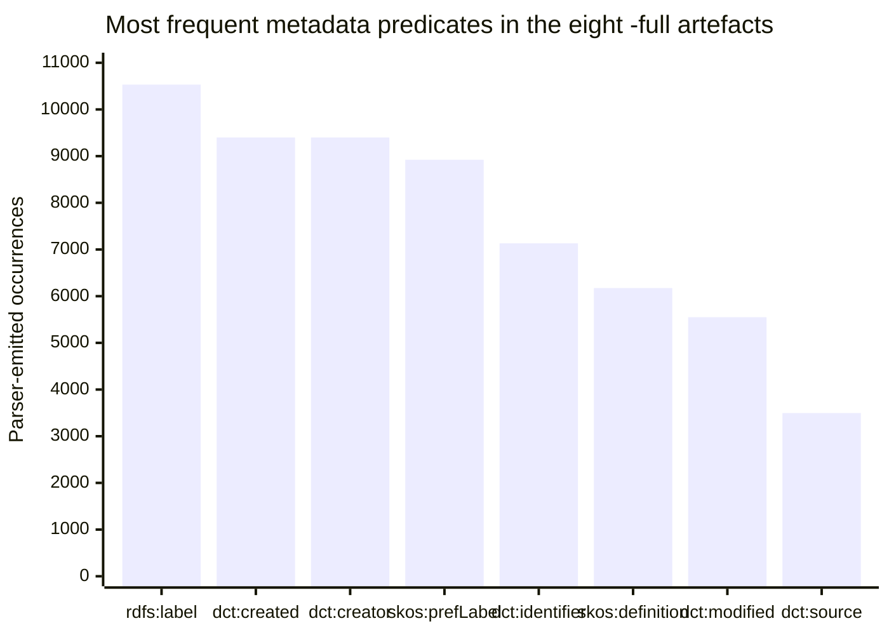
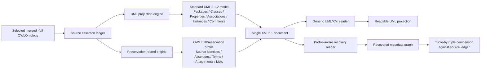
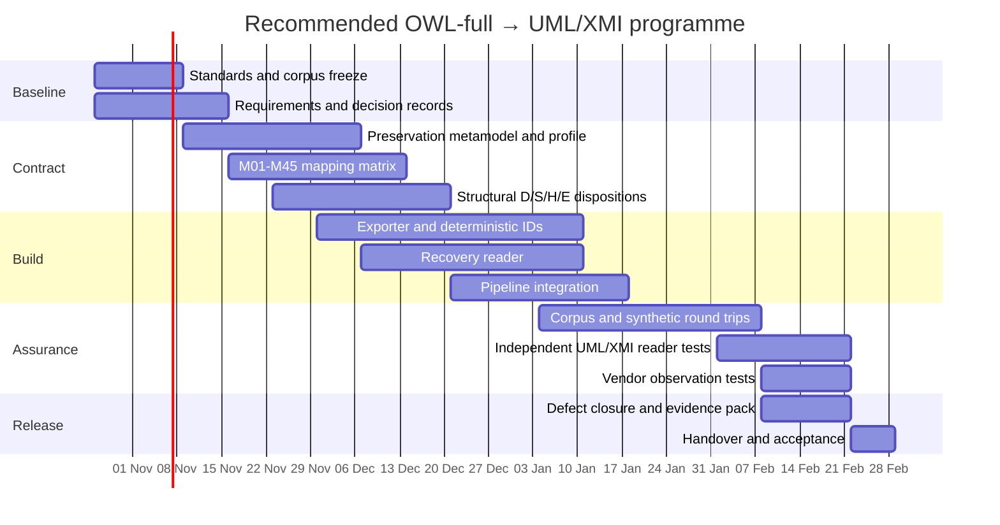
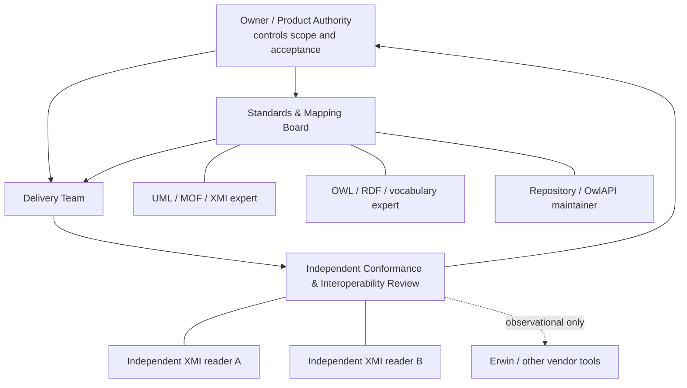

# Deep Research Report: Lossless OWL “-full” to UML 2.1 / XMI 2.1 Metadata Interchange

## Executive summary

The brief is unusually mature as a requirements and evidence document. It defines a narrow preservation boundary, distinguishes source semantics from proposed UML representations, inventories the relevant corpus empirically, and supplies a substantial acceptance-test catalogue. Its central requirement is not “translate OWL into UML” in the general sense; it is more precise: **produce a UML 2.1-family model, serialised using XMI 2.1, from which every in-scope metadata assertion in a selected flattened `-full` ontology can be reconstructed without changing subject, predicate IRI, value kind, literal lexical form, datatype, language, multiplicity or annotation attachment**. Imported material absent from that selected flattened ontology is explicitly outside scope. fileciteturn0file0

The principal research conclusion is that this requirement **cannot safely be satisfied by ordinary UML names/comments alone, by an unmodified OMG ODM profile alone, or by `xmi:Extension` alone**. UML 2.1.2 defines `Comment` as textual annotation with no semantic force, while XMI 2.1 explicitly allows consumers to ignore extensions produced by other tools. citeturn24view1turn24view3 Conversely, the OMG ODM RDF/OWL profile contains valuable constructs for RDF nodes, literals, statements and triples, but ODM 1.1 normatively references UML 2.4.1, MOF 2.4.1 and XMI 2.1.1 rather than the requested strict UML 2.1/XMI 2.1 coordinate; its literal profile also imposes Unicode NFC, which is stronger than this project's “do not silently normalise lexical text” preservation contract. citeturn26view2turn22view2

I therefore recommend a **dual-layer, single-XMI architecture**:

1. a standards-readable **UML 2.1.2 projection layer**, using ordinary packages, classes, properties, associations, generalisations, instance specifications, dependencies and comments only where their UML semantics are justified; and
2. a small, versioned **project preservation profile/backbone**, represented by ordinary UML elements plus stereotype applications, which carries an authoritative typed assertion graph for every in-scope value—including axiom annotations, nested annotations, anonymous nodes, exact literal lexical forms, unknown future predicates and source-to-UML correspondence.

The preservation layer should be authoritative for reverse reconstruction; the normal UML layer should be a navigable projection. `xmi:Extension` should be restricted to non-authoritative exporter/tool bookkeeping unless a deliberately documented fallback is required. This design follows the spirit of OMG's own ODM analysis: mappings between ontology and modelling formalisms are inherently project-sensitive because different metamodel structures generate “structure loss”, and OMG consequently made its UML↔OWL mapping informative rather than normative. citeturn26view1turn25view3

For the requested standards baseline, the strongest defensible choice is **UML 2.1.2 + XMI 2.1**. OMG lists the UML 2.1.2 Superstructure and Infrastructure as normative and points its normative machine-readable resources to the 20061012 CMOF files. Critically, the normative L2 merged resource itself declares the UML package URI as `http://schema.omg.org/spec/UML/2.1.1/uml.xml`, while declaring XMI 2.1. The implementation should therefore pin that exact machine-readable URI rather than inventing a `/2.1.2/` UML namespace. citeturn24view5turn24view0 XMI should use the normative `http://schema.omg.org/spec/XMI/2.1` namespace. citeturn24view0turn24view6

The brief provides no project deadline, budget, geographic deployment boundary or industry-sector boundary. Those are **unspecified**. It does, however, define extensive qualitative success conditions. I recommend converting these into formal gates, with the primary release KPI being **100% recovery of every in-scope preservation tuple across all eight controlling `-full` artefacts and all synthetic edge-case fixtures, with zero silent drops or attachment changes**. The current corpus comprises eight full artefacts with 129,073 parser-emitted statement events and 85 observed predicates; together with the historical authored corpus the research register covers 98 predicates. fileciteturn0file0

For planning, an **18-week implementation from 26 October 2026 to 28 February 2027** is credible for an expert team, with an indicative UK-market planning envelope of approximately **£280,000 ex VAT including 15% contingency**. This is an analytical estimate, not a budget contained in the brief. The programme should not exit design until the profile/metamodel coordinate, assertion identity scheme, lexical encoding rule, axiom-attachment scheme and inverse recovery algorithm have all been frozen.

A further research correction should be entered into the evidence register before implementation. The brief records that Schema.org's `position` page showed development version V30.1 dated 16 September 2026 when inspected. At the present retrieval, however, the official `position` page reports V30.0 dated 19 March 2026, and Schema.org's official release listing says 30.0 is the current published release. The semantic meaning of `position` remains “position of an item in a series or sequence”, but the brief's source-version provenance should be requalified rather than copied unchanged. citeturn28view0turn29view0

**Overall judgement:** proceed. The project is technically feasible **if “lossless” is defined as the brief defines it—lossless recovery of the selected flattened ontology's represented metadata, not semantic equivalence between OWL and UML and not byte-for-byte RDF/XML preservation**. fileciteturn0file0 The single most important architectural decision is to treat the UML projection as a view and the typed assertion layer as the preservation authority.

## Brief extraction and requirements baseline

The following table consolidates the explicit commission without enlarging it. Where the brief is silent, that absence is shown rather than filled by assumption. All entries in this table are extracted from the attached brief. fileciteturn0file0

| Category | Explicit brief content | Assessment |
|---|---|---|
| **Primary objective** | Design a standards-led UML 2.1-family model, serialised with XMI 2.1, for the selected flattened ontologies | Explicit |
| **Preservation objective** | Recover subject, predicate IRI, value kind, literal lexical text, datatype, language, multiplicity and annotation attachment from the export | Explicit; controlling success definition |
| **Scope boundary** | The selected generated `-full` ontology is the complete preservation scope | Explicit |
| **Imported content** | Do not revisit original imports to recover omitted headers, provenance, authorship, document boundaries, import graph or syntax | Explicit exclusion |
| **Namespace rule** | A different namespace on the subject does not remove already-present `-full` metadata from scope | Explicit |
| **Historical corpus** | Historical authored ontologies are a supplementary field catalogue only; absent historical values must not be added | Explicit |
| **Logical-equivalence claim** | Full OWL↔UML logical equivalence is not promised | Explicit exclusion |
| **Original syntax/bytes** | XML bytes, prefixes, comments, indentation, entity-reference spelling and deleted history need not survive | Explicit exclusion |
| **Standards constraint** | UML 2.1-family and XMI 2.1; exact correction level/metamodel/namespaces must be settled by expert | Explicit |
| **Representation constraint** | Metadata-preserving values must be inside the exported representation; a sidecar cannot be their only repository | Explicit |
| **UML semantic constraint** | Do not infer UML semantics merely from visual resemblance; candidate destinations require justification | Explicit |
| **Identity constraint** | Source IRI, UML identity and XMI document ID must remain distinct | Explicit |
| **XMI/XML constraint** | IDs must be legal and unique; XML escaping/normalisation must not change recovered values | Explicit |
| **Unknown-field constraint** | Future metadata predicates need generic typed fallback or explicit rejection, never silent omission | Explicit |
| **Failure rule** | Unrepresentable information must cause a specified failure or explicit loss report | Explicit |
| **Vendor constraint** | No commercial importer is the conformance oracle; Erwin may later be observed but does not define the design | Explicit |
| **Industry sector** | No business vertical is specified | **Unspecified**; technical domain is ontology/model interoperability |
| **Geographic scope** | None stated | **Unspecified**; UK/EU evidence is therefore prioritised here |
| **Budget** | None | **Unspecified** |
| **Delivery deadline** | None | **Unspecified** |
| **Project start** | None | **Unspecified** |
| **Prepared/research date** | 25 October 2026 | Explicit document date, not a delivery schedule |
| **Quantitative service levels** | None for runtime, file size, memory or throughput | **Unspecified** |
| **Success criteria** | Extensive acceptance-evidence list covering recovery, attachments, identities, XML/XMI correctness, independent readers, deterministic output and failure handling | Explicit, mainly pass/fail rather than threshold-based |

The brief's eight explicit deliverables are unusually concrete: select the exact UML/XMI coordinates; provide the XML template and profile/metamodel dependencies; supply field-by-field mappings; dispose explicitly of historical/declaration-only fields; cover structural predicates and entity/axiom kinds; compare standard UML, ODM, a project profile and XMI extensions; preserve metadata inside the export; and provide conformance/interoperability tests and inverse recovery. fileciteturn0file0

**Explicit objectives, organised for programme management.** The commission can be decomposed without changing its intent into six objectives:

| Objective | Consolidated requirement | Principal outputs |
|---|---|---|
| **O-A Standards baseline** | Resolve “UML XML 2.1” into exact UML correction level, metamodel, XMI version and namespaces | Standards decision record; namespace manifest; normative citations |
| **O-B Lossless metadata contract** | Define an exact reversible representation for every in-scope metadata value | Project profile/backbone; XML template; M01–M45 mapping matrix; inverse algorithm |
| **O-C Structural and semantic coverage** | Ensure axioms, restrictions, lists, anonymous nodes, individuals, properties, datatypes and nested annotations do not lose metadata | S01–S34 coverage matrix; D01–D09 treatment; axiom-target scheme; generic fallback |
| **O-D Interoperability** | Provide useful UML while distinguishing standard UML, ODM-derived concepts, project-specific semantics and extensions | Mechanism comparison; dependencies; independent-reader specification |
| **O-E Implementable generation** | Integrate projection into the current merged-ontology pipeline with safe IDs, deterministic output and XML-safe lexical retention | Exporter/recovery implementation; ID policy; build integration; loss report |
| **O-F Verification and governance** | Demonstrate recoverability independently of a proprietary tool | Round-trip harness; conformance suite; independent-reader tests; release evidence |

**Assumptions explicitly imposed by the brief** include that the selected `-full` ontology is authoritative for preservation; imports are not re-acquired; historical source files do not contribute absent current values; parsed RDF/OWL term identity rather than RDF/XML spelling is preserved; unknown future metadata must be handled generically; and a reader implementing the declared contract—not a particular vendor product—is the recovery authority. fileciteturn0file0

The empirical baseline is substantial enough to design against rather than relying on synthetic examples alone. The eight `-full` artefacts comprise 129,073 statement events and 85 distinct predicates with no parser failures; the 164 maintained authored files comprise 520,884 statement events and 78 distinct predicates with no parser failures; their union contains 98 predicates. The full-file register divides these into 45 metadata fields, nine supporting temporal data predicates and 31 structural predicates, with additional historical-only and declaration-only entries catalogued separately. fileciteturn0file0



The distribution matters architecturally: the preservation mechanism is not an edge feature for a handful of comments. Labels, creator/date metadata, identifiers, definitions and source annotations occur thousands of times, while `dcterms:source`, `schema:position`, `skos:note`, examples and deprecation can attach to axioms rather than merely to named UML-like entities. fileciteturn0file0

**Stakeholders.** Explicit human/organisational stakeholders are the owner, whose full-only clarification controls scope, and the commissioned UML/MOF/XMI/OWL/RDF interoperability expert. Erwin is explicitly only a possible later observation point. The brief also implies operational stakeholders—Universal Ontology maintainers, exporter/recovery developers, conformance testers and downstream UML/XMI consumers—but those roles are inferred from the required work rather than named as formal project stakeholders. OwlAPI is a technical dependency rather than a stakeholder. fileciteturn0file0

## Standards, literature and policy evidence

**UML/XMI baseline.** UML 2.1.2 is the logical correction-level choice because OMG identifies it as the formal 2.1-family release and publishes both its Superstructure and Infrastructure as normative documents. The same catalogue identifies the 20061012 CMOF files as the normative machine-readable UML resources. citeturn24view5 The normative merged L2 CMOF begins with XMI 2.1 and declares its UML package URI as:

```text
XMI namespace:
http://schema.omg.org/spec/XMI/2.1

UML L2 package URI in the normative machine-readable resource:
http://schema.omg.org/spec/UML/2.1.1/uml.xml
```

That is an important versioning nuance: **“UML 2.1.2” is the selected specification correction level, while the machine-readable metamodel resource still identifies its UML package with the 2.1.1 URI**. The implementation should preserve that distinction rather than fabricating a `2.1.2` namespace. citeturn24view0turn24view5

XMI 2.1 is separately formalised by OMG. Its `xmi:id` is of XML Schema type `xsd:ID`, and the specification states that its value is unique within the XML document but need not be globally unique. citeturn24view4 XML Schema defines `ID` as derived from `NCName`, meaning arbitrary OWL IRIs such as colon-bearing IRIs cannot simply be copied into `xmi:id`. citeturn23view2turn23view3 The brief's requirement to keep source IRI and XMI ID separate is therefore not merely stylistic—it prevents an actual XML/XMI validity error. fileciteturn0file0

**Why UML comments are insufficient.** UML 2.1.2 defines a `Comment` with a `String [0..1]` body and zero or more annotated elements, but explicitly says a comment carries no semantic force. citeturn24view1 A UML comment can therefore be an excellent human-readable projection of `skos:definition`, `rdfs:comment`, `skos:scopeNote` or related documentation, but it cannot by itself encode the source predicate, literal datatype, language, value kind, multiplicity, source axiom identity or nested annotation attachment. That is exactly why the brief's proposed “comment plus typed original record” pattern is well founded. fileciteturn0file0

**Why a project profile is standards-consistent.** UML 2.1.2 Infrastructure defines a Profile as a limited extension of a reference metamodel, primarily through stereotypes, and states that it cannot operate independently of its reference metamodel. citeturn24view2 A small project profile is therefore the correct UML-native mechanism for declaring explicit source identity, assertion records, term kinds, provenance links and recovery semantics that are not themselves ordinary UML semantics. The profile must, however, ship with the XMI or be an unambiguous resolvable dependency; otherwise a profile-aware reader cannot interpret the stereotype applications. citeturn24view2

**ODM is valuable precedent but not a drop-in answer.** ODM 1.1 makes its RDF and OWL UML Profiles normative and its UML↔OWL QVT mapping informative. citeturn22view0turn25view3 Its RDF profile is strikingly close to several project needs: it models blank nodes, RDF graphs, literals with language/datatype, reified statements and triples, and permits triples to be represented using UML comments, dependencies, instance specifications or slots. citeturn22view2turn22view3

Two incompatibilities make an **unmodified “just use ODM 1.1” strategy unsafe**, however. First, ODM 1.1's normative reference set points to MOF 2.4.1, UML 2.4.1 and XMI 2.1.1, not the brief's requested strict UML 2.1/XMI 2.1 baseline. citeturn26view2 Second, ODM's literal stereotype requires a Unicode Normal Form C string, while the project brief explicitly forbids silent Unicode normalisation where doing so would alter the recoverable lexical text. citeturn22view2 Consequently, ODM should be used as **design precedent and a source of reusable concepts**, with any adopted concepts explicitly ported/adapted into the project profile and with the deviations recorded.

This conclusion is consistent with OMG's own rationale. ODM says translation between metamodels encounters “structure loss” where no one-to-one target element exists; it makes mappings informative because particular projects have additional constraints and will often make different choices. citeturn26view1 Its informative OWL→UML mapping itself demonstrates the danger: some OWL restrictions are represented as anonymous UML classes plus comments, and some mappings are explicitly partial or application-specific. citeturn26view0 That is useful as a projection technique but unacceptable as the sole preservation channel under this brief.

**XMI extensions are a fallback, not a preservation authority.** XMI 2.1's Extension element is explicitly designed for information outside the user model, uses lax content processing, and includes an `extender` so tools may ignore other tools' extension content. citeturn24view3 Thus an `xmi:Extension` payload can be standards-valid yet disappear from a vendor round trip. The project may use extensions for generator version, diagnostics or perhaps redundant recovery information, but **authoritative source metadata should remain in the UML model/profile representation** unless a documented interoperability tier explicitly permits otherwise.

**RDF/OWL attachment semantics require first-class assertion identity.** OWL 2 permits annotations on ontologies, axioms and IRIs, while OWL's RDF mapping identifies annotated axioms through a complete annotated-source / annotated-property / annotated-target structure. Nested annotations introduce additional annotation nodes rather than collapsing onto the subject. citeturn11view2turn11view3turn11view4 Hence a recovery key based merely on “class + predicate” is inherently insufficient. The preservation model needs an assertion or axiom record that identifies the complete source structure.

**XML encoding is part of the fidelity problem.** XML 1.0 normalises physical line endings, and attribute-value processing can change whitespace depending on how values are encoded and typed. citeturn23view0turn23view1 This supports an important refinement to the brief: the authoritative lexical value should not rely on an arbitrary XML attribute's visible text. I recommend a deterministic UTF-8/base64 representation for the authoritative literal lexical form, with optional decoded display text as a convenience. This is project-specific, but it gives an exact reversible path for tabs, carriage returns, leading/trailing whitespace, empty strings and characters troublesome in XML markup without conflating XML escaping with value preservation.

**UK/EU policy context.** No geographic scope is specified, so UK and EU sources are contextual rather than controlling. The UK's Data Standards Authority exists specifically to improve cross-government data interoperability through common standards, with governance involving a steering board and peer review by subject-matter experts; GOV.UK also identifies open standards as a mechanism for consistent cross-government integration. citeturn21view1 That supports the proposed governance model of standards decision records plus independent review.

At EU level, Regulation (EU) 2024/903—the Interoperable Europe Act—is in force and establishes measures for a high level of public-sector interoperability across the Union. citeturn21view0 It does not automatically regulate this private technical conversion project, but it is policy evidence that semantic and technical interoperability should be treated as governed properties rather than merely successful import into a single product.

DCAT-AP is a particularly relevant European analogue because the input corpus itself contains DCAT metadata. The European Commission describes DCAT-AP as a profile based on W3C DCAT that enables metadata exchange between portals while allowing systems to keep their own underlying storage; it explicitly uses required/recommended/optional properties and conformance statements. citeturn21view2 The lesson is directly transferable: **profile a standard for a specific interoperability purpose, but do not pretend the profile changes the underlying vocabulary's meaning.**

## Objective-by-object analysis and comparable cases

Five comparable cases provide a useful evidence base. Three come from actual OMG ODM proof-of-concept implementations, one from OMG's own transformation design, and one from the European Commission's production metadata-profile approach. The first four are technically closest to this project; the fifth is a governance/interoperability analogue.

| Case | Context | Intervention | Reported outcome/evidence | Lesson for this project |
|---|---|---|---|---|
| **C1 — DSTC/Web-KB, dMOF and TokTok** | Early MOF/UML/knowledge-representation research | Implemented parts of the ODM model in dMOF/TokTok; Web-KB implemented many underlying concepts | OMG reports the prototypes were used to validate parts of the specification and expressive power of the model | Prototype against real metamodel constructs before freezing the mapping |
| **C2 — IBM Semantics Toolkit / EODM** | Programmatic OWL/RDFS manipulation | EMF-generated Java APIs from OWL and RDFS metamodels; ontology manipulation/inference | OMG records EODM as an open-source Eclipse/EMF project and evidence for portions of ODM | A typed metamodel/API can bridge graph semantics and model tooling more reliably than display-only conversion |
| **C3 — Sandpiper Visual Ontology Modeler** | UML-based ontology engineering | UML/MOF add-in with forward and reverse OWL engineering | OMG records forward/reverse engineering support and work towards UML2/MOF2/ODM environments | Reverse recovery must be designed with the forward mapping, not added afterwards |
| **C4 — OMG ODM UML↔OWL QVT mapping** | Standards-based model transformation | Informative QVT mappings between UML and OWL | OMG deliberately makes the mappings informative; documents partial mappings, application-specific datatype decisions and structural differences | No generic UML↔OWL transformation should be advertised as universally lossless |
| **C5 — EU DCAT-AP** | Cross-border metadata interoperability | Application profile over W3C DCAT and controlled vocabularies | Enables standardised metadata exchange while source portals retain their own systems | Project profiles can improve interoperability without redefining source vocabulary semantics |

C1–C3 are documented in ODM's proof-of-concept section. citeturn22view0 C4 is grounded in ODM's explicit distinction between normative profiles and informative transformations and its discussion of structure loss. citeturn26view1turn26view0 C5 is documented by the European Commission's SEMIC programme. citeturn21view2

The following assessment satisfies the “for each objective” requirement by tying evidence, cases, risks and KPIs directly to each objective.

| Objective | Evidence-based assessment and literature/policy basis | Comparable-case lessons | Primary risks and mitigation | Recommended measurable KPIs |
|---|---|---|---|---|
| **O-A Standards baseline** | UML 2.1.2 is OMG's formal 2.1 correction level; its machine-readable L2 package retains a 2.1.1 URI. XMI 2.1 is separately normative. Profiles require an identified reference metamodel. citeturn24view5turn24view0turn24view2 | C1, C2 and C3 show dependence on precise MOF/UML tooling generations; C4 shows mappings can span differing metamodel coordinates; C5 shows profiles require controlled versioning | **Risk:** inventing a UML namespace or mixing 2.1/2.4 resources. **Mitigation:** immutable standards manifest; checksum shipped profile/metamodel resources; automated namespace gate | 100% of namespace/metamodel references resolve to the approved manifest; zero undeclared OMG version dependencies; standards decision signed before build |
| **O-B Lossless metadata contract** | UML Comments do not carry source semantics; RDF literals distinguish lexical form/datatype/language; XML normalisation can alter naïvely encoded values. citeturn24view1turn23view1 | C2 illustrates typed APIs; C3 demonstrates value of reverse engineering; C4 exposes lossy mappings; C5 demonstrates profile-based metadata contracts | **Risk:** lexical coercion, overwrites, language loss, datatype collapse. **Mitigation:** assertion records; term-kind discriminator; UTF-8/base64 lexical authority; separate display projection | 45/45 M-fields mapped; 100% literal byte-equivalent UTF-8 recovery; 100% IRI/literal/blank distinction; 100% repetition retained |
| **O-C Structural/semantic coverage** | OWL annotation mapping depends on complete annotated source/property/target structure and nested annotations; ODM itself models reified statements and triples. citeturn11view4turn22view3 | C1–C4 all show need for explicit structural metamodels; C5 reinforces typed relationships rather than text flattening | **Risk:** metadata moved from axioms to classes; complex restrictions strengthened or weakened in UML; blank-node collapse. **Mitigation:** preserve complete source assertion independently of any UML projection; explicit attachment kind; structural record for unsupported constructs | 34/34 S-register predicates have disposition; 9/9 D-fields covered; all named/anonymous/axiom test kinds pass; zero arbitrary “nearest class” attachment |
| **O-D Interoperability** | XMI extensions may be ignored; profiles are standard UML extension mechanism; ODM 1.1 itself is not version-compatible as a strict drop-in for UML 2.1/XMI 2.1. citeturn24view3turn24view2turn26view2 | C1–C4 show tool/ecosystem variability; C5 shows interoperability comes from a declared contract and conformance profile | **Risk:** one vendor reads core UML but drops profile data. **Mitigation:** core model readable independently; recovery tested by profile-aware reference reader; extension data non-authoritative; re-export claims scoped per tool | At least two independent UML/XMI readers load core model; reference recovery reader achieves 100%; zero authoritative values stored only in `xmi:Extension` |
| **O-E Implementable generation** | Brief already identifies merged `OWLOntology` as the appropriate fork point before OWL serialisation and warns against DOM/browser-layout dependence. fileciteturn0file0 XMI IDs must be legal `xsd:ID`/NCNames. citeturn24view4turn23view2 | C2's generated EMF APIs support model-first implementation; C3 shows forward/reverse implementation must share conventions; C4 highlights identity-generation difficulty; C1 validates prototyping before standardisation | **Risk:** unstable IDs, role collisions, extra reparsing, dependency drift. **Mitigation:** deterministic role-scoped ID function, collision test, same in-memory merged ontology, pinned OwlAPI revision | 8/8 controlling artefacts export; repeated identical runs produce identical semantic recovery and deterministic IDs; zero duplicate/invalid `xmi:id`; no re-acquisition of imports |
| **O-F Verification/governance** | Brief already separates XML validation, UML validity, profile conformance, logical correctness, metadata recoverability and consumer acceptance. fileciteturn0file0 UK DSA uses steering and expert peer-review governance for interoperability standards. citeturn21view1 | C1–C3 are themselves proof-of-concept evidence; C4 warns against overclaiming semantics; C5 makes conformance explicit | **Risk:** “imports successfully” becomes a false lossless claim. **Mitigation:** independent recovery comparison against source ledger; separate conformance certificates; explicit loss report | 100% mandatory fixtures pass; zero silent losses; all release claims trace to a named test; two-reader evidence retained; any tool round-trip claim tested independently |

Several deeper findings cut across the objectives.

First, **logical projection and preservation must be decoupled**. ODM itself notes material differences between OWL and UML and documents OWL constructs without straightforward UML equivalents. citeturn25view3turn26view0 The brief correctly warns, for example, that absent OWL maximum cardinality is not evidence for UML `0..1`, that qualified cardinality is not automatically a total UML multiplicity, and that dependencies, compositions and database keys must not be inferred merely because they look convenient. fileciteturn0file0

Second, **identity requires more engineering than naming**. ODM's informative mapping explicitly calls identifier generation a critical problem and observes that reusing an ontology URI as a UML package identifier conflates objects that can evolve independently. citeturn25view3 This independently validates the brief's separation of source IRI, UML identity and XMI identity.

Third, **ODM's design should be mined selectively**. Its `literal`, `blankNode`, `statement`, `triple`, `referenceNode` and `reifies` concepts are directly relevant, but the project should not claim ODM 1.1 profile conformance unless it actually adopts the required UML 2.4.1/MOF 2.4.1/XMI 2.1.1 dependency set—which would violate the controlling baseline. citeturn22view2turn22view3turn26view2 A documented “ODM-informed project profile” is more honest and technically safer.

## Recommended target architecture and mapping contract

The recommended architecture keeps **projection semantics**, **source preservation semantics** and **serialisation mechanics** deliberately separate.



The source assertion ledger should be produced **before** display selection or UML projection. It is the internal audit baseline. For every in-scope assertion it should retain the source subject, exact predicate IRI, object kind and object content, plus recursive annotation attachment and explicit order where order exists. This directly implements the preservation contract in the brief. fileciteturn0file0

**Recommended preservation metamodel.** The smallest useful project profile/backbone contains approximately the following conceptual types:

| Project concept | Recommended UML carrier | Core fields | Purpose |
|---|---|---|---|
| `SourceIdentity` | Stereotype applicable to relevant UML `Element` | source node kind, source IRI or scoped anonymous key, OWL role(s) | Links readable UML element to source identity |
| `Assertion` | Stereotyped `InstanceSpecification` | subject ref, predicate IRI, value ref, attachment kind, parent annotation ref | Authoritative assertion identity |
| `IriTerm` | Stereotyped `InstanceSpecification` | exact absolute IRI | Preserves IRI node as node, not string literal |
| `LiteralTerm` | Stereotyped `InstanceSpecification` | lexical payload, datatype IRI, language field | Exact literal recovery |
| `BlankTerm` | Stereotyped `InstanceSpecification` | deterministic model-scoped key | Anonymous-node correspondence |
| `ListPosition` | Stereotyped instance or slot | list identity, zero/one-based position declared by contract, item ref | Ordered RDF-list reconstruction |
| `ProjectionLink` | Stereotyped dependency or property | source assertion/axiom ref, UML element ref, projection rule | States what readable UML element derives from what source structure |
| `ExportManifest` | Model/package-level stereotype | contract version, generator build, standards manifest, source artefact hash | Exporter metadata, explicitly separate from source metadata |

This design uses UML's standard profile mechanism for project-specific semantics. UML 2.1.2 explicitly supports stereotypes as limited metaclass extensions. citeturn24view2 The authoritative assertion should **not** be encoded only as a formatted paragraph in a `Comment`, because UML comments have no source-predicate semantics. citeturn24view1

**Authoritative literal representation.** I recommend:

```text
valueKind      = "literal"
lexicalEncoding = "utf8-base64"
lexicalPayload  = Base64(UTF-8(exact parsed lexical string))
datatypeIri     = exact datatype IRI
language        = exact parsed language value if present
```

A readable decoded text value may also be projected into a UML Comment or selected name, but it is not authoritative. The encoding should be deterministic, use standard padded base64, perform no Unicode normalisation, and fail explicitly if the implementation somehow receives a character sequence that cannot be represented under the chosen Unicode/UTF-8 contract. This avoids XML's line-ending and attribute normalisation changing the recovery value. citeturn23view0turn23view1

For ordinary values such as `xsd:integer`, `xsd:decimal`, dates and booleans, the exporter may additionally derive typed UML values for presentation or analysis, but the original lexical representation remains authoritative. Therefore `"01"^^xsd:integer` and `"1"^^xsd:integer` remain distinguishable even though their datatype value is mathematically equal. That requirement comes directly from the brief's acceptance criteria. fileciteturn0file0

**Identity policy.** A practical deterministic XMI identifier should be generated from a role-qualified canonical key rather than copied from the IRI:

```text
xmi:id =
  "u_" + roleCode + "_" +
  base32(first128bits(SHA-256(canonicalSourceKey)))
```

The `u_` prefix guarantees an NCName-compatible start; a restricted Base32 alphabet avoids colon and punctuation; role qualification avoids a class, association, association end and assertion derived from the same IRI colliding. A full collision table should be maintained during generation. This is a project convention, not an OMG requirement. The OMG requirements are that XMI IDs use `xsd:ID` and are document-unique. citeturn24view4turn23view2

The source IRI should remain in `SourceIdentity.sourceIri` and never be inferred from the generated XMI ID. Where one OWL IRI is punned in multiple roles, distinct UML elements receive distinct XMI IDs but the same retained source IRI plus explicit source-role values. fileciteturn0file0

**Mapping policy by field family.** The 45 main fields need individual rows in the final project matrix, but their implementation can reuse a small number of authoritative mechanisms.

| Field family | Main-register examples | Readable UML projection | Authoritative recovery representation |
|---|---|---|---|
| Human-readable labels/titles | M18 title, M23 label, M29 altLabel, M34 hiddenLabel, M37 prefLabel, M45 acronym | selected `NamedElement.name`, comments or presentation tags | one `Assertion` + exact `LiteralTerm` per source value |
| Documentation | M05 description, M21 comment, M30 changeNote, M31 definition, M32 editorialNote, M33 example, M35 historyNote, M36 note, M38 scopeNote | categorised UML Comments | distinct predicate-bearing assertion records |
| Agents | M02 contributor, M04 creator, M12 publisher | optional dependencies/labels | exact IRI/literal term; do not invent UML Actor semantics |
| Dates | M03 created, M11 modified | optional display property | lexical payload + exact `xsd:date`/`xsd:dateTime` |
| Identifiers/versioning | M07 identifier, M26 priorVersion, M27 versionIRI, M28 versionInfo | optional properties/dependencies | original IRI/literal term, independent from `xmi:id` |
| Rights | M01 accessRights, M10 license, M15 rights | readable tagged display | separate source predicates and exact resource IRIs |
| Provenance/relations | M08/M14 replacement, M13 references, M16 source, M17 subject, M22 isDefinedBy, M24 seeAlso | profiled Dependency where semantically justified | directed source assertion with exact predicate |
| State flags/order | M20 schema:position, M25 deprecated | visual ordering/badge | exact literal, datatype and actual axiom/entity attachment |
| Catalogue/DCAT | M39–M44 | dataset/distribution instances and links | typed source relationship; never collapse distribution into ontology |
| Namespace preference | M19 VANN prefix | presentation namespace table | exact literal assertion |

These families do **not** replace the required row-by-row matrix: each M01–M45 row still needs to identify subject applicability, exact profile property/XML path, target multiplicity, inverse logic and fixture. The grouping merely prevents 45 independent ad-hoc mechanisms. fileciteturn0file0

**Supporting and historical registers.** D01–D09 should remain ordinary source assertions, preferably projected as InstanceSpecification/Slot values where meaningful, but their typed originals should still participate in the generic assertion ledger. H01–H10 are mappings prepared for future/historical compatibility; they must not generate any assertion unless the selected `-full` input actually contains that predicate. E01 `dcterms:isVersionOf` should have a mapping rule but zero generated occurrence for the current corpus. fileciteturn0file0

**Structural predicates.** S01–S34 should be treated differently from documentation fields. Where there is an exact or well-justified UML projection—such as named-class `rdfs:subClassOf` to `Generalization`—the export can create it. Complex restrictions, qualified cardinalities, disjointness, equivalence, anonymous class expressions and list structures should retain a complete preservation record even when the human-facing UML representation is partial. ODM's own informative mapping illustrates why: its treatment of restrictions, domains/ranges and datatype mapping is necessarily conditional and incomplete. citeturn26view0turn25view1

**Mechanism decision.**

| Mechanism | Recommended status | Reason |
|---|---|---|
| Standard UML classes/properties/associations/generalisation/instances | **Use extensively for projection** | Highest generic UML readability |
| UML Comments | **Use for presentation only** | No semantic force; cannot identify original metadata predicate fully citeturn24view1 |
| ODM 1.1 profile | **Do not apply unchanged** | Valuable precedent, but dependency baseline is UML 2.4.1/MOF 2.4.1/XMI 2.1.1 and literal constraints conflict with exact lexical preservation citeturn26view2turn22view2 |
| ODM concepts | **Reuse selectively with explicit attribution/adaptation** | RDF nodes/triples/reification/literal patterns are strong design precedents citeturn22view2turn22view3 |
| Small project UML profile | **Primary preservation mechanism** | Standards-native extension mechanism and exact project contract citeturn24view2 |
| `xmi:Extension` | **Non-authoritative only** | Consumers are permitted to ignore extensions citeturn24view3 |
| External original OWL/sidecar | **Optional evidence only** | Useful for audit, but brief explicitly forbids sidecar-only preservation fileciteturn0file0 |

**Corrected evidence point.** Before finalising M20, update the brief's Schema.org provenance record: the official live `position` page currently identifies its expected values as Integer or Text and reports Schema.org V30.0, 19 March 2026; the official releases page likewise lists 30.0 as the latest published release. citeturn28view0turn29view0 This does not invalidate the observed `xsd:integer` values; it only means the research receipt should not state V30.1 unless a preserved historical retrieval proves that claim.

## Implementation, governance, budget, monitoring and contingencies

Because the brief gives no project dates, the following is a **recommended implementation schedule**, not an extracted commitment. It assumes mobilisation on Monday, 26 October 2026 and completes at the end of February 2027. The schedule deliberately front-loads standards and preservation-contract decisions before large-scale exporter coding.



The most important gates are not calendar gates. **Gate A** freezes UML/XMI/metamodel namespaces. **Gate B** approves the assertion/value/attachment model and lexical encoding. **Gate C** requires recovery of the synthetic pathological fixtures before full-corpus optimisation. **Gate D** requires all eight controlling artefacts to recover with zero unexplained differences. **Gate E** adds independent-reader evidence and signs the exact scope of any tool interoperability claims.

The recommended implementation branch should consume the same in-memory merged `OWLOntology` that drives the current `-full` writer rather than serialising RDF/XML and reparsing it merely to construct UML. That follows the integration point already identified in the brief and avoids making RDF/XML DOM layout an accidental transformation API. fileciteturn0file0

**Resource and indicative budget.** No budget is stated in the brief. The table is therefore a planning estimate in GBP, ex VAT, intended for a specialist UK/EU delivery model rather than a quotation.

| Resource | Indicative effort | Planning rate | Estimate |
|---|---:|---:|---:|
| UML/MOF/XMI + OWL technical lead | 45 days | £1,100/day | £49,500 |
| Senior model-transformation/profile engineer | 70 days | £900/day | £63,000 |
| Java/OwlAPI exporter engineer | 60 days | £850/day | £51,000 |
| Conformance/interoperability QA engineer | 45 days | £750/day | £33,750 |
| Standards/research reviewer | 15 days | £950/day | £14,250 |
| Delivery/product coordination | 20 days | £700/day | £14,000 |
| CI, test infrastructure and artefact storage | allowance | — | £8,000 |
| Independent/tool interoperability lab | allowance | — | £10,000 |
| **Base estimate** |  |  | **£243,500** |
| **Contingency, 15%** |  |  | **£36,525** |
| **Recommended planning envelope** |  |  | **≈ £280,000 ex VAT** |

The contingency is especially justified by four uncertainties left open in the brief: the exact project profile design, deterministic anonymous-node identity strategy, third-party profile handling and the degree of logical OWL projection desired beyond metadata preservation. These are technical uncertainties, not evidence that the core recovery problem itself is infeasible.

**Governance.** A lightweight three-body model is appropriate:



The **Owner/Product Authority** controls the full-only boundary and decides whether an unavoidable loss is acceptable. The **Standards & Mapping Board** approves normative-versus-project-specific claims, profile changes, field mappings and semantic projections. The **Delivery Team** owns exporter, recovery reader and tests. The **Independent Review** verifies results without sharing implementation assumptions with the exporter team. This mirrors the principle behind the UK DSA's combination of decision governance and subject-matter peer review, though the DSA itself does not govern this project. citeturn21view1

Each design decision should carry a short Architecture/Mapping Decision Record containing: issue; source construct; standards evidence; selected UML construct; preservation representation; inverse algorithm; status as normative/informative/project-specific; known limitations; fixtures; and approving reviewers. This is particularly important where ODM precedent is being adapted rather than directly conformed to, because ODM itself says project-specific constraints often justify different mappings. citeturn26view1

**Monitoring and evaluation framework.**

| Evaluation dimension | Measure | Baseline | Release target |
|---|---|---:|---:|
| Main metadata mapping coverage | M-register rows with approved mapping | 0 implemented / 45 researched | **45/45** |
| Supporting temporal coverage | D-register rows implemented | 0 / 9 | **9/9** |
| Structural coverage | S-register predicates with explicit disposition | 34 researched | **34/34 implemented/tested** |
| Historical/declaration discipline | H/E fields that leak absent values into current export | N/A | **0** |
| Assertion recovery | In-scope assertions whose subject/predicate/value/attachment recover | not yet measured | **100%** |
| Literal fidelity | lexical/datatype/language mismatches | not yet measured | **0** |
| Node-kind fidelity | IRI ↔ literal ↔ blank-node confusions | not yet measured | **0** |
| Axiom attachment | annotations recovered on wrong axiom/entity | not yet measured | **0** |
| Nested annotations | required recursive fixtures recovered | not yet tested | **100%** |
| XML/XMI identity | invalid/duplicate `xmi:id` | not yet tested | **0** |
| Silent unknown predicate loss | unknown predicates omitted without rejection | not yet tested | **0** |
| Determinism | ID/recovery differences over identical repeated runs | not yet tested | **0** |
| Corpus completion | controlling full artefacts exported/recovered | 0 / 8 | **8/8** |
| Generic interoperability | independent readers loading core UML model | 0 | **≥2** |
| Profile recovery | reference reader recovering preservation contract | 0 | **100%** |
| Tool round-trip claims | claims backed by actual import/re-export evidence | none | **100% of published claims** |

The primary measurement artefact should be a **source/recovery comparison ledger**, not visual inspection. For each source assertion it records an immutable source key and the recovered counterpart. Differences are categorised as missing, extra, subject mismatch, predicate mismatch, node-kind mismatch, lexical mismatch, datatype mismatch, language mismatch, attachment mismatch, ordering mismatch or identity-only difference. A zero-difference ledger is considerably stronger evidence than “the diagram looks correct”.

Conformance results should be reported in separate layers because passing one does not prove another:

| Layer | Question |
|---|---|
| XML | Is it well formed and does value encoding decode correctly? |
| XMI | Are XMI identity/reference rules satisfied? |
| UML | Does the model conform to the selected UML 2.1 metamodel? |
| Profile | Are stereotype applications and property values valid? |
| Preservation | Does inverse recovery reproduce every required source tuple? |
| Logical projection | Is the selected UML view a justified representation of the OWL construct? |
| Tool acceptance | Can a named tool import/view/re-export a declared subset? |
| Tool round trip | Does that tool preserve the specific metadata contract after re-export? |

That separation is essential because XMI itself permits ignored extension data, UML Comments carry no semantic force, and OWL/UML mappings can be structurally lossy. citeturn24view3turn24view1turn26view1

**Contingency plan.**

| Trigger | Contingency | Effect on claim |
|---|---|---|
| ODM construct proves incompatible with UML 2.1 metamodel | Reimplement required concept in project profile over UML 2.1.2; document ODM provenance only | Still UML 2.1.2/XMI 2.1; no ODM-conformance claim |
| Vendor drops stereotype applications | Keep vendor test observational; do not redesign canonical XMI around vendor behaviour | Canonical recovery remains valid; vendor round-trip marked lossy |
| A source construct has no defensible UML counterpart | Produce preservation record only plus optional explanatory Comment | Metadata-preserving, but no logical-equivalence claim |
| Unknown predicate appears | Generic assertion path automatically preserves it; optionally add later display mapping | No silent field loss |
| Unknown datatype appears | Preserve datatype IRI and lexical payload generically | Remains recoverable without UML primitive equivalent |
| XML-hostile lexical value appears | Encode authoritative UTF-8 bytes as base64 | Full lexical recovery retained |
| Deterministic blank-node labelling is unstable | Allocate scoped structural keys through a canonicalisation phase before UML ID creation | Delay deterministic-release gate; do not emit unstable final IDs |
| Profile file unavailable to consumer | Core UML remains readable; package profile alongside XMI and reject “self-contained” claim unless dependency rules are satisfied | Recovery requires declared dependency |
| Performance becomes excessive | Optimise ledger/index implementation without changing mapping semantics; stream output where possible | Performance change only; no fidelity relaxation |
| A value cannot be encoded under the contract | Fail that export or generate explicit field/target-specific loss report | Output cannot be labelled “lossless” until resolved |
| Corpus changes before release | Re-run predicate inventory and unknown-field tests; do not assume 98 predicates remain exhaustive | Contract remains generic; coverage report version increments |
| Source-standard evidence changes | Pin retrieval/version in standards manifest and requalify affected decision | No silent standards drift |

The project should explicitly avoid a tempting but damaging contingency: **never resolve schedule pressure by converting unsupported structures into comments and continuing to call the export lossless**. UML comments cannot carry the source semantics on their own. citeturn24view1

## Appendices, data tables and key references

**Appendix A — preservation-scope inventory.** The brief's empirical corpus establishes the following baseline. Counts are parser-emitted statement events, not deduplicated graph sizes. fileciteturn0file0

| Inventory | Files | Statement events | Distinct predicates | Parser failures |
|---|---:|---:|---:|---:|
| Existing generated `-full` RDF/XML | 8 | 129,073 | 85 | 0 |
| Maintained authored corpus | 164 | 520,884 | 78 | 0 |
| Predicate union | 172 file observations | not applicable as a deduplicated graph | 98 | 0 |

The controlling full artefacts span ISO/IEC 11179-3 edition 4, Universal Core, Universal Extended and Universal Reference Data, at July and September 2026 snapshots. Their exact paths, byte sizes and SHA-256 hashes are supplied in the brief and should be imported verbatim into the eventual automated test manifest rather than recopied manually. fileciteturn0file0

**Appendix B — register completeness.**

| Register | Count | Disposition |
|---|---:|---|
| Main metadata M01–M45 | 45 | Mandatory mapping for current `-full` scope |
| Supporting temporal assertions D01–D09 | 9 | Preserve as ordinary typed assertions; project to UML instances/slots where justified |
| Historical-only H01–H10 | 10 | Mapping readiness only; never manufacture absent current values |
| Declaration-only E01 | 1 | Define rule; no current value occurrence |
| Structural S01–S34 | 34 | Explicit projection/preservation policy required |
| **Union predicates** | **98** | Complete research register for inspected corpus |

The generic fallback remains mandatory despite this finite inventory because the brief expressly limits the completeness claim to the inspected files and future generated models may introduce new metadata predicates. fileciteturn0file0

**Appendix C — observed literal-domain requirements.** The project must not design its value layer only around strings. The corpus includes RDF language strings and numerous XML Schema datatypes, including booleans, dates, date-times, decimals, `gMonth`, integers, positive and non-negative integers, strings and tokens; the historical corpus additionally includes `xsd:anyURI` and the DCMI ISO639-3 datatype. fileciteturn0file0 RDF's term model makes lexical representation, datatype and—where applicable—language distinct parts of literal representation, which supports retaining them separately rather than folding them into a display value. citeturn11view0turn11view1

The full artefacts also contain multilingual values in Arabic, German, English variants, Spanish, French, Italian, Japanese, `kr`, Dutch, Polish, Portuguese, Russian, Chinese and `zxx`, plus untagged literals. The project should preserve supplied language values rather than “correcting” unexpected codes. fileciteturn0file0

**Appendix D — minimum acceptance-fixture set.** The brief already specifies the right classes of test; the implementation should turn them into immutable test data and expected recovery manifests. fileciteturn0file0

| Fixture | Minimum adversarial content | Required assertion |
|---|---|---|
| Ontology header | creator, contributor, dates, licence, rights, version IRI/info | Source metadata remains distinct from exporter metadata |
| Multilingual class | pref/alt/hidden labels in several languages | Selected UML name does not delete alternatives |
| Lexical-values fixture | `"01"^^xsd:integer`, `"1"^^xsd:integer`, whitespace, tabs, CR/LF, Unicode, empty literal | Exact lexical recovery |
| Node-kind fixture | identical character sequence once as IRI and once as `xsd:anyURI` literal | Kinds remain distinct |
| Axiom-source fixture | same subject/predicate with two different targets, each separately annotated | Correct target-specific attachment |
| Nested annotation | annotation on annotation | Recursive attachment preserved |
| Deprecation fixture | entity-level and axiom-level `owl:deprecated` | Attachments remain distinct |
| Punning fixture | one IRI in two or more OWL roles | Distinct UML identities; shared source IRI retained |
| Anonymous fixture | blank target involved in multiple structures | Stable within-model correspondence |
| Restriction fixture | qualified cardinality/anonymous restriction with annotations | No semantic strengthening through UML projection |
| DCAT fixture | dataset with multiple distributions and separate access/download/landing links | Resource distinctions retained |
| Temporal fixture | ordinary OWL-Time individuals and datatype values | Not mistaken for ontology documentation |
| Unknown predicate | new annotation predicate not present in M01–M45 | Generic retention or explicit rejection, never silent drop |
| Tool fixture | profile-aware and generic readers, followed by named-tool re-export | Claims scoped to measured behaviour |

**Appendix E — principal risks ranked.**

| Risk | Probability | Impact | Residual position after mitigation |
|---|---|---|---|
| ODM/UML version mismatch misrepresented as conformance | High | High | Low if ODM is treated as precedent rather than direct dependency |
| Axiom annotation misattachment | Medium | Very high | Low with first-class assertion identity and recovery test |
| Lexical normalisation/coercion | Medium | Very high | Low with authoritative encoded payload |
| Third-party tool removes profile data | High | High | Medium; cannot be eliminated, only measured and scoped |
| OWL semantics strengthened by UML projection | Medium | High | Low if source assertion remains authoritative |
| Unstable anonymous-node/derived IDs | Medium | High | Low–medium after canonicalisation tests |
| Unknown future fields silently omitted | Medium | High | Low with generic assertion fallback |
| File-size growth from preservation records | High | Medium | Medium; acceptable unless non-functional limits are later imposed |
| Incorrect standards namespace | Medium | High | Low with immutable manifest and schema/metamodel tests |
| Dependency drift in OwlAPI/build | Medium | Medium | Low with pinned revision and build receipt |
| Vendor-specific design pressure | Medium | Medium | Low if conformance authority remains independent |
| Evidence/version drift in external vocabularies | Medium | Low–medium | Low with retrieval/version manifests |

**Appendix F — key standards and literature references.**

The core normative reference stack should be kept deliberately short and primary-source-led:

| Authority | Use in project |
|---|---|
| **OMG UML 2.1.2 Superstructure and Infrastructure** | Selected UML semantics and profile mechanism; OMG identifies both as normative. citeturn24view5turn24view1turn24view2 |
| **OMG UML 2.1.2 normative machine-readable CMOF resources** | Metamodel package and exact namespace coordinate; L2 merged CMOF declares the 2.1.1 UML package URI. citeturn24view0 |
| **OMG MOF 2.0/XMI Mapping 2.1** | XMI serialisation, identity and extension behaviour. citeturn24view6turn24view4turn24view3 |
| **OMG ODM 1.1** | Normative RDF/OWL profile concepts; informative mapping precedent; explicit evidence of structure-loss issues. citeturn22view0turn26view1 |
| **W3C OWL 2 Structural Specification / RDF Mapping** | Ontology/entity/axiom/annotation structure and exact axiom annotation attachment. citeturn11view2turn11view4 |
| **W3C RDF Concepts** | RDF node and literal model underpinning term preservation. citeturn11view0turn11view1 |
| **W3C XML 1.0 and XML Schema Datatypes** | XML normalisation, lexical/value distinctions and legal XMI IDs. citeturn23view0turn23view1turn23view2 |
| **W3C SKOS / DCAT and DCMI Terms** | Source-vocabulary meanings must remain distinct rather than being collapsed to generic UML documentation |
| **EU DCAT-AP** | Application-profile governance and semantic-interoperability analogue. citeturn21view2 |
| **UK Data Standards Authority guidance** | Governance analogue for standards adoption and peer review. citeturn21view1 |
| **Interoperable Europe Act, Regulation (EU) 2024/903** | Wider EU policy context for governed interoperability; contextual rather than project-controlling. citeturn21view0 |

The strongest literature lesson comes from OMG's own ontology-definition work: a UML profile can bridge UML tooling and ontology modelling, but complete translations between semantically different metamodels encounter structural mismatch, and project-specific constraints legitimately drive mapping choices. citeturn26view1 Its proof-of-concept implementations—DSTC, IBM/EODM and Sandpiper—demonstrated that metamodel-based and forward/reverse approaches are technically practical, while its informative transformation annex simultaneously demonstrates why those approaches should not be mistaken for universal semantic equivalence. citeturn22view0turn26view0

**Final research judgement.** The brief should be approved as the basis for implementation subject to four pre-build amendments: explicitly freeze UML 2.1.2 with the normative machine-readable UML 2.1.1 package URI and XMI 2.1 namespace; classify ODM 1.1 as design precedent rather than a directly conformant project profile; adopt an authoritative reversible literal encoding and first-class assertion/annotation model; and requalify the Schema.org V30.1 provenance statement against the currently published V30.0 evidence. citeturn24view0turn26view2turn28view0turn29view0

With those decisions made, the project has a defensible route to the precise form of “lossless” actually commissioned: **the generated XMI can remain recognisably standard UML for ordinary consumers while carrying a formally recoverable, project-profiled representation of the selected flattened ontology's metadata, without pretending that UML itself has acquired OWL semantics or that arbitrary commercial editing tools will preserve every project-specific construct.**