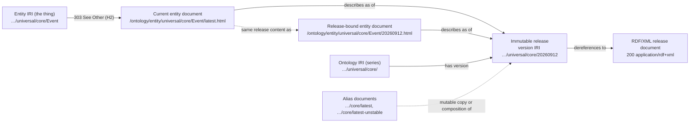
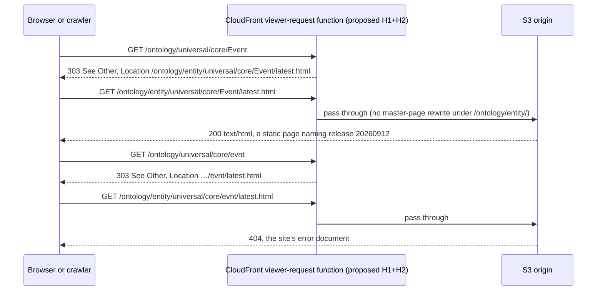
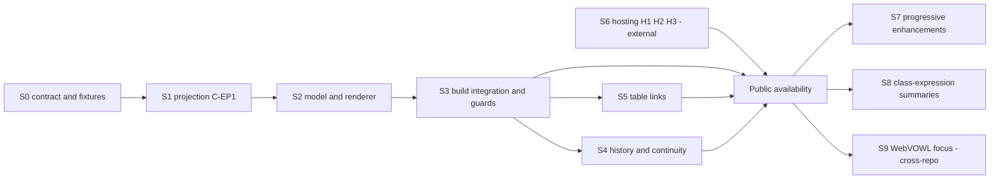

# Universal Ontology entity browser: product and technical design

> **Planning and review only.**
> This document authorizes no implementation, dependency, configuration, hosting, deployment, workflow, commit or publication change.
> Every configuration and hosting item below is an unapproved proposal.

| Item                             | Value                                                                                                                                                                         |
| -------------------------------- | ----------------------------------------------------------------------------------------------------------------------------------------------------------------------------- |
| Request                          | A useful, directly addressable page for every named entity: [Hadden-Industries/universal-ontology#1](https://github.com/Hadden-Industries/universal-ontology/issues/1)        |
| Prepared                         | 21 October 2026; live HTTP observations taken 20–21 October 2026 from one client (CloudFront edge `SOF50`)                                                                     |
| Repository                       | `Hadden-Industries/universal-ontology`, branch `main`, HEAD `eb653e5c598dbe90f019c3f023e8c52f2b767edf` ("Merge repository skill reconciliation refresh")                       |
| Working tree at start            | One pre-existing uncommitted change, `AGENTS.md` (+10/−5 lines). It was read as the binding instruction text and left untouched. This report is the only file this task adds. |
| Related repository (read only)   | `Hadden-Industries/webvowl`, branch `main`, HEAD `6bf89cd45b0c3f0495cd78807f91b0a3e60baa1a`, clean working tree                                                               |
| Parallel semantic review         | Not awaited. Assumptions and the contracts this design needs from it are listed in [§10.5](#105-assumptions-and-contracts-needed-from-the-semantic-consistency-review).        |

## Contents

- [0. Summary](#0-summary)
- [1. Review record](#1-review-record)
- [2. Current state and evidence](#2-current-state-and-evidence)
- [3. Product brief](#3-product-brief)
- [4. Current versus proposed capability matrix](#4-current-versus-proposed-capability-matrix)
- [5. Entity-page information model](#5-entity-page-information-model)
- [6. Page anatomy and annotated layouts](#6-page-anatomy-and-annotated-layouts)
- [7. URL, identity and release decision record](#7-url-identity-and-release-decision-record)
- [8. Release binding, caching and consistency](#8-release-binding-caching-and-consistency)
- [9. WebVOWL handoff](#9-webvowl-handoff)
- [10. Data-contract and ownership map](#10-data-contract-and-ownership-map)
- [11. Alternatives and the recommended smallest useful release](#11-alternatives-and-the-recommended-smallest-useful-release)
- [12. Staged implementation plan](#12-staged-implementation-plan)
- [13. Configuration and hosting changes (unapproved proposals)](#13-configuration-and-hosting-changes-unapproved-proposals)
- [14. Accessibility specification](#14-accessibility-specification)
- [15. End-to-end verification specification](#15-end-to-end-verification-specification)
- [16. Skeptical second pass](#16-skeptical-second-pass)
- [17. Owner decision list](#17-owner-decision-list)
- [18. References](#18-references)
- [Appendix A. Measurement method](#appendix-a-measurement-method)

## 0. Summary

### 0.1 What the evidence shows

1. **The issue's example is a real entity, and no identifier change is needed.**
   `https://haddenindustries.com/ontology/universal/core/Event` is an `owl:Class` described in Universal Core release `20260912`.
   Today that IRI returns HTTP 404, as does the ontology IRI `…/universal/core/`.
   The release documents (`…/core/20260912`, `…/core/latest`) dereference; entities do not.
2. **The website has no entity view.**
   Each release document has one JavaScript-rendered table page that lists only classes and named individuals.
   Properties are never shown.
   Without JavaScript the table is empty.
   A view downloads 0.5–1.5 MB of uncompressed JSON-LD.
   There is no per-entity URL, search, citation helper or WebVOWL link.
3. **An edge rule blocks any new HTML page under `/ontology/`.**
   Every lowercase `*.html` path sampled below `/ontology/` returned the same 200 master page, including `/ontology/does-not-exist.html`.
   This produces soft 404s and would mask any static entity page, so a hosting change is a prerequisite for static entity pages.
4. **Data owners exist and should be extended, not duplicated.**
   The projection policy, the browser-safe query module and its release index, the Node-only Oxigraph context engine and the Python change classifier already own the semantics an entity page needs.
   The browser index omits domain/range, class expressions, examples, dates and deprecation.
   It also merges authored `dcterms:source` values with policy-interpreted `dcterms:references` values.
5. **"Latest" and "active" are distinct and not reconciled.**
   The `latest` alias and the catalog's `latestStableRelease` flag both mean "largest dated file".
   The qualified active set lives in `policy/activation.ttl`.
   The two coincide today (`20260912`), but nothing enforces that.
   The published website catalog marks every release `activePublication: false` because the website build never receives the ownership inventory.
6. **The entity data is irregular, so explicit states matter:**
   - 1,965 owned, described entities in the current releases, including 286 UUID-named dataset and distribution individuals outside module paths;
   - 127 of 222 Core entities without any definition;
   - 73 preferred labels, after normalization, shared by more than one entity ("has address" × 12);
   - 593 historically described IRIs that are absent from the current releases, 198 of which share an authored UUID with a current IRI (for example `core/Account` and `extended/Account`);
   - 12 historical IRI groups that differ only by letter case.
7. **WebVOWL can open an exact release today; it cannot select an entity from a URL.**
   `#iri=<version IRI>` is a supported contract.
   Selection or focus by URL is only named as a future possibility in WebVOWL's ADR 0010 design.
8. **Incidental, out of scope:** local MCP release-candidate archives and test results under `dist/releases` and `dist/release-work` are publicly downloadable from `/ontology/releases/` and `/ontology/release-work/`.
   The evidence shows this was **accidental**: the plan that produced them forbids any S3 or website publication ([§2.9](#29-how-the-mcp-release-candidates-reached-the-website)).

### 0.2 Recommendation

- **Approach:** build-generated static entity pages, with no new framework.
  The URLs are `/ontology/entity/{IRI path}/latest.html` (current) and `/ontology/entity/{IRI path}/{versionTag}.html` (release-bound).
- **Dereferencing:** an edge function answers each owned entity IRI with `303 See Other` pointing at the current page.
  The narrowed master-page rewrite then returns real 404s for unknown pages.
- **Data:** an additive entity-page projection in the existing query package.
  It reuses the release-index description and the projection policy, and adds named domain/range, examples, dates, deprecation, predicate-preserving source assertions and class-expression counts.
  Derived reverse lookups are bounded and labelled with their scope.
- **Smallest useful release** ([§11.4](#114-recommended-smallest-useful-release)):
  - pages for every currently described owned entity, plus release-bound pages for dated releases from `20260714`;
  - history pages for retired IRIs;
  - a static A–Z index per module release;
  - a citation block and an ontology-level WebVOWL link;
  - hosting proposals H1 and H2, with H3 strongly recommended.
- **Later, independently:** build-time OWL class-expression summaries from the Node context owner, a WebVOWL entity-focus parameter, RDF content negotiation, ontology-IRI landing pages and WebMCP on entity pages.

### 0.3 Decisions needed

Four choices are genuinely the owner's ([§17](#17-owner-decision-list)):

- **OD-1:** what "latest" publicly means, and where alias = active is enforced;
- **OD-2:** authority to make entity IRIs dereferenceable, and the long-lived `/ontology/entity/` URL namespace;
- **OD-3:** how much release history to publish as static pages;
- **OD-4:** how to remove the accidentally published MCP candidates and prevent a recurrence ([§2.9](#29-how-the-mcp-release-candidates-reached-the-website)).

## 1. Review record

### 1.1 Instructions applied

- The working-tree version of [AGENTS.md](../../AGENTS.md), including its uncommitted edit, was treated as binding.
  The rules applied were configuration safety, working-tree safety, `.venv`-only Python, inspecting lifecycle side effects before running commands, and treating deployment as separately authorized.
- [WebVOWL `AGENTS.md`](https://github.com/Hadden-Industries/webvowl/blob/6bf89cd45b0c3f0495cd78807f91b0a3e60baa1a/AGENTS.md) contains the same configuration and working-tree rules; that repository was only read.
- The user's boundaries were applied:
  - read-only source, history and document inspection;
  - primary-source research;
  - written plans and diagrams only;
  - no install, build, artifact generation, test, benchmark, server, worktree, commit, publication, deployment or workflow-state change.
- Historical implementation plans were treated as reference material only.
  For example, the `latest/` and `all/` query layout in [the 2026-09-04 plan](../plans/2026-09-04-latest-ontology-query-data-path.md) is not implemented: the code has no such selector, and `/ontology/query/v1/latest/catalog.json` returns 404.

### 1.2 What was done

- Read the requested documents, the website and build sources, the query and projection packages, the relevant tests, the policy files and WebVOWL's URL, loading and import code and its decision records.
- Analysed the **existing** generated artifacts in `dist/` (built by earlier work, 23 September to 9 October 2026) with read-only Node one-liners ([Appendix A](#appendix-a-measurement-method)).
  Nothing was regenerated.
  The live catalog matches the local catalog for all 164 releases by family, version tag, index digest and latest flag.
- Sent read-only `HEAD` and `GET` requests to the production site and fetched public standards and vendor documentation.
- Made two read-only calls to the locally configured Universal Ontology MCP server.
  Both failed with `QUERY_INDEX_SCHEMA_UNSUPPORTED` ([§2.8](#28-incidental-findings-outside-this-designs-scope)).
- Saved one temporary copy of the live catalog in the session scratch directory outside the repository and deleted it after use.
- In a follow-up on 21 October, traced how the MCP release candidates reached the website ([§2.9](#29-how-the-mcp-release-candidates-reached-the-website)).
  This used the delivering plan and design, Git history and S3 `Last-Modified` headers.
  Three public files were hashed in transit (`curl | sha256sum`, nothing saved) and compared with their local copies.

### 1.3 What was not done

- No build, test, generation, server, browser rendering, accessibility tool, screen-reader or keyboard session was run.
- The CloudFront and S3 configuration and the sibling `amazon-aws` upload helper are outside this repository and were not inspected.
  Their behaviour is inferred only from HTTP responses.
- Conclusions about the usability of the current table page come from source code alone and are **unverified**.
- The report was not run through Markdown tooling.
  `docs/reviews/*` is an owner-approved Markdown-check exclusion ([docs/development.md L292](../development.md#L292)).

### 1.4 Evidence labels

- **[S]** — source at HEAD.
- **[A]** — existing generated artifacts in `dist/`.
- **[L]** — live HTTP observation.
- **[X]** — external primary reference.
- **(unverified)** — a usability or runtime claim that was not exercised.

## 2. Current state and evidence

### 2.1 The request and its inspirations

[Issue #1](https://github.com/Hadden-Industries/universal-ontology/issues/1) has been open since 19 June 2019, carries the `enhancement` label and has no comments.
It asks that `https://haddenindustries.com/ontology/universal/core/Event` show "the details of what an `Event` is defined as, in the latest version of the ontology", and cites schema.org and DCMI as inspiration.

What those examples actually do [L]:

- **The issue's `http://schema.org/event` link resolves to a different term.**
  It redirects (301) to `https://schema.org/event`, titled "event - Schema.org Property".
  The type is `https://schema.org/Event`, titled "Event - Schema.org Type", with canonical link `https://schema.org/Event`.
  Case alone separates two terms.
  This entity browser must therefore never case-fold identifiers.
- **schema.org serves HTML with status 200 directly at the term IRI**, with `Cache-Control: public, max-age=600`.
  A type page shows, in order: a breadcrumb (Thing › Event), the canonical URL, a description, and a properties table grouped by the declaring type, including inherited properties.
  It then lists properties that may take an `Event` as a value, more specific types, multi-syntax examples and a release version line [X].
- **`http://purl.org/dc/terms/created` reaches an anchor in one document, not a term page.**
  The chain is 302 → `https://purl.org/…`, then 307 → `purl.archive.org`, then 302 → `…/dublin_core_terms#created`, in the style of W3C vocabulary-publishing Recipe 4.
  The per-term page the issue cites is a separate document.
  It shows Vocabulary, URI, Label, Definition, Comment, Type of Term, Has Range and Subproperty of, and embeds JSON-LD `DefinedTerm` and `BreadcrumbList` blocks.
  It shows no release history and links to no machine-readable format [X].

### 2.2 The website today

| Aspect           | Observation                                                                                                                                                                                                                                                                                                                    |
| ---------------- | ------------------------------------------------------------------------------------------------------------------------------------------------------------------------------------------------------------------------------------------------------------------------------------------------------------------------------ |
| Build            | Vite with `base: "/ontology/"` takes its HTML entries from `src/**/*.html`; today that is only `src/ontology.html` ([createWebsiteConfig.js L48–L62](../../scripts/build/createWebsiteConfig.js#L48-L62), [sourceInventory.js L107–L110](../../scripts/build/sourceInventory.js#L107-L110)) [S]                              |
| Page             | A static shell with a 12-column table whose body is filled by script; without JavaScript only the header row exists ([ontology.html L139–L175](../../src/ontology.html#L139-L175)) [S]                                                                                                                                       |
| Data             | The page derives the source document from its URL path and fetches `<document>.jsonld` ([ontology.js L560–L587](../../src/ontology.js#L560-L587)) [S]                                                                                                                                                                         |
| Coverage         | Only `owl:Class` and `owl:NamedIndividual` nodes whose IRI starts with `https://haddenindustries.com/`; object, datatype and annotation properties never appear ([ontologyViewModel.js L342–L359](../../src/ontologyViewModel.js#L342-L359)) [S]                                                                            |
| Sources          | Entity sources, definition-axiom sources and policy-promoted references are merged into one list ([ontologyViewModel.js L392–L398](../../src/ontologyViewModel.js#L392-L398)) [S]                                                                                                                                          |
| Entity links     | The URI cell links to the entity IRI in a new tab ([ontology.js L15–L27, L445](../../src/ontology.js#L15-L27)); that IRI returns 404 today [S][L]                                                                                                                                                                            |
| Agents           | One page-scoped WebMCP tool, pinned to the displayed immutable release and registered only after the human page renders ([ontology.js L478–L554](../../src/ontology.js#L478-L554), [tryCreateDisplayedOntologyReleaseContext.js L124–L194](../../src/webmcp/tryCreateDisplayedOntologyReleaseContext.js#L124-L194)) [S] |
| Accessibility    | (unverified) Sorting is attached to `th` click handlers: no focusable control, no `aria-sort` ([ontology.js L351–L358](../../src/ontology.js#L351-L358)). Menu toggles expose no `aria-expanded` and close only on an outside click ([L262–L296](../../src/ontology.js#L262-L296)). Links force new tabs. The static `<title>` is "Ontology" until script runs ([ontology.html L7](../../src/ontology.html#L7)). |

### 2.3 Hosting today (observed)

| Request                                                                                                                                                    | Observed result [L]                                                                                                                                       |
| ---------------------------------------------------------------------------------------------------------------------------------------------------------- | ----------------------------------------------------------------------------------------------------------------------------------------------------------- |
| `GET /ontology/universal/core/Event`, with or without `Accept: application/rdf+xml`; also `…/event`                                                         | `404`, `text/html`, the shared 2,812-byte error document (`Last-Modified` 26 July 2026); `X-Cache: Error from cloudfront`                                  |
| `GET /ontology/universal/core/` (the ontology IRI)                                                                                                         | `404`                                                                                                                                                       |
| `/ontology/universal/core/20260912` and `/ontology/universal/core/latest`                                                                                  | `200 application/rdf+xml`, 376,694 bytes, identical `ETag`, no `Cache-Control`                                                                              |
| `/ontology/universal/core/latest.html`, `…/Event.html`, `/ontology/index.html`, `/ontology/does-not-exist.html`, `/ontology/browse/universal/core/Event.html` | `200 text/html`, 6,197 bytes, the same `ETag` as `/ontology/ontology.html`                                                                                  |
| `…/Event.HTML`, `…/Event.htm`, `/webvowl/does-not-exist.html`, `/does-not-exist.html`                                                                      | `404`: the rule is case-sensitive and limited to `/ontology/`                                                                                               |
| `/ontology/universal/core/Event.jsonld`                                                                                                                    | `404`, so a master page served for `Event.html` would render an empty table: a soft 404                                                                     |
| `/ontology/query/v1/catalog.json`                                                                                                                          | `200 application/json`, 298,679 bytes, 35,809 bytes with Brotli, no `Cache-Control`                                                                         |
| Release query indexes (Core / Extended / Reference Data / ISO/IEC 11179-3 ed. 4)                                                                           | 1,003,005 / 2,167,906 / 3,118,970 / 1,590,139 bytes; with Brotli 27,667 / 112,246 / 230,869 / 49,904 bytes                                                  |
| `latest.jsonld` (Core / Extended / Reference Data)                                                                                                         | 509,114 / 986,230 / 1,479,900 bytes, **uncompressed**                                                                                                       |
| `latest.html`, `ontology.js`, `registerDisplayedOntologyEntityDefinitionTool.js`, `ontology.css` (Brotli)                                                  | 1,336 / 6,669 / 35,369 / 2,796 bytes                                                                                                                        |
| Older content-addressed `catalogs/<sha256>.json` (3 sampled)                                                                                               | `200`: retained, but only incidentally ([§8.4](#84-retention-of-content-addressed-artifacts))                                                               |
| `/ontology/query/v1/channels/stable.json`                                                                                                                  | `404`: channel manifests are not published to the website                                                                                                   |
| `/webvowl/`                                                                                                                                                | `200 text/html`, same origin as the ontology                                                                                                                |

**Interpretation (inferred).**
An edge rule rewrites any lowercase `/ontology/**.html` request to `/ontology/ontology.html` without checking that the requested file exists.
The repository's browser test emulates a narrower form of that rule ([built-ontology-page.test.js L159–L170](../../tests/build/built-ontology-page.test.js#L159-L170)).

No response carries `Cache-Control`.
CloudFront therefore applies its default TTL, and browsers may assign heuristic freshness from `Last-Modified` ([RFC 9111 §4.2.2](https://www.rfc-editor.org/rfc/rfc9111.html#section-4.2.2)) [X].
`application/ld+json` and `application/rdf+xml` are not in CloudFront's compressible content types, while `application/json` and `text/html` are ([CloudFront: serving compressed files](https://docs.aws.amazon.com/AmazonCloudFront/latest/DeveloperGuide/ServingCompressedFiles.html)) [X].

**Publication.**
`npm run publish:website` runs the publication gate, snapshots the **whole** `dist/` tree and calls an external helper with `--bucket haddenindustries-com-static-assets --prefix ontology --exclude external/*.url --invalidate-cloudfront --delete` ([upload_to_s3.py L73–L97, L133–L160](../../scripts/upload_to_s3.py#L73-L160)) [S].

### 2.4 Release concepts and how the code treats them

| Concept                     | Definition and owner                                                                                                                                                                                                                                                                                                                                                                                                                                      | Current value                                                                                                                       |
| --------------------------- | --------------------------------------------------------------------------------------------------------------------------------------------------------------------------------------------------------------------------------------------------------------------------------------------------------------------------------------------------------------------------------------------------------------------------------------------------------- | ----------------------------------------------------------------------------------------------------------------------------------- |
| Immutable release           | One dated (or `vN`) source file, identified by its authored `owl:versionIRI`, for example `…/core/20260912`                                                                                                                                                                                                                                                                                                                                              | 164 catalogued releases across six families [A]                                                                                     |
| Latest stable release       | The largest valid eight-digit tag per family among the generated inputs ([createOntologyQueryArtifacts.js L247–L262, L349–L351](../../scripts/build/createOntologyQueryArtifacts.js#L247-L262)). The `latest` alias is a byte copy of the largest dated file ([ontologyAliases.js L53–L92](../../scripts/build/ontologyAliases.js#L53-L92)).                                                                                                          | `20260912` for the five Hadden-hosted families; `20230808` for ISO/IEC 11179-3 ed. 3                                                |
| Active publication          | The qualified set recorded in [policy/activation.ttl L17–L101](../../policy/activation.ttl#L17-L101), which says not to bump it to the largest dated filename. The publication gate binds the dated active artifacts only, not the aliases ([publication.py L79–L108](../../scripts/ontology_policy/publication.py#L79-L108)).                                                                                                                         | `20260912` for the five owned modules                                                                                               |
| `activePublication` in the website catalog | Computed only when an ownership inventory is supplied ([createOntologyQueryArtifacts.js L293–L306](../../scripts/build/createOntologyQueryArtifacts.js#L293-L306)). The website build supplies none ([ontologyAssets.js L54–L55](../../scripts/build/ontologyAssets.js#L54-L55)); the MCP generator does ([generateOntologyQueryIndexes.js L171–L191](../../scripts/generateOntologyQueryIndexes.js#L171-L191)). | `false` for all 164 releases, with empty `ownedNamespaces` [L][A]. The boolean cannot express "unknown". |
| `latest-unstable` alias     | Universal families only: the stable bytes with internal imports rewritten to aliases ([ontologyAliases.js L17–L51, L82–L88](../../scripts/build/ontologyAliases.js#L17-L51)). A mutable composition, not a release.                                                                                                                                                                                                                                     | Its bytes still declare the authored `20260912` version IRI                                                                         |
| Working snapshot            | Saved authoring files such as `core/universal-core.owl`, available only through explicit MCP generation ([ontology-context.md L14–L16, L90–L103](../mcp/ontology-context.md#L14-L16))                                                                                                                                                                                                                                                                  | Never published to the website                                                                                                      |

The [WebMCP guide](../webmcp-ontology-entity-definition-lookup.md#L56-L79) already treats `latest` as a document alias rather than a release identity.
The entity browser must preserve that distinction.

### 2.5 Entity data realities

All counts are measured over the existing artifacts [A].
"Hadden-hosted" means the IRI starts with `https://haddenindustries.com/ontology/`.
"Described" means the release index has a declared OWL entity kind for the IRI, not just the `named_resource` placeholder used for references.

| Fact                                                                                                     | Value                                                                                                                                                                                                                                                                                       |
| -------------------------------------------------------------------------------------------------------- | ------------------------------------------------------------------------------------------------------------------------------------------------------------------------------------------------------------------------------------------------------------------------------------------- |
| Hadden-hosted described entities in the current releases                                                 | **1,965**, including 286 owned `…/ontology/dataset/{uuid}` and `…/ontology/distribution/{uuid}` individuals that sit outside the module paths and are described only by Reference Data                                                                                                      |
| Hadden-hosted IRIs ever described / currently described / absent from current releases                   | 2,558 / 1,965 / **593**                                                                                                                                                                                                                                                                     |
| Absent IRIs whose authored UUID is carried by a current IRI                                              | **198**, for example `core/Account` → `extended/Account`, `core/AccountNumber` → `extended/AccountInstance`, `core/Application` → `extended/ApplicationSoftware`. No current UUID is carried by two current IRIs. 287 current IRIs have no authored UUID. |
| IRIs described in more than one current module                                                           | 0                                                                                                                                                                                                                                                                                           |
| Authored replacement assertions                                                                          | `dcterms:isReplacedBy` and `dcterms:replaces` appear only in Reference Data (52 dated releases, `20200417`–`20260912`). In `20260912`, 18 individuals link editions of external classification schemes, for example NAICS 1997 → 2002. Core, Extended and the ISO modules never use them, and no retired ontology term carries one. |
| Deprecation                                                                                              | No entity-level `owl:deprecated` in the current releases. One axiom-level deprecation marks the label "3 of 9 Code" of Reference Data `Code39`.                                                                                                                                              |
| Namespace path prefixes (count of IRIs ever described)                                                   | `universal/core/` 450, `universal/extended/` 683, `universal/reference-data/` 660, `iso/31073/ed-1/` 55, `iso/31073/ed-1/term/` 50, `iso-iec/11179/-3/ed-4/` 216, `iso-iec/11179/-3/ed-4/term/` 158, `dataset/` 139, `distribution/` 147                                                |
| Characters in local names                                                                                | Only `[A-Za-z0-9_~-]`: no dot, `%`, `#` or non-ASCII; the longest path after `/ontology/` is 151 characters                                                                                                                                                                                |
| Letter-case collisions                                                                                   | None in the current releases or in the dated releases from `20260714` (3,827 release-bound pages). Across all history, **12 groups** (13 absent IRIs), for example `extended/UniformResourceLocator` and `extended/uniformResourceLocator`. One collision falls inside a single release (ISO/IEC 11179-3 ed. 4 `20260419`). |
| Core current owned entities                                                                              | 222: 90 classes, 129 object properties, 1 datatype property, 1 annotation property, 1 datatype. **127 have no definition**; 1 has no preferred label.                                                                                                                                      |
| Normalized preferred labels shared by more than one entity (three Universal modules)                    | **73**, for example "has address" → 12 different properties                                                                                                                                                                                                                                 |
| Changes between `20260714` and `20260912`                                                                | No entity added or removed in Core, Extended, Reference Data or ISO/IEC 11179-3 ed. 4. Definition text changed for 21 Extended entities (for example `Account`) and 1 Reference Data entity.                                                                                               |
| Size of one entity description in the release index (Core)                                              | Median 1,539 bytes, 90th percentile 2,374 bytes, maximum 5,500 bytes; `Event` 3,296 bytes                                                                                                                                                                                                   |
| Entity descriptions across all 164 releases                                                              | 45,307 Hadden-hosted described-entity occurrences, which would be one static page each                                                                                                                                                                                                      |

**Worked entity: `core:Event` in Core `20260912`** [S]

- Preferred label "Event"@en.
- Definition "Occurrence or change of a particular set of circumstances"@en (`skos:definition`).
- Three scope notes.
- `dcterms:source urn:iso:std:iso:31073:ed-1:v1:term:3.3.11`.
- Identifier `urn:uuid:700de2be-ede3-4ec6-b031-6248e70881a1`; an ORCID creator.
- Created `2016-09-30T12:00:00Z`, modified `2026-06-25T13:58:00Z`.
- No named superclass, but **two restriction superclasses**: `Event_hasTemporalEntity` with minimum qualified cardinality 0 on `time:TemporalEntity`, and `hasEventType` with exactly 1 `reference-data:EventType`.
- Incoming references in Core: 7 `rdfs:subClassOf` (for example `Activity`), 9 `rdfs:range`, 2 `rdfs:domain`, 9 `owl:onClass`.
- Incoming references in Extended `20260912`, which imports Core `20260912`: 21 `rdfs:subClassOf`, 1 `rdfs:range`, 1 `owl:onClass`.

In the release index, `core:Event` appears as a `named_resource` reference in Extended.
ISO 31073 has a **distinct** entity, `…/iso/31073/ed-1/term/Event`, labelled "event".

History of `core:Event` across Core releases (projected fields) [A]:

| Release    | Change                                                                                                                                                       |
| ---------- | ------------------------------------------------------------------------------------------------------------------------------------------------------------ |
| `20190201` | First described. Definition "Occurrence, potentially involving Persons, Locations, Objects, or Documents" (`dcterms:description`); no source recorded.      |
| `20201027` | Definition changed to the current wording. `dcterms:references urn:iso:std:iso:guide:73:ed-1:v1:en:term:3.5.1.3`, which the projection policy reads as a source through `20260423`. |
| `20260420` | Reference changed to `urn:iso:std:iso:31073:ed-1:v1:en:term:3.3.11` (still `dcterms:references`).                                                           |
| `20260507` | Now recorded as `dcterms:source urn:iso:std:iso:31073:ed-1:v1:term:3.3.11`.                                                                                  |
| `20260625` | Label and definition recorded as `skos:prefLabel` and `skos:definition` instead of `dcterms:title` and `dcterms:description` (a projection-policy transition). |
| `20260714`–`20260912` | No projected change.                                                                                                                              |

### 2.6 Owners of data and behaviour

The table summarizes the owners; [§10](#10-data-contract-and-ownership-map) gives the full ownership map.

| Owner                                                                                                                         | Owns                                                                                                                                                                         | Runs in                                       |
| ----------------------------------------------------------------------------------------------------------------------------- | ---------------------------------------------------------------------------------------------------------------------------------------------------------------------------- | --------------------------------------------- |
| [projection policy](../../packages/universal-ontology-projection-policy/src/ontologyProjectionProperties.js)                  | Which property is the preferred label, definition or creator for each release; how legacy `dcterms:references` values are interpreted as sources                            | Browser and Node                              |
| [query module](../../packages/universal-ontology-query/src/createOntologyQueryModule.js)                                      | Catalog and index decoding with digest checks; release selection; lexical search; exact resolution by IRI, UUID or label                                                    | Browser (root entry) and Node                 |
| [release index projection](../../packages/universal-ontology-query/src/createOntologyReleaseQueryIndex.js)                    | Per-entity source-graph description: kinds, identifiers, creators, labels, definitions with axiom annotations, scope notes, source IRIs, `seeAlso`, named superclasses, types | Build workers                                 |
| [context engine](../../packages/universal-ontology-query/src/ontologyContextQueries.js)                                       | Bounded neighbourhoods, OWL restriction summaries, exact definition-source status, notes including examples, connection paths                                               | Node only: Oxigraph WASM in a worker          |
| [change classifier](../../scripts/ontology_policy/changes.py)                                                                 | Policy change facts (added, changed, deleted, unchanged) from rooted closures compared by RDF isomorphism                                                                    | Python through `.venv`                        |
| [activation and ownership](../../policy/activation.ttl)                                                                       | Owned modules, owned namespaces and active artifacts and digests                                                                                                             | Python, bridged to Node through `.venv`       |
| WebMCP adapter                                                                                                                | Release pinning and the compact page-scoped result                                                                                                                           | Browser                                       |

### 2.7 WebVOWL today

| Contract           | Verified behaviour [S]                                                                                                                                                                                                                                                                                                                                                                                                                                                                                                                                                                                 |
| ------------------ | ------------------------------------------------------------------------------------------------------------------------------------------------------------------------------------------------------------------------------------------------------------------------------------------------------------------------------------------------------------------------------------------------------------------------------------------------------------------------------------------------------------------------------------------------------------------------------------------------------ |
| Hosting            | `https://haddenindustries.com/webvowl/` returns 200 on the same origin as the ontology [L]                                                                                                                                                                                                                                                                                                                                                                                                                                                                                                              |
| Load route         | `#iri=<URL-encoded ontology document IRI>` loads an HTTP(S) document; `#url=` loads VOWL JSON; `#file=` names a local file; anything else is a preset ([loadingModule.js L359–L393](https://github.com/Hadden-Industries/webvowl/blob/6bf89cd45b0c3f0495cd78807f91b0a3e60baa1a/src/app/js/loadingModule.js#L359-L393))                                                                                                                                                                                                                                                                                     |
| Share links        | `#opts=k=v;…;#iri=…`, with options `nodesShown`, filters, `paused`, `language`, `zoom`, `translationX`/`translationY`, modes, `cd`/`dd`, `sidebar`, `editorMode` and `debugFeatures`. Duplicates and obsolete options are rejected ([visualizationShareLink.js L40–L159](https://github.com/Hadden-Industries/webvowl/blob/6bf89cd45b0c3f0495cd78807f91b0a3e60baa1a/src/app/js/controller/visualizationShareLink.js#L40-L159)). |
| Entity selection   | **No URL parameter.** The ownership design names `?selected=class:Person` deep linking only as an enabled possibility ([ADR 0010 L100–L101](https://github.com/Hadden-Industries/webvowl/blob/6bf89cd45b0c3f0495cd78807f91b0a3e60baa1a/docs/adr/0010-rendered-graph-is-a-projection-not-the-store.md#L100-L101), [design L283](https://github.com/Hadden-Industries/webvowl/blob/6bf89cd45b0c3f0495cd78807f91b0a3e60baa1a/docs/designs/2026-09-03-ontology-model-ownership.md#L283)). ADR 0012 defines `OntologyElementReference` as kind plus IRI and separates selection from focus. |
| Imports            | Imports are fetched over HTTP(S) with credentials omitted. On an HTTPS page an `http:` import is upgraded to `https:`. No IRI catalog is configured by default, and a 404 is reported as a missing import ([importResolver.js L21–L39, L147–L221](https://github.com/Hadden-Industries/webvowl/blob/6bf89cd45b0c3f0495cd78807f91b0a3e60baa1a/src/app/js/controller/importResolver.js#L147-L221)). |
| Limits             | Default input limit 32 MiB; default deadline 10 s ([resourceBudget.js L11–L25](https://github.com/Hadden-Industries/webvowl/blob/6bf89cd45b0c3f0495cd78807f91b0a3e60baa1a/packages/vowl/src/resourceBudget.js#L11-L25))                                                                                                                                                                                                                                                                                    |

### 2.8 Incidental findings outside this design's scope

| ID  | Finding                                                                                                                                                                                                                                                                                                                                                                                                                       | Why it matters here                                                                                     |
| --- | ----------------------------------------------------------------------------------------------------------------------------------------------------------------------------------------------------------------------------------------------------------------------------------------------------------------------------------------------------------------------------------------------------------------------------- | ------------------------------------------------------------------------------------------------------- |
| I-1 | Local MCP release-candidate output is publicly served [L]. Examples: `/ontology/releases/universal-ontology-mcp-server-v1.0.0-windows-x64.zip` (35,985,780 bytes), `…-1.0.0.tgz`, `SHA256SUMS`, `server.json` and `/ontology/release-work/jest-final-results.json`, all `200`. The upload copies the whole `dist/` tree, and `dist/releases` and `dist/release-work` hold these files [S]. The [server README](../../packages/universal-ontology-mcp-server/README.md#L11-L15) says no public package or release exists. The exposure was accidental ([§2.9](#29-how-the-mcp-release-candidates-reached-the-website)). | `/ontology/releases/` is already occupied, and the publication boundary is broader than the gate implies. **OD-4.** |
| I-2 | The configured local MCP server (`.agent-tools/bin/universal-ontology-mcp-server.mjs`, 16 September) rejected the current format-2 artifacts with `QUERY_INDEX_SCHEMA_UNSUPPORTED`. It also advertises an older tool schema than the source.                                                                                                                                                                                  | A live example of consumer and artifact skew failing closed rather than silently, which is the behaviour this design requires. Repair is out of scope. |
| I-3 | The WebMCP guide still describes "query artifact format version 1" and six entity kinds ([L121–L131, L224, L231](../webmcp-ontology-entity-definition-lookup.md#L121-L131)). The code uses format 2 and seven kinds, including `named_resource` ([ontologyQuerySchemas.js L105–L113, L581–L592](../../packages/universal-ontology-query/src/ontologyQuerySchemas.js#L105-L113)). | Documentation drift. Entity-page documentation must cite the schema, not that prose.                   |
| I-4 | The ontology IRI `…/universal/core/` returns 404, while OWL 2 says the current version SHOULD be reachable through it ([OWL 2 §3.3](https://www.w3.org/TR/owl2-syntax/#Ontology_IRI_and_Version_IRI)).                                                                                                                                                                                                                        | Proposal H6, later.                                                                                     |
| I-5 | The publication gate does not check that the `latest` alias equals the active artifact. If a new dated file were added without activation, `latest` and `latestStableRelease` would advance to it.                                                                                                                                                                                                                          | **OD-1.**                                                                                               |

### 2.9 How the MCP release candidates reached the website

**Conclusion: unintended.**
The plan that created these files prohibits publishing them anywhere except as short-lived GitHub Actions artifacts.
They reached the website because two decisions, each reasonable on its own, share the same `dist/` directory.

**What the delivering plan required** ([distributable MCP server plan](../plans/2026-08-31-distributable-local-universal-ontology-mcp-server.md)) [S]:

- The 2026-09-01 development-publication amendment ([L15–L23](../plans/2026-08-31-distributable-local-universal-ontology-mcp-server.md#L15-L23)) makes the work verification-only.
  It must not "write to AWS, CloudFront, S3", and enabling any remote publication needs a later, explicit owner-approved amendment.
- The exclusions ([L64–L76](../plans/2026-08-31-distributable-local-universal-ontology-mcp-server.md#L64-L76)) rule out any S3 upload or CloudFront invalidation from the plan.
  Development artifacts may exist remotely only as three-day GitHub Actions artifacts.
- The workflow row ([L178](../plans/2026-08-31-distributable-local-universal-ontology-mcp-server.md#L178)) states that GitHub Actions is the only permitted remote artifact store.
- The design ([§18–§19](../specs/2026-08-31-distributable-local-universal-ontology-mcp-server-design.md#L951-L995)) says candidate assets exist only locally or as three-day Actions artifacts.
- The commits that implemented the amendment are titled "Keep MCP Builds in Development Verification" (`56fb7bd`) and "Harden Unpublished MCP Candidates" (`9ccb003`), both on 1 September.
- The installation guide and the server README describe the server as unpublished.
  So does the candidate-notes file inside `dist/releases`, which is itself now public: it calls the files an "unpublished development candidate" for "verification only".

**Why the files were published anyway** [S][L]:

1. The plan placed release output in root `dist/` for one stated reason: Git already ignores it ([L181](../plans/2026-08-31-distributable-local-universal-ontology-mcp-server.md#L181)).
   The output went to `dist/releases` (the `pack:mcp-package` script in [package.json L55](../../package.json#L55)) and `dist/release-work`.
2. The website publisher has uploaded the whole `dist/` tree since its first version (`ac47f9f`, 20 July 2026), with orphan deletion since `0225b41` (27 August).
   The plan did not reconcile these two uses of `dist/`.
3. The 5 October publication-snapshot change (`ece0315`) copies "the complete built tree" and uploads it "without changing helper options".
   No exclusion was added for MCP outputs ([upload_to_s3.py L73–L97, L141–L155](../../scripts/upload_to_s3.py#L73-L155)).
4. All 15 files were uploaded in a single run on 8 October 2026, between 11:04:56 and 11:07:17 UTC, taken from S3 `Last-Modified`.
   The 12 September publication evidently did not include them.
   The 8 October run was not forced: Core `20260912` still shows `Last-Modified` 12 September 16:16 UTC.
   An unforced, checksum-comparing run would not re-send files unchanged since 1 September unless they were absent from S3.
   **Inference:** the 12 September run started from a linked worktree, whose `dist/` had no MCP outputs; commit `863e8ab` fixed worktree publishing 14 minutes before the 16:16 UTC uploads.
   The 8 October run came from the main checkout, where the candidates had existed since 1 September.

**Why it matters beyond the plan breach** [L][A]:

- **The public set is not a verified release.**
  The public `SHA256SUMS` matches the local 1 September candidate and lists `874cc165…` for the npm tarball, but the public tarball hashes to `41a7bc36…`.
  Anyone verifying it against the published checksums would get a mismatch.
- **The public test results expose local paths.**
  `release-work/jest-final-results.json` (byte-identical to the local copy) contains 46 absolute paths that include the maintainer's home-directory name.
- **It recurs on every publication from this checkout.**
  The local tarball and `release-work/universal-ontology-mcp-application-bundle.json` changed again on 19 October, so the next upload would publish newer, still-unreleased bytes.
  Whether adding an exclusion also stops `--delete` from removing the already-uploaded copies depends on the external helper and was not verified.

[§17](#17-owner-decision-list) OD-4 and proposals [R8 and H8](#13-configuration-and-hosting-changes-unapproved-proposals) cover removal and prevention.

## 3. Product brief

### 3.1 Problem

Three groups of people are poorly served today:

- **Someone holding an entity IRI cannot open it.**
  The IRI may come from RDF data, a mapping sheet, an issue or a citation; every one returns 404.
- **Someone who knows only a name cannot find the entity.**
  They must scroll a table that loads up to 1.5 MB, omits every property and stays empty without JavaScript.
- **Someone who has found an entry cannot rely on it.**
  They cannot tell which statements are authored, which release they come from, whether a cited source belongs to the definition or to the entity, or how to cite what they read.
  Graph exploration means loading a whole release into WebVOWL by hand.

### 3.2 Users

| User                                         | Typical need                                                                                | What the page must make trustworthy                     |
| -------------------------------------------- | ------------------------------------------------------------------------------------------- | -------------------------------------------------------- |
| Data integrator or developer mapping to UO   | Exact IRI, kind, definition, domain and range, and which release they came from             | Exactness and release identity                           |
| Domain reviewer or standards contributor     | Definition wording, recorded source, scope notes, earlier wording                           | The authored/derived split; citation is not quality      |
| Author citing UO in a paper, spec or ticket  | A stable link to the exact release they read and a citation they can copy                   | That the release-bound page never changes meaning        |
| Maintainer (owner)                           | Spotting missing definitions and sources, checking references, moving into WebVOWL          | Honest absence states; nothing inferred or invented      |
| Agent users through WebMCP or MCP            | Already served by the tools; the page must not contradict tool results                      | Same projections and the same release pinning            |
| Crawlers, link unfurlers and no-JS clients   | Indexable text, a meaningful title, a canonical URL and real status codes                   | Static HTML                                              |

### 3.3 Journeys

#### Journey A: find a term, understand its definition and provenance

| Step | Today                                                                                       | Proposed                                                                                                                                                                                                    |
| ---- | ------------------------------------------------------------------------------------------- | ----------------------------------------------------------------------------------------------------------------------------------------------------------------------------------------------------------- |
| A1   | Open `…/universal/core/Event`: 404                                                          | `303 See Other` to `/ontology/entity/universal/core/Event/latest.html`                                                                                                                                      |
| A2   | Know only "event": scan the Core table (classes and individuals only); agents can use the WebMCP exact-label lookup | Open the static A–Z index of the Core release and use the browser's find. A later slice adds ranked search through the existing query module. Shared labels list every candidate: "has address" shows 12 properties, each identified by its full local name and kind. |
| A3   | Read a table cell whose language and recording property are hidden                         | The authored definition shows its language tag, recording property (`skos:definition`) and selection basis; other languages and properties are listed                                                       |
| A4   | Check provenance in one merged "Sources" list                                               | Separate definition-level sources, entity-level sources and policy-interpreted references, each labelled "recorded, not evaluated"                                                                          |
| A5   | Confirm the release from the browser title only                                             | A release panel shows module, tag, version IRI, `owl:versionInfo`, prior version, source SHA-256 and whether the page is the current alias                                                                  |

Success means the definition, its source status and its release are visible without scrolling on a wide screen and within one screen of scrolling on a phone.

#### Journey B: inspect relationships and compare meaning across releases

| Step | Proposed behaviour, using `core:Event`                                                                                                                                                                                                                                         |
| ---- | -------------------------------------------------------------------------------------------------------------------------------------------------------------------------------------------------------------------------------------------------------------------------------- |
| B1   | Relationships read "No named superclass is asserted", then "2 class-expression axioms are not shown in this view", then 7 named subclasses in Core `20260912` and 21 in Extended `20260912`, which imports this exact release. Event is the range of 9 properties and the domain of 2. Every list states its scope. |
| B2   | Follow `hasEventType` ("has event type") to its own page, which shows its authored domain `core:Event` and range `reference-data:EventType`. The "exactly one `EventType`" restriction on `Event` appears only when the later class-expression slice ships.                                                                        |
| B3   | History in Universal Core lists the `20201027` definition change with the earlier wording. It links to the release-bound page where one exists (from `20260714`) and otherwise to that release's table page, for example `/ontology/universal/core/20190201.html`.          |
| B4   | A retired IRI is explained. `…/core/Account` → history page: "Not described in the current Core release (`20260912`). Last described in `20260507`. The same authored identifier `urn:uuid:e7793f14-1a42-4b2f-9b6f-47a65363001d` is carried by `…/universal/extended/Account` in Extended `20260912`." The page never says "renamed to". |

Success means a user can say when a definition changed and what it said before, without leaving the site, and is never shown an inferred relationship as asserted.

#### Journey C: share or cite the exact entity, then explore the graph

| Step | Proposed behaviour                                                                                                                                                                                                                         |
| ---- | ----------------------------------------------------------------------------------------------------------------------------------------------------------------------------------------------------------------------------------------- |
| C1   | "Cite this entity" copies a citation built from the authored ontology header and the release identity. It includes the entity IRI, version IRI, immutable page `…/Event/20260912.html` and an access date ([§6.6](#66-copy-and-citation-formats)). |
| C2   | "Share" offers the current link (the entity IRI, or `…/latest.html`) and the release-bound link, labelled so the difference is clear                                                                                                       |
| C3   | "Open this release in WebVOWL" goes to `https://haddenindustries.com/webvowl/#iri=https%3A%2F%2Fhaddenindustries.com%2Fontology%2Funiversal%2Fcore%2F20260912`, a supported contract. The entity is not preselected ([§9](#9-webvowl-handoff)). |

Success means every citation names an immutable target, and the WebVOWL link opens exactly the cited release document.
Whether that document loads successfully must be checked by hand, because imports are fetched over the network.

### 3.4 Measurable outcomes

No telemetry is proposed.
Outcomes are measured by build-time checks, post-deployment probes (separately authorized) and one small moderated task test.

| ID    | Outcome                       | Measure and target                                                                                                                                                                                                  | Baseline today                                                                      |
| ----- | ----------------------------- | ----------------------------------------------------------------------------------------------------------------------------------------------------------------------------------------------------------------- | ----------------------------------------------------------------------------------- |
| MO-1  | IRIs dereference              | Every currently described owned IRI (1,965 today) returns `303` to a `200` page bound to the current release. Target 100%, probed from the build manifest.                                                        | 0; no output exists at those paths, and the sampled `Event` returns 404             |
| MO-2  | Honest absence                | A fixed probe set (case variants, typos, retired IRIs, unknown `.html` paths) gets a final `404`, or `200` with `noindex` for history pages. Target 100%.                                                          | Unknown `.html` paths return a soft `200`                                           |
| MO-3  | Authored fidelity             | Rendered authored literals equal the projection's lexical forms after HTML decoding, carry the correct `lang` and are never truncated. Target 100% of generated pages.                                             | The table shows one value with no language or property                              |
| MO-4  | Release binding               | Pages whose displayed release differs from the data rendered: target 0, checked at build time and by runtime self-check in enhancements                                                                           | Not checked on the table page                                                       |
| MO-5  | No-JS completeness            | With scripts disabled, a sampled page shows definition, IRI, kind, release, sources and relationships. Target 100%.                                                                                               | Empty table                                                                         |
| MO-6  | Transfer budget               | First view of an entity page at most 20 KB compressed (HTML plus CSS); repeat views at most 10 KB                                                                                                                 | One table view: about 520 KB (Core) to about 1.49 MB (Reference Data)               |
| MO-7  | Accessibility                 | No automated WCAG 2.2 A/AA violations on the sampled templates, and the manual script in [§14](#14-accessibility-specification) passes with two screen-reader/browser pairs                                          | Unmeasured; known risks in [§2.2](#22-the-website-today)                            |
| MO-8  | Citation completeness         | Every page carries the entity IRI, version IRI, immutable page URL and source SHA-256. Target 100%.                                                                                                               | None                                                                                |
| MO-9  | Task success (moderated, 5 people) | At least 4 of 5 complete A, for the "has address" property of `AddressToDocumentRelationship`, and C, for `Event` at `20260912`, unaided within 2 minutes each                                           | Run the same script against today's site before release                             |
| MO-10 | Freshness after publication   | Current pages show a new release within the agreed `max-age` once H3 applies (proposed 10 minutes), checked by a post-publication probe                                                                          | Undefined (no `Cache-Control`)                                                      |

### 3.5 Scope

**In the smallest useful release:**

- Owned, described entities of every declared OWL kind in the active modules: classes, object, datatype and annotation properties, named individuals and datatypes.
- Current pages and release-bound pages for dated releases from `20260714`.
- History pages for retired IRIs outside the case-collision groups.
- A static A–Z index per module release.
- Authored fields from the extended projection ([§5.2](#52-field-catalogue)) and derived reverse lookups.
- Release panel, citation block and an ontology-level WebVOWL link.
- Explicit states.
- Hosting proposals H1 and H2, with H3 strongly recommended.

**Later, planned:**

- OWL class-expression summaries from the Node context owner.
- Ranked search.
- Entity focus in WebVOWL.
- RDF content negotiation at entity IRIs and ontology-IRI landing pages.
- WebMCP registration on entity pages.
- Semantic change facts from the DEC-016 classifier.
- Static history before `20260714`, if OD-3 approves.
- Structured data (`DefinedTerm`).

**Non-goals:**

- Ontology editing, reasoning or inference.
- Assessing source quality.
- Machine-generated explanations in the first release.
- Changing any IRI, or using label-based URLs.
- Telemetry, a dynamic server, and mappings not authored as axioms.
- Replacing WebMCP or MCP.

## 4. Current versus proposed capability matrix

| #   | Capability                         | Today (evidence)                                                                                         | Smallest useful release                                                                                                                                           | Later                                                                 | Owner                                    |
| --- | ---------------------------------- | -------------------------------------------------------------------------------------------------------- | ----------------------------------------------------------------------------------------------------------------------------------------------------------------- | --------------------------------------------------------------------- | ---------------------------------------- |
| 1   | Entity IRI dereferencing           | 404 [L]                                                                                                  | `303` to the current page (H2)                                                                                                                                    | RDF content negotiation (H5)                                         | Hosting                                  |
| 2   | Per-entity HTML document           | None                                                                                                     | Static current page                                                                                                                                               | —                                                                     | Build                                    |
| 3   | Release-bound entity document      | None                                                                                                     | Static, dated releases from `20260714` (3,827 pages)                                                                                                              | Wider history (OD-3)                                                  | Build                                    |
| 4   | Unknown document                   | Soft `200` master page [L]                                                                               | Real `404` (H1)                                                                                                                                                   | Entity-aware 404 hints (edge key-value store)                         | Hosting                                  |
| 5   | Retired IRI                        | 404                                                                                                      | History page (`200`, `noindex`) with last release and same-authored-identifier entities                                                                            | Semantic change classification (DEC-016)                              | Build, policy                            |
| 6   | Find by name                       | Scroll the table; agents can do an exact-label WebMCP lookup or a local MCP search                       | Static A–Z per module release                                                                                                                                     | Ranked lexical search with the existing query module                  | Query module                             |
| 7   | Entity kinds shown                 | Classes and named individuals [S]                                                                        | All declared kinds                                                                                                                                                | —                                                                     | Query projection                         |
| 8   | Labels                             | One selected label, no language                                                                          | All preferred and alternative labels with language and selection basis                                                                                            | Hidden labels as search aids                                          | Projection policy                        |
| 9   | Definitions                        | One selected value; language and property hidden                                                         | Every definition with property, language and selection basis; explicit absence                                                                                    | —                                                                     | Projection policy                        |
| 10  | Scope notes and examples           | Scope notes in the index but not shown; examples Node-only                                               | Scope notes, plus examples through the projection extension                                                                                                       | Comments and editorial notes                                          | Query projection                         |
| 11  | Sources                            | One merged list; the index merges authored and interpreted sources [S]                                   | Definition-level, entity-level and policy-interpreted sources shown separately; unsupported literal or structured sources flagged                                 | Rendering structured blank-node sources                               | Query projection, projection policy      |
| 12  | Named superclasses and types       | Shown as raw IRIs                                                                                        | Shown with labels resolved in the same release or its import closure                                                                                              | —                                                                     | Query projection                         |
| 13  | Subclasses and instances           | None                                                                                                     | Bounded reverse lookups in the same release and in releases that import it                                                                                        | —                                                                     | Derived at build time                    |
| 14  | Domain, range, property hierarchy  | None                                                                                                     | Named `rdfs:domain`/`rdfs:range`, `rdfs:subPropertyOf`, `owl:inverseOf`, and their reverse use                                                                     | Equivalence and disjointness                                          | Query projection extension               |
| 15  | OWL class expressions              | Node context only [S]                                                                                    | A count and an explicit "not shown" note                                                                                                                          | Build-time summaries from the context owner                           | Query (Node)                             |
| 16  | Deprecation and replacement        | Not represented                                                                                          | Entity-level `owl:deprecated`; deprecated label axioms; authored `dcterms:isReplacedBy`/`dcterms:replaces` relationships (18 in Reference Data `20260912`)       | Term-replacement wording, once A4 is confirmed ([§10.5](#105-assumptions-and-contracts-needed-from-the-semantic-consistency-review)) | Query projection                         |
| 17  | Release identity                   | Browser title only; the WebMCP result has it                                                             | Release panel                                                                                                                                                     | Published channel manifests                                           | Catalog                                  |
| 18  | Change across releases             | None                                                                                                     | Projected change points within the module                                                                                                                         | DEC-016 semantic facts                                                | Derived at build time                    |
| 19  | Citation                           | None                                                                                                     | Copyable citation with an immutable page URL                                                                                                                      | CSL-JSON and BibTeX                                                   | Presentation                             |
| 20  | Machine-readable alternates        | Release-level exports                                                                                    | Links to the release RDF/XML, JSON-LD and CSV                                                                                                                     | Per-entity JSON                                                       | Build                                    |
| 21  | WebVOWL                            | None                                                                                                     | Open the release by version IRI (supported)                                                                                                                       | Entity focus parameter (WebVOWL change)                               | WebVOWL                                  |
| 22  | Without JavaScript                 | Unusable                                                                                                 | Complete                                                                                                                                                          | —                                                                     | Build                                    |
| 23  | Search engines                     | JavaScript-only content; soft 404s                                                                       | Static pages, canonical links, real 404s, `noindex` on history pages                                                                                             | Sitemap                                                               | Build, hosting                           |
| 24  | Agents                             | WebMCP tool on release pages; local MCP                                                                  | Unchanged; pages consistent with tool results                                                                                                                     | WebMCP on entity pages                                                | WebMCP adapter                           |
| 25  | HTTP caching                       | No explicit policy [L]                                                                                   | H3                                                                                                                                                                | —                                                                     | Hosting                                  |
| 26  | Active versus latest               | Conflated in the website catalog [S][L]                                                                  | Decided by OD-1; checked at the publication gate                                                                                                                  | —                                                                     | Policy                                   |

## 5. Entity-page information model

### 5.1 Provenance classes

Every rendered value belongs to exactly one class.
The class is visible on the page through its labels and position, and is recorded in the model.

| Class            | Meaning                                                                                                                                                                                         | Presentation rule                                                                                                                                                                                                                                                                                 |
| ---------------- | ----------------------------------------------------------------------------------------------------------------------------------------------------------------------------------------------- | ------------------------------------------------------------------------------------------------------------------------------------------------------------------------------------------------------------------------------------------------------------------------------------------------- |
| **A** authored   | An RDF term asserted in the page's release graph: IRIs, literals with their lexical form, language and datatype, and the asserting property                                                    | Verbatim and never truncated. `lang` comes from the language tag. `dir="auto"`, because RDF 1.2 base direction is not carried ([WebMCP guide L231](../webmcp-ontology-entity-definition-lookup.md#L231)). The asserting property is shown on demand.                                            |
| **D** derived    | Deterministic presentation computed from authored data: selected label, kind names, local name, reverse lookups, counts, history change points, citation text, hints such as "same authored identifier" | Labelled as derived, with its scope stated ("in this release", "in releases importing this release"). Explained in an on-page "How this page is built" note.                                                                                                                                       |
| **R** release    | Catalog and index identity: module, tag, version IRI, source URL, source SHA-256, index SHA-256, build time, alias status                                                                    | Release panel and citation                                                                                                                                                                                                                                                                         |
| **S** state      | An explicit status ([§5.3](#53-explicit-states))                                                                                                                                              | Text banner. Never colour alone.                                                                                                                                                                                                                                                                   |
| **G** generated  | **Future only.** Prose or explanations produced by a model or template                                                                                                                        | A separate collapsible region titled as generated, naming the generator and its version. Excluded from the title, meta description, citation, structured data and history. Never shown as a substitute for absent authored text. Marked `data-provenance="generated"` and `data-nosnippet`.       |

Two rules apply to sources:

- **Citation presence is not quality.**
  Sources are labelled "recorded (not evaluated)".
  The page never says "verified" or "authoritative", never uses colour or badges that imply quality, and never ranks entities by how many sources they have.
  This matches the existing context contract, `sourceQuality: "not_evaluated"` ([ontologyContextSchemas.js L53–L68](../../packages/universal-ontology-query/src/ontologyContextSchemas.js#L53-L68)), and the DCMI meaning of `dcterms:source` as derivation metadata.
- **URNs are identifiers, not links.**
  `urn:iso:std:…` values are rendered as copyable code text.
  `http(s)` source IRIs link out with an external marker.
  The page never dereferences them, whether at build time or at runtime.

### 5.2 Field catalogue

Index column key:

- **Yes:** the browser-safe release index already has the field.
- **Ext:** needs the additive projection extension in slice S1.
- **Node:** available only from the Node context engine.
- **Derivable:** can be computed from fields the index already holds.

| Field                                    | Source (owner)                                                                                    | Index    | Class | Display rule                                                                                                                     | Absent or unsupported wording                                                                                                     |
| ---------------------------------------- | ------------------------------------------------------------------------------------------------- | -------- | ----- | -------------------------------------------------------------------------------------------------------------------------------- | --------------------------------------------------------------------------------------------------------------------------------- |
| Entity IRI                               | Subject term                                                                                      | Yes      | A     | Monospace, wraps anywhere, copy button, never shortened                                                                          | —                                                                                                                                 |
| Local name                               | Last path segment of the IRI                                                                      | Derivable | D    | Breadcrumb and disambiguation                                                                                                    | —                                                                                                                                 |
| Entity kinds                             | `rdf:type` declarations ([createOntologyReleaseQueryIndex.js L27–L34](../../packages/universal-ontology-query/src/createOntologyReleaseQueryIndex.js#L27-L34)) | Yes | A; names D | One chip per kind (punning shows several)                                                                       | `named_resource`: "Referenced but not declared in this release". No page is generated for this state.                             |
| Preferred labels                         | Projection policy (`skos:prefLabel` from `20260625` in Core; `dcterms:title` before)              | Yes      | A     | All languages listed. The heading uses the selected label (`en-GB`, then `en`, then a deterministic fallback) and shows the selection basis. | "No preferred label is recorded." The heading falls back to the local name, labelled as derived.                     |
| Alternative labels                       | `skos:altLabel` ([L490–L497](../../packages/universal-ontology-query/src/createOntologyReleaseQueryIndex.js#L490-L497))            | Yes      | A     | Listed with language                                                                                                             | Section omitted                                                                                                                   |
| Hidden and `rdfs:label` labels            | `skos:hiddenLabel`, `rdfs:label`                                                                  | No       | A     | Not displayed in the first release; hidden labels are search aids                                                               | —                                                                                                                                 |
| Definitions                              | Projection policy (`skos:definition` or historical `dcterms:description`)                         | Yes, with axiom annotations | A | Full text with language, recording property and selection basis; every definition shown                       | "No definition is recorded for this entity in this release." Nothing is substituted from labels, comments, the IRI or superclasses. |
| Definition-level sources                 | `owl:Axiom` + `dcterms:source` on the exact definition literal                                    | Yes, same graph only | A | "Source recorded for this definition (not evaluated)"                                                                | "No source is recorded for this definition."                                                                                      |
| Entity-level sources                     | `dcterms:source` on the entity                                                                    | Partly: IRIs only, and merged with interpreted references ([L340–L355](../../packages/universal-ontology-query/src/createOntologyReleaseQueryIndex.js#L340-L355)) | A | Listed separately from definition sources | Literal or structured sources: "A source is recorded in a form this view does not show." (gap G2) |
| Policy-interpreted references            | `dcterms:references` with prefix `urn:iso:std`, through each module's cut-off ([field-property-history.v1.json L8–L30](../../packages/universal-ontology-projection-policy/data/field-property-history.v1.json#L8-L30)) | Merged; needs Ext to separate | D over A | "Recorded as `dcterms:references`; read as a source by the projection policy for releases up to `20260423`" | —                                                                                                                                 |
| Scope notes                              | `skos:scopeNote`                                                                                  | Yes      | A     | List with language                                                                                                               | Omitted                                                                                                                           |
| Examples                                 | `skos:example` (19 in Core, 22 in Reference Data, 23 in ISO/IEC 11179-3 ed. 4)                     | Ext; Node today | A | List                                                                                                                   | Until S1 lands: "Examples are not represented in this view."                                                                     |
| Comments, notes, editorial notes          | `rdfs:comment`, `skos:note`, `skos:editorialNote`                                                 | Node only | A    | Later                                                                                                                            | —                                                                                                                                 |
| Identifiers                              | `dcterms:identifier` and `dc:identifier`                                                          | Yes      | A; canonical UUID D | UUID URNs in canonical lowercase, alongside the authored form when they differ                                      | Omitted                                                                                                                           |
| Creators                                 | Projection policy creator property                                                                | Yes      | A     | ORCID IRIs as links                                                                                                              | Omitted                                                                                                                           |
| Created and modified                     | `dcterms:created`, `dcterms:modified`                                                             | Ext      | A     | Authored lexical form, with a formatted date alongside                                                                           | Omitted                                                                                                                           |
| See also                                 | `rdfs:seeAlso`                                                                                    | Yes      | A     | External links                                                                                                                   | Omitted                                                                                                                           |
| Named superclasses                       | Named `rdfs:subClassOf` objects ([L364–L372](../../packages/universal-ontology-query/src/createOntologyReleaseQueryIndex.js#L364-L372)) | Yes | A | Linked, with labels resolved from this release or its declared import closure                       | "No named superclass is asserted in this release." Never "no superclasses".                                                       |
| Class expressions                        | `rdfs:subClassOf` and `owl:equivalentClass` with blank-node objects                               | Ext (count); Node (content) | A (count D) | "N class-expression axioms are not shown in this view."                                                        | —                                                                                                                                 |
| Named subclasses                         | Reverse lookup of `rdfs:subClassOf`                                                               | Derivable | D    | Grouped by release: this release, then releases that import this exact version IRI                                             | "No named subclass is asserted in this release or in the releases listed."                                                       |
| Types                                    | Non-declaration `rdf:type`                                                                        | Yes      | A     | Linked                                                                                                                           | Omitted                                                                                                                           |
| Instances                                | Reverse lookup of `rdf:type`                                                                      | Derivable | D    | First 50 alphabetically, with the total count and a link to the A–Z index filtered by type                                      | Omitted                                                                                                                           |
| Domain and range                         | Named `rdfs:domain` and `rdfs:range`                                                              | Ext      | A     | Shown on property pages                                                                                                          | "Domain or range is expressed as a class expression not shown in this view", when unnamed                                       |
| Used as domain by, used as range by      | Reverse of the above                                                                              | Derivable after Ext | D | Shown on class pages, bounded and with counts                                                                         | Omitted                                                                                                                           |
| `subPropertyOf`, `inverseOf`             | Named objects                                                                                     | Ext      | A     | Shown on property pages                                                                                                          | Omitted                                                                                                                           |
| Deprecation                              | `owl:deprecated true` on the entity; axiom-level deprecation of a label                           | Ext      | A     | A banner for the entity; a "deprecated" marker for a label                                                                        | Absent assertion: nothing shown. Until S1 lands the page states nothing, and must not claim the entity is not deprecated.        |
| Replacement and succession               | `dcterms:isReplacedBy`, `dcterms:replaces`                                                        | Ext. Authored only in Reference Data: 18 individuals in `20260912` (for example `NorthAmericanIndustryClassificationSystem1997` → `…2002`) link editions of external classification schemes. Never used for retired ontology terms. | A | Shown as authored relationships, worded as the predicates are ("is replaced by", "replaces") | Never inferred, including from shared UUIDs                                                                                       |
| Same authored identifier elsewhere       | UUID matches across releases and modules                                                          | Derivable at build time | D | "The same authored identifier is carried by …"                                                                        | Omitted                                                                                                                           |
| Same normalized label elsewhere          | The query module's label normalization ([createOntologyQueryModule.js L61–L67](../../packages/universal-ontology-query/src/createOntologyQueryModule.js#L61-L67)) | Derivable | D | "Other entities with the same label (not equivalence)"                                                           | Omitted                                                                                                                           |
| Ontology header                          | Title, `owl:versionInfo`, prior version, modified date, licence, publisher, creator               | Ext (in JSON-LD and quads, not in the catalog) | A | Release panel and citation                                                                                     | —                                                                                                                                 |
| Release identity                         | Catalog release record ([ontologyQuerySchemas.js L519–L579](../../packages/universal-ontology-query/src/ontologyQuerySchemas.js#L519-L579)) | Yes | R | Release panel                                                                                                           | —                                                                                                                                 |
| History                                  | Every release of the owner module                                                                 | Derivable at build time | D | Change points of projected kind, label, definition and source signatures                                               | "First described in …"                                                                                                            |
| Generated explanation                    | None                                                                                              | —        | G     | Excluded from the first release                                                                                                  | —                                                                                                                                 |

Labels for linked entities are resolved in a fixed order:

1. the page's release;
2. the releases in that release's declared import closure, matched by exact version IRI from `declaredImports`;
3. otherwise, the bare IRI with "not described in this release or its imports".

A newer release is never used to fill a gap.

### 5.3 Explicit states

| ID   | State                         | Trigger                                                                                     | HTTP                                                                                                   | Wording, example                                                                                                                                             |
| ---- | ----------------------------- | ------------------------------------------------------------------------------------------- | ------------------------------------------------------------------------------------------------------ | ------------------------------------------------------------------------------------------------------------------------------------------------------------ |
| ST-1 | Resolved                      | The IRI has a declared kind in the page's release                                           | `200`                                                                                                  | `core:Event` in `20260912`                                                                                                                                   |
| ST-2 | No definition                 | Resolved, but no definition assertion exists                                                 | `200`                                                                                                  | "No definition is recorded for this entity in this release." (`core:AddressToDocumentRelationship_hasAddress`)                                               |
| ST-3 | Not in the current release    | Described in an earlier release of its module, but not in the current one                    | `200` + `noindex` at `latest.html`                                                                     | `core:Account`: last described `20260507`, with the same-authored-identifier hint                                                                            |
| ST-4 | Unknown                       | No description in any generated window                                                       | `303` then the site's `404`                                                                            | `…/core/event`                                                                                                                                               |
| ST-5 | Referenced only               | The IRI appears in a release only as a reference                                            | No page for that release                                                                               | `core:Event` in Extended; listed on the owner page as "referenced by"                                                                                        |
| ST-6 | Ambiguous owner               | Described in more than one module in the same window                                         | The build refuses, or (if the owner chooses) a page listing every description without picking one      | None today                                                                                                                                                   |
| ST-7 | Ambiguous label               | A normalized label is shared                                                                 | Not a URL state; the A–Z index and search list candidates                                              | "12 entities are labelled ‘has address’", each with kind, module and full local name                                                                         |
| ST-8 | Unsupported IRI form          | Characters outside RFC 3986 unreserved, `%`, `#`, or a reserved local name                   | Build refuses and reports                                                                              | None today                                                                                                                                                   |
| ST-9 | Foreign entity                | The IRI is outside the owned namespaces                                                      | No page; link to the IRI with an external marker                                                       | `time:TemporalEntity`, `dcat:Dataset`                                                                                                                        |
| ST-10 | Enhancement data unavailable | A runtime enhancement finds an artifact missing or its digest mismatched                     | The static content is unaffected                                                                       | "Additional data for release `20260912` is unavailable." Another release is never substituted.                                                              |
| ST-11 | Newer release available      | A runtime enhancement reads the mutable catalog and finds a newer release                    | —                                                                                                      | "This page describes release `20260912`. A newer release, `…`, exists (checked at hh:mm)."                                                                  |
| ST-12 | Deprecated                   | `owl:deprecated true` on the entity                                                          | `200`                                                                                                  | None today; only a label-level deprecation exists (Reference Data `Code39` "3 of 9 Code")                                                                    |

### 5.4 Proposed model contract (sketch, not code)

`EntityPageModel` version 1 is a frozen, JSON-serializable projection with these members.
Every leaf carries its provenance class.

- `entity`: `iri`, `localName`, `kinds[]`, `ownerModule` (family ID), `state`.
- `release`: `familyId`, `versionTag`, `versionIri`, `ontologyIri`, `sourceArtifactUrl`, `sourceArtifactSha256`, `queryIndexSha256`, `aliasRole` (`current`, `release`), `header` (authored title, version info, prior version, modified date, licence, publisher, creator).
- `labels`: `preferred[]`, `alternative[]`, `selected` with `selectionBasis`.
- `definitions[]`: `term`, `property`, `selectionBasis`, `isSelected`, `sources[]`, `deprecated`.
- `notes`: `scope[]`, `examples[]`.
- `identifiers[]`, `creators[]`, `dates`.
- `sources`: `entity[]`, `interpretedReferences[]` (each with its policy basis), `unsupported[]`.
- `relationships`:
  - `namedSuperclasses[]`, `classExpressionCount`;
  - `subclasses` with `sameRelease[]` and `importingReleases[]`, each list bounded with a total;
  - `types[]`, `instances`;
  - `domain[]`, `range[]`, `usedAsDomainBy`, `usedAsRangeBy`;
  - `subPropertyOf[]`, `inverseOf[]`, `seeAlso[]`;
  - `isReplacedBy[]` and `replaces[]`, authored only.
- `history`: `describedIn[]` and `changePoints[]`, with field-level differences of the projection.
- `continuity`: `sharedIdentifier[]`, which is derived and states that it is not a replacement relation.
- `deprecation`.

Each relationship item carries `iri`, `label`, `labelSource` (release, import closure, or none) and `releaseRef`.

## 6. Page anatomy and annotated layouts

### 6.1 Section order and rationale

| Order | Section                                                                                     | Classes      | Rationale                                                                                                                                                                                                                                                                                                                                          |
| ----- | ------------------------------------------------------------------------------------------- | ------------ | -------------------------------------------------------------------------------------------------------------------------------------------------------------------------------------------------------------------------------------------------------------------------------------------------------------------------------------------------- |
| 1     | Global header: site name, Modules menu (A–Z indexes), A–Z, About this data                  | —            | Consistent navigation (WCAG 3.2.3) and help in the same place (3.2.6)                                                                                                                                                                                                                                                                              |
| 2     | Breadcrumb: Ontology › module › entity                                                     | D            | It shows the module, not a class hierarchy. UO entities have zero, one or several named superclasses, so a schema.org-style "Thing › Event" breadcrumb would imply single inheritance.                                                                                                                                                             |
| 3     | Title block: H1 selected label, kind chips, IRI with copy, ontology title, release and role | A, R, S      | Answers "what is this, and which release am I reading" first                                                                                                                                                                                                                                                                                       |
| 4     | State banners                                                                               | S            | Absence, history or deprecation must be noticed before the content is read                                                                                                                                                                                                                                                                         |
| 5     | Definition, with source status and other definitions in a disclosure                       | A, D summary | The primary question in Journey A                                                                                                                                                                                                                                                                                                                  |
| 6     | Notes: scope notes and examples                                                             | A            | Authored context that bounds the meaning                                                                                                                                                                                                                                                                                                           |
| 7     | Relationships, varying by kind                                                              | A, D         | Classes: superclasses, class-expression count, subclasses, domain and range use, instances. Properties: domain, range, super and inverse properties. Individuals: types. Takes DCMI's "Has Range" and "Subproperty of" and schema.org's reverse usage and "more specific types", but not schema.org's inherited-property tables, which look like inference. |
| 8     | Labels and identifiers                                                                      | A            | Preferred and alternative labels, UUIDs, creator, dates                                                                                                                                                                                                                                                                                            |
| 9     | Sources and attribution                                                                     | A, D         | Definition-level, entity-level and interpreted sources, kept apart                                                                                                                                                                                                                                                                                 |
| 10    | History in the module                                                                       | D            | Journey B                                                                                                                                                                                                                                                                                                                                          |
| 11    | Release and citation (a side rail on wide screens)                                          | R, D         | Journey C                                                                                                                                                                                                                                                                                                                                          |
| 12    | Explore: WebVOWL, the release table, downloads                                              | —            | Continue exploring                                                                                                                                                                                                                                                                                                                                 |
| 13    | Footer: how this page is built, licence (authored `dcterms:license`), privacy, template version, build identity | R | Explains the provenance classes and makes presentation changes auditable ([DR-5](#72-decisions))                                                                                                                                                                                                                  |

### 6.2 Wide layout (1024 CSS px and above)

```text
+--------------------------------------------------------------------------------------------------+
| [Skip to main content]  Hadden Industries Ontology        Modules v    A-Z    About this data    |  (1) same on every page
+--------------------------------------------------------------------------------------------------+
| Ontology > Universal Core > Event                                                                 |  (2) [D] module breadcrumb
|                                                                                                   |
| Event                                                     [Class]                                 |  (3) H1 = selected skos:prefLabel [A], lang="en"; kind chip
| https://haddenindustries.com/ontology/universal/core/Event                        [Copy IRI]      |      IRI [A], never shortened; Copy is an enhancement
| Hadden Industries Universal Core Ontology - release 20260912 - current release                    |      title [A] + tag [R] + role [S]
+--------------------------------------------------------------+-----------------------------------+
| DEFINITION                                              [A]  | ON THIS PAGE                      |
|   Occurrence or change of a particular set of               |  Definition  Notes  Relationships |  (4) in-page navigation
|   circumstances                                       (en)   |  Labels  Sources  History         |
|   recorded as skos:definition; selected: preferred           |                                   |
|   language (en)                                         [D]  | RELEASE                      [R]  |  (5) release panel
|   Definition-level source: none recorded                     |  Universal Core 20260912          |
|   Entity-level source: urn:iso:std:iso:31073:ed-1:v1:term:   |  versionInfo 2026-09-12           |
|   3.3.11 (recorded, not evaluated)                           |  Version IRI .../core/20260912    |
|                                                              |  Prior version .../core/20260714  |
| NOTES                                                   [A]  |  Source SHA-256 214f21e9...c2190  |
|   Scope notes (3)                                            |  Current release, built <time>    |
|   - An event can also be something that is expected which    |                                   |
|     does not happen, or something that is not expected ...   | CITE THIS ENTITY             [D]  |  (6) copyable citation
|   - An event can be a risk source (3.3.10)                   |  Event (Class). Hadden Industries |
|   - An event can have one or more occurrences, and can ...   |  Universal Core Ontology, release |
|   Examples: none recorded                                    |  20260912. ...           [Copy]   |
|                                                              |  Release-bound page:              |
| RELATIONSHIPS  asserted in these releases; no inference      |  .../Event/20260912.html  [Copy]  |
|   Named superclasses: none asserted                     [A]  |                                   |
|   2 class-expression axioms are not shown in this view  [D]  | EXPLORE                           |
|   Named subclasses                                      [D]  |  Open this release in WebVOWL ->  |  (7) supported #iri= link
|     in Core 20260912 (7): Activity, ...                      |  Release table (all entities)     |
|     in Extended 20260912, which imports it (21): ...         |  RDF/XML  JSON-LD  CSV            |
|   Range of (9 properties): ...                          [D]  |                                   |
|   Domain of (2 properties): Event_hasTemporalEntity,         |                                   |
|     hasEventType                                             |                                   |
|                                                              |                                   |
| LABELS AND IDENTIFIERS                                  [A]  |                                   |
|   Preferred label: Event (en)   Alternative labels: none     |                                   |
|   Identifier: urn:uuid:700de2be-ede3-4ec6-b031-6248e70881a1  |                                   |
|   Creator: https://orcid.org/0000-0001-8017-8797             |                                   |
|   Created  2016-09-30T12:00:00Z                              |                                   |
|   Modified 2026-06-25T13:58:00Z                              |                                   |
|                                                              |                                   |
| HISTORY IN UNIVERSAL CORE   projected fields only       [D]  |                                   |
|   20260625  label/definition recorded as skos:* properties   |                                   |
|   20260507  source recorded as dcterms:source                |                                   |
|   20260420  reference changed (dcterms:references)           |                                   |
|   20201027  definition changed  [show previous wording]      |                                   |
|   20190201  first described                                  |                                   |
+--------------------------------------------------------------+-----------------------------------+
| How this page is built - Licence - Privacy - Page template v1 - Built from catalog <sha256>      |  (8) footer
+--------------------------------------------------------------------------------------------------+
```

Annotations:

- **[A] authored text** is rendered as content, not as a quotation, with its language shown.
  Long IRIs wrap rather than truncate.
- **[D] derived lines** use smaller secondary text and a consistent "derived" affordance, which links to the "How this page is built" anchor.
- The **"Range of"** and **"Domain of"** lists depend on the projection extension in slice S1.
  Until it lands, they are replaced by the explicit "not represented" wording from [§5.2](#52-field-catalogue).
- **The rail is not sticky.**
  A sticky header must never cover focused elements (WCAG 2.4.11).
- **Abbreviations are for the drawing only.**
  Digests and version IRIs shortened here (`214f21e9...c2190`, `.../core/20260912`) appear in full in the HTML.
  Long scope notes shown with "..." are rendered completely.

### 6.3 Compact layout (320–480 CSS px)

```text
+--------------------------------------+
| [Skip]  HI Ontology         [Menu]   |  (1) menu button: aria-expanded, Escape closes
+--------------------------------------+
| Universal Core > Event               |  (2) [D]
| Event                                |  (3) H1 [A]
| [Class]                              |
| https://haddenindustries.com/        |      IRI wraps (overflow-wrap: anywhere)
| ontology/universal/core/Event        |
| [Copy IRI]                           |      target >= 24 x 24 CSS px
| Universal Core 20260912 - current    |      [R][S]
| > Release details                    |      native <details>
+--------------------------------------+
| Definition                       [A] |  (4) first screen ends near here
| Occurrence or change of a            |
| particular set of circumstances      |
| en - skos:definition                 |
| Source: entity-level only            |
| urn:iso:std:iso:31073:ed-1:v1:       |
| term:3.3.11 (recorded, not           |
| evaluated)                           |
+--------------------------------------+
| > Notes (3 scope notes)              |  (5) sections are headings followed by
| > Relationships                      |      disclosures; open by default when
|   Named superclasses: none asserted  |      JavaScript is unavailable
|   2 class expressions not shown      |
|   Subclasses: 7 here, 21 in Extended |
| > Labels and identifiers             |
| > Sources and attribution            |
| > History                            |
+--------------------------------------+
| Cite this entity           [Copy]    |  (6)
| Open this release in WebVOWL ->      |  (7)
| Downloads: RDF/XML  JSON-LD  CSV     |
+--------------------------------------+
| How this page is built - Licence     |  (8)
+--------------------------------------+
```

The compact order follows the semantic DOM order, so reflow (WCAG 1.4.10) needs no reordering.
The wide rail is the same DOM content placed beside the main column with CSS grid.

### 6.4 State variants

**ST-3, not in the current release:**

```text
| Account                                         [Class]  (described until 20260507)       |
| https://haddenindustries.com/ontology/universal/core/Account                              |
| NOTICE: Not described in the current Universal Core release (20260912).                   |  [S] text banner
|         Last described in release 20260507. [Open that release's table]                   |
| The same authored identifier urn:uuid:e7793f14-1a42-4b2f-9b6f-47a65363001d is carried by  |  [D] continuity hint
| https://haddenindustries.com/ontology/universal/extended/Account (Extended 20260912).     |
| A shared identifier is not a recorded replacement.                                        |
| History in Universal Core: 20190201 first described ... 20260507 last described           |
```

The page carries `<meta name="robots" content="noindex">`.
Its last-described release falls before the `20260714` window, so the link goes to that release's table page instead of a release-bound entity page.

**ST-2, no definition, on a property page:**

```text
| has address                                     [Object property]                         |
| https://haddenindustries.com/ontology/universal/core/AddressToDocumentRelationship_hasAddress |
| DEFINITION   No definition is recorded for this entity in this release.                   |
| DOMAIN       Address To Document Relationship  (…/AddressToDocumentRelationship)          |  [A], needs S1
| RANGE        Address  (…/Address)                                                         |
| OTHER ENTITIES WITH THE SAME LABEL (not equivalence): 11 more "has address" properties    |  [D]
```

**ST-7, ambiguous label in the A–Z index** (each row: label, kind, full local name, module):

```text
| has address   Object property   AddressToDocumentRelationship_hasAddress   Core           |
| has address   Object property   AddressToEventRelationship_hasAddress      Core           |
| ... 12 entities share the label "has address"                                             |
```

### 6.5 Module A–Z index page

Path: `/ontology/entity/{familyId}/{latest|versionTag}.html`.

- **Static content:** the release panel, then letter headings with one row per described entity giving label, kind and local name.
  Datasets and distributions owned by Reference Data are listed under their own heading.
- **Without JavaScript:** the browser's find-in-page is the search.
- **With JavaScript:** a labelled filter field and kind filters, with result counts announced politely through `role="status"`.
- **Size estimate:** 222 rows (Core, about 30–40 KB uncompressed) to about 800 rows (Reference Data with datasets).
  These sizes are inferred from the row counts, not measured.

### 6.6 Copy and citation formats

**Plain-text citation (derived).**
It uses only authored or release values.
It names no publisher, because the authored `dcterms:publisher` is an IRI, not a name.

```text
Event (Class). Hadden Industries Universal Core Ontology, release 20260912 (owl:versionInfo 2026-09-12).
Entity IRI: https://haddenindustries.com/ontology/universal/core/Event
Version IRI: https://haddenindustries.com/ontology/universal/core/20260912
Page: https://haddenindustries.com/ontology/entity/universal/core/Event/20260912.html
Accessed: 21 October 2026.
```

The other copy actions are "Copy IRI", "Copy release-bound link" and "Copy current link".
CSL-JSON and BibTeX are later enhancements.
No copy action alters authored text.

## 7. URL, identity and release decision record

### 7.1 Identity layers



### 7.2 Decisions

| ID    | Decision                                                                                                                                                                                                                                                                                                                                                                                                           | Rationale and evidence                                                                                                                                                                                                                                                                                                                                                                                     | Alternatives rejected                                                                                                                                                                                                                                                                                                                       |
| ----- | ------------------------------------------------------------------------------------------------------------------------------------------------------------------------------------------------------------------------------------------------------------------------------------------------------------------------------------------------------------------------------------------------------------------ | ---------------------------------------------------------------------------------------------------------------------------------------------------------------------------------------------------------------------------------------------------------------------------------------------------------------------------------------------------------------------------------------------------------- | ------------------------------------------------------------------------------------------------------------------------------------------------------------------------------------------------------------------------------------------------------------------------------------------------------------------------------------------- |
| DR-1  | Entity IRIs stay unchanged and identify the entity. HTML documents have their own URLs.                                                                                                                                                                                                                                                                                                                           | Cool URIs §3 and §3.1 require separate URIs for a thing and for documents about it. OWL 2 §3.1 and §3.3 version ontologies, not entity IRIs. All 1,965 current IRIs are already HTTP(S) and Hadden-hosted, so no rename is needed.                                                                                                                                                                       | Changing IRIs for human-friendly URLs (unnecessary and breaking); label-based URLs (73 shared labels)                                                                                                                                                                                                                                         |
| DR-2  | Documents live at `/ontology/entity/{IRI path}/latest.html` and `/ontology/entity/{IRI path}/{versionTag}.html`; module indexes at `/ontology/entity/{familyId}/{latest\|versionTag}.html`.                                                                                                                                                                                                                       | Purely syntactic mapping from the IRI, with no ownership logic at the edge. It mirrors the existing `latest`/dated alias vocabulary. It avoids collisions with release documents. It satisfies the build-tree constraint: `dist/universal/core/20260912` is a **file**, so `…/core/20260912/Event.html` cannot exist. Static and client-rendered delivery can share the same URLs. | Sibling `…/core/Event.html`: shares a namespace with `latest.html` and the dated pages, and leaves no room for release-bound documents. Fragments in release pages (`…/20260912.html#Event`, Recipe 4): not separately indexable, JavaScript-only, megabyte payloads. Query parameters: cannot become static files. |
| DR-3  | Entity IRIs answer `303 See Other` to the current document. The edge function matches only owned namespace path prefixes, generated from the activation record, followed by unreserved local names.                                                                                                                                                                                                               | RFC 9110 §15.4.4: a 303 points to a resource that describes the target. Cool URIs §4.2 deems a 200 at a thing URI inappropriate. Generating the namespace list from the activation record avoids hand-maintained drift.                                                                                                                                                                                    | `200` HTML at the IRI (schema.org practice; conflates thing and document and blocks later RDF negotiation); S3 objects at extensionless keys (would also need the external helper to set `text/html`)                                                                                                                                       |
| DR-4  | A current page shows exactly one release, the one the publication-gated `latest` alias denotes, and says so. OD-1 decides whether that must equal the active publication.                                                                                                                                                                                                                                         | The active set and the largest dated file coincide today but are not bound ([§2.4](#24-release-concepts-and-how-the-code-treats-them)). Same pinning principle as WebMCP.                                                                                                                                                                                                                                    | A current page that merges releases; "latest" resolved silently at runtime against a different release than the alias                                                                                                                                                                                                                       |
| DR-5  | Release-bound pages are **semantically immutable**: they always describe the same release with the same authored data. Their HTML template may be regenerated, and the footer records the template version.                                                                                                                                                                                                     | Allows accessibility fixes and changes to `robots` or canonical rules without breaking citations                                                                                                                                                                                                                                                                                                         | Byte-immutable HTML, which freezes accessibility defects forever                                                                                                                                                                                                                                                                            |
| DR-6  | Matching is exact and case-sensitive; IRIs are not normalized beyond the RFC 3986 syntax already validated. Case-insensitive near-matches appear only as labelled suggestions.                                                                                                                                                                                                                                   | RFC 3986 §6.2.2.1 says components other than scheme and host are case-sensitive. The schema.org `event`/`Event` example shows why. 12 historical case groups exist.                                                                                                                                                                                                                                          | Case folding; redirecting `event` to `Event`                                                                                                                                                                                                                                                                                                |
| DR-7  | Pages are generated only for IRIs whose path segments contain RFC 3986 unreserved characters (`ALPHA DIGIT - . _ ~`); anything else fails the build (ST-8). Document paths reuse the IRI path bytes unchanged, so no double encoding can occur.                                                                                                                                                                 | No current or historical owned IRI needs encoding. RFC 3986 §2.1 and §2.3 call for uppercase hex and decoded unreserved characters. IRI-to-URI mapping (RFC 3987 §3.1) can be designed when first needed.                                                                                                                                                                                                   | Silent percent-encoding, which creates two spellings of one path                                                                                                                                                                                                                                                                            |
| DR-8  | Reserved local names: `latest`, `latest-unstable`, eight-digit tags, `*-full`, `v1`… (`v` followed by a positive integer), `working`, `dependency`, `index`, plus the top-level `/ontology/entity/` segment. The editing policy should reject owned entities with these names and case-insensitive duplicates within a namespace (a proposal to the policy owner). | These tokens are document and alias names; the policy owner is the SHACL editing policy                                                                                                                                                                                                                                                                                                                      | Hoping no collision happens                                                                                                                                                                                                                                                                                                                 |
| DR-9  | Hash IRIs are out of scope: owned namespaces use slash IRIs. A future hash namespace needs its own design, because the fragment never reaches the server (RFC 3986 §3.5).                                                                                                                                                                                                                                         | Zero hash IRIs are owned today                                                                                                                                                                                                                                                                                                                                                                             | —                                                                                                                                                                                                                                                                                                                                           |
| DR-10 | Renamed or removed entities get a history page (ST-3). Replacement is never inferred. Authored-UUID continuity is shown as a derived hint.                                                                                                                                                                                                                                                                         | No retired ontology term carries a replacement assertion. `dcterms:isReplacedBy` appears only in Reference Data, between editions of external classification schemes. 198 retired IRIs share a UUID with a current IRI, and UUIDs are authored identity data ([§2.5](#25-entity-data-realities)).                                                                                                                                                                                                                               | Redirecting `core/Account` to `extended/Account`; returning `410`, which RFC 9110 §15.5.11 reserves for an intentional removal whose links should go                                                                                                                                                                                         |
| DR-11 | Absence is honest. Unknown documents return a real `404` once H1 applies. Unknown IRIs get a `303` followed by a `404`. History pages return `200` with `noindex`. Nothing unknown is redirected to a search or `latest` page with `200`.                                                                                                                                                                       | Google treats a `200` "not found" page as a soft 404 and recommends real status codes. RFC 9110 §15.5.5 says 404 makes no claim about permanence.                                                                                                                                                                                                                                                          | Client-rendered "not found" with `200`; a catch-all search page                                                                                                                                                                                                                                                                             |
| DR-12 | Current pages are indexable and self-canonical. Release-bound pages are self-canonical with `noindex, follow`. History pages are `noindex`.                                                                                                                                                                                                                                                                       | Search results stay current while citation targets remain reachable. Reversible under DR-5.                                                                                                                                                                                                                                                                                                                 | Pointing the canonical of a release-bound page at `latest`, which becomes wrong once a newer release appears                                                                                                                                                                                                                                 |
| DR-13 | `latest-unstable` gets no entity pages.                                                                                                                                                                                                                                                                                                                                                                           | It is a mutable composition of stable bytes, not a release ([ontologyAliases.js L17–L51](../../scripts/build/ontologyAliases.js#L17-L51))                                                                                                                                                                                                                                                                 | —                                                                                                                                                                                                                                                                                                                                           |
| DR-14 | Foreign entities (outside the owned namespaces) get no pages; they are linked to their own IRI.                                                                                                                                                                                                                                                                                                                   | Hadden Industries is not the authority for those IRIs                                                                                                                                                                                                                                                                                                                                                      | Mirror pages for W3C or ISO terms                                                                                                                                                                                                                                                                                                           |
| DR-15 | The ontology IRI landing page (H6) and RDF content negotiation at entity IRIs (H5) are later work.                                                                                                                                                                                                                                                                                                                | Issue #1 asks for a human page. Entity IRIs return 404 today (no object exists at any entity path; `Event` was sampled), so an HTML-only 303 makes nothing worse for RDF clients.                                                                                                                                                                                                                                                                                 | —                                                                                                                                                                                                                                                                                                                                           |

### 7.3 Path grammar

```text
entity-iri      = "https://haddenindustries.com/ontology/" iri-path
iri-path        = owned-ns-path local-name
owned-ns-path   = one of the owned namespace paths, generated from policy/activation.ttl
                  (today: universal/core/, universal/extended/, universal/reference-data/,
                   iso/31073/ed-1/ including its term/ sub-path, iso-iec/11179/-3/ed-4/
                   including its term/ sub-path, dataset/, distribution/)
local-name      = 1*( ALPHA / DIGIT / "-" / "." / "_" / "~" )  ; not a reserved name (DR-8)
version-tag     = 8DIGIT / "v" %x31-39 *DIGIT          ; OntologyVersionTagSchema, dated or vN
entity-current  = "/ontology/entity/" iri-path "/latest.html"
entity-release  = "/ontology/entity/" iri-path "/" version-tag ".html"
module-index    = "/ontology/entity/" family-id "/" ( "latest" / version-tag ) ".html"
```

The 303 rule matches `owned-ns-path` followed by one or more segments.
This covers both `iso/31073/ed-1/term/Event` and `dataset/{uuid}`.
The last segment must not be reserved.
Requests carrying a query string, and any method other than `GET` or `HEAD`, pass through unchanged.

### 7.4 Resolution sequence (proposed)



### 7.5 Worked examples

| #   | Request                                                                               | Classification                                    | Proposed result                                                                                                                                         | Notes                                                                                         |
| --- | ------------------------------------------------------------------------------------- | ------------------------------------------------- | ------------------------------------------------------------------------------------------------------------------------------------------------------- | --------------------------------------------------------------------------------------------- |
| 1   | `…/ontology/universal/core/Event`                                                     | Owned entity IRI                                  | `303` → `/ontology/entity/universal/core/Event/latest.html` → `200`, release `20260912`                                                                  | The issue's example. Today `404`.                                                             |
| 2   | `…/ontology/universal/core/event`                                                     | IRI-shaped, unknown                               | `303` → `…/event/latest.html` → `404`                                                                                                                   | Case-sensitive, like schema.org `event` (property) versus `Event` (type)                      |
| 3   | `…/ontology/universal/core/Account`                                                   | Retired: last described `20260507`                | `303` → `…/Account/latest.html` → `200` + `noindex` history page                                                                                        | Shared-UUID hint to `extended/Account`; no replacement claim                                  |
| 4   | `…/ontology/universal/extended/Account`                                               | Owned entity IRI                                  | `303` → current page                                                                                                                                    | Its definition changed between `20260714` and `20260912`; history shows the change            |
| 5   | `…/ontology/dataset/00ec9975-2c73-42b2-b066-15649379f875`                             | Owned namespace outside the module paths          | `303` → `/ontology/entity/dataset/00ec9975-…/latest.html`; the page names Universal Reference Data as the describing module                              | The breadcrumb lists datasets under Reference Data                                            |
| 6   | `…/ontology/iso/31073/ed-1/term/Event`                                                | Owned entity IRI (ISO 31073 module)               | `303` → `/ontology/entity/iso/31073/ed-1/term/Event/latest.html`                                                                                        | A different entity from `core:Event`; each page shows the other only as a same-label hint     |
| 7   | `…/ontology/universal/core/20260912`                                                  | Version IRI; reserved name                        | Unchanged: `200 application/rdf+xml`                                                                                                                    | Not an entity                                                                                 |
| 8   | `…/ontology/universal/core/latest`, `…/latest-unstable`                               | Alias documents; reserved                         | Unchanged                                                                                                                                               | —                                                                                             |
| 9   | `…/ontology/universal/core/latest.html`, `…/20260912-full.html`                       | Release table pages                               | Unchanged; on the H1 allow-list                                                                                                                         | —                                                                                             |
| 10  | `…/ontology/universal/core/Event.html`                                                | Not a document                                    | After H1: `404`. An optional `301` to the entity page is an implementation choice.                                                                      | Today: soft `200` with an empty table                                                         |
| 11  | `/ontology/entity/universal/core/Event/20260912.html`                                 | Release-bound page                                | `200`, self-canonical, `noindex, follow`                                                                                                                | The citation target                                                                           |
| 12  | `/ontology/entity/universal/core/Event/20190201.html`                                 | Release before the window                         | `404` in the first release (OD-3); the history section links to `/ontology/universal/core/20190201.html`                                                | —                                                                                             |
| 13  | `…/universal/extended/UniformResourceLocator` and `…/uniformResourceLocator`          | Historical case-collision group                   | The current member, if any, gets its pages. The retired member gets no history page and is listed in the build report.                                 | Windows and default macOS filesystems are case-insensitive; S3 keys are case-sensitive        |
| 14  | `…/ontology/universal/core/`                                                          | Ontology IRI                                      | Unchanged `404` in the first release; H6 later adds a `303` to the module index or the RDF document                                                    | OWL 2 §3.3 says the ontology IRI SHOULD reach the current version                             |
| 15  | `urn:uuid:700de2be-ede3-4ec6-b031-6248e70881a1`                                       | Authored identifier, not an HTTP IRI              | No URL. The A–Z index shows the UUID; the later search resolves it, as WebMCP and MCP already do.                                                       | —                                                                                             |
| 16  | `http://www.w3.org/2006/time#TemporalEntity`                                          | Foreign                                           | Linked out from the Event page with an external marker                                                                                                  | ST-9                                                                                          |

### 7.6 Assessment of the issue's example URL

The example works without changing any identifier.
`…/universal/core/Event` already identifies the Core class.
With H2 the browser follows one `303` to a document that shows the definition from the current release.
"Latest version" in the issue is read as "the current release, named on the page".
OD-1 settles whether that release must be the active publication.

The issue's schema.org link is a reminder to resolve exact IRIs only.
The DCMI precedent (an anchor in a single document) was considered and rejected for this site: per-term documents (Recipe 5) are lighter, indexable and work without JavaScript.

## 8. Release binding, caching and consistency

### 8.1 Principles

| ID  | Principle                                                                                                                                                                                                                                                                                              |
| --- | ------------------------------------------------------------------------------------------------------------------------------------------------------------------------------------------------------------------------------------------------------------------------------------------------------ |
| P1  | **One page, one release.** Authored content comes from one release. Cross-release sections (importing releases, history, shared identifiers) cite their release on every item.                                                                                                                         |
| P2  | **Static first.** Authored content is in the HTML at build time; no runtime fetch is needed to read it, and enhancements never replace it.                                                                                                                                                              |
| P3  | **Enhancements fetch only immutable artifacts by digest.** The mutable `catalog.json` is consulted only for the ST-11 "newer release" notice, with `cache: "no-cache"`, as in the existing fetch adapter ([fetchOntologyQueryArtifactRepository.js L248–L265](../../packages/universal-ontology-query/src/fetchOntologyQueryArtifactRepository.js#L248-L265)). |
| P4  | **No silent substitution.** A missing artifact or digest mismatch shows ST-10. Another release, the alias or a newer catalog is never used instead.                                                                                                                                                     |
| P5  | **Aliases are never identities.** A current page says "current release as of build <time>", and its release content must equal the release-bound page of the same release (a build test).                                                                                                           |
| P6  | **Explicit caching (H3).** No HTML or alias relies on heuristic freshness.                                                                                                                                                                                                                             |
| P7  | **Retention is a contract, not a side effect** ([§8.4](#84-retention-of-content-addressed-artifacts)).                                                                                                                                                                                                 |
| P8  | **Fail closed on format skew.** A consumer that meets an unsupported artifact format refuses, as the local MCP server did in I-2. It never falls back.                                                                                                                                                  |

### 8.2 Skew and failure scenarios

| #   | Scenario                                                                                                    | Required behaviour                                                                                                                                                                                                                         |
| --- | ----------------------------------------------------------------------------------------------------------- | ------------------------------------------------------------------------------------------------------------------------------------------------------------------------------------------------------------------------------------------- |
| 1   | A release advances while a user has `…/Event/latest.html` open                                              | The open page stays true about the release it names. The ST-11 notice appears only if the optional enhancement checks the catalog.                                                                                                       |
| 2   | A browser holds a stale `latest.html` while the catalog is newer                                            | The page shows its embedded release and does not try to reconcile it.                                                                                                                                                                      |
| 3   | CloudFront edges still serve the old `latest.html` during invalidation                                      | Same as 2. The freshness bound is H3's `s-maxage` plus invalidation.                                                                                                                                                                      |
| 4   | The upload helper writes a new `catalog.json` before its indexes, or prunes an index (order unknown, helper not inspected) | Static pages are unaffected. Enhancements show ST-10. The generator already writes immutable objects before the catalog locally ([createOntologyQueryArtifacts.js L403–L407](../../scripts/build/createOntologyQueryArtifacts.js#L403-L407)); the upload order still needs confirming (H7). |
| 5   | An index digest mismatches                                                                                  | The existing `QUERY_INDEX_DIGEST_MISMATCH` is surfaced as ST-10, never retried against another release ([built-ontology-page.test.js L750–L782](../../tests/build/built-ontology-page.test.js#L750-L782))                               |
| 6   | The `latest` alias differs from the active artifact at publication                                          | With OD-1's recommendation, the publication gate refuses ([§13](#13-configuration-and-hosting-changes-unapproved-proposals) R4). Without it, pages honestly say "latest dated release".                                                  |
| 7   | A defect is found in a published release                                                                    | A new release is published. The old release-bound page keeps its content and may gain a notice through a template change (DR-5).                                                                                                          |
| 8   | A browser cached the `404` for `…/Event` before pages existed                                               | `404` is heuristically cacheable (RFC 9110 §15.5.5). The site error document carries `Last-Modified` 26 July 2026, so a cache **may** keep it for days (RFC 9111 §4.2.2). H3 gives error responses `max-age=60`.                         |
| 9   | Artifact format changes (for example S1 adds fields to a published artifact)                               | Regenerate everything together and keep one current schema (DEC-012 in [the context plan](../plans/2026-09-23-mcp-ontology-context.md)). Readers reject unknown formats.                                                                  |
| 10  | A future release introduces a case-only collision                                                           | The build fails with both IRIs named ([§12](#12-staged-implementation-plan) S3). The policy proposal in DR-8 prevents it upstream.                                                                                                         |

### 8.3 Cache policy (proposal H3)

| Object class                                                   | Paths                                                                                                         | Proposed `Cache-Control`                                                  | Reason                                                                                                                                                                                                                                       |
| -------------------------------------------------------------- | ------------------------------------------------------------------------------------------------------------- | ------------------------------------------------------------------------- | -------------------------------------------------------------------------------------------------------------------------------------------------------------------------------------------------------------------------------------------- |
| Content-addressed query artifacts                              | `/ontology/query/v1/releases/**/<sha256>.json`, `/catalogs/<sha256>.json`, `/datasets/<sha256>.nq`             | `public, max-age=31536000, immutable`                                     | The name is the digest of the bytes                                                                                                                                                                                                         |
| Dated release documents and derivatives                         | `/ontology/{family}/{tag}`, `.jsonld`, `.csv`, `-full*`                                                      | `public, max-age=86400`                                                   | Authored bytes never change, but derivatives (JSON-LD, CSV, closures) can change with tooling                                                                                                                                               |
| Release-bound entity pages and module indexes                  | `/ontology/entity/**/{tag}.html`                                                                              | `public, max-age=86400`                                                   | Fixed meaning; presentation can be regenerated (DR-5)                                                                                                                                                                                       |
| Mutable documents                                              | `…/latest*`, `/ontology/entity/**/latest.html`, `/ontology/query/v1/catalog.json`, `/ontology/ontology.html` | `public, max-age=0, s-maxage=600, must-revalidate`, relying on `ETag`      | Bounds staleness after publication (MO-10) together with invalidation                                                                                                                                                                       |
| Scripts and stylesheets (names not fingerprinted)              | `/ontology/*.js`, `/ontology/*.css`                                                                           | `public, no-cache`                                                        | Vite emits stable names (`[name].js`, `[name].[ext]`, [createWebsiteConfig.js L73–L76](../../scripts/build/createWebsiteConfig.js#L73-L76)), so long-lived caching would need fingerprinting, which is a build-configuration change         |
| Error responses                                                | `404`                                                                                                         | `public, max-age=60`                                                      | Prevents long heuristic caching of absence                                                                                                                                                                                                   |
| Edge-generated `303`                                           | Entity IRIs                                                                                                   | `public, max-age=3600`                                                    | The target (`latest.html`) is stable. A viewer-request function answers before the cache is consulted (the caching of generated responses should be confirmed during S6); this header governs browsers.                                                                                            |

### 8.4 Retention of content-addressed artifacts

Three older `catalogs/<sha256>.json` sampled on the live site still return `200`.
That retention is incidental.
The Vite config sets `emptyOutDir: false`, the local `dist/` happens to keep old outputs, and the helper mirrors `dist/` with `--delete`.

A build from a fresh clone would publish only the current objects.
If the helper deletes remote objects that are absent locally, older objects would then disappear.
The helper's deletion semantics were not inspected.

Static entity pages do not depend on these artifacts.
The MCP remote mode, the WebMCP tool and any future enhancement do.

Proposal H7: publication never deletes a content-addressed object referenced by any catalog published in the last N publications, or by any release-bound page.
The publication gate should check this before upload.

## 9. WebVOWL handoff

### 9.1 Verified contracts

The contracts below were confirmed in source at WebVOWL `6bf89cd4` ([§2.7](#27-webvowl-today)).

- **Hosting and limits:** WebVOWL is served from the same origin as the ontology.
  Its default limits are 32 MiB of input and a 10-second deadline.
- **`#iri=`:** the value is decoded with `decodeURIComponent` and treated as an ontology document IRI ([loadingModule.js L378–L383](https://github.com/Hadden-Industries/webvowl/blob/6bf89cd45b0c3f0495cd78807f91b0a3e60baa1a/src/app/js/loadingModule.js#L378-L383)).
- **Format detection:** WebVOWL names formats from file extensions, so an extensionless IRI such as `…/core/20260912` carries no extension-based format ([L331–L332](https://github.com/Hadden-Industries/webvowl/blob/6bf89cd45b0c3f0495cd78807f91b0a3e60baa1a/src/app/js/loadingModule.js#L331-L332)).
  The resolver passes the response `Content-Type` along ([importResolver.js L269–L281](https://github.com/Hadden-Industries/webvowl/blob/6bf89cd45b0c3f0495cd78807f91b0a3e60baa1a/src/app/js/controller/importResolver.js#L269-L281)), and the site serves `application/rdf+xml` [L].
  How the controller then chooses a parser was not traced.
- **Share links:** a share link is created by `createVisualizationShareLink`, which encodes the source identity with `encodeURI` ([visualizationShareLink.js L230](https://github.com/Hadden-Industries/webvowl/blob/6bf89cd45b0c3f0495cd78807f91b0a3e60baa1a/src/app/js/controller/visualizationShareLink.js#L230)).
  A link encoded with `encodeURIComponent` decodes identically.
- **Selection and focus:** there is no URL option for either.
  Duplicate options and the obsolete `doc`, `minDegree` and `nodes` options are rejected; other unrecognized names are silently ignored ([L40–L70](https://github.com/Hadden-Industries/webvowl/blob/6bf89cd45b0c3f0495cd78807f91b0a3e60baa1a/src/app/js/controller/visualizationShareLink.js#L40-L70)).
  A deployment without W-1 would therefore ignore a `select=` option rather than fail.
  Pages must not emit one until WebVOWL supports it.

### 9.2 Supported handoff in the smallest useful release

- **Link:** `https://haddenindustries.com/webvowl/#iri=` + `encodeURIComponent(versionIri)`.
  For example: `https://haddenindustries.com/webvowl/#iri=https%3A%2F%2Fhaddenindustries.com%2Fontology%2Funiversal%2Fcore%2F20260912`.
- **Label:** "Open this release in WebVOWL. Opens the whole ontology; *Event* is not preselected."
  It is a plain link in the same tab, with no script dependency.
- **Release correctness:** the link uses the **version IRI**, which is the immutable authored release.
  It never uses `latest`, so the handoff matches the page's release even after the alias moves.
- **Expected network activity (not executed):**
  - Core `20260912` is 376,694 bytes of uncompressed RDF/XML.
  - It imports Reference Data `20260912` (1,139,625 bytes, same origin).
  - Reference Data imports ISO/IEC 11179-3 ed. 4 `20260912` (same origin).
  - That imports SKOS, cross-origin at `w3.org`.
  - Core also imports `http://www.w3.org/ns/time/gregorian`, which WebVOWL upgrades to HTTPS; it is also cross-origin.

  Cross-origin access to the W3C documents was not verified.
  Missing imports produce WebVOWL's missing-import warning; whether the rendering is still useful is **(unverified)**.
- **Alternative to verify before use:** the self-contained closure `…/core/20260912-full` (2,298,206 bytes) avoids network imports.
  It keeps the root version IRI while its bytes differ from the release source.
  If used, label it "closure document of release 20260912".
- **Named individuals:** most Reference Data and dataset entities are named individuals.
  VOWL emphasizes classes and properties, so individual pages should say that WebVOWL may not draw individuals **(unverified)**.

### 9.3 Proposals that need WebVOWL changes (unapproved, cross-repository)

| ID  | Proposal                                                                                                                                                                                                                                                                                                                                                                                                                                                         | Contract impact                                                                                                                                                                                               |
| --- | ------------------------------------------------------------------------------------------------------------------------------------------------------------------------------------------------------------------------------------------------------------------------------------------------------------------------------------------------------------------------------------------------------------------------------------------------------------------- | ------------------------------------------------------------------------------------------------------------------------------------------------------------------------------------------------------------- |
| W-1 | Add `select=<kind>:<percent-encoded IRI>`, and optionally `focus=`, to the `#opts=` vocabulary. The kind names must come from WebVOWL's `OntologyElementReference` vocabulary (verify the names). After load, run the **same controller operation** a human selection triggers (ADR 0012 parity). An unknown IRI raises a visible, actionable error and never falls back silently. Duplicate options are rejected like the others. | New share-link option and tests ([visualizationShareLink.js](https://github.com/Hadden-Industries/webvowl/blob/6bf89cd45b0c3f0495cd78807f91b0a3e60baa1a/src/app/js/controller/visualizationShareLink.js)); documentation in `docs/webmcp.md` and the README |
| W-2 | Let `#iri=` loads use an import catalog that maps `w3.org` imports to the same-origin copies already published under `/ontology/external/`, configured by the application and **not** supplied by the URL.                                                                                                                                                                                                                                                          | Configuration of the import resolver ([importResolver.js L131–L151](https://github.com/Hadden-Industries/webvowl/blob/6bf89cd45b0c3f0495cd78807f91b0a3e60baa1a/src/app/js/controller/importResolver.js#L131-L151)); its security review must cover redirect targets. |
| W-3 | When a selected element's IRI lies under `https://haddenindustries.com/ontology/`, show "Open entity page" in WebVOWL's details panel.                                                                                                                                                                                                                                                                                                                             | UI addition; optional                                                                                                                                                                                         |

Mapping UO kinds to WebVOWL kinds for W-1 is a WebVOWL-side contract and is not assumed here.

### 9.4 Independence

The smallest useful release depends only on the existing `#iri=` route.
No WebVOWL release, deployment or code change is needed.
If WebVOWL is unavailable, only the link fails; the entity pages are unaffected.

## 10. Data-contract and ownership map

### 10.1 Ownership map

| Concern                                  | Owner and files                                                                                                                                                                                                                                                                                 | Consumers                                                  | Change authority                                                            |
| ---------------------------------------- | --------------------------------------------------------------------------------------------------------------------------------------------------------------------------------------------------------------------------------------------------------------------------------------------- | ---------------------------------------------------------- | --------------------------------------------------------------------------- |
| Authored releases                        | `src/{family}/{versionTag}` immutable files; working files in `core/`, `extended/`, `reference-data/`, `iso-31073/`, `iso-iec11179-3/`                                                                                                                                                           | Everything                                                 | Ontology authors; activation procedure                                     |
| Ownership and activation                 | [policy/activation.ttl](../../policy/activation.ttl), `scripts/ontology_policy/modules.py`; Node bridge [readOntologyOwnershipInventory.js](../../scripts/build/readOntologyOwnershipInventory.js) (needs `.venv`)                                                                             | MCP generator, publication gate                            | Policy owner, through the qualified activation procedure                   |
| Field projection by release              | [universal-ontology-projection-policy](../../packages/universal-ontology-projection-policy/src/ontologyProjectionProperties.js) and its [data](../../packages/universal-ontology-projection-policy/data/field-property-history.v1.json)                                                         | View model, index, context, **entity pages**               | Projection policy                                                           |
| Release index and catalog                | [createOntologyReleaseQueryIndex.js](../../packages/universal-ontology-query/src/createOntologyReleaseQueryIndex.js), [createOntologyQueryArtifacts.js](../../scripts/build/createOntologyQueryArtifacts.js), [schemas](../../packages/universal-ontology-query/src/ontologyQuerySchemas.js) | WebMCP, MCP, **entity pages**                              | Query package; one current schema (DEC-012)                                 |
| Browser query semantics                  | [createOntologyQueryModule.js](../../packages/universal-ontology-query/src/createOntologyQueryModule.js), [fetch adapter](../../packages/universal-ontology-query/src/fetchOntologyQueryArtifactRepository.js)                                                                                 | WebMCP; later entity-page search                           | Query package                                                               |
| Context, restrictions and paths          | [ontologyContextQueries.js](../../packages/universal-ontology-query/src/ontologyContextQueries.js), `createNodeOntologyQueryModule.js`, `ontologyStoreWorker.cjs` (Node only)                                                                                                                  | MCP; later entity-page build (S8)                          | Query package                                                               |
| Semantic change facts                    | [scripts/ontology_policy/changes.py](../../scripts/ontology_policy/changes.py) (DEC-016, Python)                                                                                                                                                                                              | Editing policy; later entity-page history                  | Policy owner                                                                |
| Release aliases and closures             | [ontologyAliases.js](../../scripts/build/ontologyAliases.js), [fullOntologyAssets.js](../../scripts/build/fullOntologyAssets.js)                                                                                                                                                              | Website, WebVOWL users                                     | Build                                                                       |
| Release table page                       | [ontology.js](../../src/ontology.js), [ontologyViewModel.js](../../src/ontologyViewModel.js) (a JSON-LD projection that differs from the index)                                                                                                                                              | Humans, WebMCP host page                                   | Website                                                                     |
| Publication gate                         | [publication.py](../../scripts/ontology_policy/publication.py), [upload_to_s3.py](../../scripts/upload_to_s3.py)                                                                                                                                                                              | Deployment                                                 | Owner; deployment separately authorized                                     |
| Edge routing, caching, error documents   | CloudFront and S3 outside this repository; the sibling `amazon-aws` helper                                                                                                                                                                                                                    | Every visitor                                              | Hosting owner; separately authorized                                        |
| Entity pages (proposed)                  | New build module(s) consuming the owners above; no new semantics                                                                                                                                                                                                                              | Humans, crawlers, citations                                | Website, plus a query-package extension                                     |

### 10.2 Browser-supported versus Node-only capabilities

| Capability                                                                                  | Browser (`universal-ontology-query` root)                                                                                                                                                                       | Node only (`universal-ontology-query/node`, Python)                                                         | Website build time (Node workers)                     |
| ------------------------------------------------------------------------------------------- | --------------------------------------------------------------------------------------------------------------------------------------------------------------------------------------------------------------- | ---------------------------------------------------------------------------------------------------------- | ----------------------------------------------------- |
| Decode catalog and index, verify digests, bounded same-origin reads (1 MiB / 8 MiB)          | Yes ([limits](../../packages/universal-ontology-query/src/ontologyQueryArtifactLimits.js#L6-L8))                                                                                                                 | Yes                                                                                                        | Yes                                                   |
| Release selection: `specified_releases`, `latest_stable_releases`                          | Yes                                                                                                                                                                                                             | Yes                                                                                                        | Yes                                                   |
| Release selection: `active_publications`                                                    | The code supports it ([L128–L132](../../packages/universal-ontology-query/src/createOntologyQueryModule.js#L128-L132)), but the **website catalog has no active flags**, so it fails with `UNKNOWN_ONTOLOGY_RELEASE`. Unsupported on the website (G1). | Yes, with a filesystem catalog built with the inventory                                                    | Possible only if the inventory is supplied            |
| Lexical search and exact resolution by IRI, UUID or label                                   | Yes                                                                                                                                                                                                             | Yes                                                                                                        | Yes                                                   |
| Reverse lookups (subclasses, instances, domain/range use)                                   | Not exposed; derivable from a loaded index                                                                                                                                                                      | Context engine (incoming edges)                                                                            | Yes, over every index in memory                       |
| OWL class-expression summaries, definition-source status across graphs, connection paths    | **No.** Oxigraph WASM (4,051,880 bytes) and a worker; local filesystem mode only ([MCP README L30](../../packages/universal-ontology-mcp-server/README.md#L30))                                                    | Yes                                                                                                        | Possible (S8)                                         |
| Working-snapshot generation                                                                 | No                                                                                                                                                                                                              | Yes                                                                                                        | No; never published                                   |
| Semantic change classification                                                              | No                                                                                                                                                                                                              | Python (`rdflib`)                                                                                          | Only with `.venv` (pipeline impact)                   |
| Ownership and activation                                                                    | No                                                                                                                                                                                                              | Python, with a Node bridge through `.venv`                                                                 | Not in today's website build                          |

### 10.3 Proposed contracts

| ID    | Contract                       | Owner             | Shape and rules                                                                                                                                                                                                                                                                                                                                                                                                              |
| ----- | ------------------------------ | ----------------- | ---------------------------------------------------------------------------------------------------------------------------------------------------------------------------------------------------------------------------------------------------------------------------------------------------------------------------------------------------------------------------------------------------------------------------- |
| C-EP1 | `EntityPageProjection` v1      | Query package     | A pure, browser-safe function over one release's RDF/JS quads, its release identity and the projection policy. It **composes** today's entity description (the same selection, sorting and annotation logic) and adds the fields marked **Ext** in [§5.2](#52-field-catalogue). Sources keep the predicate that recorded them and the policy rule that interprets them. It is used at build time first; publishing it as a content-addressed artifact is a later option. |
| C-EP2 | `EntityPageModel` v1           | Website build     | A presentation model ([§5.4](#54-proposed-model-contract-sketch-not-code)) composed from C-EP1, the catalog, reverse indexes, history and continuity. It never re-derives label or definition selection.                                                                                                                                                                                                                      |
| C-EP3 | `EntityPageManifest` v1        | Website build     | One record per generated path: IRI, family, version tag, state, role (current or release-bound), digest of the page content, release index SHA-256. Used by tests, the publication gate (R4), post-deployment probes (MO-1) and as input to H2's namespace list.                                                                                                                                                             |
| C-EP4 | Owned namespace list for H2    | Policy owner      | Generated from `activation.ttl` through `modules.py` at publication time; the gate already runs Python. Deployed with the edge function, under separate authorization.                                                                                                                                                                                                                                                       |
| C-EP5 | History signature              | Website build     | Per IRI and release, a digest of the projected kinds, labels, definitions and predicate-preserving sources. Change points are labelled "projected-field change", **not** a semantic change; DEC-016 owns semantic change facts.                                                                                                                                                                                              |

### 10.4 Gap register

| ID  | Gap                                                                                                                                                               | Evidence                                                                                                                                                                         | Resolution                                                                                                                                                  |
| --- | ----------------------------------------------------------------------------------------------------------------------------------------------------------------- | -------------------------------------------------------------------------------------------------------------------------------------------------------------------------------- | ----------------------------------------------------------------------------------------------------------------------------------------------------------- |
| G1  | The website catalog marks every release `activePublication: false` with empty `ownedNamespaces`, and the boolean cannot say "unknown"                             | [ontologyAssets.js L54–L55](../../scripts/build/ontologyAssets.js#L54-L55); live catalog [L]                                                                                      | OD-1 and R4. Either check at the publication gate, or change the field to tri-state at the next format change. Never read `false` as "not active".         |
| G2  | `entitySourceIris` merges authored `dcterms:source` with policy-interpreted `dcterms:references`, keeps IRIs only and drops literal sources                     | [createOntologyReleaseQueryIndex.js L340–L355](../../packages/universal-ontology-query/src/createOntologyReleaseQueryIndex.js#L340-L355)                                         | C-EP1 keeps predicates and interpretation basis                                                                                                             |
| G3  | The browser index lacks domain and range, property hierarchy, inverse, examples, comments, dates, deprecation and class expressions                              | [OntologyEntityDescriptionSchema](../../packages/universal-ontology-query/src/ontologyQuerySchemas.js#L480-L494)                                                                  | C-EP1 for named items and counts; S8 for class expressions                                                                                                  |
| G4  | The catalog has no ontology title, licence or description                                                                                                         | [catalog schema](../../packages/universal-ontology-query/src/ontologyQuerySchemas.js#L519-L579)                                                                                   | C-EP1 ontology-header projection at build time                                                                                                              |
| G5  | No artifact records which releases describe an IRI                                                                                                                | —                                                                                                                                                                                | Built at build time from the indexes already in memory (C-EP5)                                                                                              |
| G6  | Channel manifests are not published; browsers use the mutable `catalog.json`                                                                                      | `channels/stable.json` returns 404 [L]                                                                                                                                           | Not needed for static pages. Revisit if client enhancements need a pinned channel.                                                                         |
| G7  | Retention of content-addressed artifacts is incidental                                                                                                            | [§8.4](#84-retention-of-content-addressed-artifacts)                                                                                                                              | H7 and R4                                                                                                                                                   |
| G8  | Entity and ontology IRIs return 404; the `*.html` soft-404 rewrite; no explicit caching                                                                          | [§2.3](#23-hosting-today-observed)                                                                                                                                                | H1–H3, later H5 and H6                                                                                                                                      |
| G9  | No WebVOWL selection or focus by URL                                                                                                                              | [§2.7](#27-webvowl-today)                                                                                                                                                         | W-1 (later)                                                                                                                                                 |
| G10 | Case-only IRI collisions across history (12 groups) cannot coexist as directories on a case-insensitive build machine                                           | [§2.5](#25-entity-data-realities)                                                                                                                                                 | Window rule and exclusion list now (OD-3); DR-8 policy rule upstream                                                                                         |
| G11 | The release table page omits properties and uses a JSON-LD projection that differs from the index                                                                | [ontologyViewModel.js L342–L398](../../src/ontologyViewModel.js#L342-L398)                                                                                                        | Out of scope; S5 links rows to entity pages                                                                                                                  |
| G12 | Documentation drift in the WebMCP guide (I-3)                                                                                                                     | [§2.8](#28-incidental-findings-outside-this-designs-scope)                                                                                                                        | Documentation fix, separately                                                                                                                               |

### 10.5 Assumptions and contracts needed from the semantic-consistency review

This design does not wait for that review.
It assumes the following and asks the review to confirm or override them:

- **A1:** The projection policy remains the only authority on which property counts as preferred label, definition or creator for each release.
  Entity pages display whatever it selects and name the property.
- **A2:** Same-label entities in different modules (for example `core:Event` and `iso/31073/ed-1/term/Event`) are distinct unless an authored axiom says otherwise.
  Pages show "same label (not equivalence)" hints only.
- **A3:** Authored UUIDs are stable identity data.
  If the review finds UUID reuse across different concepts, the continuity hint must be withdrawn or qualified.
  The 198 retired-to-current shared UUIDs make this consequential.
- **A4:** Ontology-term deprecation and replacement will be modelled with `owl:deprecated` and `dcterms:isReplacedBy`, or similar, on entities.
  Today `dcterms:isReplacedBy` and `dcterms:replaces` appear only in Reference Data, where 18 individuals in `20260912` link editions of external classification schemes.
  The review should confirm whether the same predicate may also mark term replacement, or whether term replacement needs a distinct pattern.
  C-EP1 displays only authored values and never interprets one usage as the other.
- **A5:** A definition review that rewrites wording produces a new release.
  Release-bound pages of earlier releases keep the earlier wording.
- **A6:** Labels or IRIs may change after the review.
  URLs never depend on labels, so only IRI changes affect URLs, and those become history pages under DR-10.

The contract asked of the review: a short, versioned statement of A1–A4 that this design can cite, and, for any IRI it proposes to retire or rename, an authored record (deprecation or replacement) rather than silent removal.

## 11. Alternatives and the recommended smallest useful release

### 11.1 Options

- **A. Extend the current table page.**
  Add an entity detail panel to `ontology.html`, addressed by fragment or query on release pages (`…/core/20260912.html#Event`) and fed by the JSON-LD view model.
  With H2 alone, an IRI could `303` to `…/core/latest.html#Event`.
- **B. Build-generated static entity pages.**
  The Vite asset plugin emits HTML for each entity and release from the extended projection, using plain escaped templates, with optional enhancements.
- **C. A static shell over the query artifacts.**
  One shell page serves every `/ontology/entity/**.html` route; its script resolves the IRI and release from the path, loads the catalog and a content-addressed index, and renders on the client.
- **D. Adopt a framework**, such as a static-site generator or an SPA framework.
- **E. Server or edge rendering**, such as Lambda@Edge or an origin service.

### 11.2 Comparison

| Criterion                                | A. Extend table page                                                                                                         | B. Static pages                                                                                                                       | C. Shell + query artifacts                                                                                                                                     |
| ---------------------------------------- | ---------------------------------------------------------------------------------------------------------------------------- | ------------------------------------------------------------------------------------------------------------------------------------- | ------------------------------------------------------------------------------------------------------------------------------------------------------------ |
| Deep links                               | Fragment or parameter on a release page; works only with JavaScript; one URL space per release                                | One path per entity and release; IRIs through H2                                                                                       | One path per entity and release; IRIs through H2                                                                                                             |
| Indexing and discoverability             | Poor: one document per release, client-rendered                                                                              | Strong: static text, canonical link, real 404s, meaningful titles                                                                     | Weak: client-rendered; status codes cannot be set from the client, so it needs the Google-recommended `noindex` or redirect-to-404 workaround                |
| Without JavaScript                       | Nothing                                                                                                                       | Everything                                                                                                                            | Nothing                                                                                                                                                      |
| Accessibility                            | Inherits the table widget debt and adds a complex panel                                                                      | Simple documents and native elements                                                                                                  | Needs client routing, focus management on navigation and announced loading states                                                                           |
| Browser payload, first view (compressed) | About 520 KB (Core) to 1.49 MB (Reference Data) of JSON-LD, plus about 11 KB of scripts and CSS [L]                          | About 3–6 KB (HTML plus CSS; estimate)                                                                                                | About 1.3 + 6.7 + about 35 (query chunk) + 36 (catalog) + 28–231 (index) ≈ 107–310 KB [L-derived]                                                           |
| Build growth                             | None                                                                                                                          | About 6.4k files (3,827 release-bound + 1,965 current + 580 history pages + A–Z indexes), about 45 MB raw at an estimated 7 KB per page, for the window; about 45k files and about 0.3 GB for full history | One shell file                                                                                                                                               |
| Cache consistency                        | Pinned to the loaded JSON-LD; the alias goes stale as it does today                                                           | Content fixed at build; current pages revalidated (H3)                                                                                | Pins at load; depends on catalog freshness and artifact retention                                                                                            |
| Maintenance and owners                   | Grows the JSON-LD view model, a second projection that already differs from the index ([§2.2](#22-the-website-today))         | One projection owner (C-EP1) plus a renderer and generator                                                                            | A client data layer, routing and states; still needs new published artifacts for history and cross-release relationships                                    |
| Hosting requirements                     | H2 only; no H1 needed for fragments                                                                                           | H1 (otherwise masked), H2, H3                                                                                                         | A shell route (an H1 variant), H2, H3                                                                                                                        |
| Relationship and history coverage        | Limited to view-model fields                                                                                                  | Full: every release is in memory at build                                                                                             | In-release only, unless new artifacts are published                                                                                                         |
| Delivery risk                            | Low risk, low value                                                                                                           | Moderate: depends on hosting approval; build growth                                                                                   | Moderate to high: JavaScript dependency, soft-404 handling, a second renderer                                                                               |

**D. A framework does not earn its cost.**
The capabilities needed are static HTML emission, escaped templating, path generation, a few progressive enhancements (copy, filter, notice) and CSS.
Vite, Node and the platform already provide all of them.
A framework would add a second build system, a new dependency graph with lockfile and licence work, qualification under the repository's dependency policy, and new configuration needing approval.
None of the requirements is unmet without one.
Reconsider only if a future requirement adds in-page interactive graphs, multilingual interface chrome or heavily interactive islands.

**E. Server or edge rendering is rejected.**
It contradicts the static-hosting model and adds runtime infrastructure and cost.
The Node-only semantics (Oxigraph) can run at build time instead.

### 11.3 Recommendation

Choose **B**.
Design the renderer as a pure function so that a later client feature can reuse it, but do not ship C's client renderer as a second path.

If the hosting change H1 is refused or delayed, A with H2 is the only route that makes the issue's IRI show a definition with **only** an edge redirect.
It is weaker: JavaScript only, heavy payload, poor indexing.
This trade-off is part of OD-2.

### 11.4 Recommended smallest useful release

1. **Static current pages** for the 1,965 currently described owned entities (all declared kinds).
2. **Static release-bound pages** for dated releases from `20260714` (3,827), which today contain no case collision.
3. **History pages** (ST-3, `noindex`) for retired IRIs outside the 12 case-collision groups, with continuity hints.
4. **A static A–Z index per module release.**
5. **Page content:** the extended projection (C-EP1), plus reverse lookups in the same release and in releases that import it, history change points, the release panel, the citation, an ontology-level WebVOWL link and downloads.
6. **Explicit states** ST-1 to ST-12, wherever reachable.
7. **Hosting:** H1 and H2 required; H3 strongly recommended.
8. **Publication gate check (R4)**, conditional on OD-1.

Excluded from the smallest release: OWL class-expression content (a count only), search ranking, WebMCP on entity pages, RDF negotiation and WebVOWL focus.

## 12. Staged implementation plan

Each slice is mergeable on its own with tests.
No slice is visible to the public before hosting enablement (S6), because H1 is required to serve static pages.
The predicted files show ownership seams; they are not approved edits.
Any file that may count as build configuration under [AGENTS.md](../../AGENTS.md) is called out in [§13](#13-configuration-and-hosting-changes-unapproved-proposals).



| Slice                                   | Goal                                                                                                                                                                                                                         | Likely files                                                                                                                                                                                                                                                                                                         | Acceptance criteria                                                                                                                                                                                                                                                                                                                                                                     | Recovery                                                                                                                                                       |
| --------------------------------------- | ---------------------------------------------------------------------------------------------------------------------------------------------------------------------------------------------------------------------------- | -------------------------------------------------------------------------------------------------------------------------------------------------------------------------------------------------------------------------------------------------------------------------------------------------------------------------- | --------------------------------------------------------------------------------------------------------------------------------------------------------------------------------------------------------------------------------------------------------------------------------------------------------------------------------------------------------------------------------------- | -------------------------------------------------------------------------------------------------------------------------------------------------------------- |
| **S0** Contract and fixtures            | Fix the URL grammar, states, provenance classes and reserved names; author fixtures                                                                                                                                          | `docs/specs/<date>-entity-pages.md` (new); `tests/fixtures/entity-pages/*.rdf` (new, hand-authored)                                                                                                                                                                                                                    | Every state ST-1 to ST-12 has a fixture or a stated reason it cannot occur. Fixtures cover: a class with restrictions and scope notes, a property without a definition, a shared label, a UUID-named dataset individual, a retired IRI with a shared UUID, a reference-only IRI, a case-only pair, multilingual definitions, legacy `dcterms:title`/`description` with `dcterms:references`, an instruction-like and HTML-like definition, and a deprecated label axiom. | Documents and fixtures only                                                                                                                                    |
| **S1** Projection C-EP1                 | Additive entity-page projection in the query package                                                                                                                                                                          | `packages/universal-ontology-query/src/createOntologyEntityPageProjection.js` (new), exported from the existing `artifacts.js`; refactor `createOntologyReleaseQueryIndex.js` to share its description builder; tests under `packages/universal-ontology-query/tests/`                                               | Hand-authored oracles per fixture. Fields shared with the release index are **identical** to it (a cross-check test). Literals keep exact lexical form, language and datatype. No inference: restrictions are counted, not flattened. Output is deterministic. Linear time in quads. No Node-only imports, so it stays browser-safe.                                                       | Unused until S3; can be reverted in isolation                                                                                                                  |
| **S2** Model and renderer               | Compose `EntityPageModel` and render the entity, history and A–Z pages                                                                                                                                                       | `scripts/build/entityPages/createEntityPageModel.js`, `renderEntityPage.js`, `renderModuleIndex.js` (new); entity styles scoped inside `src/ontology.css`, avoiding a new entry; tests under `tests/build/`                                                                                                           | Snapshots per state. Generated HTML passes `html-validate` with the existing `.htmlvalidate.json`. The hostile fixture renders inert (escaped; no script execution). `lang` and `dir` are present on authored text. Every [§6](#6-page-anatomy-and-annotated-layouts) section is present without scripts. Pages carry the same head partial (`templates/head-icons.html`) that `globalHeadPlugin` injects into Vite entries, because emitted assets bypass `transformIndexHtml` ([vitePlugins.js L120–L137](../../scripts/build/vitePlugins.js#L120-L137)). Typical page at most 10 KB compressed (Brotli measured in the test).            | Pure functions; no output yet                                                                                                                                  |
| **S3** Build integration and guards     | Emit pages, indexes and the C-EP3 manifest from the existing asset pipeline                                                                                                                                                  | `scripts/build/ontologyAssetWorker.js` (new asset kind), `scripts/build/ontologyAssets.js`, a new `scripts/build/createEntityPageAssets.js`, `scripts/build/sourceInventory.js` (reserve `entity/`); `tests/build/entity-page-assets.test.js` (new); updates to `tests/build/ontology-assets.test.js` and `tests/build/website-build.integration.test.js` | The fixture build emits exactly the expected path set. Two builds are byte-identical. A case-collision fixture fails and names both IRIs. Reserved, unsupported and ambiguous-owner inputs fail closed. Asset collisions with existing outputs fail ([pattern](../../scripts/build/ontologyAssets.js#L57-L68)). A size and count report is emitted. `npm run build:verify` succeeds. | Derived output: revert the code and rebuild. Masked in production until H1.                                                                                   |
| **S4** History and continuity           | Change points per module, history pages for retired IRIs, shared-UUID hints                                                                                                                                                  | `scripts/build/entityPages/createEntityHistory.js` (new); tests                                                                                                                                                                                                                                                      | The `core:Event` fixture reproduces the [§2.5](#25-entity-data-realities) table. `core/Account` shows the `extended/Account` hint and never says "renamed". Collision-group members are excluded and reported. History pages carry `noindex`.                                                                                                                                         | Same as S3                                                                                                                                                     |
| **S5** Table links                      | Table rows link to entity pages for the table's release; no forced new tab                                                                                                                                                   | `src/ontology.js`; `tests/build/built-ontology-page.test.js`                                                                                                                                                                                                                                                          | Links resolve to `/ontology/entity/{IRI path}/{tag\|latest}.html` matching the page's release. Exports and WebMCP are unchanged.                                                                                                                                                                                                                                                         | Release with or after H1; before H1 the links would reach the soft-404 master page                                                                            |
| **S6** Hosting enablement (external)    | H1 and H2, then H3; S6 needs separate hosting authorization                                                                                                                                                                  | The CloudFront function or association and upload metadata (outside the repository); the local emulation in `tests/build/built-ontology-page.test.js` is updated to the new rules                                                                                                                                    | Function tests pass for every [§7.5](#75-worked-examples) row. Post-deployment probes meet MO-1, MO-2 and MO-10. Legacy routes are unchanged (dated, `latest`, `-full`, `.jsonld`/`.csv`, `query/`, table pages).                                                                                                                                                                       | Roll the function back to its previous live version and invalidate. Pages stay harmlessly masked.                                                              |
| **S7** Progressive enhancements         | Copy buttons, A–Z filter, ST-11 notice, ranked search page through the browser query module, WebMCP registration on entity pages                                                                                            | Small ES modules under `src/`; a new search page under `src/` (a new HTML entry, which needs H1 to be served)                                                                                                                                                                                                         | Enhancements never change static authored content. Failures are isolated. The catalog is fetched only on demand with `no-cache`, and indexes by digest.                                                                                                                                                                                                                                | Remove the enhancement                                                                                                                                          |
| **S8** Class-expression summaries       | Build-time summaries from the Node context owner, after measurement                                                                                                                                                          | Build step calling `universal-ontology-query/node`                                                                                                                                                                                                                                                                    | The `AddressRelationship` and `Activity` oracles in [the context plan](../plans/2026-09-23-mcp-ontology-context.md#L367-L380) are reproduced. Minimum-zero wording never implies existence. Build time and size measured and accepted (about 1,965 × 50 ms warm, by analogy with [the recorded measurements](../mcp/ontology-context.md#L148-L152); unmeasured for this use). | Disable the step                                                                                                                                               |
| **S9** WebVOWL focus (cross-repository) | W-1                                                                                                                                                                                                                          | WebVOWL repository                                                                                                                                                                                                                                                                                                    | Parity with human selection; visible error for an unknown IRI                                                                                                                                                                                                                                                                                                                           | WebVOWL-side                                                                                                                                                   |

Later enhancements, independent of each other:

- H5 RDF content negotiation and H6 the ontology-IRI landing page.
- CSL-JSON and BibTeX citations.
- `DefinedTerm` JSON-LD, labelled as derived.
- A sitemap.
- DEC-016 semantic change facts on history pages (Python at publication time).
- Static history before `20260714` (OD-3).
- Entity-aware 404 hints through an edge key-value store, which fits easily: about 2,558 keys of at most 512 bytes in a 5 MB store ([CloudFront quotas](https://docs.aws.amazon.com/AmazonCloudFront/latest/DeveloperGuide/cloudfront-limits.html)).
- Accessibility repairs to the existing table page.

## 13. Configuration and hosting changes (unapproved proposals)

Nothing in this section is approved.
Each item names the exact file or setting where it is known, the current and proposed behaviour, and the impact.
[AGENTS.md](../../AGENTS.md) requires explicit approval for every configuration change, including build, deployment, hosting and repository-policy files.
Build-pipeline code that may count as build configuration is listed here so it can be classified explicitly.

### 13.1 Repository

| ID  | File and setting                                                                                                                       | Current                                                                                      | Proposed                                                                                                                                                                                                                                                                                                          | Behavioural and pipeline impact                                                                                                                                                                                                                                                                                                                           |
| --- | -------------------------------------------------------------------------------------------------------------------------------------- | -------------------------------------------------------------------------------------------- | ----------------------------------------------------------------------------------------------------------------------------------------------------------------------------------------------------------------------------------------------------------------------------------------------------------------- | ----------------------------------------------------------------------------------------------------------------------------------------------------------------------------------------------------------------------------------------------------------------------------------------------------------------------------------------------------------- |
| R1  | [scripts/build/ontologyAssets.js](../../scripts/build/ontologyAssets.js) `createOntologyBuildAssets` (build pipeline; possibly build configuration) | Emits aliases, JSON-LD, CSV, query artifacts and full closures                              | After the query artifacts, call the entity-page producer (S3), with the same collision guard as the query outputs                                                                                                                                                                                                 | About 6.4k more HTML files (about 45 MB raw, estimated) and a manifest in `dist/`, so more uploads. Build-time cost unmeasured; S3 reports it. No new npm script or dependency. CI jobs that run `build:verify` produce more output.                                                                                                                              |
| R2  | [scripts/build/ontologyAssetWorker.js](../../scripts/build/ontologyAssetWorker.js) `requestedAssetKinds`                                | `json_ld`, `csv`, `query_index`                                                              | Add `entity_page_projection`, computed from the same parsed quads                                                                                                                                                                                                                                                  | Runs inside the existing worker pass; no new parse                                                                                                                                                                                                                                                                                                       |
| R3  | [scripts/build/sourceInventory.js](../../scripts/build/sourceInventory.js) reserved roots                                               | Reserves the generated alias and full-closure names                                          | Refuse authored source files under `src/entity/`, so they cannot collide with generated outputs                                                                                                                                                                                                                    | Build fails closed on collision                                                                                                                                                                                                                                                                                                                         |
| R4  | [scripts/ontology_policy/publication.py](../../scripts/ontology_policy/publication.py) `check_publication_gate` (publication policy)   | Binds the dated active artifacts only (L79–L108)                                             | Depending on OD-1, also require that: `dist/{family}/latest` bytes equal the active artifact; the C-EP3 manifest's current release per module equals the active version; and content-addressed objects referenced by the last N catalogs are present (H7)                                                         | Publication refuses on alias drift or missing referenced artifacts. `tests/test_publication_gate.py` needs new cases. Uses the existing `.venv` gate runtime, so the website build gains no Python dependency.                                                                                                                                           |
| R5  | `package.json` and `package-lock.json` (optional)                                                                                      | No automated accessibility-rules engine                                                      | A dev dependency on an accessibility-rules engine for the Playwright tests                                                                                                                                                                                                                                         | New dependency graph, licence review and lockfile regeneration. **Recommended deferral:** use Playwright's accessibility tree assertions with the existing dependency, plus manual audit.                                                                                                                                                               |
| R6  | `vite.config.mjs`, `createWebsiteConfig.js`, `.github/workflows/*`, `.htmlvalidate.json`, `.json-quality.json`                          | —                                                                                            | **No change needed for the smallest useful release.** Entity styles go into the existing `ontology.css`. A later search page in `src/*.html` is picked up automatically as an entry. Generated JSON (the manifest) uses the producer presentation the JSON policy already recognizes.                              | If a future need forced the website build to read activation through `.venv`, CI jobs that build without `.venv` would break. R4 avoids that by checking at the publication gate instead.                                                                                                                                                                |
| R7  | `policy/editing-policy.ttl` (SHACL, repository policy), owned by the policy owner                                                      | No reserved-name or case-uniqueness rule                                                     | Reject owned entity local names that are reserved (DR-8) and case-insensitive duplicates within an owned namespace                                                                                                                                                                                                 | Prevents new collisions upstream. A separate policy decision.                                                                                                                                                                                                                                                                                            |
| R8  | [scripts/upload_to_s3.py](../../scripts/upload_to_s3.py#L73-L155) (deployment), for OD-4                                              | Snapshots all of `dist/`; `--exclude external/*.url` only                                    | Three options, from smallest to most structural. **(a)** Add `--exclude` entries for `releases/*` and `release-work/*` to `build_upload_command`; the glob semantics belong to the external helper. **(b)** Also make `prepare_publication_candidate` refuse any top-level `dist/` entry outside the website's known outputs, so a future tool writing into `dist/` fails closed instead of publishing. **(c)** Move MCP release output out of `dist/`, changing `pack:mcp-package`, the distribution scripts, the `.json-quality.json` patterns and the workflow. | (a) stops this exposure. (b) prevents the same class of accident. (c) removes the shared directory, at the cost of many configuration edits. None of them removes the copies already published (H8). Whether `--delete` touches excluded keys must be confirmed in the helper. |

### 13.2 Hosting (outside this repository)

| ID  | Setting                                                                                                    | Current (observed)                                                                    | Proposed                                                                                                                                                                                                                                                                                                                                                                                                                                                                  | Behavioural impact                                                                                                                                                                                                                                                                                                       |
| --- | ---------------------------------------------------------------------------------------------------------- | ------------------------------------------------------------------------------------- | ------------------------------------------------------------------------------------------------------------------------------------------------------------------------------------------------------------------------------------------------------------------------------------------------------------------------------------------------------------------------------------------------------------------------------------------------------------------------- | ------------------------------------------------------------------------------------------------------------------------------------------------------------------------------------------------------------------------------------------------------------------------------------------------------------------------ |
| H1  | Master-page rewrite on the `/ontology/*` behaviour; the mechanism was not inspected                       | Every lowercase `/ontology/**.html` → `/ontology/ontology.html`                        | Rewrite only `^/ontology/(?:universal\|iso\|iso-iec)/(?:[^/]+/)*(?:latest\|latest-unstable\|\d{8}\|\d{8}-full\|v[1-9]\d*)\.html$` and `/ontology/ontology.html`; everything else passes to the origin                                                                                                                                                                                                                                                                   | Entity pages and future HTML entries are served. Unknown `.html` becomes a real 404, ending the soft 404s. `/ontology/index.html` becomes 404 unless allow-listed or redirected. **Check access logs for other `.html` traffic first.**                                                                                 |
| H2  | Viewer-request function on the same behaviour, combined with H1 if the rewrite is already a CloudFront Function (verify the association) | Entity IRIs → 404                                                                     | For `GET` or `HEAD` without a query string: if the path is `/ontology/` + an owned namespace path (C-EP4) + unreserved segments whose last segment is not reserved and contains no `.` (none observed), return `303 See Other` with `Location: /ontology/entity/{IRI path}/latest.html`, `Cache-Control: public, max-age=3600` and a short hypertext body linking the target (RFC 9110 §15.4.4) | Every owned IRI dereferences to its document. RDF clients receive HTML after the redirect; the H5 negotiation comes later. Function limits apply: no network access, 10 KB code ([CloudFront Functions restrictions](https://docs.aws.amazon.com/AmazonCloudFront/latest/DeveloperGuide/cloudfront-function-restrictions.html), [quotas](https://docs.aws.amazon.com/AmazonCloudFront/latest/DeveloperGuide/cloudfront-limits.html)). A path-prefix list fits easily. |
| H3  | Object `Cache-Control` metadata set by the upload helper                                                   | None on any observed object                                                           | The [§8.3](#83-cache-policy-proposal-h3) table                                                                                                                                                                                                                                                                                                                                                                                                                             | Bounded staleness after publication. Long immutable caching only for content-addressed artifacts. Cheap edge revalidation through `ETag`.                                                                                                                                                                                 |
| H4  | `Content-Type` for `.html`                                                                                 | `text/html` without a charset                                                          | `text/html; charset=utf-8`                                                                                                                                                                                                                                                                                                                                                                                                                                                | Low priority; pages also declare `<meta charset="UTF-8">`                                                                                                                                                                                                                                                                |
| H5  | Later: content negotiation at entity IRIs                                                                  | —                                                                                     | When `Accept` prefers `application/rdf+xml` or `application/ld+json`, return a 303 to the owner module's `latest` document (`.jsonld` for JSON-LD), with `Vary: Accept`                                                                                                                                                                                                                                                                                                  | Linked Data clients get RDF; follows Recipe 5                                                                                                                                                                                                                                                                             |
| H6  | Later: ontology IRI `…/{family}/`                                                                         | 404                                                                                   | Return a 303 to the module A–Z page (HTML) or to `…/{family}/latest` (RDF), by `Accept`                                                                                                                                                                                                                                                                                                                                                                                   | Meets OWL 2 §3.3                                                                                                                                                                                                                                                                                                         |
| H7  | The helper's `--delete` and upload order                                                                   | Unknown; older catalogs happen to remain                                              | Never delete content-addressed objects referenced by retained catalogs or release-bound pages. Upload immutable objects before mutable ones (catalog, aliases, `latest.html`).                                                                                                                                                                                                                                                                                             | Pinned references keep working. Partial uploads cannot expose a catalog that points at missing objects.                                                                                                                                                                                                                   |
| H8  | OD-4: removal of `/ontology/releases/**` and `/ontology/release-work/**`                                  | 15 objects publicly served since 8 October 2026 ([§2.9](#29-how-the-mcp-release-candidates-reached-the-website)) | Delete the 15 objects after confirmation, invalidate the two paths in CloudFront, then confirm `404` responses. Do this together with R8, or the next publication from the main checkout puts them back. | Ends the unintended distribution. Destructive and outside this repository; needs separate authorization. Access logs, if enabled, would show whether anything was downloaded. |

## 14. Accessibility specification

Target: WCAG 2.2 level AA ([W3C WCAG 2.2](https://www.w3.org/TR/WCAG22/)).
Nothing here has been verified.

| Area                    | Success criteria                                                                                     | Design rule                                                                                                                                                                                                                                                                                       |
| ----------------------- | ---------------------------------------------------------------------------------------------------- | ------------------------------------------------------------------------------------------------------------------------------------------------------------------------------------------------------------------------------------------------------------------------------------------------- |
| Page identity           | 2.4.2 Page Titled (A)                                                                                | `<title>{selected label} – {kind} – {module} {tag} – Hadden Industries Ontology</title>`, emitted statically. History pages begin "Not current:".                                                                                                                                                |
| Language                | 3.1.1 Language of Page (A), 3.1.2 Language of Parts (AA)                                             | `<html lang="en">`; every authored literal carries `lang` from its tag; untagged literals inherit. Authored containers carry `dir="auto"` because base direction is not represented.                                                                                                             |
| Structure               | 1.3.1 Info and Relationships (A), 2.4.6 Headings and Labels (AA)                                     | One `h1`, section `h2`s and subgroup `h3`s. `<dl>` for label/value pairs, lists for relationships, `<table>` with `<th scope>` only for history.                                                                                                                                                 |
| Order and reflow        | 1.3.2 Meaningful Sequence (A), 1.4.10 Reflow (AA), 1.4.12 Text Spacing (AA)                         | DOM order equals compact order, with the wide rail placed by CSS grid. IRIs use `overflow-wrap: anywhere`. No fixed heights. Any wide table scrolls inside a focusable region that has an accessible name.                                                                                      |
| Navigation              | 2.4.1 Bypass Blocks (A), 3.2.3 Consistent Navigation (AA), 3.2.6 Consistent Help (A)                | A skip link to `<main>`; `header`, `nav`, `main`, `aside` and `footer` landmarks; "About this data" in the same place on every page                                                                                                                                                              |
| Links                   | 2.4.4 Link Purpose (In Context) (A)                                                                  | Link text names the destination. External links carry visually hidden "(external)" text. No forced new tabs. URN sources are text, not links.                                                                                                                                                  |
| Keyboard and focus      | 2.1.1 Keyboard (A), 2.4.3 Focus Order (A), 2.4.7 Focus Visible (AA), 2.4.11 Focus Not Obscured (Minimum) (AA) | Native `<a>`, `<button>` and `<details>` only. A visible focus ring that meets 1.4.11. No sticky element covers focus. The menu button exposes `aria-expanded` and closes on Escape.                                                                                                       |
| Targets                 | 2.5.8 Target Size (Minimum) (AA)                                                                     | Copy buttons, chips and disclosure summaries at least 24 × 24 CSS px                                                                                                                                                                                                                             |
| Colour and contrast     | 1.4.1 Use of Color (A), 1.4.3 Contrast (Minimum) (AA), 1.4.11 Non-text Contrast (AA)                | States are text, not colour alone. Check the existing light and dark tokens in [ontology.css](../../src/ontology.css#L5-L45) and `forced-colors` mode.                                                                                                                                         |
| Dynamic feedback        | 4.1.2 Name, Role, Value (A), 4.1.3 Status Messages (AA), 1.4.13 Content on Hover or Focus (AA)      | Copy buttons have specific names ("Copy IRI of Event"). "Copied" and filter counts go through `role="status"`. No meaning depends on hover-only tooltips.                                                                                                                                       |
| Without scripts         | Supports 1.3.1 and 2.1.1                                                                             | All authored content is in the HTML; `<details>` works natively; copy becomes plain selectable text                                                                                                                                                                                              |

Manual script, for after implementation (not run):

1. Keyboard only: skip link, then the definition, then each relationship link, then the copy and citation controls, then the WebVOWL link.
   Focus must be visible and never hidden.
2. NVDA with Chrome on Windows, and VoiceOver with Safari on macOS and iOS.
   Check the headings list, landmarks, the announced language switch on a non-English fixture literal, and announcements for "Copied" and filter results.
3. 320 CSS px width and 400% zoom: no two-dimensional scrolling except inside the history table region.
4. Dark mode and Windows forced colours: states remain distinguishable.
5. Scripts disabled: every section of [§6.1](#61-section-order-and-rationale) is present.

## 15. End-to-end verification specification

These checks are specified, not run.
Commands are listed for a future implementation task only.
Per [AGENTS.md](../../AGENTS.md), verification uses `npm run build:verify` (direct Vite), because `npm run build` invokes auto-fixes.

| Layer                    | Tooling                                                                                                                                                                                                                                         | Cases                                                                                                                                                                                                                                                                                                                                                                                                                                                                                                                                                                                                                                                                                                                       |
| ------------------------ | ----------------------------------------------------------------------------------------------------------------------------------------------------------------------------------------------------------------------------------------------- | --------------------------------------------------------------------------------------------------------------------------------------------------------------------------------------------------------------------------------------------------------------------------------------------------------------------------------------------------------------------------------------------------------------------------------------------------------------------------------------------------------------------------------------------------------------------------------------------------------------------------------------------------------------------------------------------------------------------------- |
| Unit (Jest)              | The existing runner, `npm test -- --runInBand <files>`                                                                                                                                                                                          | C-EP1 oracles; the cross-check that shared fields equal the release index; model composition; renderer escaping (hostile fixture); state mapping; history change points (Event); continuity (Account); collision, reserved-name and unsupported-form guards                                                                                                                                                                                                                                                                                                                                                                                                                                                       |
| Build integration        | `tests/build/run-vite-build.js` fixture builds (existing pattern); full `npm run build:verify`                                                                                                                                                  | Exact path set; byte-identical rebuilds; manifest correctness; module A–Z pages; size and count report under budget; no change to existing outputs (aliases, JSON-LD, CSV, query artifacts, full closures)                                                                                                                                                                                                                                                                                                                                                                                                                                                                                                         |
| Browser (Playwright, existing dependency) | The local server in [built-ontology-page.test.js](../../tests/build/built-ontology-page.test.js#L144-L204) updated to emulate H1 and H2                                                                         | For `Event`: `303` then `200`; the page shows definition, IRI, kind, release and sources with scripts disabled (`javaScriptEnabled: false`); keyboard path; a 320 px viewport; copy status message; WebVOWL `href` exactly equals the expected encoded version IRI; A–Z filter; static pages make no requests to `/query/v1/`; no console errors; `…/event` ends in `404`; the `Account` history page has `noindex`; existing table pages still render and register WebMCP |
| Edge function            | CloudFront function test events (separately authorized)                                                                                                                                                                                         | Every row of [§7.5](#75-worked-examples); query strings and methods other than `GET`/`HEAD` pass through; reserved names untouched; a path of 151 or more characters                                                                                                                                                                                                                                                                                                                                                                                                                                                                                                                                              |
| Post-deployment probes   | `curl` `HEAD`/`GET` from the manifest (separately authorized)                                                                                                                                                                                   | MO-1 over all current IRIs or a stratified sample; the MO-2 probe set; MO-10 after a publication; headers (`Location`, `Cache-Control`, `Content-Type`, `Content-Encoding`); legacy route regression (dated, `latest`, `-full`, `.jsonld`, `.csv`, `query/`)                                                                                                                                                                                                                                                                                                                                                                                                                                                    |
| Consistency              | Fixture with two releases                                                                                                                                                                                                                       | Advance the catalog after the build: the static page is unchanged and the enhancement shows ST-11. Corrupt the index: the enhancement shows ST-10 and never substitutes. Make the alias differ from the active artifact: the gate refuses (R4, if approved).                                                                                                                                                                                                                                                                                                                                                                                                                                                       |
| Accessibility            | Playwright accessibility tree assertions; optional rules engine (R5); the manual script in [§14](#14-accessibility-specification)                                                                                                               | MO-7                                                                                                                                                                                                                                                                                                                                                                                                                                                                                                                                                                                                                                                                                                                         |
| Usability                | Moderated session                                                                                                                                                                                                                               | MO-9 tasks, run on today's site first and then on the new pages                                                                                                                                                                                                                                                                                                                                                                                                                                                                                                                                                                                                                                                             |

## 16. Skeptical second pass

| #   | Challenge                                                                                                     | Response                                                                                                                                                                                                                                                                       | Residual risk                                                                                     |
| --- | ------------------------------------------------------------------------------------------------------------- | -------------------------------------------------------------------------------------------------------------------------------------------------------------------------------------------------------------------------------------------------------------------------------- | ------------------------------------------------------------------------------------------------- |
| 1   | Static pages cannot be served until H1, so the "smallest" release depends on hosting approval.                 | True, and stated as OD-2. A + H2 is the documented interim. S0–S4 still produce verified artifacts and tests offline.                                                                                                                                                         | Schedule depends on the hosting owner                                                             |
| 2   | The 303 changes what RDF clients receive.                                                                      | Today they get 404, so an HTML description is no worse. H5 adds RDF negotiation; including it from day one is a small extension of the same function.                                                                                                                         | Tools expecting RDF at the IRI still need H5                                                      |
| 3   | A second projection (C-EP1) can drift from the release index.                                                  | It composes the same description builder, and a cross-check test requires the shared fields to be identical. One owner.                                                                                                                                                       | Low                                                                                               |
| 4   | Reverse lookups and "importing releases" could read as inference.                                              | Asserted triples only; no transitive closure; each list names its release; counts are bounded.                                                                                                                                                                                | Readers may still over-read; the wording is tested                                                |
| 5   | History change points could read as semantic change.                                                           | They are labelled "projected-field change", and recording-property transitions are named. DEC-016 owns semantic facts.                                                                                                                                                       | Low                                                                                               |
| 6   | UUID continuity could mislead (for example, `AccountNumber` → `AccountInstance` looks like more than a rename). | The wording is "shares the authored identifier", never "renamed". A3 asks the semantic review to confirm UUID semantics. The hint can be withdrawn.                                                                                                                             | Moderate until A3 is confirmed                                                                    |
| 7   | `noindex` on release-bound pages hides history from search.                                                    | It avoids stale results, and DR-5 makes it reversible.                                                                                                                                                                                                                        | Low                                                                                               |
| 8   | 127 of 222 Core entities (mostly properties) have no definition, so pages will look thin.                      | Domain, range, labels and usage give substance; honesty is a requirement; maintainers gain a visible worklist. `noindex` for undefined entities is an available option, not the default.                                                                                     | A reputational judgement for the owner, not a technical blocker                                   |
| 9   | The `20260714` window means older citations cannot point to release-bound entity pages.                        | Those citations can point to version IRIs and release table pages, which exist. OD-3.                                                                                                                                                                                         | Accepted                                                                                          |
| 10  | 13 retired IRIs in case groups get no history page.                                                            | Listed in the build report. A full fix needs the DR-8 policy rule upstream, or an S3-key mapping in the uploader.                                                                                                                                                            | Low impact                                                                                        |
| 11  | The design relies on an edge rule that was not inspected.                                                     | H1 and H2 are stated as behaviour with probes. The implementer must inspect the current function and its association before changing anything.                                                                                                                               | Medium until inspected                                                                            |
| 12  | H3 `must-revalidate` on aliases reduces caching.                                                               | `s-maxage=600` keeps edge caching, and `ETag` revalidation is cheap.                                                                                                                                                                                                          | Low                                                                                               |
| 13  | Build time and memory with 164 releases in one Vite build.                                                     | Every index is already rendered in the same build. The extra cost is projection and string rendering, so it is likely small, but unmeasured. S3 must report time and peak memory.                                                                                            | Unknown until measured                                                                            |
| 14  | Why not schema.org's simpler model (`200` HTML at the IRI)?                                                    | It needs extensionless HTML objects with a helper-set content type, conflates thing and document, and complicates H5. The `303` costs one edge rule.                                                                                                                          | —                                                                                                 |
| 15  | Security: authored text may contain markup or instructions.                                                    | Mandatory escaping, a hostile fixture in tests, no inline handlers. A CSP is a later hardening.                                                                                                                                                                               | Low with tests                                                                                    |
| 16  | Accessibility claims are untested.                                                                             | Specified with gates; existing table debt is noted rather than inherited.                                                                                                                                                                                                     | Real until verified                                                                               |
| 17  | Recommending "active" couples publication to policy.                                                           | The gate already depends on activation; the added check is small; the alternative is explicit labelling.                                                                                                                                                                      | OD-1                                                                                              |

**What would change the recommendation:**

- H1 refused: adopt A + H2 as the product, accepting JavaScript-only pages and weak indexing.
- Build growth unacceptable: generate current pages only and render history client-side (C) from published artifacts.
- A requirement for interactive in-page graphs or multilingual interface chrome: reassess D.

## 17. Owner decision list

Only genuinely consequential, unresolved choices are listed.

| ID   | Decision                                                                                          | Options                                                                                                                                                                                                                                                                          | Recommendation                                                         | Consequence and reversibility                                                                                                                                                                                                                               |
| ---- | ------------------------------------------------------------------------------------------------- | -------------------------------------------------------------------------------------------------------------------------------------------------------------------------------------------------------------------------------------------------------------------------------- | ---------------------------------------------------------------------- | ----------------------------------------------------------------------------------------------------------------------------------------------------------------------------------------------------------------------------------------------------------- |
| OD-1 | What "latest" (current) publicly means, and where alias = active is enforced                      | (a) **Active publication:** current pages and `latest` aliases must equal `policy/activation.ttl`, and the publication gate refuses drift (R4). (b) **Largest dated release** (status quo): pages say "latest dated release", which is not necessarily the qualified active set. | (a)                                                                    | (a) stops an unqualified dated file silently becoming `latest`, at the cost of a small gate change; reversible. (b) needs no change but `latest` can drift unseen (I-5).                                                                                   |
| OD-2 | Authority to make owned entity IRIs dereferenceable, and the long-lived `/ontology/entity/` namespace | (a) **H1 + H2 (+ H3)** with static pages under `/ontology/entity/…`. (b) **H2 only**, with fragment deep links into release table pages (option A). (c) Defer.                                                                                                                 | (a)                                                                    | Cited URLs must persist once published ("cool URIs don't change"). The edge rules are reversible; the namespace is effectively permanent.                                                                                                                  |
| OD-3 | How much release history to publish as static pages                                               | (a) Dated releases from `20260714` (3,827 pages, collision-free). (b) All history (45,307 pages, about 0.3 GB, 12 case-collision groups needing exclusions or an uploader key mapping). (c) Current releases only.                                                               | (a)                                                                    | Storage, upload time and edge-case handling against citation coverage. Expanding later is additive.                                                                                                                                                         |
| OD-4 | Removing the accidentally published MCP candidates (I-1, [§2.9](#29-how-the-mcp-release-candidates-reached-the-website)) and preventing a recurrence | (a) R8 (a) + (b): exclude the two prefixes and fail closed on unexpected top-level `dist/` entries, then delete the published copies (H8). (b) R8 (c): move MCP output out of `dist/`, then H8. (c) Keep them public, which needs a plan amendment approving public distribution and a verified, internally consistent candidate set. | (a) now; (b) only if `dist/` keeps attracting non-website output        | **Until R8 lands, publishing the website from the main checkout re-uploads newer, still-unreleased bytes.** Publish from a clean worktree, or pause. H8 is destructive and needs separate authorization. (c) contradicts the current plan, README and installation guide. |

Two related choices are not listed because they have low-risk defaults recorded in the decisions:

- whether retired IRIs return `200` + `noindex` (DR-10, DR-11);
- the `robots` policy for release-bound pages (DR-12).

Both are reversible under DR-5.

## 18. References

### 18.1 Repository sources (HEAD `eb653e5c`)

- [README.md](../../README.md); [docs/development.md](../development.md); [docs/webmcp-ontology-entity-definition-lookup.md](../webmcp-ontology-entity-definition-lookup.md); [docs/mcp/ontology-context.md](../mcp/ontology-context.md)
- [docs/plans/2026-09-04-latest-ontology-query-data-path.md](../plans/2026-09-04-latest-ontology-query-data-path.md) (historical; not implemented); [docs/plans/2026-09-23-mcp-ontology-context.md](../plans/2026-09-23-mcp-ontology-context.md)
- [packages/universal-ontology-mcp-server/README.md](../../packages/universal-ontology-mcp-server/README.md)
- Website: [src/ontology.html](../../src/ontology.html), [src/ontology.js](../../src/ontology.js), [src/ontology.css](../../src/ontology.css), [src/ontologyViewModel.js](../../src/ontologyViewModel.js), [src/webmcp/](../../src/webmcp/)
- Build: [scripts/build/](../../scripts/build/), [scripts/generateOntologyQueryIndexes.js](../../scripts/generateOntologyQueryIndexes.js), [scripts/upload_to_s3.py](../../scripts/upload_to_s3.py), [scripts/ontology_policy/publication.py](../../scripts/ontology_policy/publication.py), [scripts/ontology_policy/changes.py](../../scripts/ontology_policy/changes.py)
- Packages: [packages/universal-ontology-query/](../../packages/universal-ontology-query/), [packages/universal-ontology-projection-policy/](../../packages/universal-ontology-projection-policy/)
- Policy: [policy/activation.ttl](../../policy/activation.ttl)
- Tests: [tests/build/built-ontology-page.test.js](../../tests/build/built-ontology-page.test.js)

### 18.2 WebVOWL (HEAD `6bf89cd4`)

- [README](https://github.com/Hadden-Industries/webvowl/blob/6bf89cd45b0c3f0495cd78807f91b0a3e60baa1a/README.md); [docs/webmcp.md](https://github.com/Hadden-Industries/webvowl/blob/6bf89cd45b0c3f0495cd78807f91b0a3e60baa1a/docs/webmcp.md)
- [visualizationShareLink.js](https://github.com/Hadden-Industries/webvowl/blob/6bf89cd45b0c3f0495cd78807f91b0a3e60baa1a/src/app/js/controller/visualizationShareLink.js); [loadingModule.js](https://github.com/Hadden-Industries/webvowl/blob/6bf89cd45b0c3f0495cd78807f91b0a3e60baa1a/src/app/js/loadingModule.js); [importResolver.js](https://github.com/Hadden-Industries/webvowl/blob/6bf89cd45b0c3f0495cd78807f91b0a3e60baa1a/src/app/js/controller/importResolver.js); [resourceBudget.js](https://github.com/Hadden-Industries/webvowl/blob/6bf89cd45b0c3f0495cd78807f91b0a3e60baa1a/packages/vowl/src/resourceBudget.js)
- [ADR 0010](https://github.com/Hadden-Industries/webvowl/blob/6bf89cd45b0c3f0495cd78807f91b0a3e60baa1a/docs/adr/0010-rendered-graph-is-a-projection-not-the-store.md); [ADR 0012](https://github.com/Hadden-Industries/webvowl/blob/6bf89cd45b0c3f0495cd78807f91b0a3e60baa1a/docs/adr/0012-human-and-agent-visualization-action-parity.md); [ontology-model ownership design](https://github.com/Hadden-Industries/webvowl/blob/6bf89cd45b0c3f0495cd78807f91b0a3e60baa1a/docs/designs/2026-09-03-ontology-model-ownership.md)

### 18.3 External primary references (accessed 20–21 October 2026)

- W3C, [Cool URIs for the Semantic Web](https://www.w3.org/TR/cooluris/) (Interest Group Note 2008): §3–§3.1 (things versus documents), §4.1–§4.4 (hash and 303 URIs), §4.5 (cool URIs), §4.6 (linking).
- W3C, [Best Practice Recipes for Publishing RDF Vocabularies](https://www.w3.org/TR/swbp-vocab-pub/): Recipe 4 (single HTML document with anchors) and Recipe 5 (one HTML document per term, with 303).
- W3C, [OWL 2 Structural Specification](https://www.w3.org/TR/owl2-syntax/#Ontology_IRI_and_Version_IRI): §3.1 Ontology IRI and Version IRI; §3.3 Versioning.
- W3C, [Data on the Web Best Practices](https://www.w3.org/TR/dwbp/): BP1, BP5, BP7, BP8, BP9, BP10, BP11.
- IETF, [RFC 9110](https://www.rfc-editor.org/rfc/rfc9110.html): §15.4.4 (303), §15.5.5 (404), §15.5.11 (410), §8.7 (Content-Location), §12.5.5 (Vary).
- IETF, [RFC 9111](https://www.rfc-editor.org/rfc/rfc9111.html): §4.2.2 heuristic freshness; §5.2.2.4 `no-cache`.
- IETF, [RFC 3986](https://www.rfc-editor.org/rfc/rfc3986.html): §2.1, §2.3, §3.5, §6.2.2.1. IETF, [RFC 3987](https://www.rfc-editor.org/rfc/rfc3987.html): §3.1 IRI-to-URI mapping.
- W3C, [WCAG 2.2](https://www.w3.org/TR/WCAG22/) and its [quick reference](https://www.w3.org/WAI/WCAG22/quickref/).
- Google Search Central: [JavaScript SEO basics](https://developers.google.com/search/docs/crawling-indexing/javascript/javascript-seo-basics); [HTTP status codes and soft 404s](https://developers.google.com/search/docs/crawling-indexing/http-network-errors).
- AWS CloudFront: [serving compressed files](https://docs.aws.amazon.com/AmazonCloudFront/latest/DeveloperGuide/ServingCompressedFiles.html); [cache expiration](https://docs.aws.amazon.com/AmazonCloudFront/latest/DeveloperGuide/Expiration.html); [CloudFront Functions](https://docs.aws.amazon.com/AmazonCloudFront/latest/DeveloperGuide/cloudfront-functions.html), [restrictions](https://docs.aws.amazon.com/AmazonCloudFront/latest/DeveloperGuide/cloudfront-function-restrictions.html), [event structure](https://docs.aws.amazon.com/AmazonCloudFront/latest/DeveloperGuide/functions-event-structure.html), [associating functions](https://docs.aws.amazon.com/AmazonCloudFront/latest/DeveloperGuide/associate-function.html); [quotas](https://docs.aws.amazon.com/AmazonCloudFront/latest/DeveloperGuide/cloudfront-limits.html).
- schema.org: [Event](https://schema.org/Event) (type), [event](https://schema.org/event) (property), [DefinedTerm](https://schema.org/DefinedTerm).
- DCMI: [Date Created term page](https://www.dublincore.org/specifications/dublin-core/dcmi-terms/terms/created/); [source](https://www.dublincore.org/specifications/dublin-core/dcmi-terms/terms/source/).

## Appendix A. Measurement method

Every measurement was read-only.

- **Artifact analysis.**
  Inline `node -e` scripts read `dist/query/v1/catalog.json` and the release indexes it names, already present from earlier builds.
  They used no project code, wrote nothing and generated nothing.
  "Described" means a declared OWL kind; `named_resource` placeholders were excluded.
  Normalized labels reproduce the query module's normalization ([createOntologyQueryModule.js L61–L67](../../packages/universal-ontology-query/src/createOntologyQueryModule.js#L61-L67)): NFKC, lowercase, punctuation and whitespace runs collapsed.
- **Live versus local catalog.**
  The live `catalog.json` was saved temporarily outside the repository and compared with the local catalog by family, version tag, index digest and latest flag: no differences across 164 releases.
  The copy was deleted afterwards.
- **Source inspection.**
  `grep` and `awk` over the RDF/XML release files traced `core:Event`, its incoming references and its historical source predicates.
- **HTTP.**
  `curl -I` and `curl -o /dev/null` against `haddenindustries.com`, with and without `Accept-Encoding: br, gzip` and with an RDF `Accept` header.
  Brotli sizes are transferred bytes.
  All observations come from one client and edge location (`SOF50`), so cache states (`Hit`, `Miss`) are incidental.
- **Caveats.**
  Counts reflect the release files catalogued at `eb653e5c`; the newest dated release is `20260912`.
  Page-size and build-time figures marked as estimates were not measured.
  No accessibility, usability or performance test was run.

